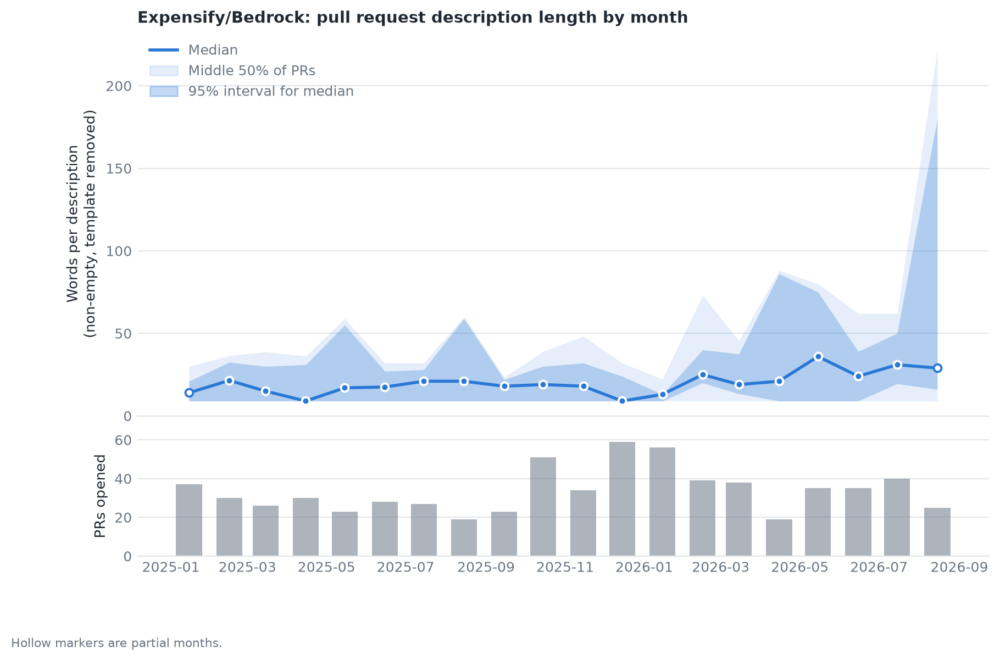
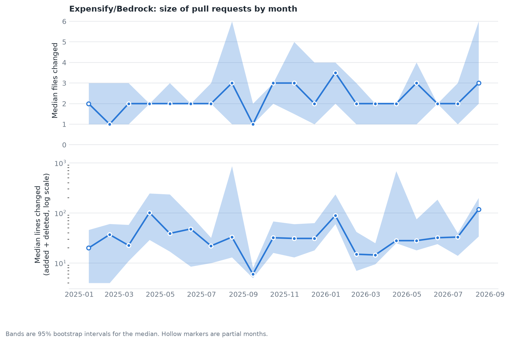
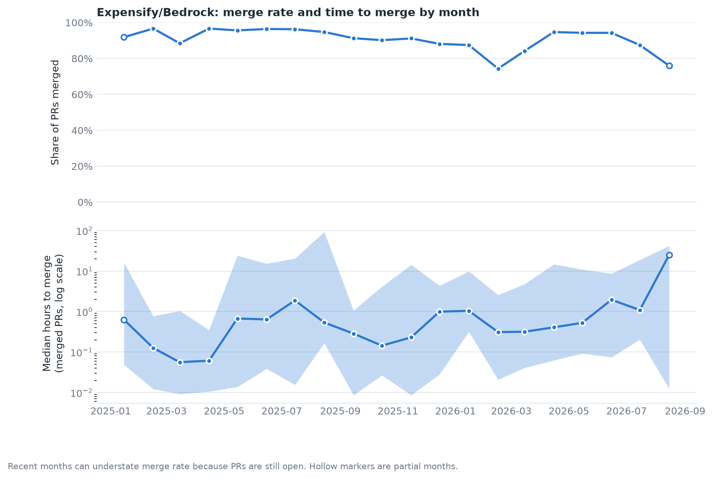
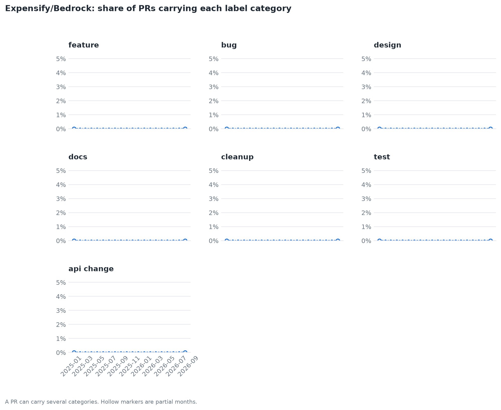
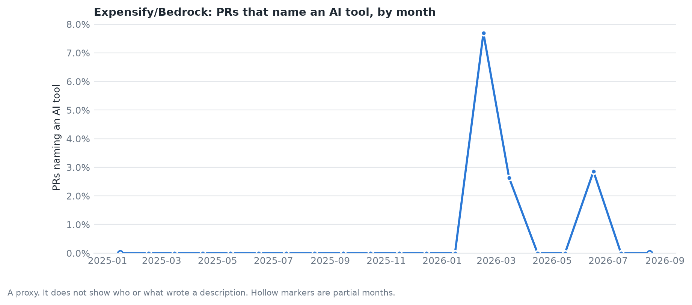

# Pull requests in Expensify/Bedrock: description length, size, speed and labels

Window 2025-01-06 to 2026-08-17 (UTC). Data fetched 2026-11-20. prwords 3.0.0, generated 2026-11-26. Method fixed in advance in `docs/ANALYSIS_PLAN.md`.

## 1. Data

- Repository primary language: C
- Pull requests opened in the window: 675
- Removed as bot accounts: 1
- Analysed: 674 PRs from 63 authors
- Merged: 606 (89.9%). Closed without merging: 63 (9.3%). Still open: 5
- Follow-up: merge outcomes use a 30-day follow-up. PRs without enough follow-up: 0
- Empty descriptions after cleaning: 0.3%

## 2. Did the PR template change?

Lines that appeared or disappeared across the window (full list in `template_audit.csv`):

| line                                                                                              | first_month   | last_month   |   months |   peak_share | change_event   |
|:--------------------------------------------------------------------------------------------------|:--------------|:-------------|---------:|-------------:|:---------------|
| *internal testing reminder:** when changing bedrock, please compile auth against your new changes | 2025-12       | 2026-08      |        3 |         0.64 | added          |
| _________                                                                                         | 2025-12       | 2026-08      |        3 |         0.64 | added          |

Distinct template lines detected: 5.

## 3. First 28 days versus last 28 days

First window 2025-01-06 to 2025-02-02. Last window 2026-07-21 to 2026-08-17. Ratios are last median divided by first median. Bootstrap intervals, 2,000 resamples.

| Metric                                |   n first |   n last |   Median first |   Median last |   Ratio |   Ratio low |   Ratio high |      p |   Cliff's delta |
|:--------------------------------------|----------:|---------:|---------------:|--------------:|--------:|------------:|-------------:|-------:|----------------:|
| Description words (non-empty)         |        37 |       38 |          14    |         29    |    2.07 |        0.95 |        10.28 | 0.0097 |            0.34 |
| Files changed                         |        37 |       38 |           2    |          2    |    1    |        0.67 |         2.5  | 0.23   |            0.16 |
| Lines added                           |        37 |       38 |          16    |         32    |    2    |        1.02 |        16    | 0.0012 |            0.43 |
| Lines deleted                         |        37 |       38 |           3    |         15.5  |    5.17 |        0.2  |        13.33 | 0.19   |            0.17 |
| Net lines (added minus deleted)       |        37 |       38 |           2    |          9    |    4.5  |        0.14 |        24    | 0.092  |            0.23 |
| Lines changed (added plus deleted)    |        37 |       38 |          20    |         49.5  |    2.48 |        0.89 |        13.35 | 0.0029 |            0.4  |
| Hours from open to merge (merged PRs) |        34 |       32 |           0.63 |          2.59 |    4.11 |        0.02 |       255.7  | 0.48   |            0.1  |
| Commits                               |        37 |       38 |           2    |          3    |    1.5  |        0.67 |         3.25 | 0.039  |            0.27 |
| Comments                              |        37 |       38 |           0    |          0    |  nan    |        0    |         0    | 0.085  |           -0.2  |
| Reviews                               |        37 |       38 |           1    |          1    |    1    |        0    |         1    | 0.99   |            0    |

| Measure                             |   n first |   n last | Share first   | Share last   |   Change (points) |     p |
|:------------------------------------|----------:|---------:|:--------------|:-------------|------------------:|------:|
| Merged within follow-up period      |        37 |       38 | 89.2%         | 81.6%        |              -7.6 | 0.52  |
| Closed without merging              |        37 |       38 | 8.1%          | 15.8%        |               7.7 | 0.48  |
| Opened as draft                     |        37 |       38 | 0.0%          | 13.2%        |              13.2 | 0.054 |
| From outside contributors           |        37 |       38 | 100.0%        | 97.4%        |              -2.6 | 1     |
| Has a kind or type label            |        37 |       38 | 0.0%          | 0.0%         |               0   | 1     |
| Description text repeated elsewhere |        37 |       38 | 43.2%         | 39.5%        |              -3.8 | 0.82  |
| Names an AI tool (disclosure)       |        37 |       38 | 0.0%          | 0.0%         |               0   | 1     |
| Label category: feature             |        37 |       38 | 0.0%          | 0.0%         |               0   | 1     |
| Label category: bug                 |        37 |       38 | 0.0%          | 0.0%         |               0   | 1     |
| Label category: design              |        37 |       38 | 0.0%          | 0.0%         |               0   | 1     |
| Label category: docs                |        37 |       38 | 0.0%          | 0.0%         |               0   | 1     |
| Label category: cleanup             |        37 |       38 | 0.0%          | 0.0%         |               0   | 1     |
| Label category: test                |        37 |       38 | 0.0%          | 0.0%         |               0   | 1     |
| Label category: api_change          |        37 |       38 | 0.0%          | 0.0%         |               0   | 1     |

## 4. Monthly trends

Theil-Sen slope per month and Kendall tau over full months only.

| metric                     |   months |   slope_per_month |   slope_ci_low |   slope_ci_high |     tau |       p |
|:---------------------------|---------:|------------------:|---------------:|----------------:|--------:|--------:|
| median_words               |       18 |             0.559 |          0.1   |           1.286 |   0.393 |   0.025 |
| median_files_changed       |       18 |            -0     |         -0     |           0.077 |   0.229 |   0.237 |
| median_additions           |       18 |            -0     |         -1.143 |           0.867 |  -0.013 |   0.939 |
| median_deletions           |       18 |            -0.056 |         -0.467 |           0.4   |  -0.088 |   0.619 |
| median_churn               |       18 |            -0.571 |         -1.731 |           0.656 |  -0.192 |   0.271 |
| median_hours_to_merge      |       18 |             0.03  |          0.005 |           0.086 |   0.373 |   0.032 |
| merge_rate                 |       18 |            -0.005 |         -0.011 |          -0.001 |  -0.483 |   0.006 |
| share_outside_contributors |       18 |            -0.001 |         -0.004 |          -0     |  -0.291 |   0.113 |
| share_ai_disclosed         |       18 |            -0     |         -0     |          -0     |   0.35  |   0.077 |
| median_comments            |       18 |            -0     |         -0     |          -0     | nan     | nan     |
| median_reviews             |       18 |            -0     |         -0     |          -0     |   0.183 |   0.362 |
| share_feature              |       18 |            -0     |         -0     |          -0     | nan     | nan     |
| share_bug                  |       18 |            -0     |         -0     |          -0     | nan     | nan     |
| share_design               |       18 |            -0     |         -0     |          -0     | nan     | nan     |
| share_docs                 |       18 |            -0     |         -0     |          -0     | nan     | nan     |
| share_cleanup              |       18 |            -0     |         -0     |          -0     | nan     | nan     |
| share_test                 |       18 |            -0     |         -0     |          -0     | nan     | nan     |
| share_api_change           |       18 |            -0     |         -0     |          -0     | nan     | nan     |

## 5. Labels

Share of PRs with a kind or type label: 0.0% overall. Label coverage by month is in `monthly_summary.csv` (`share_has_kind_label`).

| category            |   n_prs |   share |   median_words |   median_files |   median_churn |   merge_rate |   median_hours_to_merge |   share_ai_disclosed |
|:--------------------|--------:|--------:|---------------:|---------------:|---------------:|-------------:|------------------------:|---------------------:|
| feature             |       0 |       0 |            nan |            nan |            nan |      nan     |                 nan     |              nan     |
| bug                 |       0 |       0 |            nan |            nan |            nan |      nan     |                 nan     |              nan     |
| design              |       0 |       0 |            nan |            nan |            nan |      nan     |                 nan     |              nan     |
| docs                |       0 |       0 |            nan |            nan |            nan |      nan     |                 nan     |              nan     |
| cleanup             |       0 |       0 |            nan |            nan |            nan |      nan     |                 nan     |              nan     |
| test                |       0 |       0 |            nan |            nan |            nan |      nan     |                 nan     |              nan     |
| api_change          |       0 |       0 |            nan |            nan |            nan |      nan     |                 nan     |              nan     |
| (no category label) |     674 |       1 |             19 |              2 |             30 |        0.899 |                   0.382 |                0.007 |

## 6. Are PRs with signs of AI involvement smaller or larger?

Authorship is not observable. The proxy is `ai_disclosed`, defined in the analysis plan: 5 PRs (0.74%). 5 disclosed PRs are listed in `ai_disclosure_samples.csv` for manual audit.

### ai_disclosed

**Verdict: not testable.** Too few exposed PRs.

Pattern: lines changed: not estimated; files changed: not estimated; lines added: not estimated; lines deleted: not estimated; hours to merge: not estimated.

Not estimated: fewer than 30 exposed PRs (exposed PRs: 5).

### Robustness by tool (lines changed)

| tool        |   n exposed | status                    |
|:------------|------------:|:--------------------------|
| unspecified |           3 | fewer than 30 exposed PRs |
| claude      |           2 | fewer than 30 exposed PRs |

### File type check

Not run. Use `--file-check N` to sample N exposed PRs and matching unexposed PRs.

## 7. Other checks

- Outside contributors: 98.1% of PRs overall.
- Top 10 authors opened 64.7% of PRs.
- PRs whose description text is repeated elsewhere (10 or more words): 46.7%.

## 8. Limitations

- Word count and size describe PRs, not who wrote them. Proxies for AI involvement are noisy and omit undisclosed use.
- Added and deleted lines include generated or vendored files unless the project avoids committing them.
- Disclosure mostly captures tools that add attribution by default, so it is tool-skewed.
- Template removal is heuristic. Check `template_audit.csv`.
- One repository cannot support general claims. See the plan for replication.
- Months at the edges of the window are partial and are excluded from trend tests.

