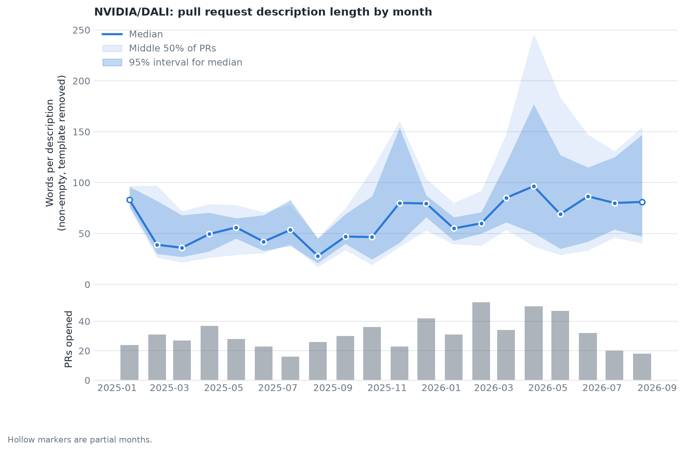
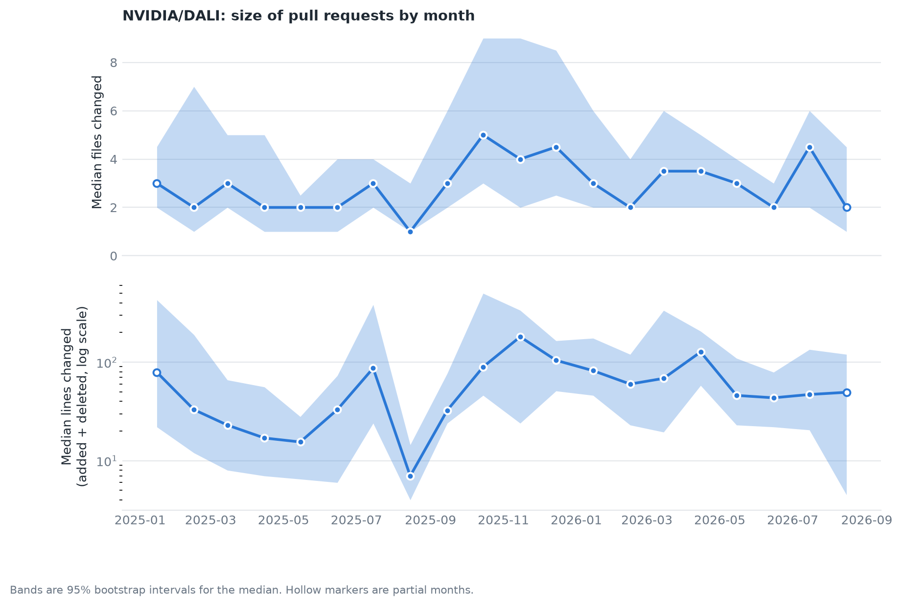
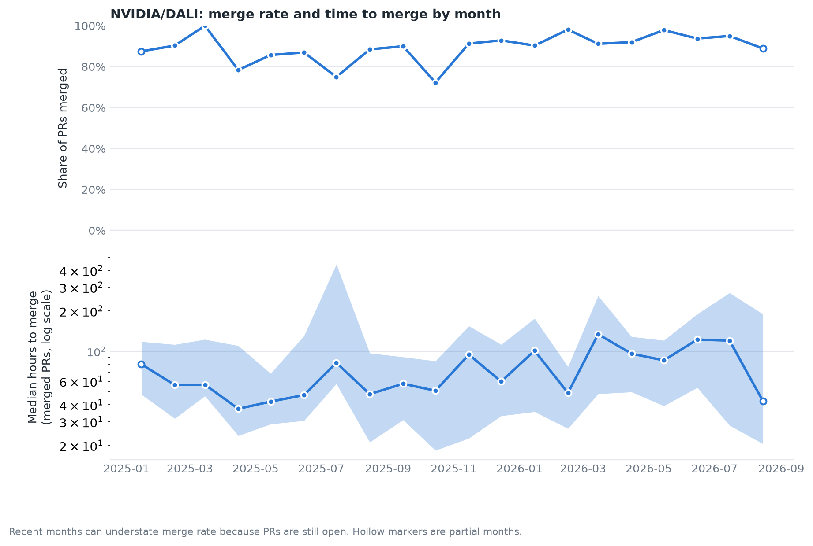
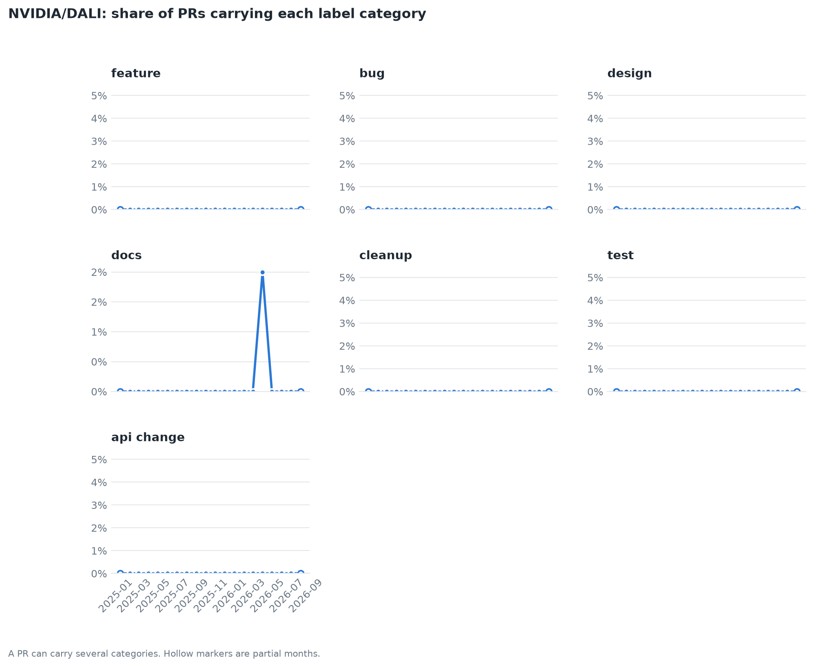
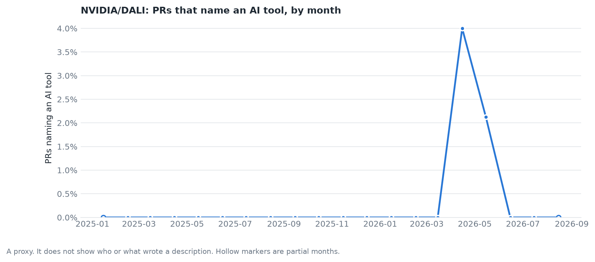

# Pull requests in NVIDIA/DALI: description length, size, speed and labels

Window 2025-01-06 to 2026-08-17 (UTC). Data fetched 2026-11-20. prwords 3.0.0, generated 2026-11-26. Method fixed in advance in `docs/ANALYSIS_PLAN.md`.

## 1. Data

- Repository primary language: C++
- Pull requests opened in the window: 628
- Removed as bot accounts: 0
- Analysed: 628 PRs from 22 authors
- Merged: 565 (90.0%). Closed without merging: 60 (9.6%). Still open: 3
- Follow-up: merge outcomes use a 30-day follow-up. PRs without enough follow-up: 0
- Empty descriptions after cleaning: 1.9%

## 2. Did the PR template change?

Lines that appeared or disappeared across the window (full list in `template_audit.csv`):

| line                                      | first_month   | last_month   |   months |   peak_share | change_event   |
|:------------------------------------------|:--------------|:-------------|---------:|-------------:|:---------------|
| ## category:                              | 2025-03       | 2026-08      |       16 |            1 | added          |
| ### affected modules and functionalities: | 2025-03       | 2026-08      |       18 |            1 | added          |
| ### key points relevant for the review:   | 2025-03       | 2026-08      |       18 |            1 | added          |
| *jira task**: n/a                         | 2025-03       | 2026-07      |       11 |            1 | added          |

Distinct template lines detected: 27.

## 3. First 28 days versus last 28 days

First window 2025-01-06 to 2025-02-02. Last window 2026-07-21 to 2026-08-17. Ratios are last median divided by first median. Bootstrap intervals, 2,000 resamples.

| Metric                                |   n first |   n last |   Median first |   Median last |   Ratio |   Ratio low |   Ratio high |    p |   Cliff's delta |
|:--------------------------------------|----------:|---------:|---------------:|--------------:|--------:|------------:|-------------:|-----:|----------------:|
| Description words (non-empty)         |        24 |       27 |          83    |         90    |    1.08 |        0.7  |         1.49 | 0.84 |           -0.03 |
| Files changed                         |        24 |       27 |           3    |          3    |    1    |        0.44 |         2.29 | 0.81 |            0.04 |
| Lines added                           |        24 |       27 |          44.5  |         31    |    0.7  |        0.04 |         5.55 | 0.26 |           -0.19 |
| Lines deleted                         |        24 |       27 |           8.5  |         10    |    1.18 |        0.19 |         6    | 0.98 |            0    |
| Net lines (added minus deleted)       |        24 |       27 |          14.5  |          5    |    0.34 |        0.01 |         7.25 | 0.31 |           -0.17 |
| Lines changed (added plus deleted)    |        24 |       27 |          79    |         67    |    0.85 |        0.07 |         3.7  | 0.21 |           -0.21 |
| Hours from open to merge (merged PRs) |        21 |       24 |          80.16 |        101.14 |    1.26 |        0.31 |         3.94 | 0.79 |            0.05 |
| Commits                               |        24 |       27 |           3    |          2    |    0.67 |        0.29 |         2    | 0.5  |           -0.11 |
| Comments                              |        24 |       27 |           4.5  |          5    |    1.11 |        0.67 |         2.33 | 0.49 |            0.11 |
| Reviews                               |        24 |       27 |           4    |          4    |    1    |        0.36 |         2    | 0.43 |           -0.13 |

| Measure                             |   n first |   n last | Share first   | Share last   |   Change (points) |    p |
|:------------------------------------|----------:|---------:|:--------------|:-------------|------------------:|-----:|
| Merged within follow-up period      |        24 |       27 | 79.2%         | 88.9%        |               9.7 | 0.45 |
| Closed without merging              |        24 |       27 | 12.5%         | 11.1%        |              -1.4 | 1    |
| Opened as draft                     |        24 |       27 | 8.3%          | 0.0%         |              -8.3 | 0.22 |
| From outside contributors           |        24 |       27 | 25.0%         | 44.4%        |              19.4 | 0.24 |
| Has a kind or type label            |        24 |       27 | 0.0%          | 0.0%         |               0   | 1    |
| Description text repeated elsewhere |        24 |       27 | 4.2%          | 18.5%        |              14.4 | 0.2  |
| Names an AI tool (disclosure)       |        24 |       27 | 0.0%          | 0.0%         |               0   | 1    |
| Label category: feature             |        24 |       27 | 0.0%          | 0.0%         |               0   | 1    |
| Label category: bug                 |        24 |       27 | 0.0%          | 0.0%         |               0   | 1    |
| Label category: design              |        24 |       27 | 0.0%          | 0.0%         |               0   | 1    |
| Label category: docs                |        24 |       27 | 0.0%          | 0.0%         |               0   | 1    |
| Label category: cleanup             |        24 |       27 | 0.0%          | 0.0%         |               0   | 1    |
| Label category: test                |        24 |       27 | 0.0%          | 0.0%         |               0   | 1    |
| Label category: api_change          |        24 |       27 | 0.0%          | 0.0%         |               0   | 1    |

## 4. Monthly trends

Theil-Sen slope per month and Kendall tau over full months only.

| metric                     |   months |   slope_per_month |   slope_ci_low |   slope_ci_high |     tau |       p |
|:---------------------------|---------:|------------------:|---------------:|----------------:|--------:|--------:|
| median_words               |       18 |             2.9   |          1.5   |           4.25  |   0.59  |   0.001 |
| median_files_changed       |       18 |             0.071 |         -0     |           0.167 |   0.288 |   0.117 |
| median_additions           |       18 |             1.818 |         -0.25  |           4.333 |   0.285 |   0.102 |
| median_deletions           |       18 |             0.143 |         -0.409 |           0.75  |   0.079 |   0.649 |
| median_churn               |       18 |             2.25  |         -2.5   |           6.25  |   0.262 |   0.129 |
| median_hours_to_merge      |       18 |             3.977 |          1.925 |           6.059 |   0.569 |   0.001 |
| merge_rate                 |       18 |             0.006 |          0.001 |           0.011 |   0.42  |   0.015 |
| share_outside_contributors |       18 |            -0.008 |         -0.021 |           0.005 |  -0.163 |   0.369 |
| share_ai_disclosed         |       18 |            -0     |         -0     |          -0     |   0.324 |   0.107 |
| median_comments            |       18 |             0.111 |         -0     |           0.25  |   0.286 |   0.118 |
| median_reviews             |       18 |             0.25  |         -0     |           0.389 |   0.532 |   0.004 |
| share_feature              |       18 |            -0     |         -0     |          -0     | nan     | nan     |
| share_bug                  |       18 |            -0     |         -0     |          -0     | nan     | nan     |
| share_design               |       18 |            -0     |         -0     |          -0     | nan     | nan     |
| share_docs                 |       18 |            -0     |         -0     |          -0     |   0.216 |   0.289 |
| share_cleanup              |       18 |            -0     |         -0     |          -0     | nan     | nan     |
| share_test                 |       18 |            -0     |         -0     |          -0     | nan     | nan     |
| share_api_change           |       18 |            -0     |         -0     |          -0     | nan     | nan     |

## 5. Labels

Share of PRs with a kind or type label: 0.0% overall. Label coverage by month is in `monthly_summary.csv` (`share_has_kind_label`).

| category            |   n_prs |   share |   median_words |   median_files |   median_churn |   merge_rate |   median_hours_to_merge |   share_ai_disclosed |
|:--------------------|--------:|--------:|---------------:|---------------:|---------------:|-------------:|------------------------:|---------------------:|
| feature             |       0 |   0     |            nan |            nan |            nan |        nan   |                 nan     |              nan     |
| bug                 |       0 |   0     |            nan |            nan |            nan |        nan   |                 nan     |              nan     |
| design              |       0 |   0     |            nan |            nan |            nan |        nan   |                 nan     |              nan     |
| docs                |       1 |   0.002 |             22 |              1 |            218 |          1   |                 940.256 |                0     |
| cleanup             |       0 |   0     |            nan |            nan |            nan |        nan   |                 nan     |              nan     |
| test                |       0 |   0     |            nan |            nan |            nan |        nan   |                 nan     |              nan     |
| api_change          |       0 |   0     |            nan |            nan |            nan |        nan   |                 nan     |              nan     |
| (no category label) |     627 |   0.998 |             62 |              3 |             51 |          0.9 |                  68.305 |                0.005 |

## 6. Are PRs with signs of AI involvement smaller or larger?

Authorship is not observable. The proxy is `ai_disclosed`, defined in the analysis plan: 3 PRs (0.48%). 3 disclosed PRs are listed in `ai_disclosure_samples.csv` for manual audit.

### ai_disclosed

**Verdict: not testable.** Too few exposed PRs.

Pattern: lines changed: not estimated; files changed: not estimated; lines added: not estimated; lines deleted: not estimated; hours to merge: not estimated.

Not estimated: fewer than 30 exposed PRs (exposed PRs: 3).

### Robustness by tool (lines changed)

| tool        |   n exposed | status                    |
|:------------|------------:|:--------------------------|
| unspecified |           3 | fewer than 30 exposed PRs |

### File type check

Not run. Use `--file-check N` to sample N exposed PRs and matching unexposed PRs.

## 7. Other checks

- Outside contributors: 40.8% of PRs overall.
- Top 10 authors opened 97.1% of PRs.
- PRs whose description text is repeated elsewhere (10 or more words): 6.1%.

## 8. Limitations

- Word count and size describe PRs, not who wrote them. Proxies for AI involvement are noisy and omit undisclosed use.
- Added and deleted lines include generated or vendored files unless the project avoids committing them.
- Disclosure mostly captures tools that add attribution by default, so it is tool-skewed.
- Template removal is heuristic. Check `template_audit.csv`.
- One repository cannot support general claims. See the plan for replication.
- Months at the edges of the window are partial and are excluded from trend tests.

