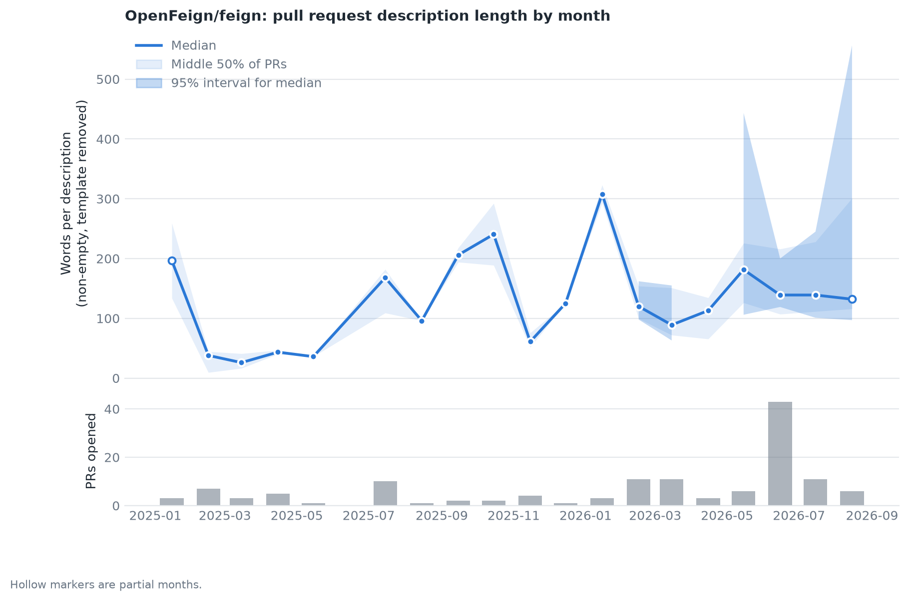
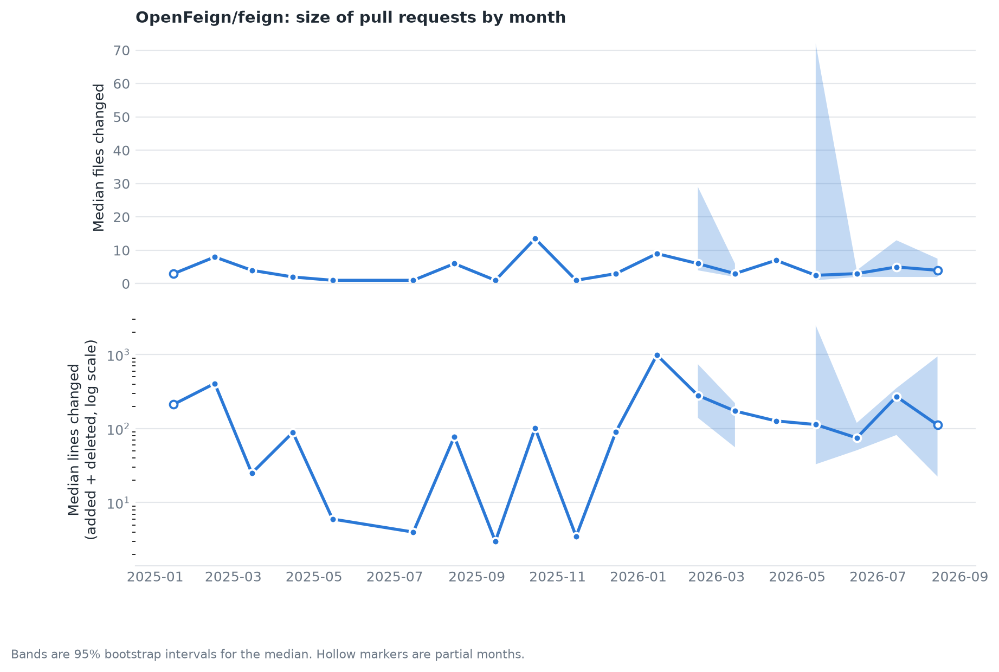
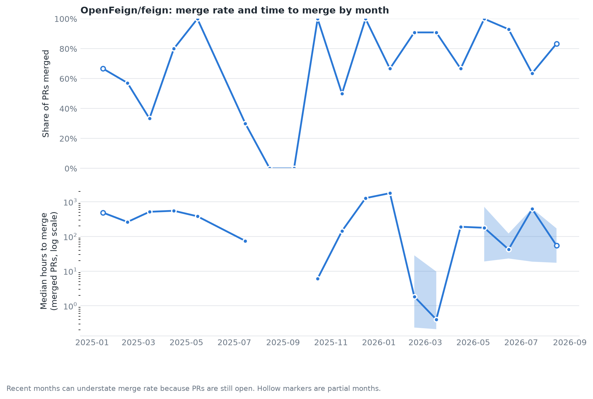
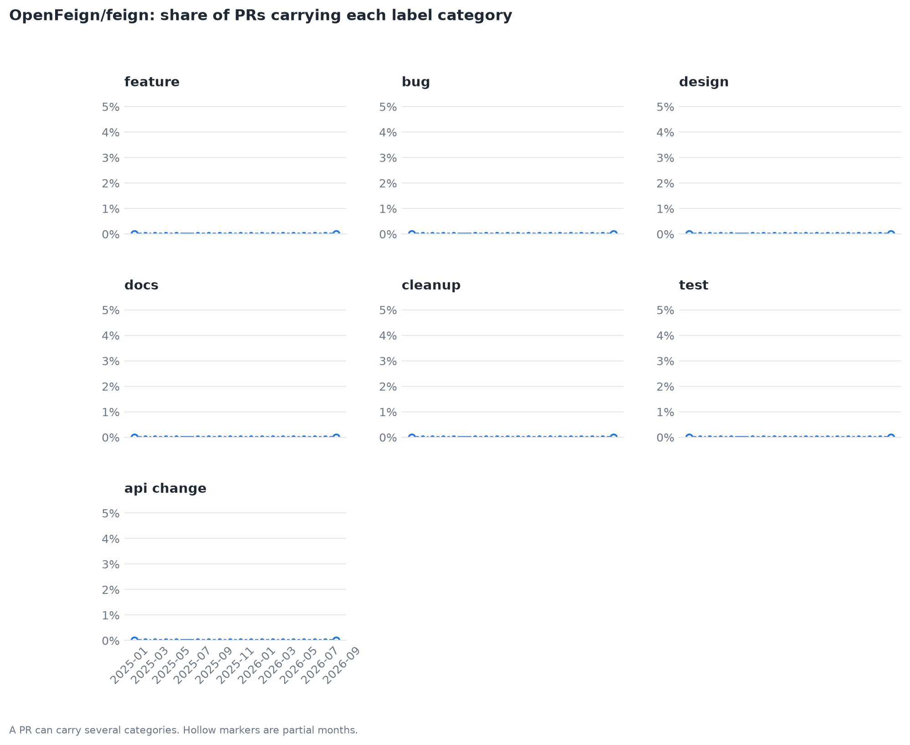
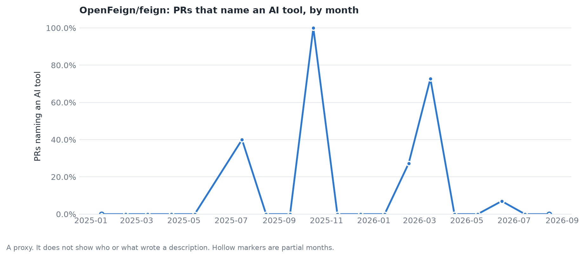

# Pull requests in OpenFeign/feign: description length, size, speed and labels

Window 2025-01-06 to 2026-08-17 (UTC). Data fetched 2026-11-20. prwords 3.0.0, generated 2026-11-26. Method fixed in advance in `docs/ANALYSIS_PLAN.md`.

## 1. Data

- Repository primary language: Java
- Pull requests opened in the window: 762
- Removed as bot accounts: 629
- Analysed: 133 PRs from 32 authors
- Merged: 102 (76.7%). Closed without merging: 31 (23.3%). Still open: 0
- Follow-up: merge outcomes use a 30-day follow-up. PRs without enough follow-up: 0
- Empty descriptions after cleaning: 4.5%

## 2. Did the PR template change?

No template line appeared or disappeared with a share of 50% or more. Template text was detected monthly and removed before counting words.

Distinct template lines detected: 0.

## 3. First 28 days versus last 28 days

First window 2025-01-06 to 2025-02-02. Last window 2026-07-21 to 2026-08-17. Ratios are last median divided by first median. Bootstrap intervals, 2,000 resamples.

| Metric                                |   n first |   n last |   Median first |   Median last |   Ratio |   Ratio low |   Ratio high | p   |   Cliff's delta |
|:--------------------------------------|----------:|---------:|---------------:|--------------:|--------:|------------:|-------------:|:----|----------------:|
| Description words (non-empty)         |         2 |       10 |            nan |           nan |     nan |         nan |          nan | n/a |             nan |
| Files changed                         |         3 |       10 |            nan |           nan |     nan |         nan |          nan | n/a |             nan |
| Lines added                           |         3 |       10 |            nan |           nan |     nan |         nan |          nan | n/a |             nan |
| Lines deleted                         |         3 |       10 |            nan |           nan |     nan |         nan |          nan | n/a |             nan |
| Net lines (added minus deleted)       |         3 |       10 |            nan |           nan |     nan |         nan |          nan | n/a |             nan |
| Lines changed (added plus deleted)    |         3 |       10 |            nan |           nan |     nan |         nan |          nan | n/a |             nan |
| Hours from open to merge (merged PRs) |         2 |        8 |            nan |           nan |     nan |         nan |          nan | n/a |             nan |
| Commits                               |         3 |       10 |            nan |           nan |     nan |         nan |          nan | n/a |             nan |
| Comments                              |         3 |       10 |            nan |           nan |     nan |         nan |          nan | n/a |             nan |
| Reviews                               |         3 |       10 |            nan |           nan |     nan |         nan |          nan | n/a |             nan |

| Measure                             |   n first |   n last | Share first   | Share last   |   Change (points) |    p |
|:------------------------------------|----------:|---------:|:--------------|:-------------|------------------:|-----:|
| Merged within follow-up period      |         3 |       10 | 33.3%         | 80.0%        |              46.7 | 0.2  |
| Closed without merging              |         3 |       10 | 33.3%         | 20.0%        |             -13.3 | 1    |
| Opened as draft                     |         3 |       10 | 0.0%          | 0.0%         |               0   | 1    |
| From outside contributors           |         3 |       10 | 33.3%         | 70.0%        |              36.7 | 0.51 |
| Has a kind or type label            |         3 |       10 | 0.0%          | 0.0%         |               0   | 1    |
| Description text repeated elsewhere |         3 |       10 | 0.0%          | 0.0%         |               0   | 1    |
| Names an AI tool (disclosure)       |         3 |       10 | 0.0%          | 0.0%         |               0   | 1    |
| Label category: feature             |         3 |       10 | 0.0%          | 0.0%         |               0   | 1    |
| Label category: bug                 |         3 |       10 | 0.0%          | 0.0%         |               0   | 1    |
| Label category: design              |         3 |       10 | 0.0%          | 0.0%         |               0   | 1    |
| Label category: docs                |         3 |       10 | 0.0%          | 0.0%         |               0   | 1    |
| Label category: cleanup             |         3 |       10 | 0.0%          | 0.0%         |               0   | 1    |
| Label category: test                |         3 |       10 | 0.0%          | 0.0%         |               0   | 1    |
| Label category: api_change          |         3 |       10 | 0.0%          | 0.0%         |               0   | 1    |

## 4. Monthly trends

Theil-Sen slope per month and Kendall tau over full months only.

| metric                     |   months |   slope_per_month |   slope_ci_low |   slope_ci_high |     tau |       p |
|:---------------------------|---------:|------------------:|---------------:|----------------:|--------:|--------:|
| median_words               |       17 |             7.125 |          1.35  |          12.375 |   0.376 |   0.035 |
| median_files_changed       |       17 |             0.021 |         -0.333 |           0.333 |   0.076 |   0.677 |
| median_additions           |       17 |             7.122 |         -0.25  |          16     |   0.332 |   0.064 |
| median_deletions           |       17 |             0.369 |         -0.667 |           1.5   |   0.119 |   0.509 |
| median_churn               |       17 |             6.631 |         -3.312 |          18.333 |   0.206 |   0.271 |
| median_hours_to_merge      |       15 |           -12.335 |        -51.209 |          34.503 |  -0.124 |   0.559 |
| merge_rate                 |       17 |             0.019 |         -0.01  |           0.061 |   0.221 |   0.228 |
| share_outside_contributors |       17 |            -0     |         -0.037 |           0.036 |  -0.039 |   0.834 |
| share_ai_disclosed         |       17 |            -0     |         -0     |          -0     |   0.143 |   0.471 |
| median_comments            |       17 |            -0     |         -0.05  |          -0     |  -0.239 |   0.239 |
| median_reviews             |       17 |            -0     |         -0     |           0.091 |   0.251 |   0.212 |
| share_feature              |       17 |            -0     |         -0     |          -0     | nan     | nan     |
| share_bug                  |       17 |            -0     |         -0     |          -0     | nan     | nan     |
| share_design               |       17 |            -0     |         -0     |          -0     | nan     | nan     |
| share_docs                 |       17 |            -0     |         -0     |          -0     | nan     | nan     |
| share_cleanup              |       17 |            -0     |         -0     |          -0     | nan     | nan     |
| share_test                 |       17 |            -0     |         -0     |          -0     | nan     | nan     |
| share_api_change           |       17 |            -0     |         -0     |          -0     | nan     | nan     |

## 5. Labels

Share of PRs with a kind or type label: 0.0% overall. Label coverage by month is in `monthly_summary.csv` (`share_has_kind_label`).

| category            |   n_prs |   share |   median_words |   median_files |   median_churn |   merge_rate |   median_hours_to_merge |   share_ai_disclosed |
|:--------------------|--------:|--------:|---------------:|---------------:|---------------:|-------------:|------------------------:|---------------------:|
| feature             |       0 |       0 |            nan |            nan |            nan |      nan     |                 nan     |               nan    |
| bug                 |       0 |       0 |            nan |            nan |            nan |      nan     |                 nan     |               nan    |
| design              |       0 |       0 |            nan |            nan |            nan |      nan     |                 nan     |               nan    |
| docs                |       0 |       0 |            nan |            nan |            nan |      nan     |                 nan     |               nan    |
| cleanup             |       0 |       0 |            nan |            nan |            nan |      nan     |                 nan     |               nan    |
| test                |       0 |       0 |            nan |            nan |            nan |      nan     |                 nan     |               nan    |
| api_change          |       0 |       0 |            nan |            nan |            nan |      nan     |                 nan     |               nan    |
| (no category label) |     133 |       1 |            125 |              3 |             97 |        0.767 |                  36.947 |                 0.15 |

## 6. Are PRs with signs of AI involvement smaller or larger?

Authorship is not observable. The proxy is `ai_disclosed`, defined in the analysis plan: 20 PRs (15.04%). 20 disclosed PRs are listed in `ai_disclosure_samples.csv` for manual audit.

### ai_disclosed

**Verdict: not testable.** Too few exposed PRs.

Pattern: lines changed: not estimated; files changed: not estimated; lines added: not estimated; lines deleted: not estimated; hours to merge: not estimated.

Not estimated: fewer than 30 exposed PRs (exposed PRs: 20).

### Robustness by tool (lines changed)

| tool        |   n exposed | status                    |
|:------------|------------:|:--------------------------|
| unspecified |          20 | fewer than 30 exposed PRs |

### File type check

Not run. Use `--file-check N` to sample N exposed PRs and matching unexposed PRs.

## 7. Other checks

- Outside contributors: 57.9% of PRs overall.
- Top 10 authors opened 82.7% of PRs.
- PRs whose description text is repeated elsewhere (10 or more words): 0.0%.

## 8. Limitations

- Word count and size describe PRs, not who wrote them. Proxies for AI involvement are noisy and omit undisclosed use.
- Added and deleted lines include generated or vendored files unless the project avoids committing them.
- Disclosure mostly captures tools that add attribution by default, so it is tool-skewed.
- Template removal is heuristic. Check `template_audit.csv`.
- One repository cannot support general claims. See the plan for replication.
- Months at the edges of the window are partial and are excluded from trend tests.

