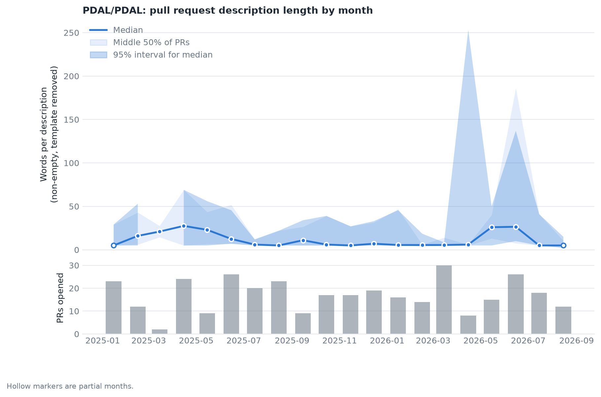
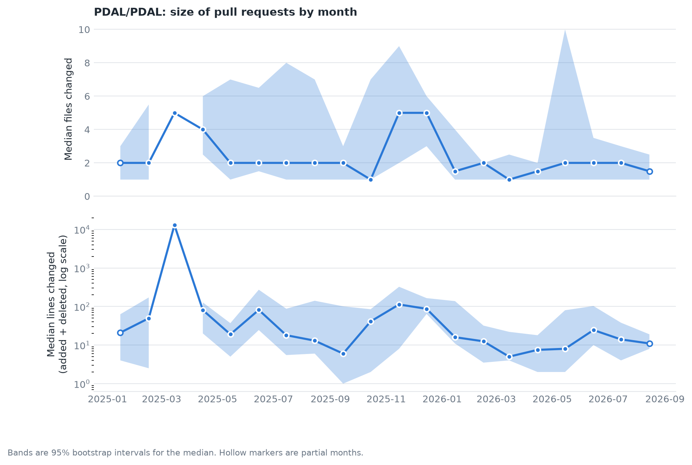
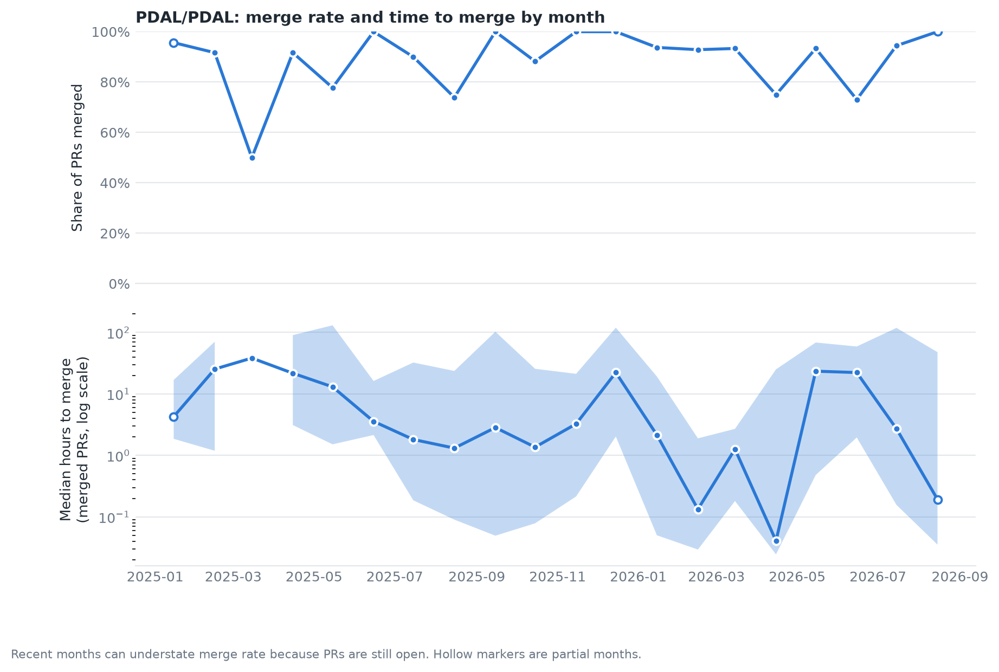
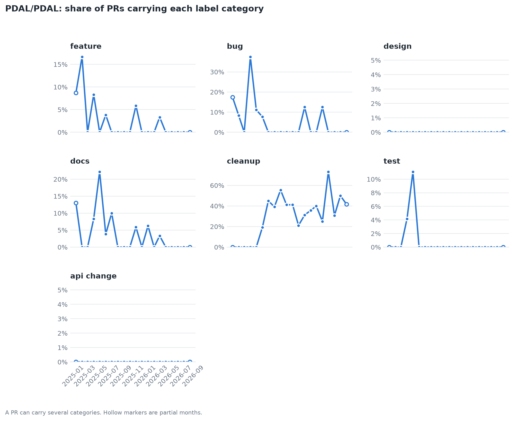
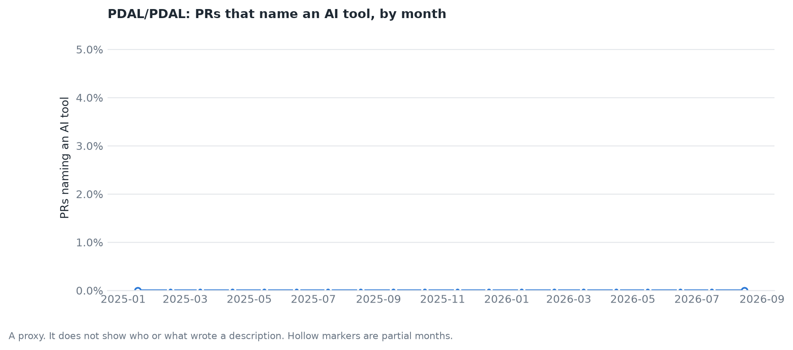

# Pull requests in PDAL/PDAL: description length, size, speed and labels

Window 2025-01-06 to 2026-08-17 (UTC). Data fetched 2026-11-20. prwords 3.0.0, generated 2026-11-26. Method fixed in advance in `docs/ANALYSIS_PLAN.md`.

## 1. Data

- Repository primary language: C++
- Pull requests opened in the window: 390
- Removed as bot accounts: 50
- Analysed: 340 PRs from 47 authors
- Merged: 308 (90.6%). Closed without merging: 29 (8.5%). Still open: 3
- Follow-up: merge outcomes use a 30-day follow-up. PRs without enough follow-up: 0
- Empty descriptions after cleaning: 20.6%

## 2. Did the PR template change?

No template line appeared or disappeared with a share of 50% or more. Template text was detected monthly and removed before counting words.

Distinct template lines detected: 0.

## 3. First 28 days versus last 28 days

First window 2025-01-06 to 2025-02-02. Last window 2026-07-21 to 2026-08-17. Ratios are last median divided by first median. Bootstrap intervals, 2,000 resamples.

| Metric                                |   n first |   n last |   Median first |   Median last |   Ratio |   Ratio low |   Ratio high |    p |   Cliff's delta |
|:--------------------------------------|----------:|---------:|---------------:|--------------:|--------:|------------:|-------------:|-----:|----------------:|
| Description words (non-empty)         |        19 |       23 |           5    |          5    |    1    |        0.17 |         3    | 0.84 |            0.04 |
| Files changed                         |        25 |       24 |           2    |          2    |    1    |        0.33 |         1.5  | 0.31 |           -0.16 |
| Lines added                           |        25 |       24 |          21    |         11    |    0.52 |        0.09 |         1.83 | 0.17 |           -0.23 |
| Lines deleted                         |        25 |       24 |           3    |          2.5  |    0.83 |        0.25 |         3    | 0.64 |           -0.08 |
| Net lines (added minus deleted)       |        25 |       24 |           3    |          3    |    1    |        0.1  |        10    | 0.96 |           -0.01 |
| Lines changed (added plus deleted)    |        25 |       24 |          21    |         12    |    0.57 |        0.11 |         1.5  | 0.12 |           -0.26 |
| Hours from open to merge (merged PRs) |        24 |       24 |           4.27 |          1.36 |    0.32 |        0.02 |         5.02 | 0.29 |           -0.18 |
| Commits                               |        25 |       24 |           1    |          1    |    1    |        0.33 |         2    | 0.34 |           -0.15 |
| Comments                              |        25 |       24 |           0    |          0    |  nan    |      nan    |       nan    | 0.14 |           -0.18 |
| Reviews                               |        25 |       24 |           0    |          0    |  nan    |      nan    |       nan    | 0.31 |           -0.12 |

| Measure                             |   n first |   n last | Share first   | Share last   |   Change (points) |       p |
|:------------------------------------|----------:|---------:|:--------------|:-------------|------------------:|--------:|
| Merged within follow-up period      |        25 |       24 | 96.0%         | 100.0%       |               4   | 1       |
| Closed without merging              |        25 |       24 | 4.0%          | 0.0%         |              -4   | 1       |
| Opened as draft                     |        25 |       24 | 0.0%          | 0.0%         |               0   | 1       |
| From outside contributors           |        25 |       24 | 44.0%         | 45.8%        |               1.8 | 1       |
| Has a kind or type label            |        25 |       24 | 0.0%          | 0.0%         |               0   | 1       |
| Description text repeated elsewhere |        25 |       24 | 0.0%          | 0.0%         |               0   | 1       |
| Names an AI tool (disclosure)       |        25 |       24 | 0.0%          | 0.0%         |               0   | 1       |
| Label category: feature             |        25 |       24 | 8.0%          | 0.0%         |              -8   | 0.49    |
| Label category: bug                 |        25 |       24 | 16.0%         | 0.0%         |             -16   | 0.11    |
| Label category: design              |        25 |       24 | 0.0%          | 0.0%         |               0   | 1       |
| Label category: docs                |        25 |       24 | 12.0%         | 0.0%         |             -12   | 0.23    |
| Label category: cleanup             |        25 |       24 | 0.0%          | 41.7%        |              41.7 | 0.00024 |
| Label category: test                |        25 |       24 | 0.0%          | 0.0%         |               0   | 1       |
| Label category: api_change          |        25 |       24 | 0.0%          | 0.0%         |               0   | 1       |

## 4. Monthly trends

Theil-Sen slope per month and Kendall tau over full months only.

| metric                     |   months |   slope_per_month |   slope_ci_low |   slope_ci_high |     tau |       p |
|:---------------------------|---------:|------------------:|---------------:|----------------:|--------:|--------:|
| median_words               |       18 |            -0.286 |         -1.154 |           0.083 |  -0.269 |   0.127 |
| median_files_changed       |       18 |            -0     |         -0.125 |          -0     |  -0.263 |   0.166 |
| median_additions           |       18 |            -2     |         -4.214 |          -0.292 |  -0.454 |   0.009 |
| median_deletions           |       18 |            -0.083 |         -1.167 |           0.222 |  -0.115 |   0.516 |
| median_churn               |       18 |            -2.833 |         -7     |          -0.333 |  -0.373 |   0.032 |
| median_hours_to_merge      |       18 |            -0.353 |         -1.759 |           0.041 |  -0.32  |   0.068 |
| merge_rate                 |       18 |             0.001 |         -0.008 |           0.012 |   0.087 |   0.62  |
| share_outside_contributors |       18 |            -0.01  |         -0.026 |           0.003 |  -0.275 |   0.111 |
| share_ai_disclosed         |       18 |            -0     |         -0     |          -0     | nan     | nan     |
| median_comments            |       18 |            -0     |         -0     |           0.042 |   0.178 |   0.358 |
| median_reviews             |       18 |            -0     |         -0     |          -0     | nan     | nan     |
| share_feature              |       18 |            -0     |         -0.001 |          -0     |  -0.345 |   0.074 |
| share_bug                  |       18 |            -0     |         -0.006 |          -0     |  -0.279 |   0.146 |
| share_design               |       18 |            -0     |         -0     |          -0     | nan     | nan     |
| share_docs                 |       18 |            -0     |         -0.006 |          -0     |  -0.278 |   0.14  |
| share_cleanup              |       18 |             0.024 |          0.001 |           0.043 |   0.401 |   0.022 |
| share_test                 |       18 |            -0     |         -0     |          -0     |  -0.324 |   0.107 |
| share_api_change           |       18 |            -0     |         -0     |          -0     | nan     | nan     |

## 5. Labels

Share of PRs with a kind or type label: 0.0% overall. Label coverage by month is in `monthly_summary.csv` (`share_has_kind_label`).

| category            |   n_prs |   share |   median_words |   median_files |   median_churn |   merge_rate |   median_hours_to_merge |   share_ai_disclosed |
|:--------------------|--------:|--------:|---------------:|---------------:|---------------:|-------------:|------------------------:|---------------------:|
| feature             |       9 |   0.026 |           51   |            8   |          324   |        1     |                 184.671 |                    0 |
| bug                 |      20 |   0.059 |           14   |            2   |           29   |        0.9   |                  21.227 |                    0 |
| design              |       0 |   0     |          nan   |          nan   |          nan   |      nan     |                 nan     |                  nan |
| docs                |      13 |   0.038 |           20.5 |            2   |           21   |        1     |                   5.934 |                    0 |
| cleanup             |     103 |   0.303 |           26   |            2   |           16   |        0.981 |                  19.545 |                    0 |
| test                |       2 |   0.006 |           38.5 |           33.5 |        14178.5 |        1     |                  51.58  |                    0 |
| api_change          |       0 |   0     |          nan   |          nan   |          nan   |      nan     |                 nan     |                  nan |
| (no category label) |     201 |   0.591 |            5   |            2   |           20   |        0.861 |                   1.144 |                    0 |

## 6. Are PRs with signs of AI involvement smaller or larger?

Authorship is not observable. The proxy is `ai_disclosed`, defined in the analysis plan: 0 PRs (0.00%). 0 disclosed PRs are listed in `ai_disclosure_samples.csv` for manual audit.

### ai_disclosed

**Verdict: not testable.** Too few exposed PRs.

Pattern: lines changed: not estimated; files changed: not estimated; lines added: not estimated; lines deleted: not estimated; hours to merge: not estimated.

Not estimated: fewer than 30 exposed PRs (exposed PRs: 0).

### Robustness by tool (lines changed)

No tool named in any disclosure.

### File type check

Not run. Use `--file-check N` to sample N exposed PRs and matching unexposed PRs.

## 7. Other checks

- Outside contributors: 46.2% of PRs overall.
- Top 10 authors opened 83.2% of PRs.
- PRs whose description text is repeated elsewhere (10 or more words): 0.0%.

## 8. Limitations

- Word count and size describe PRs, not who wrote them. Proxies for AI involvement are noisy and omit undisclosed use.
- Added and deleted lines include generated or vendored files unless the project avoids committing them.
- Disclosure mostly captures tools that add attribution by default, so it is tool-skewed.
- Template removal is heuristic. Check `template_audit.csv`.
- One repository cannot support general claims. See the plan for replication.
- Months at the edges of the window are partial and are excluded from trend tests.

