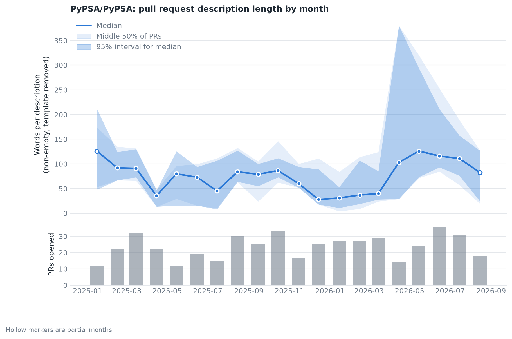
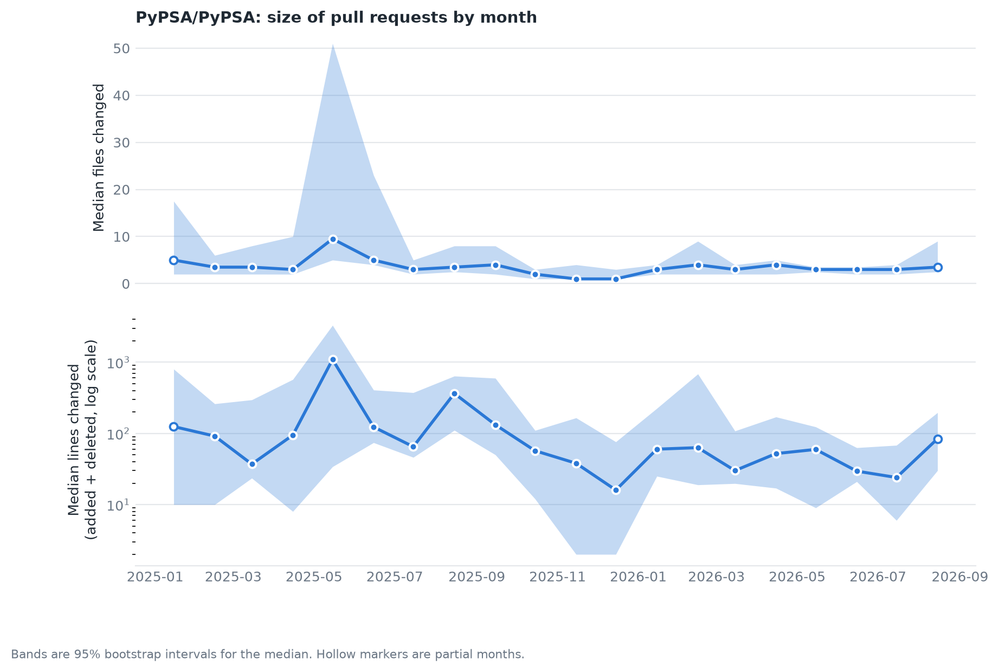
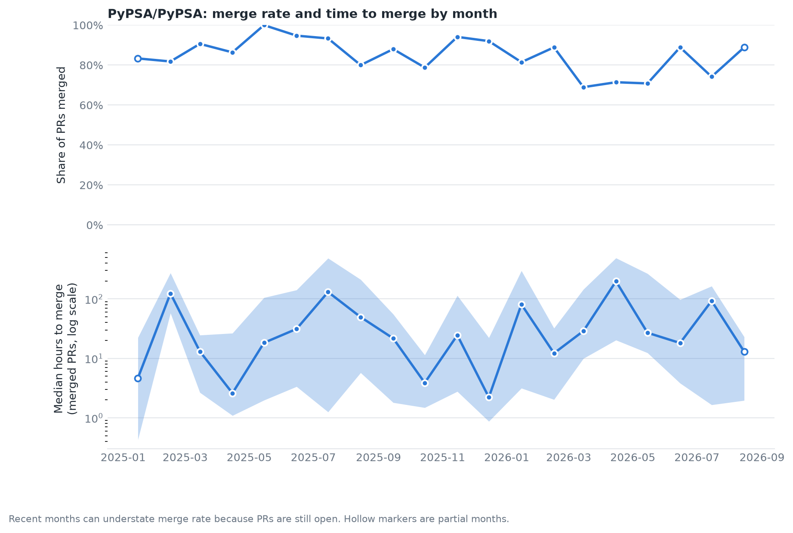
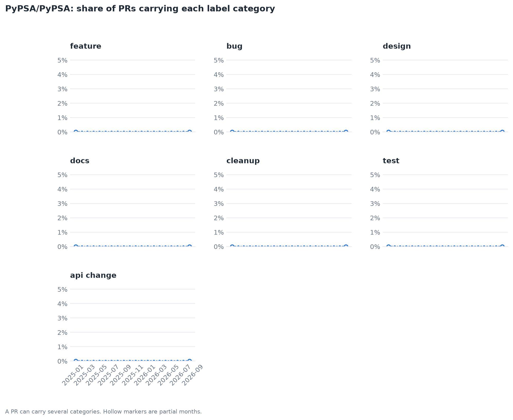
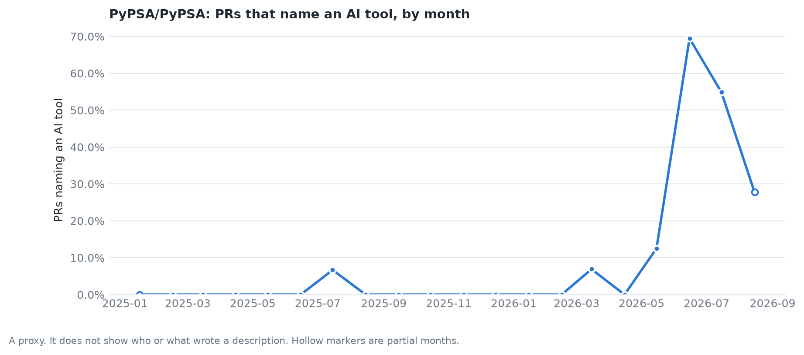
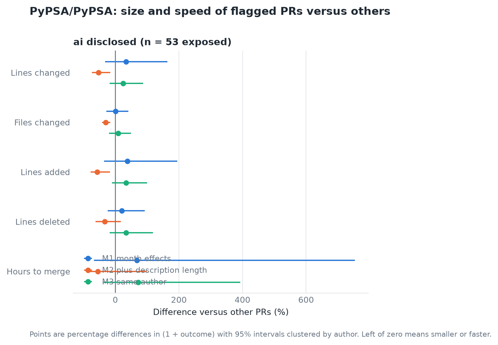

# Pull requests in PyPSA/PyPSA: description length, size, speed and labels

Window 2025-01-06 to 2026-08-17 (UTC). Data fetched 2026-11-20. prwords 3.0.0, generated 2026-11-26. Method fixed in advance in `docs/ANALYSIS_PLAN.md`.

## 1. Data

- Repository primary language: Python
- Pull requests opened in the window: 532
- Removed as bot accounts: 62
- Analysed: 470 PRs from 69 authors
- Merged: 395 (84.0%). Closed without merging: 62 (13.2%). Still open: 13
- Follow-up: merge outcomes use a 30-day follow-up. PRs without enough follow-up: 0
- Empty descriptions after cleaning: 9.6%

## 2. Did the PR template change?

Lines that appeared or disappeared across the window (full list in `template_audit.csv`):

| line                                                                                                                             | first_month   | last_month   |   months |   peak_share | change_event   |
|:---------------------------------------------------------------------------------------------------------------------------------|:--------------|:-------------|---------:|-------------:|:---------------|
| unit tests for new features were added (if applicable).                                                                          | 2025-04       | 2026-03      |        3 |         0.65 | removed        |
| a note for the release notes `doc/release_notes.rst` of the upcoming release is included.                                        | 2025-04       | 2025-04      |        1 |         0.61 | removed        |
| code changes are sufficiently documented; i.e. new functions contain docstrings and further explanations may be given in `doc`.  | 2025-04       | 2025-04      |        1 |         0.61 | removed        |
| ## changes proposed in this pull request                                                                                         | 2025-04       | 2026-03      |        2 |         0.59 | removed        |
| a note for the release notes `docs/release-notes.md` of the upcoming release is included.                                        | 2025-12       | 2026-03      |        3 |         0.71 | added          |
| code changes are sufficiently documented; i.e. new functions contain docstrings and further explanations may be given in `docs`. | 2025-12       | 2026-03      |        3 |         0.71 | added          |

Distinct template lines detected: 8.

## 3. First 28 days versus last 28 days

First window 2025-01-06 to 2025-02-02. Last window 2026-07-21 to 2026-08-17. Ratios are last median divided by first median. Bootstrap intervals, 2,000 resamples.

| Metric                                |   n first |   n last |   Median first |   Median last |   Ratio |   Ratio low |   Ratio high |    p |   Cliff's delta |
|:--------------------------------------|----------:|---------:|---------------:|--------------:|--------:|------------:|-------------:|-----:|----------------:|
| Description words (non-empty)         |         9 |       28 |         126    |        101.5  |    0.81 |        0.26 |         2.39 | 0.4  |           -0.19 |
| Files changed                         |        12 |       31 |           5    |          3    |    0.6  |        0.17 |         2    | 0.36 |           -0.18 |
| Lines added                           |        12 |       31 |          84.5  |         44    |    0.52 |        0.02 |         7.33 | 0.25 |           -0.23 |
| Lines deleted                         |        12 |       31 |          49    |          8    |    0.16 |        0.02 |         4.5  | 0.29 |           -0.21 |
| Net lines (added minus deleted)       |        12 |       31 |          21    |          4    |    0.19 |        0    |         8.5  | 0.24 |           -0.23 |
| Lines changed (added plus deleted)    |        12 |       31 |         124.5  |         67    |    0.54 |        0.04 |         8.6  | 0.25 |           -0.23 |
| Hours from open to merge (merged PRs) |        10 |       25 |           4.65 |          9.81 |    2.11 |        0.1  |        26.97 | 0.5  |            0.15 |
| Commits                               |        12 |       31 |           2    |          2    |    1    |        0.35 |         1.5  | 0.56 |           -0.12 |
| Comments                              |        12 |       31 |           0    |          0    |  nan    |        0    |         0    | 0.19 |           -0.21 |
| Reviews                               |        12 |       31 |           0.5  |          1    |    2    |        0    |         2    | 0.92 |           -0.02 |

| Measure                             |   n first |   n last | Share first   | Share last   |   Change (points) |     p |
|:------------------------------------|----------:|---------:|:--------------|:-------------|------------------:|------:|
| Merged within follow-up period      |        12 |       31 | 83.3%         | 80.6%        |              -2.7 | 1     |
| Closed without merging              |        12 |       31 | 16.7%         | 12.9%        |              -3.8 | 1     |
| Opened as draft                     |        12 |       31 | 8.3%          | 6.5%         |              -1.9 | 1     |
| From outside contributors           |        12 |       31 | 8.3%          | 25.8%        |              17.5 | 0.4   |
| Has a kind or type label            |        12 |       31 | 0.0%          | 0.0%         |               0   | 1     |
| Description text repeated elsewhere |        12 |       31 | 0.0%          | 0.0%         |               0   | 1     |
| Names an AI tool (disclosure)       |        12 |       31 | 0.0%          | 38.7%        |              38.7 | 0.019 |
| Label category: feature             |        12 |       31 | 0.0%          | 0.0%         |               0   | 1     |
| Label category: bug                 |        12 |       31 | 0.0%          | 0.0%         |               0   | 1     |
| Label category: design              |        12 |       31 | 0.0%          | 0.0%         |               0   | 1     |
| Label category: docs                |        12 |       31 | 0.0%          | 0.0%         |               0   | 1     |
| Label category: cleanup             |        12 |       31 | 0.0%          | 0.0%         |               0   | 1     |
| Label category: test                |        12 |       31 | 0.0%          | 0.0%         |               0   | 1     |
| Label category: api_change          |        12 |       31 | 0.0%          | 0.0%         |               0   | 1     |

## 4. Monthly trends

Theil-Sen slope per month and Kendall tau over full months only.

| metric                     |   months |   slope_per_month |   slope_ci_low |   slope_ci_high |     tau |       p |
|:---------------------------|---------:|------------------:|---------------:|----------------:|--------:|--------:|
| median_words               |       18 |             1.333 |         -3.667 |           3.688 |   0.111 |   0.55  |
| median_files_changed       |       18 |            -0.031 |         -0.182 |          -0     |  -0.224 |   0.222 |
| median_additions           |       18 |            -3     |         -8.2   |           0.643 |  -0.277 |   0.111 |
| median_deletions           |       18 |            -0.625 |         -2     |          -0     |  -0.361 |   0.04  |
| median_churn               |       18 |            -4.375 |         -9.8   |          -0.833 |  -0.438 |   0.011 |
| median_hours_to_merge      |       18 |             0.992 |         -2.497 |           4.96  |   0.098 |   0.601 |
| merge_rate                 |       18 |            -0.01  |         -0.018 |          -0     |  -0.354 |   0.041 |
| share_outside_contributors |       18 |             0.013 |          0.002 |           0.033 |   0.373 |   0.032 |
| share_ai_disclosed         |       18 |            -0     |         -0     |           0.01  |   0.513 |   0.008 |
| median_comments            |       18 |            -0     |         -0     |          -0     |   0.432 |   0.034 |
| median_reviews             |       18 |            -0     |         -0     |           0.083 |   0.47  |   0.018 |
| share_feature              |       18 |            -0     |         -0     |          -0     | nan     | nan     |
| share_bug                  |       18 |            -0     |         -0     |          -0     | nan     | nan     |
| share_design               |       18 |            -0     |         -0     |          -0     | nan     | nan     |
| share_docs                 |       18 |            -0     |         -0     |          -0     | nan     | nan     |
| share_cleanup              |       18 |            -0     |         -0     |          -0     | nan     | nan     |
| share_test                 |       18 |            -0     |         -0     |          -0     | nan     | nan     |
| share_api_change           |       18 |            -0     |         -0     |          -0     | nan     | nan     |

## 5. Labels

Share of PRs with a kind or type label: 0.0% overall. Label coverage by month is in `monthly_summary.csv` (`share_has_kind_label`).

| category            |   n_prs |   share |   median_words |   median_files |   median_churn |   merge_rate |   median_hours_to_merge |   share_ai_disclosed |
|:--------------------|--------:|--------:|---------------:|---------------:|---------------:|-------------:|------------------------:|---------------------:|
| feature             |       0 |       0 |            nan |            nan |            nan |       nan    |                 nan     |              nan     |
| bug                 |       0 |       0 |            nan |            nan |            nan |       nan    |                 nan     |              nan     |
| design              |       0 |       0 |            nan |            nan |            nan |       nan    |                 nan     |              nan     |
| docs                |       0 |       0 |            nan |            nan |            nan |       nan    |                 nan     |              nan     |
| cleanup             |       0 |       0 |            nan |            nan |            nan |       nan    |                 nan     |              nan     |
| test                |       0 |       0 |            nan |            nan |            nan |       nan    |                 nan     |              nan     |
| api_change          |       0 |       0 |            nan |            nan |            nan |       nan    |                 nan     |              nan     |
| (no category label) |     470 |       1 |             79 |              3 |             62 |         0.84 |                  21.382 |                0.113 |

## 6. Are PRs with signs of AI involvement smaller or larger?

Authorship is not observable. The proxy is `ai_disclosed`, defined in the analysis plan: 53 PRs (11.28%). 50 disclosed PRs are listed in `ai_disclosure_samples.csv` for manual audit.

### ai_disclosed

**Verdict: no difference detected.** The same-month interval for lines changed runs from -32.4% to +164.4%.

Pattern: lines changed: no clear difference; files changed: no clear difference; lines added: no clear difference; lines deleted: no clear difference; hours to merge: no clear difference.

Within-author permutation p-value, lines changed: 0.0570.

| Outcome        | Model                      |   n |   n exposed |   Median exposed |   Median others | Difference (95% CI)      |       p |   p (Holm) |
|:---------------|:---------------------------|----:|------------:|-----------------:|----------------:|:-------------------------|--------:|-----------:|
| Lines changed  | M1 month effects           | 470 |          53 |             55   |            62   | +33.7% (-32.4 to +164.4) | 0.4     |    1       |
| Lines changed  | M2 plus description length | 470 |          53 |             55   |            62   | -52.5% (-73.3 to -15.6)  | 0.011   |    0.044   |
| Lines changed  | M3 same author             | 470 |          53 |             55   |            62   | +24.4% (-17.7 to +87.9)  | 0.3     |    0.95    |
| Files changed  | M1 month effects           | 470 |          53 |              3   |             3   | +0.8% (-27.9 to +41.0)   | 0.96    |    1       |
| Files changed  | M2 plus description length | 470 |          53 |              3   |             3   | -30.3% (-42.0 to -16.1)  | 0.00013 |    0.00065 |
| Files changed  | M3 same author             | 470 |          53 |              3   |             3   | +9.3% (-19.9 to +49.1)   | 0.58    |    0.95    |
| Lines added    | M1 month effects           | 470 |          53 |             29   |            45   | +38.0% (-35.4 to +195.1) | 0.41    |    1       |
| Lines added    | M2 plus description length | 470 |          53 |             29   |            45   | -56.6% (-77.4 to -16.8)  | 0.012   |    0.044   |
| Lines added    | M3 same author             | 470 |          53 |             29   |            45   | +33.9% (-10.4 to +100.2) | 0.15    |    0.77    |
| Lines deleted  | M1 month effects           | 470 |          53 |              5   |             6   | +20.8% (-24.2 to +92.3)  | 0.43    |    1       |
| Lines deleted  | M2 plus description length | 470 |          53 |              5   |             6   | -33.4% (-62.3 to +17.8)  | 0.16    |    0.32    |
| Lines deleted  | M3 same author             | 470 |          53 |              5   |             6   | +34.2% (-17.6 to +118.4) | 0.24    |    0.95    |
| Hours to merge | M1 month effects           | 395 |          40 |             25.4 |            20.3 | +68.0% (-67.0 to +753.9) | 0.53    |    1       |
| Hours to merge | M2 plus description length | 395 |          40 |             25.4 |            20.3 | -55.1% (-89.9 to +99.1)  | 0.29    |    0.32    |
| Hours to merge | M3 same author             | 395 |          40 |             25.4 |            20.3 | +72.5% (-39.7 to +393.6) | 0.31    |    0.95    |

### Robustness by tool (lines changed)

| tool        |   n exposed | Same month               | Same author             | call                | status                    |
|:------------|------------:|:-------------------------|:------------------------|:--------------------|:--------------------------|
| unspecified |          52 | +33.7% (-33.0 to +167.0) | +24.1% (-20.2 to +92.9) | no clear difference | ok                        |
| claude      |           1 | n/a                      | n/a                     | nan                 | fewer than 30 exposed PRs |

### File type check

Sample: 52 exposed and 36 unexposed PRs from the same months. 1 PRs with more than 100 files were excluded.

Share of changed lines by file type:

| group     |   n_prs | code   | tests   | docs   | config   | generated   | other   |   median_code_test_lines |
|:----------|--------:|:-------|:--------|:-------|:---------|:------------|:--------|-------------------------:|
| exposed   |      52 | 57.0%  | 32.8%   | 6.7%   | 1.5%     | 1.6%        | 0.4%    |                     29.5 |
| unexposed |      36 | 19.2%  | 12.9%   | 18.0%  | 2.0%     | 47.8%       | 0.1%    |                     12.5 |

Code and test lines only, same month: +87.8% (95% CI -27.3 to +384.9), p = 0.19. This is a robustness check and does not change the verdict.

## 7. Other checks

- Outside contributors: 35.5% of PRs overall.
- Top 10 authors opened 80.9% of PRs.
- PRs whose description text is repeated elsewhere (10 or more words): 3.8%.

## 8. Limitations

- Word count and size describe PRs, not who wrote them. Proxies for AI involvement are noisy and omit undisclosed use.
- Added and deleted lines include generated or vendored files unless the project avoids committing them.
- Disclosure mostly captures tools that add attribution by default, so it is tool-skewed.
- Template removal is heuristic. Check `template_audit.csv`.
- One repository cannot support general claims. See the plan for replication.
- Months at the edges of the window are partial and are excluded from trend tests.

