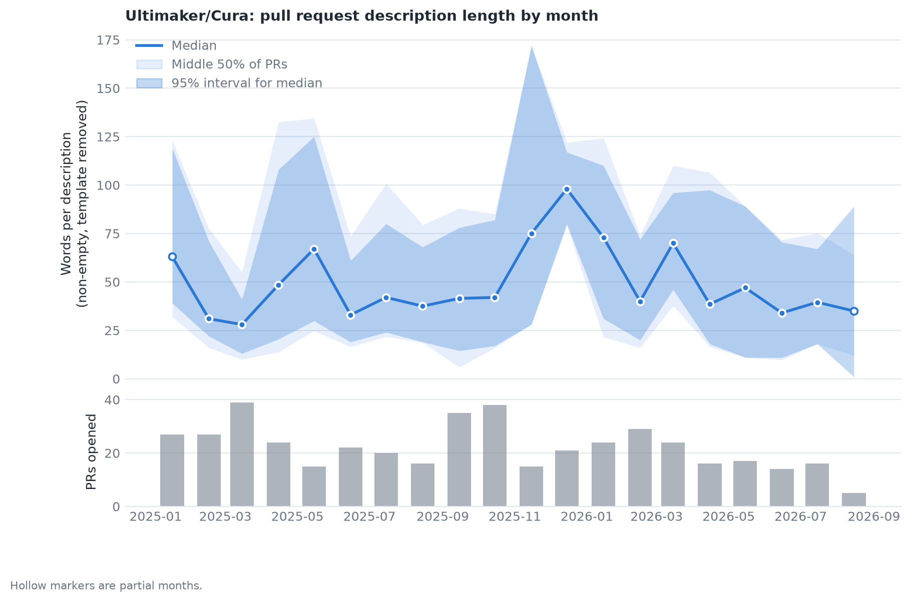
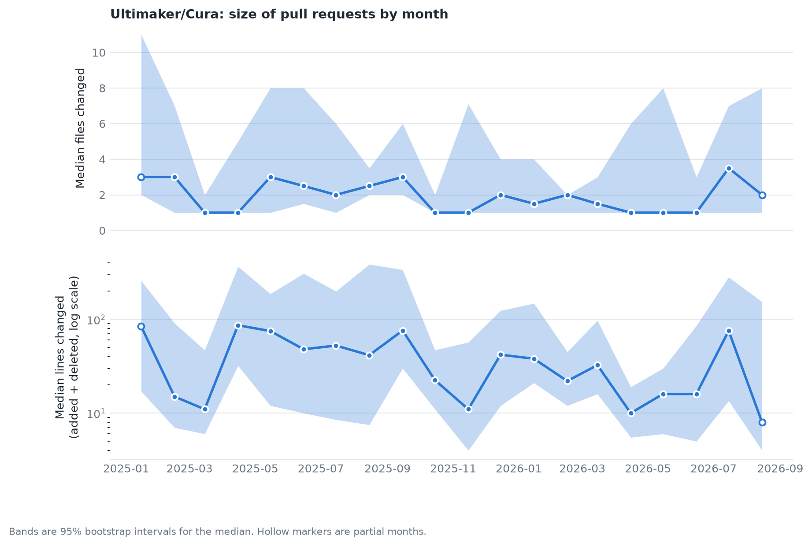
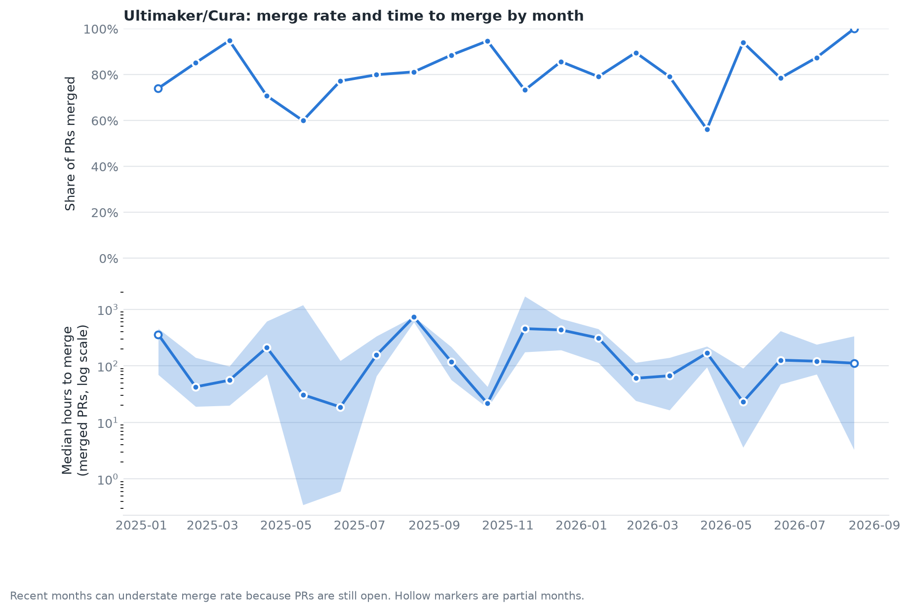
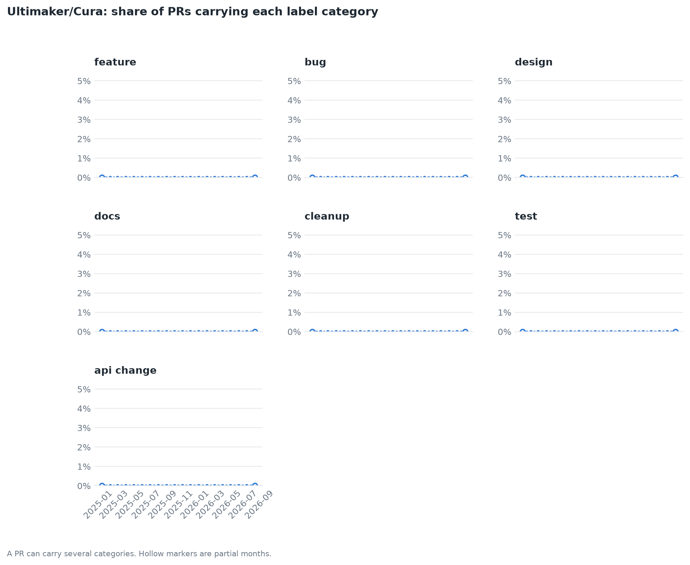
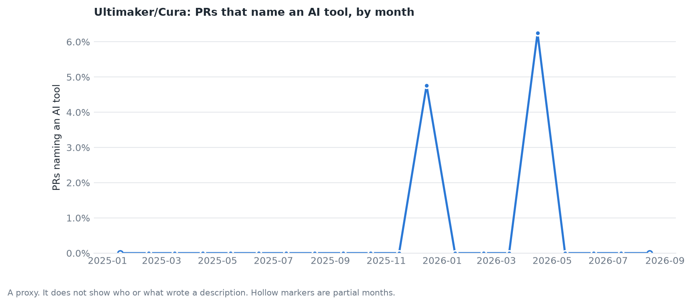

# Pull requests in Ultimaker/Cura: description length, size, speed and labels

Window 2025-01-06 to 2026-08-17 (UTC). Data fetched 2026-11-20. prwords 3.0.0, generated 2026-11-26. Method fixed in advance in `docs/ANALYSIS_PLAN.md`.

## 1. Data

- Repository primary language: Python
- Pull requests opened in the window: 448
- Removed as bot accounts: 4
- Analysed: 444 PRs from 46 authors
- Merged: 367 (82.7%). Closed without merging: 49 (11.0%). Still open: 28
- Follow-up: merge outcomes use a 30-day follow-up. PRs without enough follow-up: 0
- Empty descriptions after cleaning: 2.5%

## 2. Did the PR template change?

No template line appeared or disappeared with a share of 50% or more. Template text was detected monthly and removed before counting words.

Distinct template lines detected: 0.

## 3. First 28 days versus last 28 days

First window 2025-01-06 to 2025-02-02. Last window 2026-07-21 to 2026-08-17. Ratios are last median divided by first median. Bootstrap intervals, 2,000 resamples.

| Metric                                |   n first |   n last |   Median first |   Median last |   Ratio |   Ratio low |   Ratio high |     p |   Cliff's delta |
|:--------------------------------------|----------:|---------:|---------------:|--------------:|--------:|------------:|-------------:|------:|----------------:|
| Description words (non-empty)         |        25 |       12 |          63    |         32    |    0.51 |        0.18 |         1.35 | 0.074 |           -0.37 |
| Files changed                         |        27 |       12 |           3    |          2.5  |    0.83 |        0.15 |         4    | 0.46  |           -0.15 |
| Lines added                           |        27 |       12 |          82    |         14    |    0.17 |        0.04 |         2.2  | 0.2   |           -0.27 |
| Lines deleted                         |        27 |       12 |           1    |          1.5  |    1.5  |        0.2  |         5.5  | 0.74  |            0.07 |
| Net lines (added minus deleted)       |        27 |       12 |          63    |          5.5  |    0.09 |        0    |         1.08 | 0.044 |           -0.41 |
| Lines changed (added plus deleted)    |        27 |       12 |          84    |         14    |    0.17 |        0.05 |         2.09 | 0.2   |           -0.26 |
| Hours from open to merge (merged PRs) |        20 |       10 |         360.15 |        115.83 |    0.32 |        0.13 |         1.68 | 0.14  |           -0.34 |
| Commits                               |        27 |       12 |           3    |          2.5  |    0.83 |        0.33 |         1.5  | 0.17  |           -0.28 |
| Comments                              |        27 |       12 |           1    |          1    |    1    |        0.33 |         1.5  | 0.12  |           -0.3  |
| Reviews                               |        27 |       12 |           1    |          1.5  |    1.5  |        1    |         2    | 0.12  |            0.3  |

| Measure                             |   n first |   n last | Share first   | Share last   |   Change (points) |     p |
|:------------------------------------|----------:|---------:|:--------------|:-------------|------------------:|------:|
| Merged within follow-up period      |        27 |       12 | 70.4%         | 83.3%        |              13   | 0.69  |
| Closed without merging              |        27 |       12 | 14.8%         | 16.7%        |               1.9 | 1     |
| Opened as draft                     |        27 |       12 | 3.7%          | 8.3%         |               4.6 | 0.53  |
| From outside contributors           |        27 |       12 | 88.9%         | 100.0%       |              11.1 | 0.54  |
| Has a kind or type label            |        27 |       12 | 0.0%          | 16.7%        |              16.7 | 0.089 |
| Description text repeated elsewhere |        27 |       12 | 0.0%          | 0.0%         |               0   | 1     |
| Names an AI tool (disclosure)       |        27 |       12 | 0.0%          | 0.0%         |               0   | 1     |
| Label category: feature             |        27 |       12 | 0.0%          | 0.0%         |               0   | 1     |
| Label category: bug                 |        27 |       12 | 0.0%          | 0.0%         |               0   | 1     |
| Label category: design              |        27 |       12 | 0.0%          | 0.0%         |               0   | 1     |
| Label category: docs                |        27 |       12 | 0.0%          | 0.0%         |               0   | 1     |
| Label category: cleanup             |        27 |       12 | 0.0%          | 0.0%         |               0   | 1     |
| Label category: test                |        27 |       12 | 0.0%          | 0.0%         |               0   | 1     |
| Label category: api_change          |        27 |       12 | 0.0%          | 0.0%         |               0   | 1     |

## 4. Monthly trends

Theil-Sen slope per month and Kendall tau over full months only.

| metric                     |   months |   slope_per_month |   slope_ci_low |   slope_ci_high |     tau |       p |
|:---------------------------|---------:|------------------:|---------------:|----------------:|--------:|--------:|
| median_words               |       18 |             0.5   |         -0.75  |           2.2   |   0.131 |   0.448 |
| median_files_changed       |       18 |            -0     |         -0.143 |          -0     |  -0.203 |   0.27  |
| median_additions           |       18 |            -0.333 |         -3.083 |           1     |  -0.131 |   0.448 |
| median_deletions           |       18 |            -0     |         -0.25  |           0.273 |   0.013 |   0.939 |
| median_churn               |       18 |            -2     |         -4.625 |           0.714 |  -0.217 |   0.211 |
| median_hours_to_merge      |       18 |             0.862 |        -12.362 |          11.138 |   0.072 |   0.709 |
| merge_rate                 |       18 |             0.002 |         -0.008 |           0.014 |   0.052 |   0.762 |
| share_outside_contributors |       18 |             0.006 |         -0.007 |           0.016 |   0.191 |   0.271 |
| share_ai_disclosed         |       18 |            -0     |         -0     |          -0     |   0.211 |   0.293 |
| median_comments            |       18 |            -0     |         -0     |          -0     | nan     | nan     |
| median_reviews             |       18 |            -0     |         -0     |          -0     |   0.083 |   0.68  |
| share_feature              |       18 |            -0     |         -0     |          -0     | nan     | nan     |
| share_bug                  |       18 |            -0     |         -0     |          -0     | nan     | nan     |
| share_design               |       18 |            -0     |         -0     |          -0     | nan     | nan     |
| share_docs                 |       18 |            -0     |         -0     |          -0     | nan     | nan     |
| share_cleanup              |       18 |            -0     |         -0     |          -0     | nan     | nan     |
| share_test                 |       18 |            -0     |         -0     |          -0     | nan     | nan     |
| share_api_change           |       18 |            -0     |         -0     |          -0     | nan     | nan     |

## 5. Labels

Share of PRs with a kind or type label: 1.6% overall. Label coverage by month is in `monthly_summary.csv` (`share_has_kind_label`).

| category            |   n_prs |   share |   median_words |   median_files |   median_churn |   merge_rate |   median_hours_to_merge |   share_ai_disclosed |
|:--------------------|--------:|--------:|---------------:|---------------:|---------------:|-------------:|------------------------:|---------------------:|
| feature             |       0 |       0 |            nan |            nan |          nan   |      nan     |                 nan     |              nan     |
| bug                 |       0 |       0 |            nan |            nan |          nan   |      nan     |                 nan     |              nan     |
| design              |       0 |       0 |            nan |            nan |          nan   |      nan     |                 nan     |              nan     |
| docs                |       0 |       0 |            nan |            nan |          nan   |      nan     |                 nan     |              nan     |
| cleanup             |       0 |       0 |            nan |            nan |          nan   |      nan     |                 nan     |              nan     |
| test                |       0 |       0 |            nan |            nan |          nan   |      nan     |                 nan     |              nan     |
| api_change          |       0 |       0 |            nan |            nan |          nan   |      nan     |                 nan     |              nan     |
| (no category label) |     444 |       1 |             46 |              2 |           29.5 |        0.827 |                  98.131 |                0.005 |

## 6. Are PRs with signs of AI involvement smaller or larger?

Authorship is not observable. The proxy is `ai_disclosed`, defined in the analysis plan: 2 PRs (0.45%). 2 disclosed PRs are listed in `ai_disclosure_samples.csv` for manual audit.

### ai_disclosed

**Verdict: not testable.** Too few exposed PRs.

Pattern: lines changed: not estimated; files changed: not estimated; lines added: not estimated; lines deleted: not estimated; hours to merge: not estimated.

Not estimated: fewer than 30 exposed PRs (exposed PRs: 2).

### Robustness by tool (lines changed)

| tool        |   n exposed | status                    |
|:------------|------------:|:--------------------------|
| unspecified |           1 | fewer than 30 exposed PRs |
| claude      |           1 | fewer than 30 exposed PRs |

### File type check

Not run. Use `--file-check N` to sample N exposed PRs and matching unexposed PRs.

## 7. Other checks

- Outside contributors: 82.9% of PRs overall.
- Top 10 authors opened 87.4% of PRs.
- PRs whose description text is repeated elsewhere (10 or more words): 0.5%.

## 8. Limitations

- Word count and size describe PRs, not who wrote them. Proxies for AI involvement are noisy and omit undisclosed use.
- Added and deleted lines include generated or vendored files unless the project avoids committing them.
- Disclosure mostly captures tools that add attribution by default, so it is tool-skewed.
- Template removal is heuristic. Check `template_audit.csv`.
- One repository cannot support general claims. See the plan for replication.
- Months at the edges of the window are partial and are excluded from trend tests.

