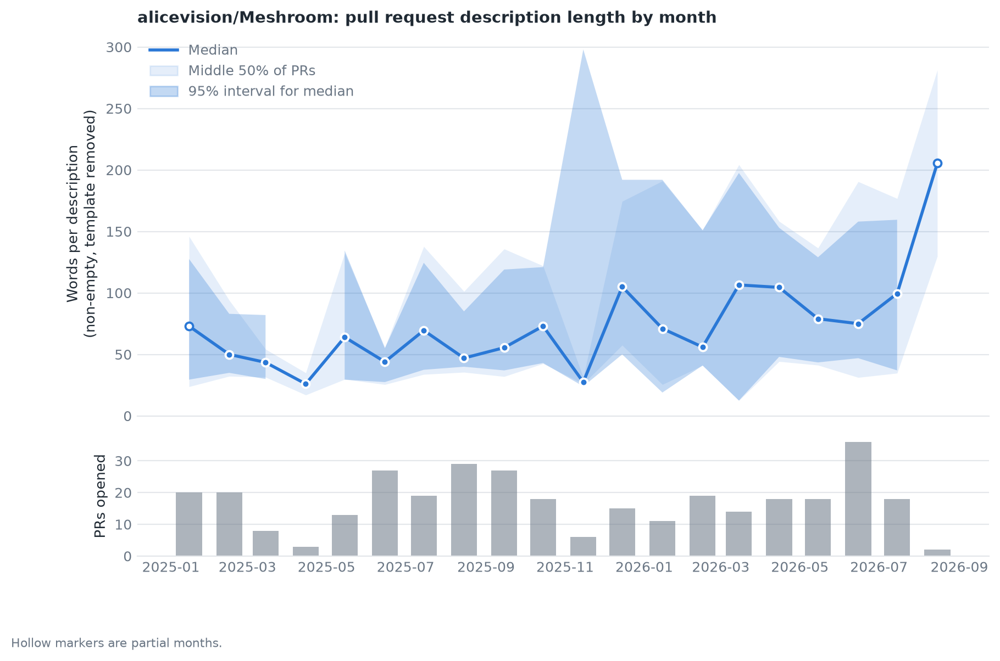
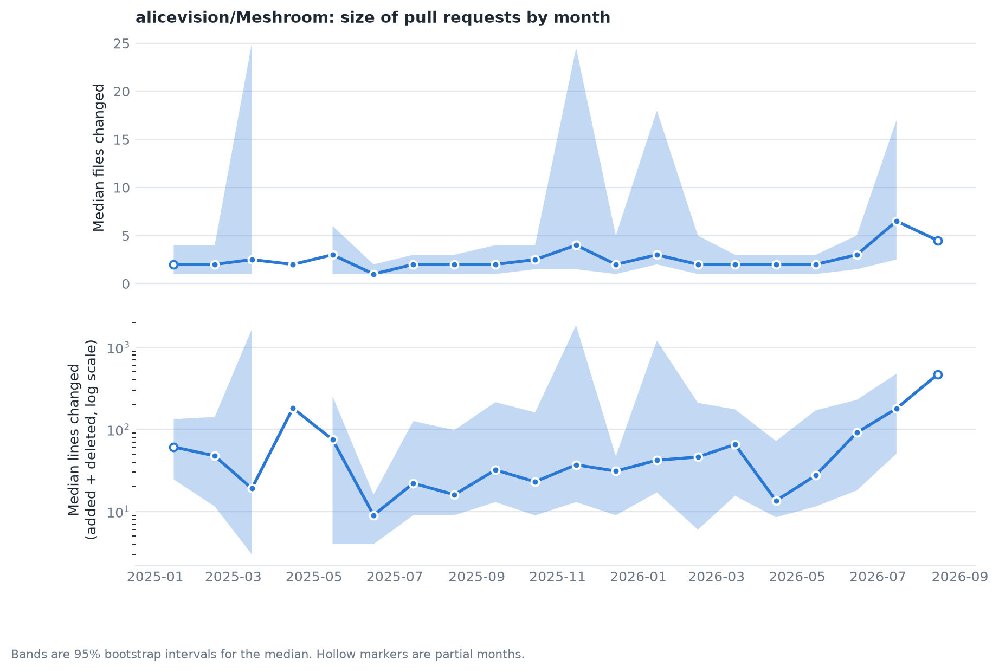
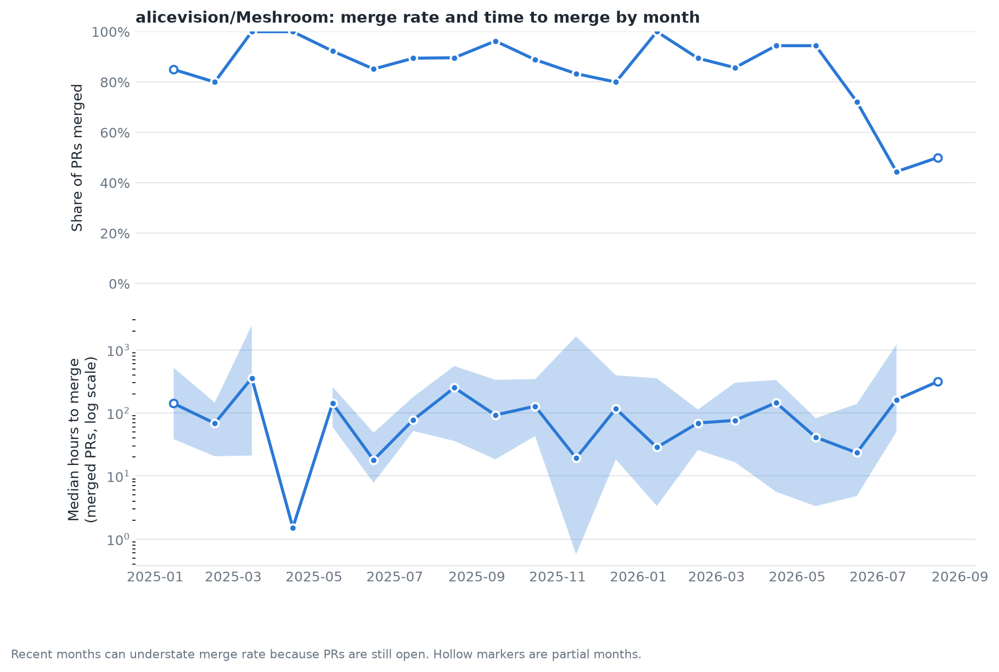
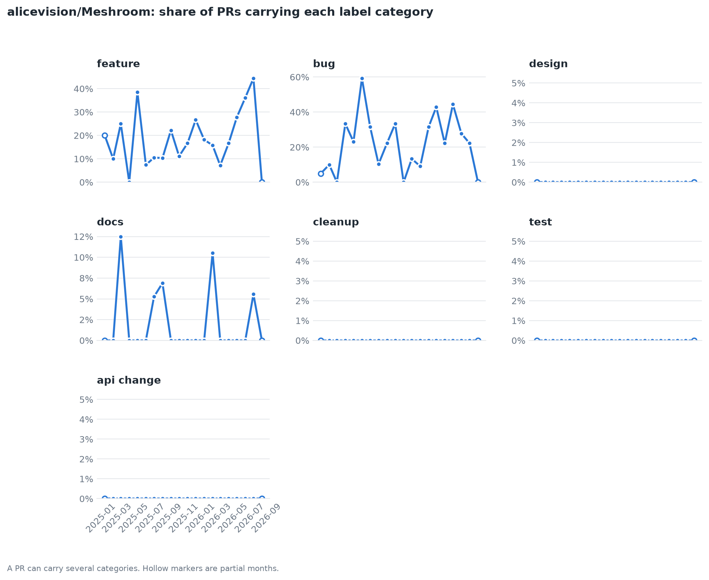
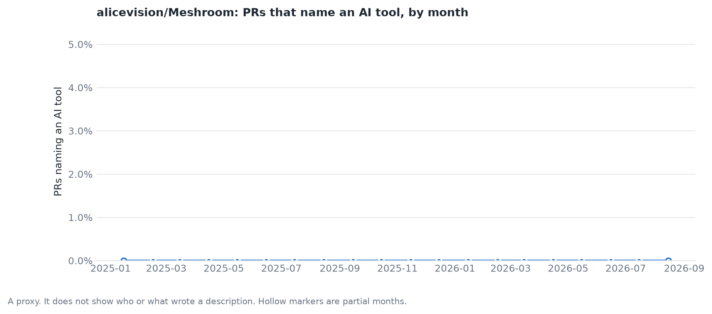

# Pull requests in alicevision/Meshroom: description length, size, speed and labels

Window 2025-01-06 to 2026-08-17 (UTC). Data fetched 2026-11-20. prwords 3.0.0, generated 2026-11-26. Method fixed in advance in `docs/ANALYSIS_PLAN.md`.

## 1. Data

- Repository primary language: Python
- Pull requests opened in the window: 395
- Removed as bot accounts: 54
- Analysed: 341 PRs from 23 authors
- Merged: 290 (85.0%). Closed without merging: 32 (9.4%). Still open: 19
- Follow-up: merge outcomes use a 30-day follow-up. PRs without enough follow-up: 0
- Empty descriptions after cleaning: 4.1%

## 2. Did the PR template change?

No template line appeared or disappeared with a share of 50% or more. Template text was detected monthly and removed before counting words.

Distinct template lines detected: 1.

## 3. First 28 days versus last 28 days

First window 2025-01-06 to 2025-02-02. Last window 2026-07-21 to 2026-08-17. Ratios are last median divided by first median. Bootstrap intervals, 2,000 resamples.

| Metric                                |   n first |   n last |   Median first |   Median last |   Ratio |   Ratio low |   Ratio high | p   |   Cliff's delta |
|:--------------------------------------|----------:|---------:|---------------:|--------------:|--------:|------------:|-------------:|:----|----------------:|
| Description words (non-empty)         |        20 |        4 |            nan |           nan |     nan |         nan |          nan | n/a |             nan |
| Files changed                         |        20 |        4 |            nan |           nan |     nan |         nan |          nan | n/a |             nan |
| Lines added                           |        20 |        4 |            nan |           nan |     nan |         nan |          nan | n/a |             nan |
| Lines deleted                         |        20 |        4 |            nan |           nan |     nan |         nan |          nan | n/a |             nan |
| Net lines (added minus deleted)       |        20 |        4 |            nan |           nan |     nan |         nan |          nan | n/a |             nan |
| Lines changed (added plus deleted)    |        20 |        4 |            nan |           nan |     nan |         nan |          nan | n/a |             nan |
| Hours from open to merge (merged PRs) |        17 |        3 |            nan |           nan |     nan |         nan |          nan | n/a |             nan |
| Commits                               |        20 |        4 |            nan |           nan |     nan |         nan |          nan | n/a |             nan |
| Comments                              |        20 |        4 |            nan |           nan |     nan |         nan |          nan | n/a |             nan |
| Reviews                               |        20 |        4 |            nan |           nan |     nan |         nan |          nan | n/a |             nan |

| Measure                             |   n first |   n last | Share first   | Share last   |   Change (points) |    p |
|:------------------------------------|----------:|---------:|:--------------|:-------------|------------------:|-----:|
| Merged within follow-up period      |        20 |        4 | 75.0%         | 75.0%        |                 0 | 1    |
| Closed without merging              |        20 |        4 | 10.0%         | 25.0%        |                15 | 0.44 |
| Opened as draft                     |        20 |        4 | 5.0%          | 25.0%        |                20 | 0.31 |
| From outside contributors           |        20 |        4 | 75.0%         | 100.0%       |                25 | 0.54 |
| Has a kind or type label            |        20 |        4 | 0.0%          | 0.0%         |                 0 | 1    |
| Description text repeated elsewhere |        20 |        4 | 0.0%          | 0.0%         |                 0 | 1    |
| Names an AI tool (disclosure)       |        20 |        4 | 0.0%          | 0.0%         |                 0 | 1    |
| Label category: feature             |        20 |        4 | 20.0%         | 0.0%         |               -20 | 1    |
| Label category: bug                 |        20 |        4 | 5.0%          | 25.0%        |                20 | 0.31 |
| Label category: design              |        20 |        4 | 0.0%          | 0.0%         |                 0 | 1    |
| Label category: docs                |        20 |        4 | 0.0%          | 0.0%         |                 0 | 1    |
| Label category: cleanup             |        20 |        4 | 0.0%          | 0.0%         |                 0 | 1    |
| Label category: test                |        20 |        4 | 0.0%          | 0.0%         |                 0 | 1    |
| Label category: api_change          |        20 |        4 | 0.0%          | 0.0%         |                 0 | 1    |

## 4. Monthly trends

Theil-Sen slope per month and Kendall tau over full months only.

| metric                     |   months |   slope_per_month |   slope_ci_low |   slope_ci_high |     tau |       p |
|:---------------------------|---------:|------------------:|---------------:|----------------:|--------:|--------:|
| median_words               |       18 |             2.944 |          0.875 |           4.9   |   0.516 |   0.002 |
| median_files_changed       |       18 |            -0     |         -0     |           0.111 |   0.222 |   0.24  |
| median_additions           |       18 |             2     |         -0.042 |           4.875 |   0.333 |   0.057 |
| median_deletions           |       18 |             0.2   |         -0.333 |           0.857 |   0.139 |   0.425 |
| median_churn               |       18 |             2.3   |         -0.95  |           5.583 |   0.203 |   0.26  |
| median_hours_to_merge      |       18 |             0.064 |        -12.17  |           6.456 |   0.007 |   1     |
| merge_rate                 |       18 |            -0.006 |         -0.019 |           0.002 |  -0.247 |   0.159 |
| share_outside_contributors |       18 |             0.007 |         -0.006 |           0.017 |   0.149 |   0.399 |
| share_ai_disclosed         |       18 |            -0     |         -0     |          -0     | nan     | nan     |
| median_comments            |       18 |            -0     |         -0     |          -0     | nan     | nan     |
| median_reviews             |       18 |            -0     |         -0     |           0.133 |   0.349 |   0.069 |
| share_feature              |       18 |             0.012 |          0.001 |           0.023 |   0.367 |   0.034 |
| share_bug                  |       18 |             0.007 |         -0.009 |           0.021 |   0.127 |   0.47  |
| share_design               |       18 |            -0     |         -0     |          -0     | nan     | nan     |
| share_docs                 |       18 |            -0     |         -0     |          -0     |  -0.047 |   0.809 |
| share_cleanup              |       18 |            -0     |         -0     |          -0     | nan     | nan     |
| share_test                 |       18 |            -0     |         -0     |          -0     | nan     | nan     |
| share_api_change           |       18 |            -0     |         -0     |          -0     | nan     | nan     |

## 5. Labels

Share of PRs with a kind or type label: 4.4% overall. Label coverage by month is in `monthly_summary.csv` (`share_has_kind_label`).

| category            |   n_prs |   share |   median_words |   median_files |   median_churn |   merge_rate |   median_hours_to_merge |   share_ai_disclosed |
|:--------------------|--------:|--------:|---------------:|---------------:|---------------:|-------------:|------------------------:|---------------------:|
| feature             |      68 |   0.199 |           99.5 |              6 |          264.5 |        0.735 |                 240.087 |                    0 |
| bug                 |      85 |   0.249 |           55.5 |              1 |           11   |        0.941 |                  22.99  |                    0 |
| design              |       0 |   0     |          nan   |            nan |          nan   |      nan     |                 nan     |                  nan |
| docs                |       7 |   0.021 |           47   |              1 |          107   |        1     |                  88.164 |                    0 |
| cleanup             |       0 |   0     |          nan   |            nan |          nan   |      nan     |                 nan     |                  nan |
| test                |       0 |   0     |          nan   |            nan |          nan   |      nan     |                 nan     |                  nan |
| api_change          |       0 |   0     |          nan   |            nan |          nan   |      nan     |                 nan     |                  nan |
| (no category label) |     184 |   0.54  |           57   |              2 |           35.5 |        0.848 |                  99.533 |                    0 |

## 6. Are PRs with signs of AI involvement smaller or larger?

Authorship is not observable. The proxy is `ai_disclosed`, defined in the analysis plan: 0 PRs (0.00%). 0 disclosed PRs are listed in `ai_disclosure_samples.csv` for manual audit.

### ai_disclosed

**Verdict: not testable.** Too few exposed PRs.

Pattern: lines changed: not estimated; files changed: not estimated; lines added: not estimated; lines deleted: not estimated; hours to merge: not estimated.

Not estimated: fewer than 30 exposed PRs (exposed PRs: 0).

### Robustness by tool (lines changed)

No tool named in any disclosure.

### File type check

Not run. Use `--file-check N` to sample N exposed PRs and matching unexposed PRs.

## 7. Other checks

- Outside contributors: 84.2% of PRs overall.
- Top 10 authors opened 96.2% of PRs.
- PRs whose description text is repeated elsewhere (10 or more words): 0.6%.

## 8. Limitations

- Word count and size describe PRs, not who wrote them. Proxies for AI involvement are noisy and omit undisclosed use.
- Added and deleted lines include generated or vendored files unless the project avoids committing them.
- Disclosure mostly captures tools that add attribution by default, so it is tool-skewed.
- Template removal is heuristic. Check `template_audit.csv`.
- One repository cannot support general claims. See the plan for replication.
- Months at the edges of the window are partial and are excluded from trend tests.

