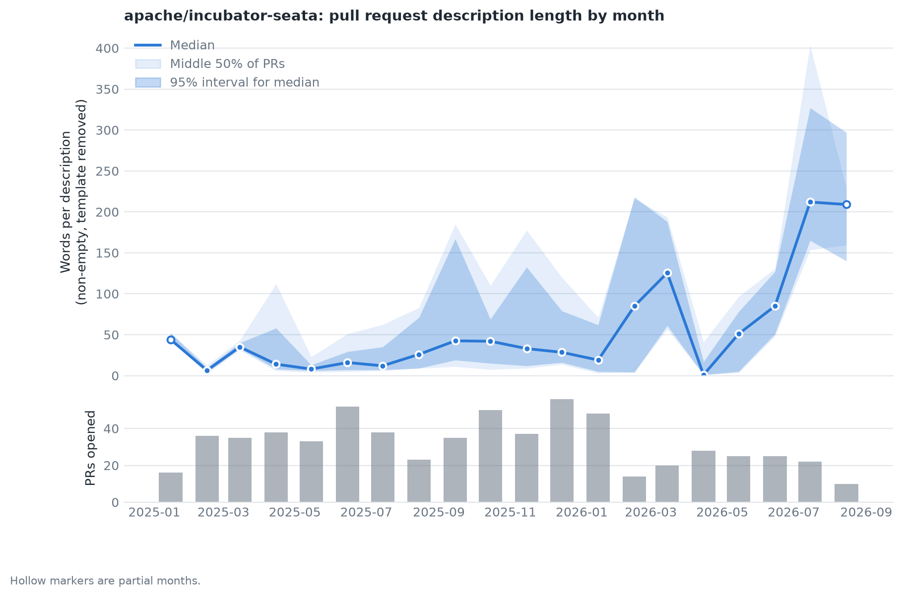
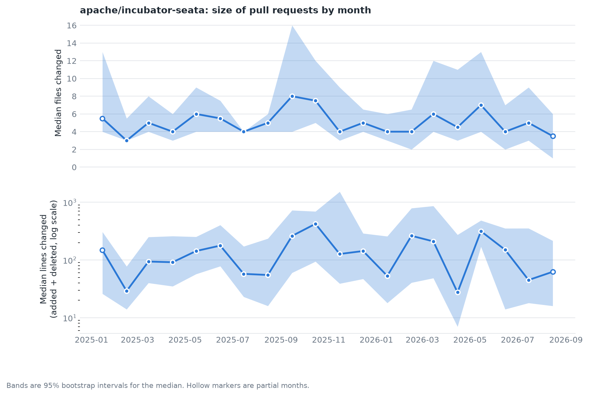
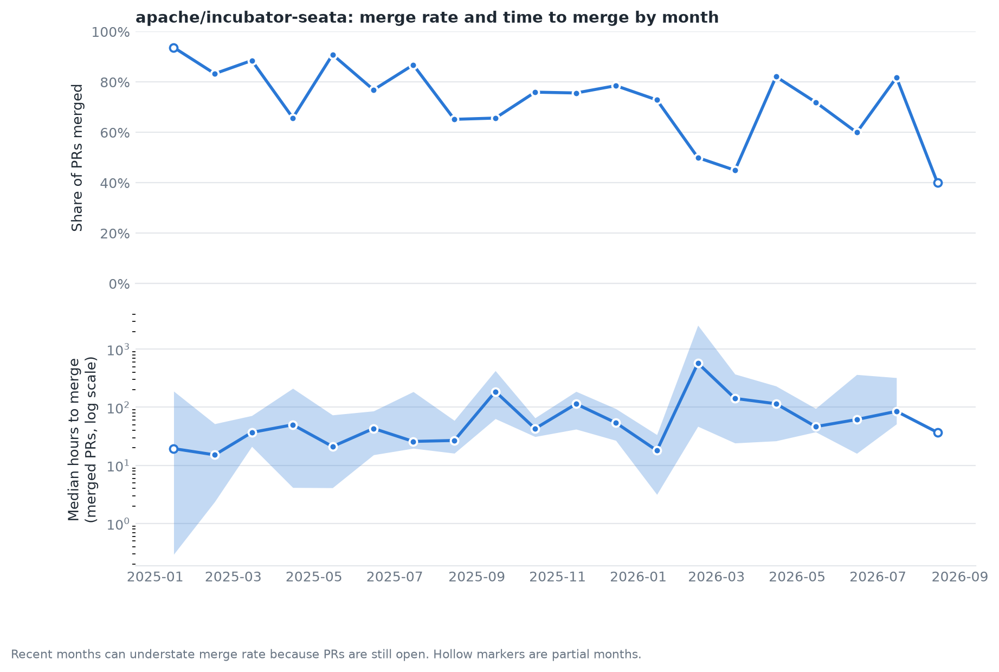
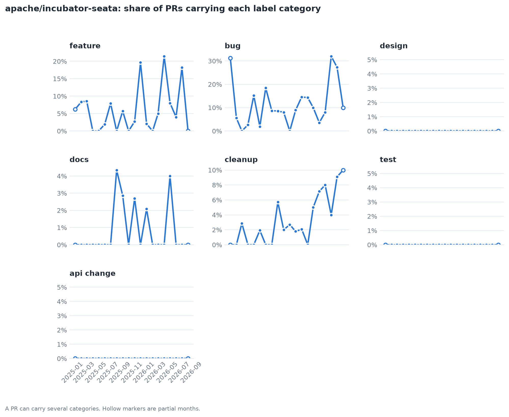
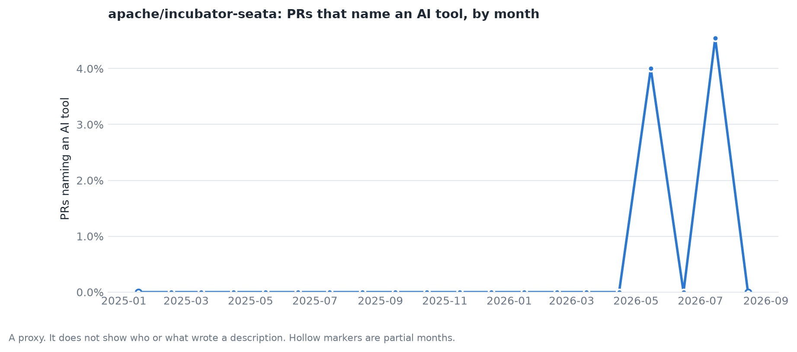

# Pull requests in apache/incubator-seata: description length, size, speed and labels

Window 2025-01-06 to 2026-08-17 (UTC). Data fetched 2026-11-20. prwords 3.0.0, generated 2026-11-26. Method fixed in advance in `docs/ANALYSIS_PLAN.md`.

## 1. Data

- Repository primary language: Java
- Pull requests opened in the window: 644
- Removed as bot accounts: 3
- Analysed: 641 PRs from 111 authors
- Merged: 481 (75.0%). Closed without merging: 106 (16.5%). Still open: 54
- Follow-up: merge outcomes use a 30-day follow-up. PRs without enough follow-up: 0
- Empty descriptions after cleaning: 11.9%

## 2. Did the PR template change?

Lines that appeared or disappeared across the window (full list in `template_audit.csv`):

| line                                        | first_month   | last_month   |   months |   peak_share | change_event   |
|:--------------------------------------------|:--------------|:-------------|---------:|-------------:|:---------------|
| i have read the contributing.md guidelines. | 2025-09       | 2026-07      |       10 |            1 | added          |

Distinct template lines detected: 7.

## 3. First 28 days versus last 28 days

First window 2025-01-06 to 2025-02-02. Last window 2026-07-21 to 2026-08-17. Ratios are last median divided by first median. Bootstrap intervals, 2,000 resamples.

| Metric                                |   n first |   n last |   Median first |   Median last |   Ratio |   Ratio low |   Ratio high |       p |   Cliff's delta |
|:--------------------------------------|----------:|---------:|---------------:|--------------:|--------:|------------:|-------------:|--------:|----------------:|
| Description words (non-empty)         |        16 |       22 |          44    |        211.5  |    4.81 |        3.98 |         5.48 | 5.3e-07 |            0.97 |
| Files changed                         |        16 |       23 |           5.5  |          4    |    0.73 |        0.23 |         1.4  | 0.19    |           -0.25 |
| Lines added                           |        16 |       23 |          90    |         35    |    0.39 |        0.04 |         7.89 | 0.61    |           -0.1  |
| Lines deleted                         |        16 |       23 |          11    |          3    |    0.27 |        0.07 |         1.33 | 0.059   |           -0.36 |
| Net lines (added minus deleted)       |        16 |       23 |          70    |         25    |    0.36 |        0.03 |        17.75 | 0.99    |           -0.01 |
| Lines changed (added plus deleted)    |        16 |       23 |         148    |         45    |    0.3  |        0.07 |         1.66 | 0.2     |           -0.24 |
| Hours from open to merge (merged PRs) |        15 |       16 |          19.45 |         62.49 |    3.21 |        0.16 |        89.44 | 0.44    |            0.17 |
| Commits                               |        16 |       23 |           5    |          4    |    0.8  |        0.2  |         1.33 | 0.095   |           -0.32 |
| Comments                              |        16 |       23 |           1    |          1    |    1    |        0.5  |         2    | 0.64    |            0.09 |
| Reviews                               |        16 |       23 |           2.5  |          2    |    0.8  |        0.29 |         4    | 0.77    |           -0.06 |

| Measure                             |   n first |   n last | Share first   | Share last   |   Change (points) |    p |
|:------------------------------------|----------:|---------:|:--------------|:-------------|------------------:|-----:|
| Merged within follow-up period      |        16 |       23 | 81.2%         | 60.9%        |             -20.4 | 0.29 |
| Closed without merging              |        16 |       23 | 6.2%          | 4.3%         |              -1.9 | 1    |
| Opened as draft                     |        16 |       23 | 0.0%          | 4.3%         |               4.3 | 1    |
| From outside contributors           |        16 |       23 | 75.0%         | 52.2%        |             -22.8 | 0.19 |
| Has a kind or type label            |        16 |       23 | 43.8%         | 60.9%        |              17.1 | 0.34 |
| Description text repeated elsewhere |        16 |       23 | 31.2%         | 13.0%        |             -18.2 | 0.23 |
| Names an AI tool (disclosure)       |        16 |       23 | 0.0%          | 4.3%         |               4.3 | 1    |
| Label category: feature             |        16 |       23 | 6.2%          | 8.7%         |               2.4 | 1    |
| Label category: bug                 |        16 |       23 | 31.2%         | 21.7%        |              -9.5 | 0.71 |
| Label category: design              |        16 |       23 | 0.0%          | 0.0%         |               0   | 1    |
| Label category: docs                |        16 |       23 | 0.0%          | 0.0%         |               0   | 1    |
| Label category: cleanup             |        16 |       23 | 0.0%          | 8.7%         |               8.7 | 0.5  |
| Label category: test                |        16 |       23 | 0.0%          | 0.0%         |               0   | 1    |
| Label category: api_change          |        16 |       23 | 0.0%          | 0.0%         |               0   | 1    |

## 4. Monthly trends

Theil-Sen slope per month and Kendall tau over full months only.

| metric                     |   months |   slope_per_month |   slope_ci_low |   slope_ci_high |     tau |       p |
|:---------------------------|---------:|------------------:|---------------:|----------------:|--------:|--------:|
| median_words               |       18 |             4.167 |          1.167 |           8     |   0.485 |   0.005 |
| median_files_changed       |       18 |            -0     |         -0.1   |           0.167 |   0.078 |   0.668 |
| median_additions           |       18 |             2.125 |         -6.167 |          12     |   0.111 |   0.55  |
| median_deletions           |       18 |            -0.25  |         -0.611 |           0.111 |  -0.29  |   0.095 |
| median_churn               |       18 |             4.125 |         -5.115 |          17.1   |   0.118 |   0.495 |
| median_hours_to_merge      |       18 |             3.236 |          0.501 |           8.537 |   0.386 |   0.026 |
| merge_rate                 |       18 |            -0.008 |         -0.022 |           0.005 |  -0.307 |   0.081 |
| share_outside_contributors |       18 |             0.007 |         -0.013 |           0.026 |   0.137 |   0.454 |
| share_ai_disclosed         |       18 |            -0     |         -0     |          -0     |   0.436 |   0.03  |
| median_comments            |       18 |            -0     |         -0     |          -0     |   0.059 |   0.768 |
| median_reviews             |       18 |            -0     |         -0     |           0.042 |   0.193 |   0.324 |
| share_feature              |       18 |             0.003 |         -0.002 |           0.01  |   0.196 |   0.266 |
| share_bug                  |       18 |             0.007 |         -0.001 |           0.015 |   0.309 |   0.075 |
| share_design               |       18 |            -0     |         -0     |          -0     | nan     | nan     |
| share_docs                 |       18 |            -0     |         -0     |          -0     |   0.065 |   0.735 |
| share_cleanup              |       18 |             0.004 |          0.002 |           0.006 |   0.523 |   0.003 |
| share_test                 |       18 |            -0     |         -0     |          -0     | nan     | nan     |
| share_api_change           |       18 |            -0     |         -0     |          -0     | nan     | nan     |

## 5. Labels

Share of PRs with a kind or type label: 43.7% overall. Label coverage by month is in `monthly_summary.csv` (`share_has_kind_label`).

| category            |   n_prs |   share |   median_words |   median_files |   median_churn |   merge_rate |   median_hours_to_merge |   share_ai_disclosed |
|:--------------------|--------:|--------:|---------------:|---------------:|---------------:|-------------:|------------------------:|---------------------:|
| feature             |      40 |   0.062 |           43.5 |           16.5 |          634.5 |        0.925 |                 315.961 |                 0.05 |
| bug                 |      64 |   0.1   |           52.5 |            4   |           70.5 |        0.906 |                  39.292 |                 0    |
| design              |       0 |   0     |          nan   |          nan   |          nan   |      nan     |                 nan     |               nan    |
| docs                |       5 |   0.008 |           39.5 |            3   |           51   |        1     |                  16.151 |                 0    |
| cleanup             |      17 |   0.027 |           42.5 |            8   |          284   |        0.941 |                  81.972 |                 0    |
| test                |       0 |   0     |          nan   |          nan   |          nan   |      nan     |                 nan     |               nan    |
| api_change          |       0 |   0     |          nan   |          nan   |          nan   |      nan     |                 nan     |               nan    |
| (no category label) |     515 |   0.803 |           31   |            4   |           94   |        0.709 |                  39.718 |                 0    |

## 6. Are PRs with signs of AI involvement smaller or larger?

Authorship is not observable. The proxy is `ai_disclosed`, defined in the analysis plan: 2 PRs (0.31%). 2 disclosed PRs are listed in `ai_disclosure_samples.csv` for manual audit.

### ai_disclosed

**Verdict: not testable.** Too few exposed PRs.

Pattern: lines changed: not estimated; files changed: not estimated; lines added: not estimated; lines deleted: not estimated; hours to merge: not estimated.

Not estimated: fewer than 30 exposed PRs (exposed PRs: 2).

### Robustness by tool (lines changed)

| tool        |   n exposed | status                    |
|:------------|------------:|:--------------------------|
| unspecified |           2 | fewer than 30 exposed PRs |

### File type check

Not run. Use `--file-check N` to sample N exposed PRs and matching unexposed PRs.

## 7. Other checks

- Outside contributors: 68.3% of PRs overall.
- Top 10 authors opened 52.3% of PRs.
- PRs whose description text is repeated elsewhere (10 or more words): 22.5%.

## 8. Limitations

- Word count and size describe PRs, not who wrote them. Proxies for AI involvement are noisy and omit undisclosed use.
- Added and deleted lines include generated or vendored files unless the project avoids committing them.
- Disclosure mostly captures tools that add attribution by default, so it is tool-skewed.
- Template removal is heuristic. Check `template_audit.csv`.
- One repository cannot support general claims. See the plan for replication.
- Months at the edges of the window are partial and are excluded from trend tests.

