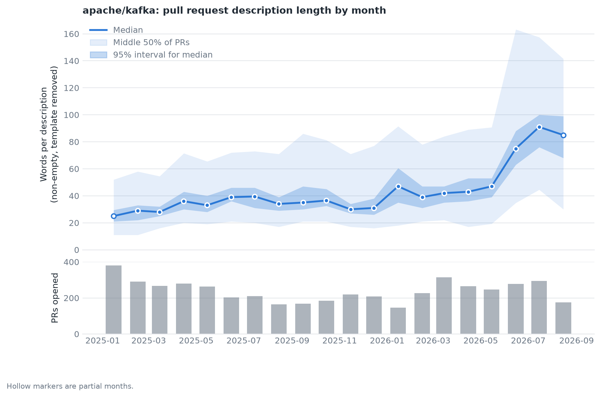
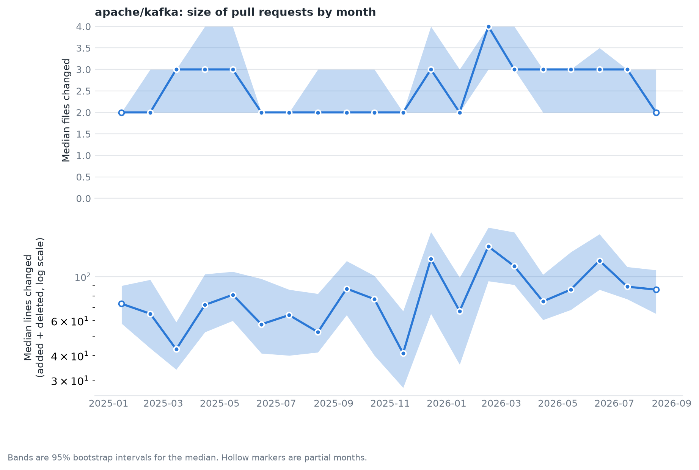
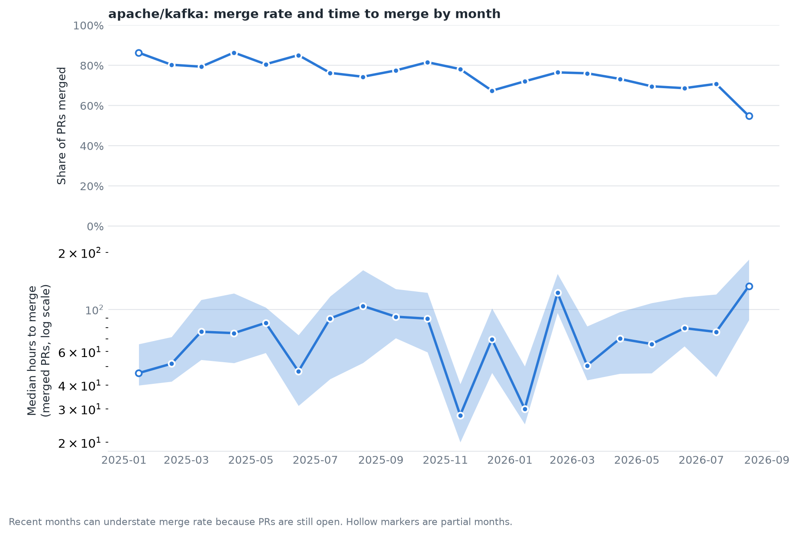
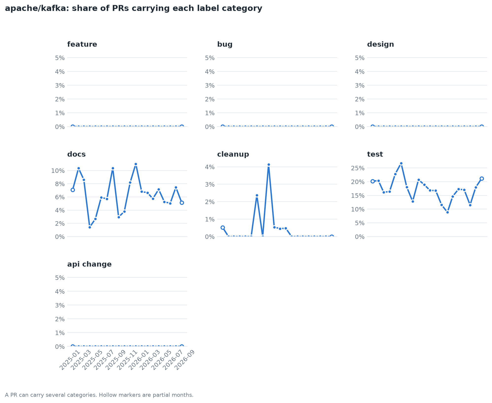
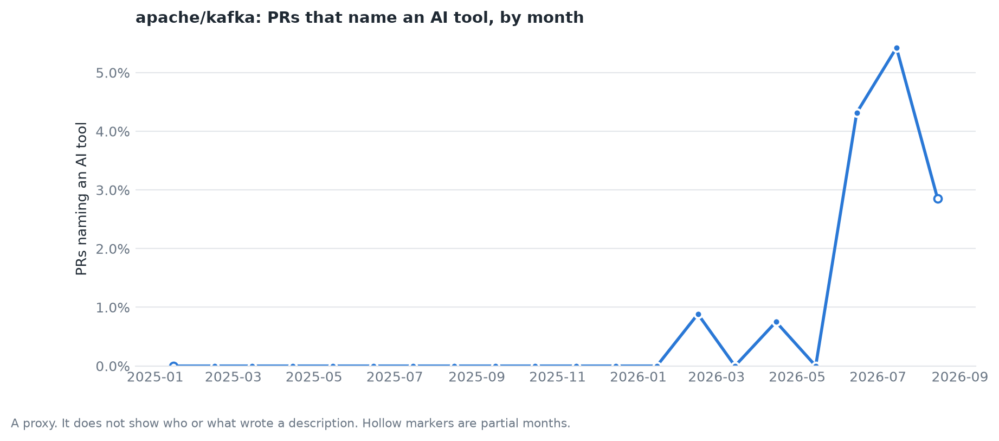
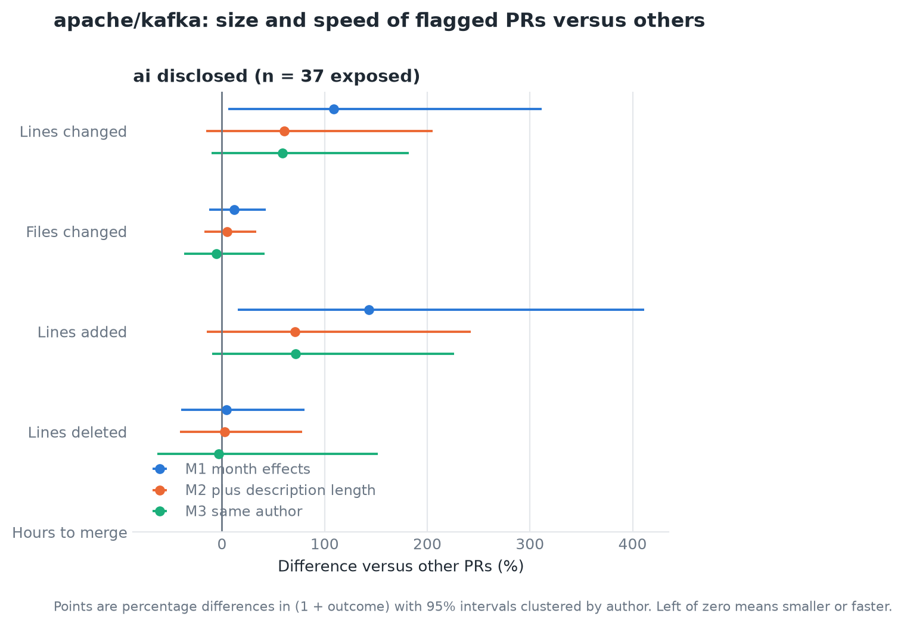

# Pull requests in apache/kafka: description length, size, speed and labels

Window 2025-01-06 to 2026-08-17 (UTC). Data fetched 2026-11-19. prwords 3.0.0, generated 2026-11-26. Method fixed in advance in `docs/ANALYSIS_PLAN.md`.

## 1. Data

- Repository primary language: Java
- Pull requests opened in the window: 4,793
- Removed as bot accounts: 4
- Analysed: 4,789 PRs from 558 authors
- Merged: 3,659 (76.4%). Closed without merging: 788 (16.5%). Still open: 342
- Follow-up: merge outcomes use a 30-day follow-up. PRs without enough follow-up: 0
- Empty descriptions after cleaning: 2.3%

## 2. Did the PR template change?

Lines that appeared or disappeared across the window (full list in `template_audit.csv`):

| line                                                   | first_month   | last_month   |   months |   peak_share | change_event   |
|:-------------------------------------------------------|:--------------|:-------------|---------:|-------------:|:---------------|
| verify design and implementation                       | 2025-01       | 2025-02      |        2 |         0.67 | removed        |
| verify documentation (including upgrade notes)         | 2025-01       | 2025-02      |        2 |         0.67 | removed        |
| verify test coverage and ci build status               | 2025-01       | 2025-02      |        2 |         0.67 | removed        |
| ### committer checklist (excluded from commit message) | 2025-01       | 2025-02      |        2 |         0.67 | removed        |

Distinct template lines detected: 5.

## 3. First 28 days versus last 28 days

First window 2025-01-06 to 2025-02-02. Last window 2026-07-21 to 2026-08-17. Ratios are last median divided by first median. Bootstrap intervals, 2,000 resamples.

| Metric                                |   n first |   n last |   Median first |   Median last |   Ratio |   Ratio low |   Ratio high |       p |   Cliff's delta |
|:--------------------------------------|----------:|---------:|---------------:|--------------:|--------:|------------:|-------------:|--------:|----------------:|
| Description words (non-empty)         |       350 |      295 |          25    |         84    |    3.36 |        2.66 |         4.19 | 1.1e-30 |            0.53 |
| Files changed                         |       390 |      295 |           2    |          2    |    1    |        1    |         1.5  | 0.029   |            0.09 |
| Lines added                           |       390 |      295 |          21.5  |         64    |    2.98 |        1.89 |         4.89 | 3.1e-08 |            0.25 |
| Lines deleted                         |       390 |      295 |          14    |          6    |    0.43 |        0.27 |         0.69 | 2.7e-06 |           -0.21 |
| Net lines (added minus deleted)       |       390 |      295 |           0.5  |         45    |   90    |       13.33 |        90    | 3e-18   |            0.39 |
| Lines changed (added plus deleted)    |       390 |      295 |          73    |         83    |    1.14 |        0.78 |         1.61 | 0.3     |            0.05 |
| Hours from open to merge (merged PRs) |       336 |      182 |          46.95 |        108.38 |    2.31 |        1.34 |         3.28 | 0.00038 |            0.19 |
| Commits                               |       390 |      295 |           2    |          1    |    0.5  |        0.5  |         1    | 0.0029  |           -0.13 |
| Comments                              |       390 |      295 |           1    |          1    |    1    |        0.5  |         1    | 0.17    |           -0.06 |
| Reviews                               |       390 |      295 |           2    |          2    |    1    |        0.33 |         1    | 5.9e-06 |           -0.2  |

| Measure                             |   n first |   n last | Share first   | Share last   |   Change (points) |       p |
|:------------------------------------|----------:|---------:|:--------------|:-------------|------------------:|--------:|
| Merged within follow-up period      |       390 |      295 | 80.8%         | 54.6%        |             -26.2 | 1.9e-13 |
| Closed without merging              |       390 |      295 | 13.3%         | 15.3%        |               1.9 | 0.51    |
| Opened as draft                     |       390 |      295 | 2.1%          | 1.4%         |              -0.7 | 0.57    |
| From outside contributors           |       390 |      295 | 60.3%         | 73.9%        |              13.6 | 0.00024 |
| Has a kind or type label            |       390 |      295 | 0.0%          | 0.0%         |               0   | 1       |
| Description text repeated elsewhere |       390 |      295 | 14.4%         | 3.1%         |             -11.3 | 2.6e-07 |
| Names an AI tool (disclosure)       |       390 |      295 | 0.0%          | 3.4%         |               3.4 | 0.0002  |
| Label category: feature             |       390 |      295 | 0.0%          | 0.0%         |               0   | 1       |
| Label category: bug                 |       390 |      295 | 0.0%          | 0.0%         |               0   | 1       |
| Label category: design              |       390 |      295 | 0.0%          | 0.0%         |               0   | 1       |
| Label category: docs                |       390 |      295 | 7.4%          | 4.7%         |              -2.7 | 0.2     |
| Label category: cleanup             |       390 |      295 | 0.5%          | 0.0%         |              -0.5 | 0.51    |
| Label category: test                |       390 |      295 | 20.0%         | 20.0%        |               0   | 1       |
| Label category: api_change          |       390 |      295 | 0.0%          | 0.0%         |               0   | 1       |

## 4. Monthly trends

Theil-Sen slope per month and Kendall tau over full months only.

| metric                     |   months |   slope_per_month |   slope_ci_low |   slope_ci_high |     tau |       p |
|:---------------------------|---------:|------------------:|---------------:|----------------:|--------:|--------:|
| median_words               |       18 |             1.167 |          0.8   |           2.833 |   0.625 |   0     |
| median_files_changed       |       18 |            -0     |         -0     |           0.091 |   0.3   |   0.132 |
| median_additions           |       18 |             3.222 |          1.269 |           4.7   |   0.516 |   0.002 |
| median_deletions           |       18 |            -0.133 |         -0.55  |           0.25  |  -0.19  |   0.284 |
| median_churn               |       18 |             2.875 |          0.5   |           5.25  |   0.399 |   0.021 |
| median_hours_to_merge      |       18 |            -0.011 |         -2.187 |           3.009 |  -0.007 |   1     |
| merge_rate                 |       18 |            -0.007 |         -0.011 |          -0.004 |  -0.569 |   0.001 |
| share_outside_contributors |       18 |            -0     |         -0.007 |           0.006 |  -0.046 |   0.823 |
| share_ai_disclosed         |       18 |            -0     |         -0     |           0.001 |   0.554 |   0.005 |
| median_comments            |       18 |            -0     |         -0     |          -0     |  -0.314 |   0.122 |
| median_reviews             |       18 |            -0.056 |         -0.143 |          -0     |  -0.375 |   0.045 |
| share_feature              |       18 |            -0     |         -0     |          -0     | nan     | nan     |
| share_bug                  |       18 |            -0     |         -0     |          -0     | nan     | nan     |
| share_design               |       18 |            -0     |         -0     |          -0     | nan     | nan     |
| share_docs                 |       18 |             0     |         -0.003 |           0.003 |   0.02  |   0.941 |
| share_cleanup              |       18 |            -0     |         -0     |          -0     |  -0.121 |   0.53  |
| share_test                 |       18 |            -0.003 |         -0.008 |           0.001 |  -0.268 |   0.131 |
| share_api_change           |       18 |            -0     |         -0     |          -0     | nan     | nan     |

## 5. Labels

Share of PRs with a kind or type label: 0.0% overall. Label coverage by month is in `monthly_summary.csv` (`share_has_kind_label`).

| category            |   n_prs |   share |   median_words |   median_files |   median_churn |   merge_rate |   median_hours_to_merge |   share_ai_disclosed |
|:--------------------|--------:|--------:|---------------:|---------------:|---------------:|-------------:|------------------------:|---------------------:|
| feature             |       0 |   0     |            nan |            nan |            nan |      nan     |                 nan     |              nan     |
| bug                 |       0 |   0     |            nan |            nan |            nan |      nan     |                 nan     |              nan     |
| design              |       0 |   0     |            nan |            nan |            nan |      nan     |                 nan     |              nan     |
| docs                |     305 |   0.064 |             26 |              1 |             12 |        0.816 |                  63.786 |                0.007 |
| cleanup             |      17 |   0.004 |             19 |              1 |             74 |        1     |                  80.126 |                0     |
| test                |     833 |   0.174 |             30 |              1 |             45 |        0.837 |                  52.11  |                0.002 |
| api_change          |       0 |   0     |            nan |            nan |            nan |      nan     |                 nan     |              nan     |
| (no category label) |    3644 |   0.761 |             44 |              3 |             97 |        0.743 |                  72.804 |                0.009 |

## 6. Are PRs with signs of AI involvement smaller or larger?

Authorship is not observable. The proxy is `ai_disclosed`, defined in the analysis plan: 37 PRs (0.77%). 37 disclosed PRs are listed in `ai_disclosure_samples.csv` for manual audit.

### ai_disclosed

**Verdict: no difference detected.** The same-month gap does not hold within the same author, so it reflects who discloses AI use, not the PRs themselves.

Pattern: lines changed: no clear difference; files changed: no clear difference; lines added: no clear difference; lines deleted: no clear difference; hours to merge: not estimated.

Within-author permutation p-value, lines changed: 0.2029.

| Outcome       | Model                      |    n |   n exposed |   Median exposed |   Median others | Difference (95% CI)       |     p |   p (Holm) |
|:--------------|:---------------------------|-----:|------------:|-----------------:|----------------:|:--------------------------|------:|-----------:|
| Lines changed | M1 month effects           | 4789 |          37 |              206 |              78 | +109.0% (+6.2 to +311.5)  | 0.033 |      0.099 |
| Lines changed | M2 plus description length | 4789 |          37 |              206 |              78 | +60.8% (-15.3 to +205.3)  | 0.15  |      0.52  |
| Lines changed | M3 same author             | 4789 |          37 |              206 |              78 | +59.1% (-10.2 to +181.9)  | 0.11  |      0.4   |
| Files changed | M1 month effects           | 4789 |          37 |                4 |               2 | +11.8% (-12.4 to +42.6)   | 0.37  |      0.74  |
| Files changed | M2 plus description length | 4789 |          37 |                4 |               2 | +5.2% (-16.9 to +33.3)    | 0.67  |      1     |
| Files changed | M3 same author             | 4789 |          37 |                4 |               2 | -5.4% (-36.8 to +41.7)    | 0.79  |      1     |
| Lines added   | M1 month effects           | 4789 |          37 |              193 |              50 | +143.1% (+15.6 to +411.6) | 0.019 |      0.077 |
| Lines added   | M2 plus description length | 4789 |          37 |              193 |              50 | +71.0% (-14.6 to +242.5)  | 0.13  |      0.52  |
| Lines added   | M3 same author             | 4789 |          37 |              193 |              50 | +71.6% (-9.7 to +226.0)   | 0.099 |      0.4   |
| Lines deleted | M1 month effects           | 4789 |          37 |               13 |              10 | +4.4% (-39.7 to +80.5)    | 0.88  |      0.88  |
| Lines deleted | M2 plus description length | 4789 |          37 |               13 |              10 | +2.9% (-40.7 to +78.3)    | 0.92  |      1     |
| Lines deleted | M3 same author             | 4789 |          37 |               13 |              10 | -3.4% (-62.9 to +151.6)   | 0.94  |      1     |

### Robustness by tool (lines changed)

| tool        |   n exposed | status                    |
|:------------|------------:|:--------------------------|
| unspecified |          20 | fewer than 30 exposed PRs |
| claude      |          17 | fewer than 30 exposed PRs |

### File type check

Sample: 37 exposed and 37 unexposed PRs from the same months. 0 PRs with more than 100 files were excluded.

Share of changed lines by file type:

| group     |   n_prs | code   | tests   | docs   | config   | generated   | other   |   median_code_test_lines |
|:----------|--------:|:-------|:--------|:-------|:---------|:------------|:--------|-------------------------:|
| exposed   |      37 | 45.8%  | 44.7%   | 9.4%   | 0.0%     | 0.0%        | 0.0%    |                      156 |
| unexposed |      37 | 22.8%  | 76.9%   | 0.1%   | 0.1%     | 0.0%        | 0.1%    |                      109 |

Code and test lines only, same month: +49.9% (95% CI -36.2 to +252.7), p = 0.35. This is a robustness check and does not change the verdict.

## 7. Other checks

- Outside contributors: 65.8% of PRs overall.
- Top 10 authors opened 28.0% of PRs.
- PRs whose description text is repeated elsewhere (10 or more words): 5.7%.

## 8. Limitations

- Word count and size describe PRs, not who wrote them. Proxies for AI involvement are noisy and omit undisclosed use.
- Added and deleted lines include generated or vendored files unless the project avoids committing them.
- Disclosure mostly captures tools that add attribution by default, so it is tool-skewed.
- Template removal is heuristic. Check `template_audit.csv`.
- One repository cannot support general claims. See the plan for replication.
- Months at the edges of the window are partial and are excluded from trend tests.

