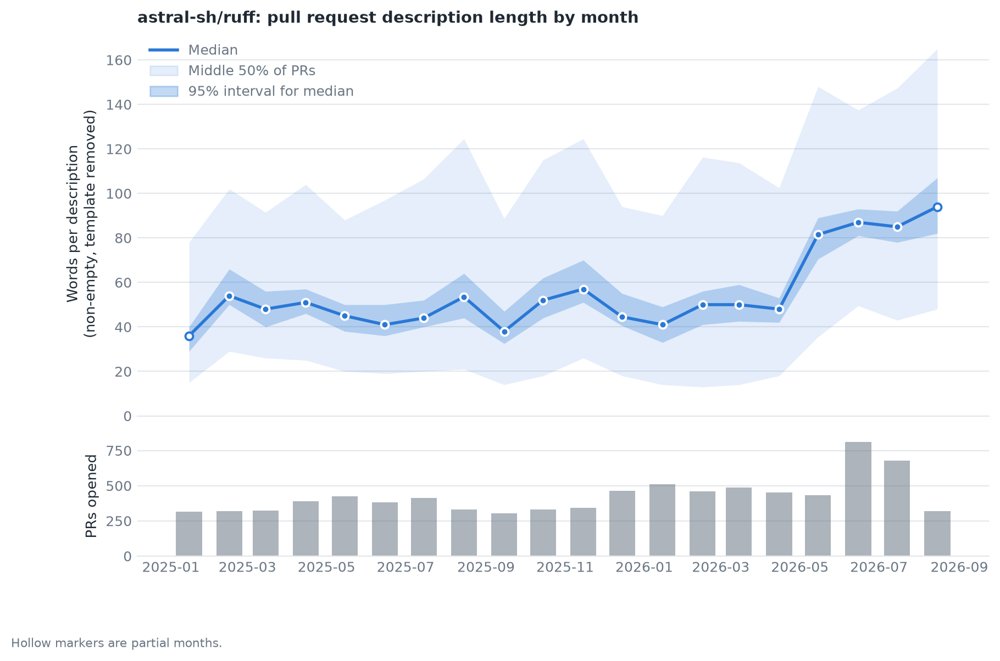
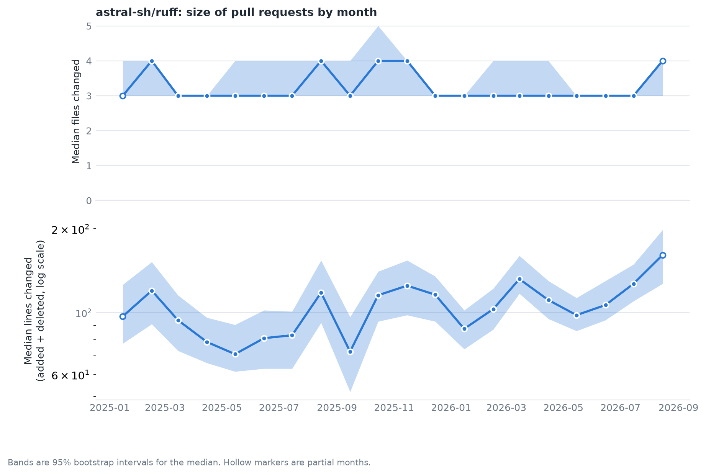
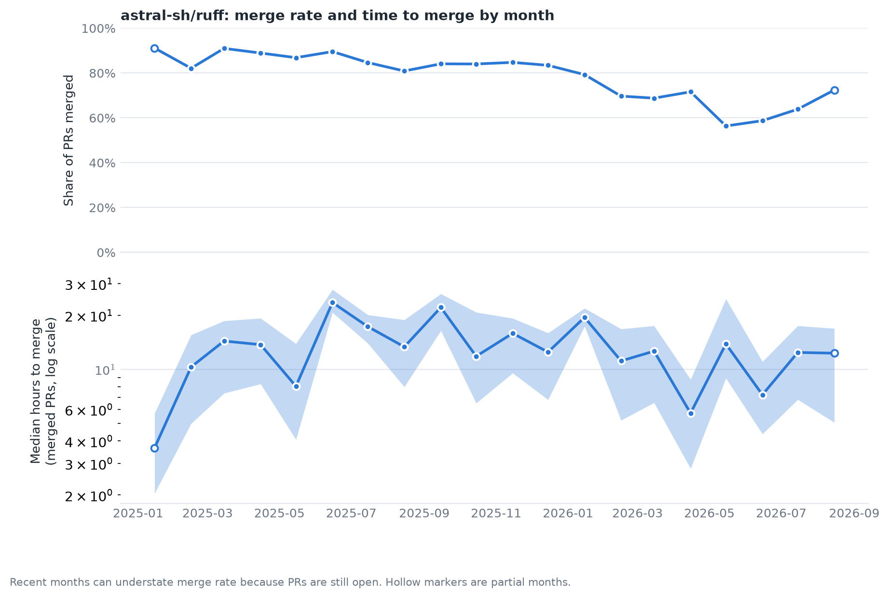
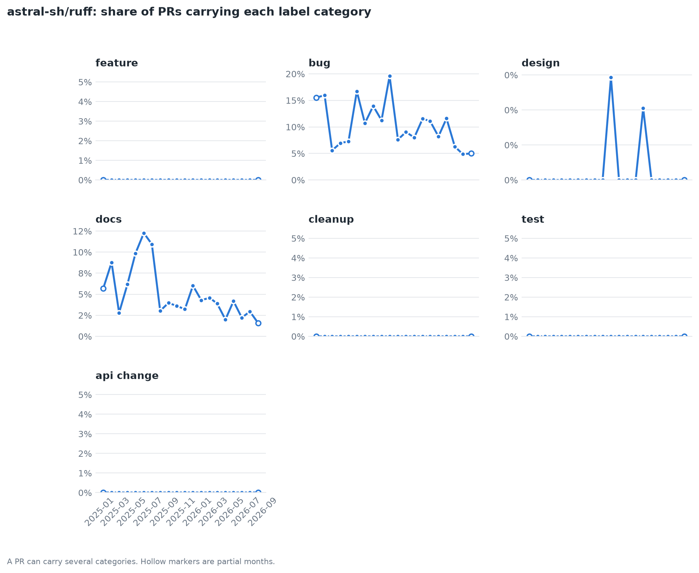
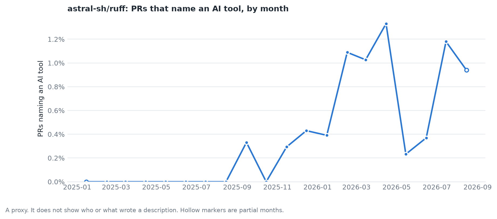
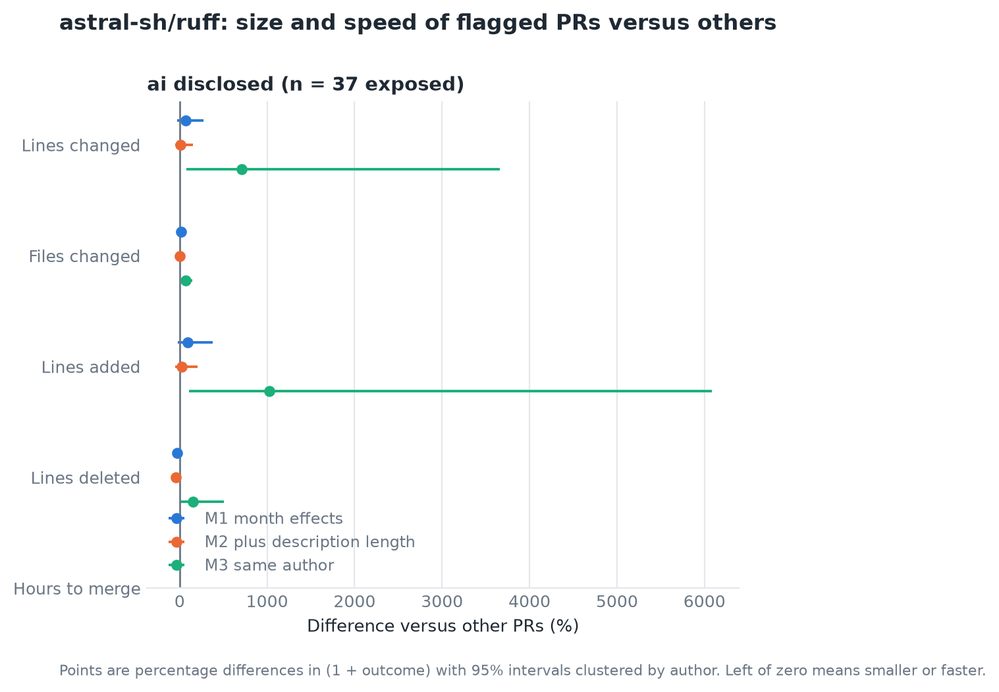

# Pull requests in astral-sh/ruff: description length, size, speed and labels

Window 2025-01-06 to 2026-08-17 (UTC). Data fetched 2026-11-19. prwords 3.0.0, generated 2026-11-26. Method fixed in advance in `docs/ANALYSIS_PLAN.md`.

## 1. Data

- Repository primary language: Rust
- Pull requests opened in the window: 9,681
- Removed as bot accounts: 1,197
- Analysed: 8,484 PRs from 677 authors
- Merged: 6,494 (76.5%). Closed without merging: 1,759 (20.7%). Still open: 231
- Follow-up: merge outcomes use a 30-day follow-up. PRs without enough follow-up: 0
- Empty descriptions after cleaning: 7.2%

## 2. Did the PR template change?

No template line appeared or disappeared with a share of 50% or more. Template text was detected monthly and removed before counting words.

Distinct template lines detected: 2.

## 3. First 28 days versus last 28 days

First window 2025-01-06 to 2025-02-02. Last window 2026-07-21 to 2026-08-17. Ratios are last median divided by first median. Bootstrap intervals, 2,000 resamples.

| Metric                                |   n first |   n last |   Median first |   Median last |   Ratio |   Ratio low |   Ratio high |       p |   Cliff's delta |
|:--------------------------------------|----------:|---------:|---------------:|--------------:|--------:|------------:|-------------:|--------:|----------------:|
| Description words (non-empty)         |       325 |      551 |          37    |         86    |    2.32 |        2    |         2.93 | 2.1e-21 |            0.38 |
| Files changed                         |       332 |      562 |           3    |          4    |    1.33 |        1    |         1.33 | 0.15    |            0.06 |
| Lines added                           |       332 |      562 |          73    |        116.5  |    1.6  |        1.21 |         2.21 | 0.0021  |            0.12 |
| Lines deleted                         |       332 |      562 |          16    |         15    |    0.94 |        0.71 |         1.29 | 0.54    |           -0.02 |
| Net lines (added minus deleted)       |       332 |      562 |          29.5  |         86    |    2.92 |        2.07 |         5.31 | 7e-07   |            0.2  |
| Lines changed (added plus deleted)    |       332 |      562 |         101    |        141    |    1.4  |        1.04 |         2.03 | 0.0072  |            0.11 |
| Hours from open to merge (merged PRs) |       302 |      390 |           3.93 |          7.39 |    1.88 |        0.96 |         4.56 | 7.6e-05 |            0.18 |
| Commits                               |       332 |      562 |           2    |          2    |    1    |        1    |         1    | 0.67    |           -0.02 |
| Comments                              |       332 |      562 |           1    |          3    |    3    |        1.5  |         3    | 2.8e-21 |            0.37 |
| Reviews                               |       332 |      562 |           2    |          1    |    0.5  |        0.5  |         1    | 2.4e-15 |           -0.31 |

| Measure                             |   n first |   n last | Share first   | Share last   |   Change (points) |       p |
|:------------------------------------|----------:|---------:|:--------------|:-------------|------------------:|--------:|
| Merged within follow-up period      |       332 |      562 | 90.4%         | 67.8%        |             -22.6 | 1.2e-15 |
| Closed without merging              |       332 |      562 | 8.1%          | 21.9%        |              13.8 | 3.5e-08 |
| Opened as draft                     |       332 |      562 | 2.4%          | 19.4%        |              17   | 1.3e-15 |
| From outside contributors           |       332 |      562 | 52.1%         | 50.9%        |              -1.2 | 0.73    |
| Has a kind or type label            |       332 |      562 | 0.0%          | 0.0%         |               0   | 1       |
| Description text repeated elsewhere |       332 |      562 | 0.0%          | 0.0%         |               0   | 1       |
| Names an AI tool (disclosure)       |       332 |      562 | 0.0%          | 2.0%         |               2   | 0.009   |
| Label category: feature             |       332 |      562 | 0.0%          | 0.0%         |               0   | 1       |
| Label category: bug                 |       332 |      562 | 15.1%         | 4.4%         |             -10.6 | 7.2e-08 |
| Label category: design              |       332 |      562 | 0.0%          | 0.0%         |               0   | 1       |
| Label category: docs                |       332 |      562 | 6.0%          | 2.0%         |              -4.1 | 0.002   |
| Label category: cleanup             |       332 |      562 | 0.0%          | 0.0%         |               0   | 1       |
| Label category: test                |       332 |      562 | 0.0%          | 0.0%         |               0   | 1       |
| Label category: api_change          |       332 |      562 | 0.0%          | 0.0%         |               0   | 1       |

## 4. Monthly trends

Theil-Sen slope per month and Kendall tau over full months only.

| metric                     |   months |   slope_per_month |   slope_ci_low |   slope_ci_high |     tau |       p |
|:---------------------------|---------:|------------------:|---------------:|----------------:|--------:|--------:|
| median_words               |       18 |             0.857 |         -0.308 |           2.75  |   0.238 |   0.172 |
| median_files_changed       |       18 |            -0     |         -0     |          -0     |  -0.238 |   0.243 |
| median_additions           |       18 |             1.5   |         -0     |           3.056 |   0.325 |   0.063 |
| median_deletions           |       18 |             0.167 |         -0.292 |           0.583 |   0.134 |   0.446 |
| median_churn               |       18 |             1.571 |         -0.643 |           3.556 |   0.281 |   0.112 |
| median_hours_to_merge      |       18 |            -0.211 |         -0.713 |           0.217 |  -0.203 |   0.26  |
| merge_rate                 |       18 |            -0.017 |         -0.022 |          -0.01  |  -0.699 |   0     |
| share_outside_contributors |       18 |            -0.011 |         -0.019 |          -0     |  -0.346 |   0.048 |
| share_ai_disclosed         |       18 |             0     |          0     |           0.001 |   0.658 |   0     |
| median_comments            |       18 |             0.071 |         -0     |           0.111 |   0.719 |   0     |
| median_reviews             |       18 |            -0     |         -0.083 |          -0     |  -0.379 |   0.053 |
| share_feature              |       18 |            -0     |         -0     |          -0     | nan     | nan     |
| share_bug                  |       18 |            -0.002 |         -0.006 |           0.002 |  -0.098 |   0.601 |
| share_design               |       18 |            -0     |         -0     |          -0     |   0.127 |   0.528 |
| share_docs                 |       18 |            -0.003 |         -0.006 |          -0     |  -0.346 |   0.048 |
| share_cleanup              |       18 |            -0     |         -0     |          -0     | nan     | nan     |
| share_test                 |       18 |            -0     |         -0     |          -0     | nan     | nan     |
| share_api_change           |       18 |            -0     |         -0     |          -0     | nan     | nan     |

## 5. Labels

Share of PRs with a kind or type label: 0.0% overall. Label coverage by month is in `monthly_summary.csv` (`share_has_kind_label`).

| category            |   n_prs |   share |   median_words |   median_files |   median_churn |   merge_rate |   median_hours_to_merge |   share_ai_disclosed |
|:--------------------|--------:|--------:|---------------:|---------------:|---------------:|-------------:|------------------------:|---------------------:|
| feature             |       0 |   0     |            nan |            nan |          nan   |      nan     |                 nan     |              nan     |
| bug                 |     832 |   0.098 |             55 |              3 |           86.5 |        0.905 |                  16.894 |                0.001 |
| design              |       2 |   0     |             91 |             10 |          782   |        0     |                 nan     |                0     |
| docs                |     418 |   0.049 |             31 |              1 |            9   |        0.938 |                   7.855 |                0     |
| cleanup             |       0 |   0     |            nan |            nan |          nan   |      nan     |                 nan     |              nan     |
| test                |       0 |   0     |            nan |            nan |          nan   |      nan     |                 nan     |              nan     |
| api_change          |       0 |   0     |            nan |            nan |          nan   |      nan     |                 nan     |              nan     |
| (no category label) |    7232 |   0.852 |             59 |              3 |          118   |        0.74  |                  12.712 |                0.005 |

## 6. Are PRs with signs of AI involvement smaller or larger?

Authorship is not observable. The proxy is `ai_disclosed`, defined in the analysis plan: 37 PRs (0.44%). 37 disclosed PRs are listed in `ai_disclosure_samples.csv` for manual audit.

### ai_disclosed

**Verdict: no difference detected.** The same-month interval for lines changed runs from -25.5% to +273.2%.

Pattern: lines changed: no clear difference; files changed: no clear difference; lines added: no clear difference; lines deleted: no clear difference; hours to merge: not estimated.

Within-author permutation p-value, lines changed: 0.0005.

| Outcome       | Model                      |    n |   n exposed |   Median exposed |   Median others | Difference (95% CI)          |      p |   p (Holm) |
|:--------------|:---------------------------|-----:|------------:|-----------------:|----------------:|:-----------------------------|-------:|-----------:|
| Lines changed | M1 month effects           | 8484 |          37 |              208 |             104 | +66.7% (-25.5 to +273.2)     | 0.21   |      0.64  |
| Lines changed | M2 plus description length | 8484 |          37 |              208 |             104 | +11.4% (-50.1 to +148.8)     | 0.79   |      1     |
| Lines changed | M3 same author             | 8484 |          37 |              208 |             104 | +712.1% (+75.3 to +3661.8)   | 0.0074 |      0.016 |
| Files changed | M1 month effects           | 8484 |          37 |                5 |               3 | +15.6% (-9.0 to +46.7)       | 0.23   |      0.64  |
| Files changed | M2 plus description length | 8484 |          37 |                5 |               3 | +2.0% (-20.0 to +29.9)       | 0.88   |      1     |
| Files changed | M3 same author             | 8484 |          37 |                5 |               3 | +72.2% (+20.2 to +146.7)     | 0.0031 |      0.012 |
| Lines added   | M1 month effects           | 8484 |          37 |              197 |              77 | +94.4% (-20.8 to +376.8)     | 0.15   |      0.59  |
| Lines added   | M2 plus description length | 8484 |          37 |              197 |              77 | +25.8% (-48.6 to +207.7)     | 0.62   |      1     |
| Lines added   | M3 same author             | 8484 |          37 |              197 |              77 | +1025.2% (+104.6 to +6087.9) | 0.0054 |      0.016 |
| Lines deleted | M1 month effects           | 8484 |          37 |                7 |              14 | -25.2% (-56.8 to +29.3)      | 0.3    |      0.64  |
| Lines deleted | M2 plus description length | 8484 |          37 |                7 |              14 | -41.3% (-65.2 to -0.8)       | 0.047  |      0.19  |
| Lines deleted | M3 same author             | 8484 |          37 |                7 |              14 | +153.6% (+6.5 to +503.8)     | 0.035  |      0.035 |

### Robustness by tool (lines changed)

| tool        |   n exposed | status                    |
|:------------|------------:|:--------------------------|
| unspecified |          22 | fewer than 30 exposed PRs |
| claude      |          13 | fewer than 30 exposed PRs |
| codex       |           2 | fewer than 30 exposed PRs |

### File type check

Sample: 37 exposed and 37 unexposed PRs from the same months. 0 PRs with more than 100 files were excluded.

Share of changed lines by file type:

| group     |   n_prs | code   | tests   | docs   | config   | generated   | other   |   median_code_test_lines |
|:----------|--------:|:-------|:--------|:-------|:---------|:------------|:--------|-------------------------:|
| exposed   |      37 | 44.1%  | 10.4%   | 20.8%  | 0.8%     | 24.0%       | 0.0%    |                      119 |
| unexposed |      37 | 55.7%  | 2.9%    | 22.4%  | 1.5%     | 17.4%       | 0.1%    |                       77 |

Code and test lines only, same month: -2.0% (95% CI -56.5 to +120.9), p = 0.96. This is a robustness check and does not change the verdict.

## 7. Other checks

- Outside contributors: 49.3% of PRs overall.
- Top 10 authors opened 64.9% of PRs.
- PRs whose description text is repeated elsewhere (10 or more words): 0.7%.

## 8. Limitations

- Word count and size describe PRs, not who wrote them. Proxies for AI involvement are noisy and omit undisclosed use.
- Added and deleted lines include generated or vendored files unless the project avoids committing them.
- Disclosure mostly captures tools that add attribution by default, so it is tool-skewed.
- Template removal is heuristic. Check `template_audit.csv`.
- One repository cannot support general claims. See the plan for replication.
- Months at the edges of the window are partial and are excluded from trend tests.

