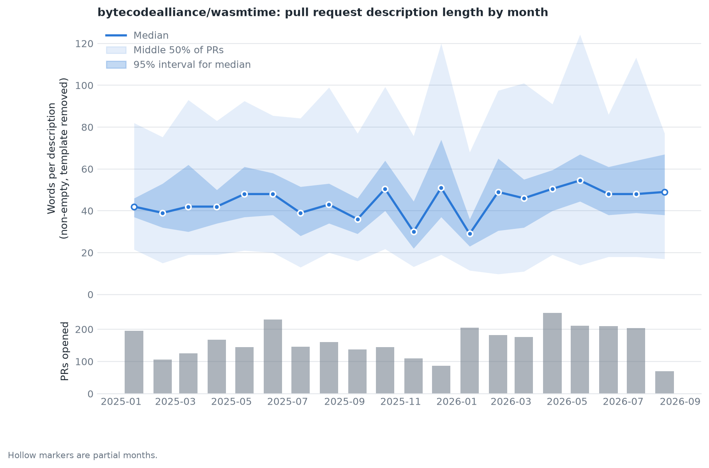
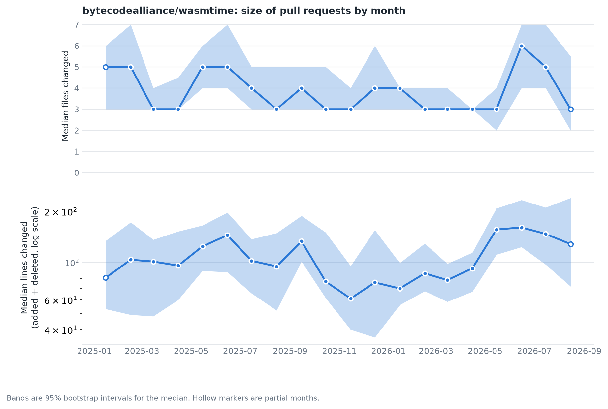
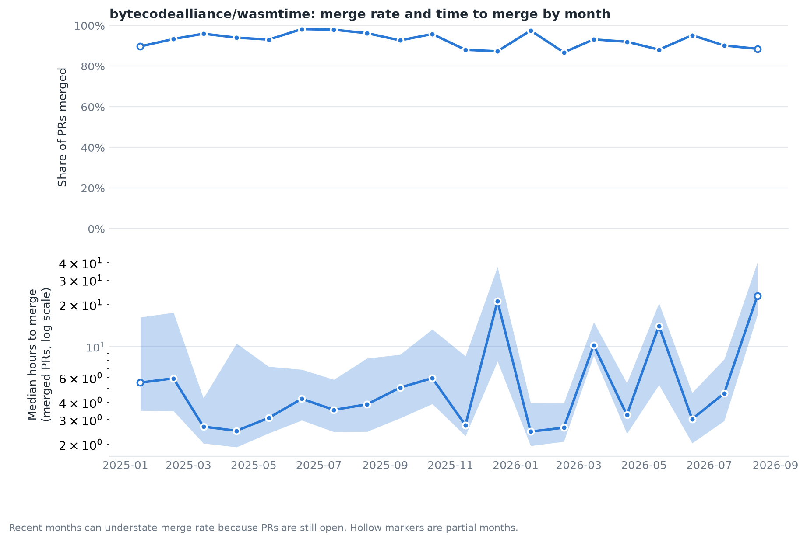
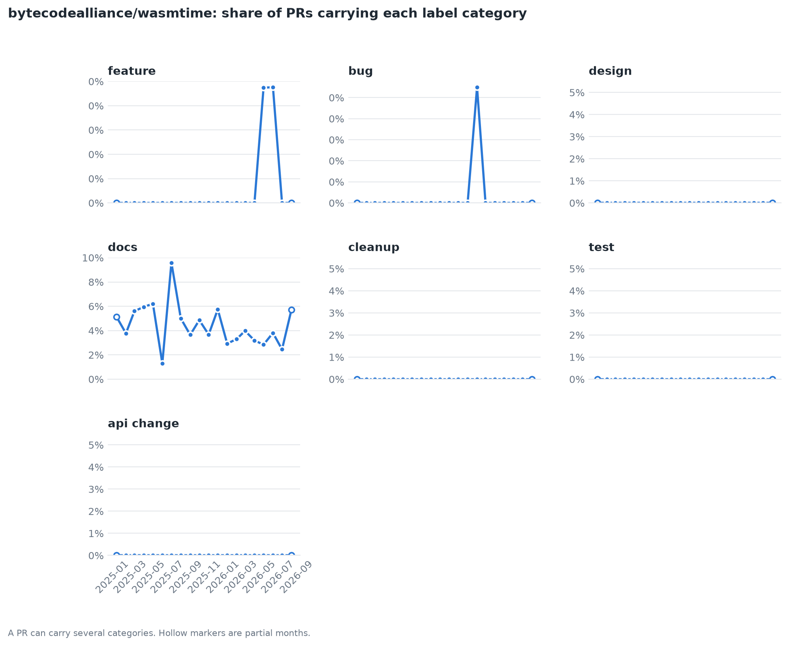
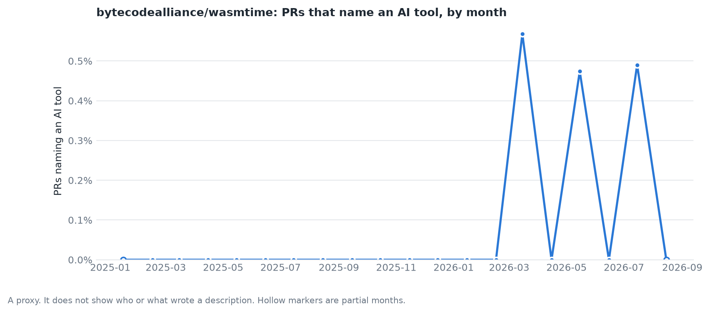

# Pull requests in bytecodealliance/wasmtime: description length, size, speed and labels

Window 2025-01-06 to 2026-08-17 (UTC). Data fetched 2026-11-20. prwords 3.0.0, generated 2026-11-26. Method fixed in advance in `docs/ANALYSIS_PLAN.md`.

## 1. Data

- Repository primary language: Rust
- Pull requests opened in the window: 3,263
- Removed as bot accounts: 2
- Analysed: 3,261 PRs from 294 authors
- Merged: 3,032 (93.0%). Closed without merging: 198 (6.1%). Still open: 31
- Follow-up: merge outcomes use a 30-day follow-up. PRs without enough follow-up: 0
- Empty descriptions after cleaning: 7.3%

## 2. Did the PR template change?

No template line appeared or disappeared with a share of 50% or more. Template text was detected monthly and removed before counting words.

Distinct template lines detected: 0.

## 3. First 28 days versus last 28 days

First window 2025-01-06 to 2025-02-02. Last window 2026-07-21 to 2026-08-17. Ratios are last median divided by first median. Bootstrap intervals, 2,000 resamples.

| Metric                                |   n first |   n last |   Median first |   Median last |   Ratio |   Ratio low |   Ratio high |      p |   Cliff's delta |
|:--------------------------------------|----------:|---------:|---------------:|--------------:|--------:|------------:|-------------:|-------:|----------------:|
| Description words (non-empty)         |       187 |      177 |          42    |         46    |    1.1  |        0.87 |         1.41 | 0.79   |           -0.02 |
| Files changed                         |       195 |      180 |           5    |          5.5  |    1.1  |        0.67 |         2.13 | 0.49   |            0.04 |
| Lines added                           |       195 |      180 |          57    |        138    |    2.42 |        1.3  |         4.5  | 0.0019 |            0.19 |
| Lines deleted                         |       195 |      180 |          13    |         18    |    1.38 |        0.78 |         2.67 | 0.25   |            0.07 |
| Net lines (added minus deleted)       |       195 |      180 |          18    |         67.5  |    3.75 |        1.59 |        10.69 | 0.02   |            0.14 |
| Lines changed (added plus deleted)    |       195 |      180 |          81    |        194    |    2.4  |        1.05 |         4.48 | 0.0021 |            0.18 |
| Hours from open to merge (merged PRs) |       175 |      162 |           5.53 |         13.72 |    2.48 |        0.44 |         4.66 | 0.14   |            0.09 |
| Commits                               |       195 |      180 |           2    |          1    |    0.5  |        0.5  |         1    | 0.023  |           -0.12 |
| Comments                              |       195 |      180 |           1    |          1    |    1    |        0    |         1    | 0.97   |           -0    |
| Reviews                               |       195 |      180 |           1    |          1    |    1    |        1    |         1    | 0.18   |           -0.06 |

| Measure                             |   n first |   n last | Share first   | Share last   |   Change (points) |      p |
|:------------------------------------|----------:|---------:|:--------------|:-------------|------------------:|-------:|
| Merged within follow-up period      |       195 |      180 | 88.2%         | 87.8%        |              -0.4 | 1      |
| Closed without merging              |       195 |      180 | 9.7%          | 9.4%         |              -0.3 | 1      |
| Opened as draft                     |       195 |      180 | 5.6%          | 1.1%         |              -4.5 | 0.022  |
| From outside contributors           |       195 |      180 | 33.3%         | 48.9%        |              15.6 | 0.0023 |
| Has a kind or type label            |       195 |      180 | 0.0%          | 0.0%         |               0   | 1      |
| Description text repeated elsewhere |       195 |      180 | 0.0%          | 1.1%         |               1.1 | 0.23   |
| Names an AI tool (disclosure)       |       195 |      180 | 0.0%          | 0.6%         |               0.6 | 0.48   |
| Label category: feature             |       195 |      180 | 0.0%          | 0.0%         |               0   | 1      |
| Label category: bug                 |       195 |      180 | 0.0%          | 0.0%         |               0   | 1      |
| Label category: design              |       195 |      180 | 0.0%          | 0.0%         |               0   | 1      |
| Label category: docs                |       195 |      180 | 5.1%          | 3.3%         |              -1.8 | 0.45   |
| Label category: cleanup             |       195 |      180 | 0.0%          | 0.0%         |               0   | 1      |
| Label category: test                |       195 |      180 | 0.0%          | 0.0%         |               0   | 1      |
| Label category: api_change          |       195 |      180 | 0.0%          | 0.0%         |               0   | 1      |

## 4. Monthly trends

Theil-Sen slope per month and Kendall tau over full months only.

| metric                     |   months |   slope_per_month |   slope_ci_low |   slope_ci_high |     tau |       p |
|:---------------------------|---------:|------------------:|---------------:|----------------:|--------:|--------:|
| median_words               |       18 |             0.5   |         -0.125 |           0.962 |   0.283 |   0.109 |
| median_files_changed       |       18 |            -0     |         -0.125 |          -0     |  -0.071 |   0.71  |
| median_additions           |       18 |             1.5   |         -0.944 |           3.625 |   0.19  |   0.293 |
| median_deletions           |       18 |            -0.5   |         -1.214 |           0.5   |  -0.198 |   0.255 |
| median_churn               |       18 |             0.192 |         -2.909 |           4.214 |   0.007 |   1     |
| median_hours_to_merge      |       18 |             0.07  |         -0.099 |           0.463 |   0.15  |   0.41  |
| merge_rate                 |       18 |            -0.003 |         -0.006 |           0     |  -0.32  |   0.068 |
| share_outside_contributors |       18 |            -0.002 |         -0.007 |           0.004 |  -0.098 |   0.601 |
| share_ai_disclosed         |       18 |            -0     |         -0     |          -0     |   0.443 |   0.025 |
| median_comments            |       18 |            -0     |         -0     |          -0     |  -0.194 |   0.339 |
| median_reviews             |       18 |            -0     |         -0     |          -0     | nan     | nan     |
| share_feature              |       18 |            -0     |         -0     |          -0     |   0.408 |   0.042 |
| share_bug                  |       18 |            -0     |         -0     |          -0     |   0.137 |   0.5   |
| share_design               |       18 |            -0     |         -0     |          -0     | nan     | nan     |
| share_docs                 |       18 |            -0.002 |         -0.003 |          -0     |  -0.386 |   0.026 |
| share_cleanup              |       18 |            -0     |         -0     |          -0     | nan     | nan     |
| share_test                 |       18 |            -0     |         -0     |          -0     | nan     | nan     |
| share_api_change           |       18 |            -0     |         -0     |          -0     | nan     | nan     |

## 5. Labels

Share of PRs with a kind or type label: 0.0% overall. Label coverage by month is in `monthly_summary.csv` (`share_has_kind_label`).

| category            |   n_prs |   share |   median_words |   median_files |   median_churn |   merge_rate |   median_hours_to_merge |   share_ai_disclosed |
|:--------------------|--------:|--------:|---------------:|---------------:|---------------:|-------------:|------------------------:|---------------------:|
| feature             |       2 |   0.001 |           89.5 |              4 |          125.5 |        1     |                 242.827 |                0     |
| bug                 |       1 |   0     |           41   |              5 |           95   |        1     |                   0.719 |                0     |
| design              |       0 |   0     |          nan   |            nan |          nan   |      nan     |                 nan     |              nan     |
| docs                |     136 |   0.042 |           69.5 |              2 |           76   |        0.904 |                  15.917 |                0     |
| cleanup             |       0 |   0     |          nan   |            nan |          nan   |      nan     |                 nan     |              nan     |
| test                |       0 |   0     |          nan   |            nan |          nan   |      nan     |                 nan     |              nan     |
| api_change          |       0 |   0     |          nan   |            nan |          nan   |      nan     |                 nan     |              nan     |
| (no category label) |    3122 |   0.957 |           43   |              4 |          107   |        0.931 |                   4.118 |                0.001 |

## 6. Are PRs with signs of AI involvement smaller or larger?

Authorship is not observable. The proxy is `ai_disclosed`, defined in the analysis plan: 3 PRs (0.09%). 3 disclosed PRs are listed in `ai_disclosure_samples.csv` for manual audit.

### ai_disclosed

**Verdict: not testable.** Too few exposed PRs.

Pattern: lines changed: not estimated; files changed: not estimated; lines added: not estimated; lines deleted: not estimated; hours to merge: not estimated.

Not estimated: fewer than 30 exposed PRs (exposed PRs: 3).

### Robustness by tool (lines changed)

| tool        |   n exposed | status                    |
|:------------|------------:|:--------------------------|
| unspecified |           3 | fewer than 30 exposed PRs |

### File type check

Not run. Use `--file-check N` to sample N exposed PRs and matching unexposed PRs.

## 7. Other checks

- Outside contributors: 28.6% of PRs overall.
- Top 10 authors opened 74.4% of PRs.
- PRs whose description text is repeated elsewhere (10 or more words): 1.6%.

## 8. Limitations

- Word count and size describe PRs, not who wrote them. Proxies for AI involvement are noisy and omit undisclosed use.
- Added and deleted lines include generated or vendored files unless the project avoids committing them.
- Disclosure mostly captures tools that add attribution by default, so it is tool-skewed.
- Template removal is heuristic. Check `template_audit.csv`.
- One repository cannot support general claims. See the plan for replication.
- Months at the edges of the window are partial and are excluded from trend tests.

