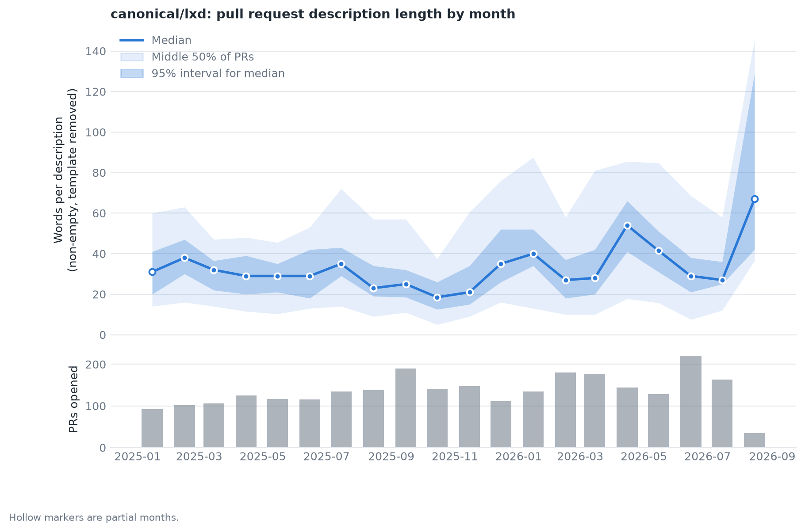
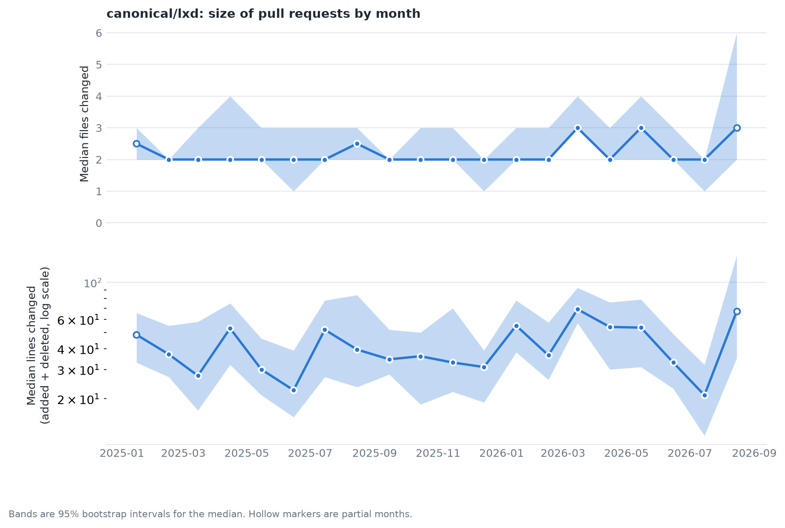
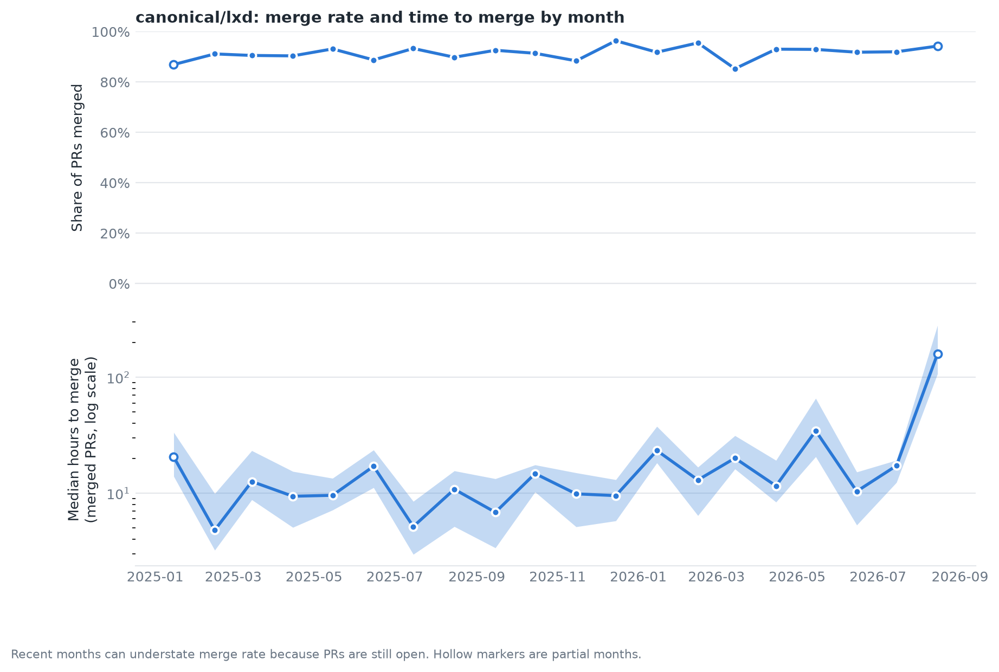
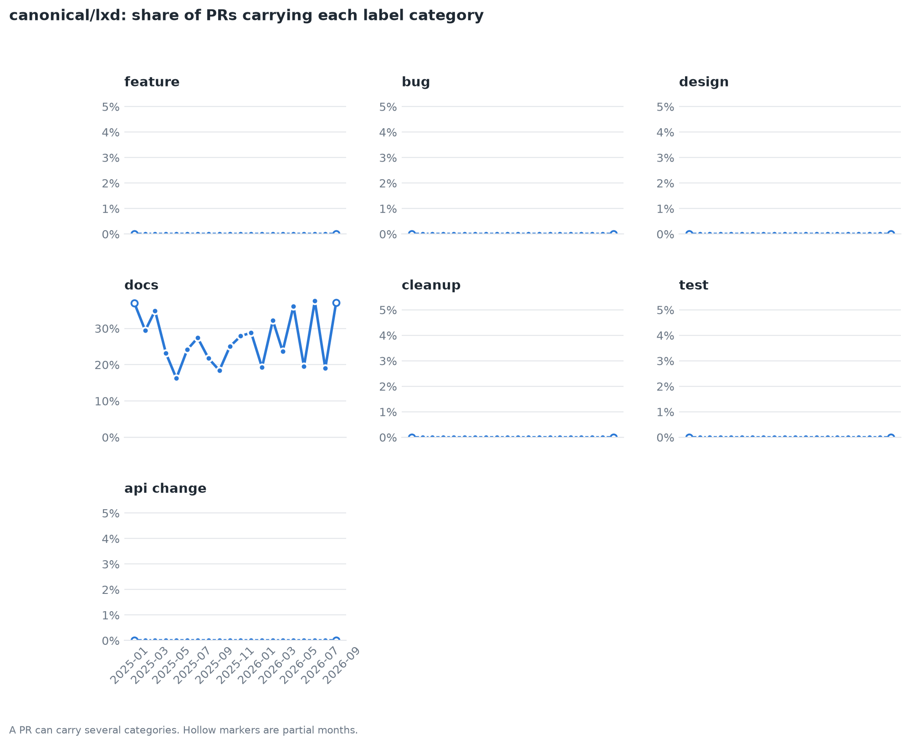
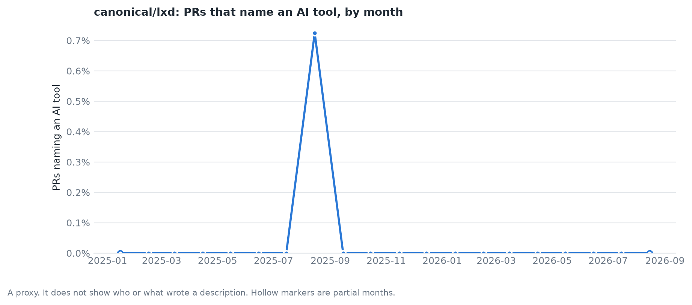

# Pull requests in canonical/lxd: description length, size, speed and labels

Window 2025-01-06 to 2026-08-17 (UTC). Data fetched 2026-11-20. prwords 3.0.0, generated 2026-11-26. Method fixed in advance in `docs/ANALYSIS_PLAN.md`.

## 1. Data

- Repository primary language: Go
- Pull requests opened in the window: 3,527
- Removed as bot accounts: 825
- Analysed: 2,702 PRs from 81 authors
- Merged: 2,471 (91.5%). Closed without merging: 221 (8.2%). Still open: 10
- Follow-up: merge outcomes use a 30-day follow-up. PRs without enough follow-up: 0
- Empty descriptions after cleaning: 27.3%

## 2. Did the PR template change?

No template line appeared or disappeared with a share of 50% or more. Template text was detected monthly and removed before counting words.

Distinct template lines detected: 3.

## 3. First 28 days versus last 28 days

First window 2025-01-06 to 2025-02-02. Last window 2026-07-21 to 2026-08-17. Ratios are last median divided by first median. Bootstrap intervals, 2,000 resamples.

| Metric                                |   n first |   n last |   Median first |   Median last |   Ratio |   Ratio low |   Ratio high |      p |   Cliff's delta |
|:--------------------------------------|----------:|---------:|---------------:|--------------:|--------:|------------:|-------------:|-------:|----------------:|
| Description words (non-empty)         |        81 |       58 |          31    |         47.5  |    1.53 |        0.97 |         3.08 | 0.049  |            0.2  |
| Files changed                         |        92 |       76 |           2.5  |          3    |    1.2  |        0.67 |         1.5  | 0.85   |            0.02 |
| Lines added                           |        92 |       76 |          31    |         39    |    1.26 |        0.69 |         2.83 | 0.83   |            0.02 |
| Lines deleted                         |        92 |       76 |          13.5  |          5    |    0.37 |        0.13 |         1.26 | 0.1    |           -0.15 |
| Net lines (added minus deleted)       |        92 |       76 |           7.5  |         19.5  |    2.6  |        0.56 |         5.78 | 0.099  |            0.15 |
| Lines changed (added plus deleted)    |        92 |       76 |          48.5  |         63    |    1.3  |        0.67 |         2.5  | 0.91   |            0.01 |
| Hours from open to merge (merged PRs) |        80 |       68 |          20.55 |         30.94 |    1.51 |        0.63 |         4.7  | 0.083  |            0.17 |
| Commits                               |        92 |       76 |           3    |          2    |    0.67 |        0.25 |         1    | 0.007  |           -0.24 |
| Comments                              |        92 |       76 |           0.5  |          1    |    2    |        0    |         2    | 0.75   |            0.03 |
| Reviews                               |        92 |       76 |           1    |          3    |    3    |        1    |         3    | 0.0035 |            0.26 |

| Measure                             |   n first |   n last | Share first   | Share last   |   Change (points) |      p |
|:------------------------------------|----------:|---------:|:--------------|:-------------|------------------:|-------:|
| Merged within follow-up period      |        92 |       76 | 85.9%         | 78.9%        |              -6.9 | 0.31   |
| Closed without merging              |        92 |       76 | 13.0%         | 9.2%         |              -3.8 | 0.47   |
| Opened as draft                     |        92 |       76 | 6.5%          | 7.9%         |               1.4 | 0.77   |
| From outside contributors           |        92 |       76 | 55.4%         | 40.8%        |             -14.6 | 0.065  |
| Has a kind or type label            |        92 |       76 | 0.0%          | 0.0%         |               0   | 1      |
| Description text repeated elsewhere |        92 |       76 | 0.0%          | 7.9%         |               7.9 | 0.0077 |
| Names an AI tool (disclosure)       |        92 |       76 | 0.0%          | 0.0%         |               0   | 1      |
| Label category: feature             |        92 |       76 | 0.0%          | 0.0%         |               0   | 1      |
| Label category: bug                 |        92 |       76 | 0.0%          | 0.0%         |               0   | 1      |
| Label category: design              |        92 |       76 | 0.0%          | 0.0%         |               0   | 1      |
| Label category: docs                |        92 |       76 | 37.0%         | 35.5%        |              -1.4 | 0.87   |
| Label category: cleanup             |        92 |       76 | 0.0%          | 0.0%         |               0   | 1      |
| Label category: test                |        92 |       76 | 0.0%          | 0.0%         |               0   | 1      |
| Label category: api_change          |        92 |       76 | 0.0%          | 0.0%         |               0   | 1      |

## 4. Monthly trends

Theil-Sen slope per month and Kendall tau over full months only.

| metric                     |   months |   slope_per_month |   slope_ci_low |   slope_ci_high |     tau |       p |
|:---------------------------|---------:|------------------:|---------------:|----------------:|--------:|--------:|
| median_words               |       18 |            -0     |         -0.8   |           0.857 |  -0.007 |   0.97  |
| median_files_changed       |       18 |            -0     |         -0     |          -0     |   0.224 |   0.263 |
| median_additions           |       18 |             0.143 |         -0.75  |           0.929 |   0.02  |   0.909 |
| median_deletions           |       18 |            -0.167 |         -0.5   |           0.429 |  -0.101 |   0.568 |
| median_churn               |       18 |             0.222 |         -0.875 |           1.75  |   0.092 |   0.596 |
| median_hours_to_merge      |       18 |             0.509 |          0.061 |           1.105 |   0.399 |   0.021 |
| merge_rate                 |       18 |             0.001 |         -0.002 |           0.003 |   0.124 |   0.501 |
| share_outside_contributors |       18 |            -0.007 |         -0.017 |           0.004 |  -0.203 |   0.26  |
| share_ai_disclosed         |       18 |            -0     |         -0     |          -0     |  -0.098 |   0.63  |
| median_comments            |       18 |            -0     |         -0     |          -0     |  -0.158 |   0.429 |
| median_reviews             |       18 |             0.077 |         -0     |           0.125 |   0.555 |   0.004 |
| share_feature              |       18 |            -0     |         -0     |          -0     | nan     | nan     |
| share_bug                  |       18 |            -0     |         -0     |          -0     | nan     | nan     |
| share_design               |       18 |            -0     |         -0     |          -0     | nan     | nan     |
| share_docs                 |       18 |             0.001 |         -0.007 |           0.009 |   0.059 |   0.765 |
| share_cleanup              |       18 |            -0     |         -0     |          -0     | nan     | nan     |
| share_test                 |       18 |            -0     |         -0     |          -0     | nan     | nan     |
| share_api_change           |       18 |            -0     |         -0     |          -0     | nan     | nan     |

## 5. Labels

Share of PRs with a kind or type label: 0.0% overall. Label coverage by month is in `monthly_summary.csv` (`share_has_kind_label`).

| category            |   n_prs |   share |   median_words |   median_files |   median_churn |   merge_rate |   median_hours_to_merge |   share_ai_disclosed |
|:--------------------|--------:|--------:|---------------:|---------------:|---------------:|-------------:|------------------------:|---------------------:|
| feature             |       0 |   0     |            nan |            nan |            nan |      nan     |                 nan     |              nan     |
| bug                 |       0 |   0     |            nan |            nan |            nan |      nan     |                 nan     |              nan     |
| design              |       0 |   0     |            nan |            nan |            nan |      nan     |                 nan     |              nan     |
| docs                |     717 |   0.265 |             36 |              4 |             65 |        0.915 |                  19.517 |                0     |
| cleanup             |       0 |   0     |            nan |            nan |            nan |      nan     |                 nan     |              nan     |
| test                |       0 |   0     |            nan |            nan |            nan |      nan     |                 nan     |              nan     |
| api_change          |       0 |   0     |            nan |            nan |            nan |      nan     |                 nan     |              nan     |
| (no category label) |    1985 |   0.735 |             29 |              2 |             34 |        0.914 |                  12.125 |                0.001 |

## 6. Are PRs with signs of AI involvement smaller or larger?

Authorship is not observable. The proxy is `ai_disclosed`, defined in the analysis plan: 1 PRs (0.04%). 1 disclosed PRs are listed in `ai_disclosure_samples.csv` for manual audit.

### ai_disclosed

**Verdict: not testable.** Too few exposed PRs.

Pattern: lines changed: not estimated; files changed: not estimated; lines added: not estimated; lines deleted: not estimated; hours to merge: not estimated.

Not estimated: fewer than 30 exposed PRs (exposed PRs: 1).

### Robustness by tool (lines changed)

| tool    |   n exposed | status                    |
|:--------|------------:|:--------------------------|
| copilot |           1 | fewer than 30 exposed PRs |

### File type check

Not run. Use `--file-check N` to sample N exposed PRs and matching unexposed PRs.

## 7. Other checks

- Outside contributors: 36.6% of PRs overall.
- Top 10 authors opened 88.0% of PRs.
- PRs whose description text is repeated elsewhere (10 or more words): 3.2%.

## 8. Limitations

- Word count and size describe PRs, not who wrote them. Proxies for AI involvement are noisy and omit undisclosed use.
- Added and deleted lines include generated or vendored files unless the project avoids committing them.
- Disclosure mostly captures tools that add attribution by default, so it is tool-skewed.
- Template removal is heuristic. Check `template_audit.csv`.
- One repository cannot support general claims. See the plan for replication.
- Months at the edges of the window are partial and are excluded from trend tests.

