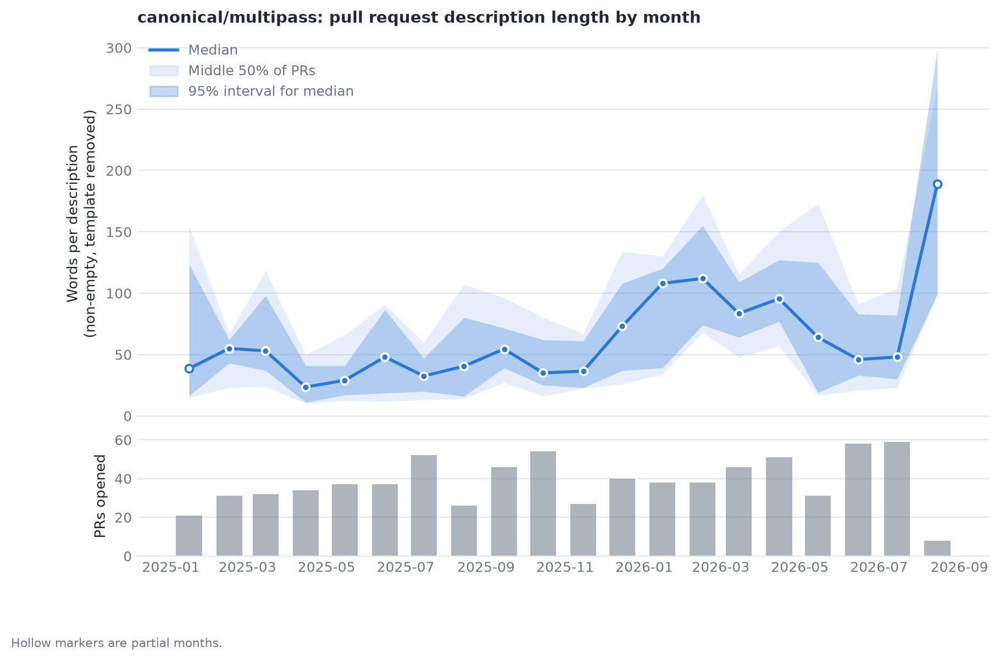
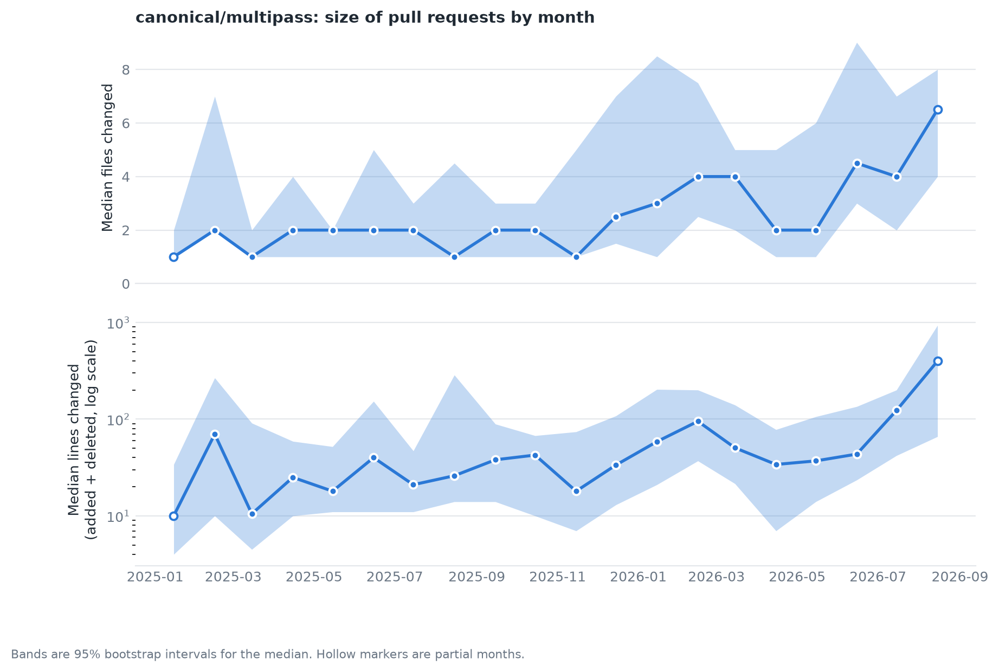
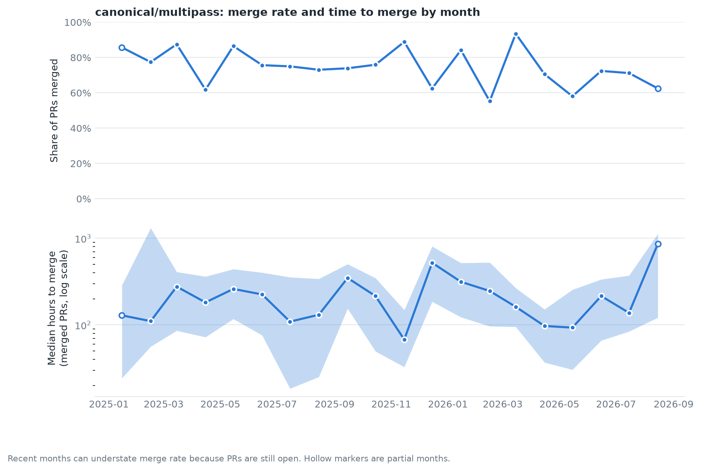
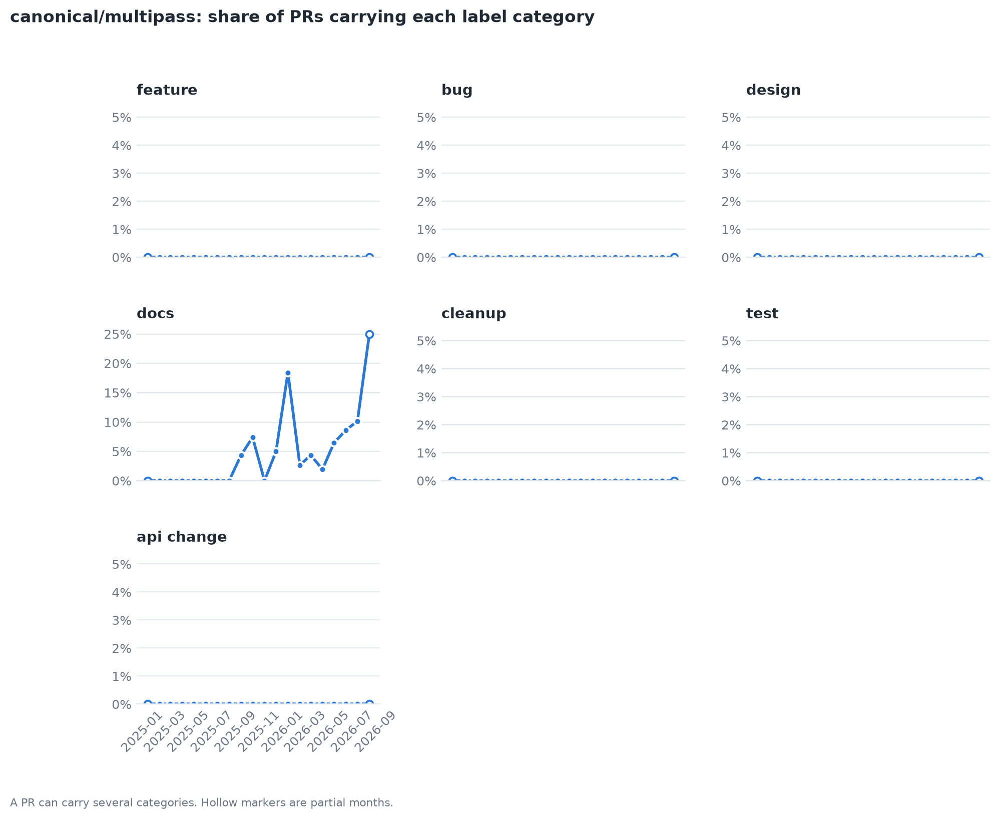
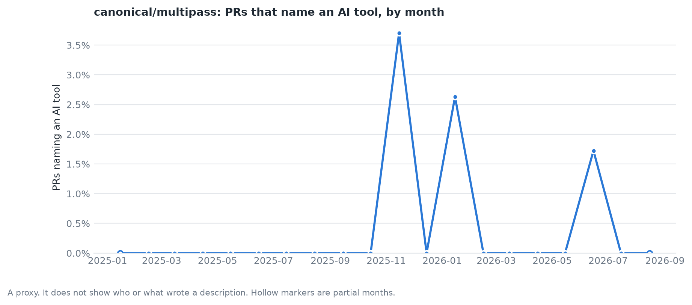

# Pull requests in canonical/multipass: description length, size, speed and labels

Window 2025-01-06 to 2026-08-17 (UTC). Data fetched 2026-11-20. prwords 3.0.0, generated 2026-11-26. Method fixed in advance in `docs/ANALYSIS_PLAN.md`.

## 1. Data

- Repository primary language: C++
- Pull requests opened in the window: 907
- Removed as bot accounts: 141
- Analysed: 766 PRs from 71 authors
- Merged: 572 (74.7%). Closed without merging: 156 (20.4%). Still open: 38
- Follow-up: merge outcomes use a 30-day follow-up. PRs without enough follow-up: 0
- Empty descriptions after cleaning: 8.2%

## 2. Did the PR template change?

Lines that appeared or disappeared across the window (full list in `template_audit.csv`):

| line                                                                     | first_month   | last_month   |   months |   peak_share | change_event   |
|:-------------------------------------------------------------------------|:--------------|:-------------|---------:|-------------:|:---------------|
| i have tested the changes locally                                        | 2026-02       | 2026-02      |        1 |         0.87 | removed        |
| i have updated documentation (if needed)                                 | 2026-02       | 2026-02      |        1 |         0.79 | removed        |
| i have added integration tests or no new ones were appropriate           | 2026-06       | 2026-08      |        3 |         0.61 | added          |
| i have added unit tests or no new ones were appropriate                  | 2026-06       | 2026-08      |        3 |         0.61 | added          |
| i have tested the changes locally or no specific testing was appropriate | 2026-06       | 2026-08      |        3 |         0.61 | added          |
| i have updated documentation or no changes were appropriate              | 2026-06       | 2026-08      |        3 |         0.61 | added          |

Distinct template lines detected: 11.

## 3. First 28 days versus last 28 days

First window 2025-01-06 to 2025-02-02. Last window 2026-07-21 to 2026-08-17. Ratios are last median divided by first median. Bootstrap intervals, 2,000 resamples.

| Metric                                |   n first |   n last |   Median first |   Median last |   Ratio |   Ratio low |   Ratio high |       p |   Cliff's delta |
|:--------------------------------------|----------:|---------:|---------------:|--------------:|--------:|------------:|-------------:|--------:|----------------:|
| Description words (non-empty)         |        20 |       23 |          38.5  |            82 |    2.13 |        0.48 |         6.6  | 0.34    |            0.17 |
| Files changed                         |        21 |       23 |           1    |             5 |    5    |        1.5  |         8    | 0.016   |            0.41 |
| Lines added                           |        21 |       23 |           5    |           190 |   38    |        3.68 |       157.67 | 0.00049 |            0.61 |
| Lines deleted                         |        21 |       23 |           2    |            24 |   12    |        1    |        61    | 0.032   |            0.38 |
| Net lines (added minus deleted)       |        21 |       23 |           2    |            75 |   37.5  |        0.5  |       169.5  | 0.015   |            0.43 |
| Lines changed (added plus deleted)    |        21 |       23 |          10    |           199 |   19.9  |        3.68 |       147.75 | 0.0008  |            0.59 |
| Hours from open to merge (merged PRs) |        18 |       14 |         128.93 |           560 |    4.34 |        0.65 |        25.02 | 0.024   |            0.48 |
| Commits                               |        21 |       23 |           1    |             3 |    3    |        1    |        10    | 0.026   |            0.38 |
| Comments                              |        21 |       23 |           2    |             1 |    0.5  |        0.33 |         2    | 0.25    |           -0.2  |
| Reviews                               |        21 |       23 |           2    |             4 |    2    |        0.33 |         6.5  | 0.49    |            0.12 |

| Measure                             |   n first |   n last | Share first   | Share last   |   Change (points) |     p |
|:------------------------------------|----------:|---------:|:--------------|:-------------|------------------:|------:|
| Merged within follow-up period      |        21 |       23 | 76.2%         | 39.1%        |             -37.1 | 0.017 |
| Closed without merging              |        21 |       23 | 14.3%         | 17.4%        |               3.1 | 1     |
| Opened as draft                     |        21 |       23 | 0.0%          | 8.7%         |               8.7 | 0.49  |
| From outside contributors           |        21 |       23 | 85.7%         | 43.5%        |             -42.2 | 0.005 |
| Has a kind or type label            |        21 |       23 | 0.0%          | 0.0%         |               0   | 1     |
| Description text repeated elsewhere |        21 |       23 | 0.0%          | 4.3%         |               4.3 | 1     |
| Names an AI tool (disclosure)       |        21 |       23 | 0.0%          | 0.0%         |               0   | 1     |
| Label category: feature             |        21 |       23 | 0.0%          | 0.0%         |               0   | 1     |
| Label category: bug                 |        21 |       23 | 0.0%          | 0.0%         |               0   | 1     |
| Label category: design              |        21 |       23 | 0.0%          | 0.0%         |               0   | 1     |
| Label category: docs                |        21 |       23 | 0.0%          | 17.4%        |              17.4 | 0.11  |
| Label category: cleanup             |        21 |       23 | 0.0%          | 0.0%         |               0   | 1     |
| Label category: test                |        21 |       23 | 0.0%          | 0.0%         |               0   | 1     |
| Label category: api_change          |        21 |       23 | 0.0%          | 0.0%         |               0   | 1     |

## 4. Monthly trends

Theil-Sen slope per month and Kendall tau over full months only.

| metric                     |   months |   slope_per_month |   slope_ci_low |   slope_ci_high |     tau |       p |
|:---------------------------|---------:|------------------:|---------------:|----------------:|--------:|--------:|
| median_words               |       18 |             1.8   |         -0.167 |           4.833 |   0.315 |   0.069 |
| median_files_changed       |       18 |             0.125 |         -0     |           0.2   |   0.514 |   0.006 |
| median_additions           |       18 |             1.9   |          0.75  |           3.75  |   0.507 |   0.003 |
| median_deletions           |       18 |             0.286 |         -0.091 |           0.846 |   0.25  |   0.157 |
| median_churn               |       18 |             2.083 |          0.292 |           4.75  |   0.393 |   0.023 |
| median_hours_to_merge      |       18 |            -2.928 |        -12.757 |           6.586 |  -0.15  |   0.41  |
| merge_rate                 |       18 |            -0.005 |         -0.017 |           0.006 |  -0.242 |   0.175 |
| share_outside_contributors |       18 |            -0.003 |         -0.016 |           0.01  |  -0.131 |   0.448 |
| share_ai_disclosed         |       18 |            -0     |         -0     |          -0     |   0.21  |   0.289 |
| median_comments            |       18 |            -0.033 |         -0.125 |          -0     |  -0.426 |   0.025 |
| median_reviews             |       18 |            -0     |         -0.143 |          -0     |  -0.173 |   0.358 |
| share_feature              |       18 |            -0     |         -0     |          -0     | nan     | nan     |
| share_bug                  |       18 |            -0     |         -0     |          -0     | nan     | nan     |
| share_design               |       18 |            -0     |         -0     |          -0     | nan     | nan     |
| share_docs                 |       18 |             0.005 |          0.002 |           0.007 |   0.61  |   0.001 |
| share_cleanup              |       18 |            -0     |         -0     |          -0     | nan     | nan     |
| share_test                 |       18 |            -0     |         -0     |          -0     | nan     | nan     |
| share_api_change           |       18 |            -0     |         -0     |          -0     | nan     | nan     |

## 5. Labels

Share of PRs with a kind or type label: 0.0% overall. Label coverage by month is in `monthly_summary.csv` (`share_has_kind_label`).

| category            |   n_prs |   share |   median_words |   median_files |   median_churn |   merge_rate |   median_hours_to_merge |   share_ai_disclosed |
|:--------------------|--------:|--------:|---------------:|---------------:|---------------:|-------------:|------------------------:|---------------------:|
| feature             |       0 |   0     |            nan |            nan |            nan |      nan     |                 nan     |              nan     |
| bug                 |       0 |   0     |            nan |            nan |            nan |      nan     |                 nan     |              nan     |
| design              |       0 |   0     |            nan |            nan |            nan |      nan     |                 nan     |              nan     |
| docs                |      34 |   0.044 |             65 |              3 |             53 |        0.853 |                 452.918 |                0     |
| cleanup             |       0 |   0     |            nan |            nan |            nan |      nan     |                 nan     |              nan     |
| test                |       0 |   0     |            nan |            nan |            nan |      nan     |                 nan     |              nan     |
| api_change          |       0 |   0     |            nan |            nan |            nan |      nan     |                 nan     |              nan     |
| (no category label) |     732 |   0.956 |             56 |              2 |             37 |        0.742 |                 173.725 |                0.004 |

## 6. Are PRs with signs of AI involvement smaller or larger?

Authorship is not observable. The proxy is `ai_disclosed`, defined in the analysis plan: 3 PRs (0.39%). 3 disclosed PRs are listed in `ai_disclosure_samples.csv` for manual audit.

### ai_disclosed

**Verdict: not testable.** Too few exposed PRs.

Pattern: lines changed: not estimated; files changed: not estimated; lines added: not estimated; lines deleted: not estimated; hours to merge: not estimated.

Not estimated: fewer than 30 exposed PRs (exposed PRs: 3).

### Robustness by tool (lines changed)

| tool        |   n exposed | status                    |
|:------------|------------:|:--------------------------|
| unspecified |           3 | fewer than 30 exposed PRs |

### File type check

Not run. Use `--file-check N` to sample N exposed PRs and matching unexposed PRs.

## 7. Other checks

- Outside contributors: 37.5% of PRs overall.
- Top 10 authors opened 85.4% of PRs.
- PRs whose description text is repeated elsewhere (10 or more words): 0.9%.

## 8. Limitations

- Word count and size describe PRs, not who wrote them. Proxies for AI involvement are noisy and omit undisclosed use.
- Added and deleted lines include generated or vendored files unless the project avoids committing them.
- Disclosure mostly captures tools that add attribution by default, so it is tool-skewed.
- Template removal is heuristic. Check `template_audit.csv`.
- One repository cannot support general claims. See the plan for replication.
- Months at the edges of the window are partial and are excluded from trend tests.

