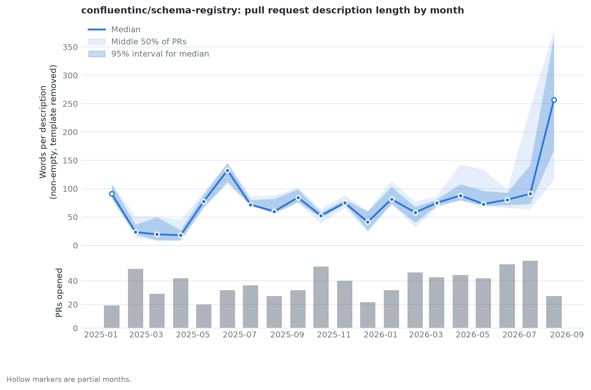
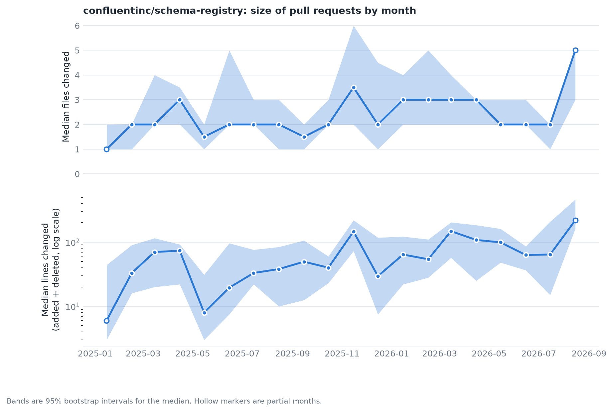
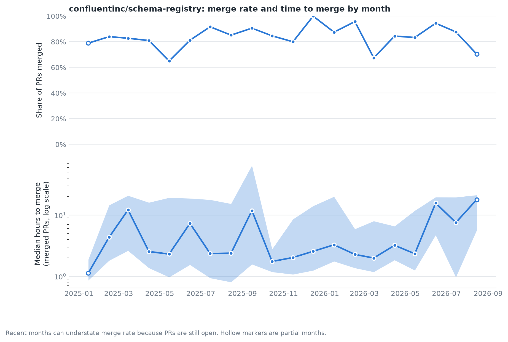
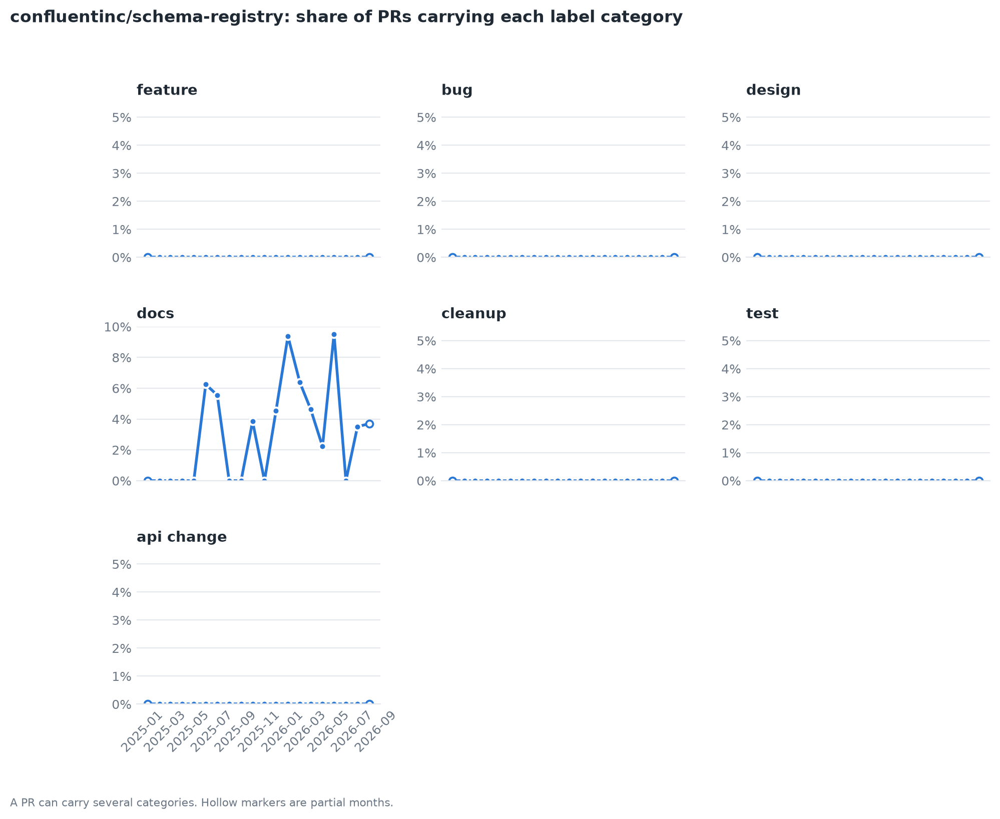
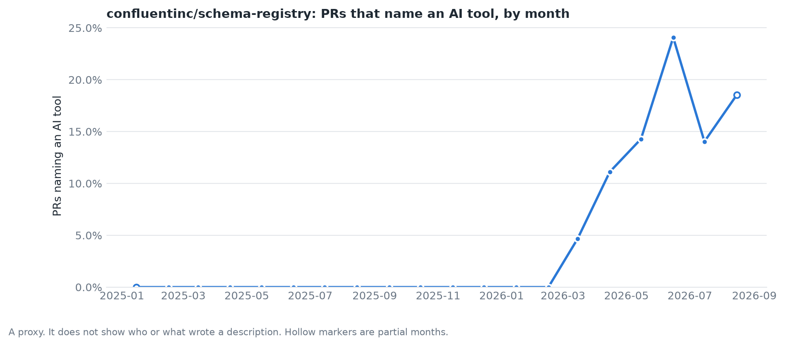
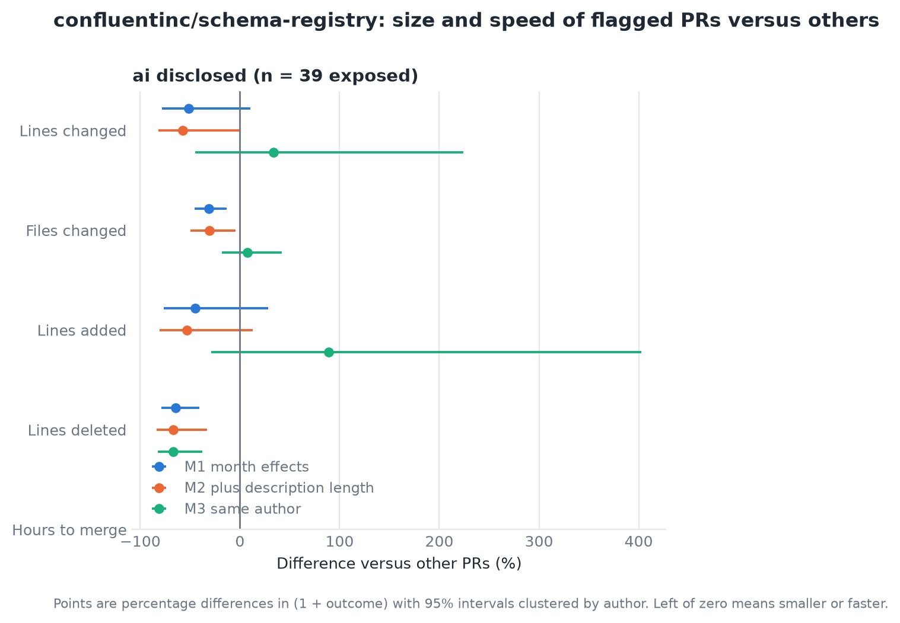

# Pull requests in confluentinc/schema-registry: description length, size, speed and labels

Window 2025-01-06 to 2026-08-17 (UTC). Data fetched 2026-11-20. prwords 3.0.0, generated 2026-11-26. Method fixed in advance in `docs/ANALYSIS_PLAN.md`.

## 1. Data

- Repository primary language: Java
- Pull requests opened in the window: 910
- Removed as bot accounts: 162
- Analysed: 748 PRs from 59 authors
- Merged: 632 (84.5%). Closed without merging: 108 (14.4%). Still open: 8
- Follow-up: merge outcomes use a 30-day follow-up. PRs without enough follow-up: 0
- Empty descriptions after cleaning: 4.8%

## 2. Did the PR template change?

Lines that appeared or disappeared across the window (full list in `template_audit.csv`):

| line                                                                                             | first_month   | last_month   |   months |   peak_share | change_event   |
|:-------------------------------------------------------------------------------------------------|:--------------|:-------------|---------:|-------------:|:---------------|
| list the ld flags needed to be set to enable this change                                         | 2025-02       | 2025-05      |        4 |         1    | removed        |
| does this change require modifying existing system tests or adding new system tests?             | 2025-02       | 2025-05      |        4 |         0.95 | removed        |
| is this change gated behind feature flag(s)?                                                     | 2025-02       | 2025-05      |        4 |         0.95 | removed        |
| did you add sufficient unit test and/or integration test coverage for this pr?                   | 2025-02       | 2025-05      |        4 |         0.93 | removed        |
| contains customer facing changes? including api/behavior changes                                 | 2025-02       | 2025-05      |        4 |         0.9  | removed        |
| if so, please include the link(s) to the changes that must be released together                  | 2025-07       | 2026-08      |       14 |         1    | added          |
| list the config(s) needed to be set to enable this change                                        | 2025-07       | 2026-08      |       14 |         1    | added          |
| please answer the questions with y, n or n/a if not applicable.                                  | 2025-07       | 2026-08      |       14 |         1    | added          |
| **[n]** does this change require modifying existing system tests or adding new system tests?     | 2025-08       | 2026-08      |        5 |         0.66 | added          |
| **[n]** is this change gated behind config(s)?                                                   | 2025-08       | 2026-02      |        4 |         0.66 | added          |
| **[n]** must this be released together with other change(s), either in this repo or another one? | 2025-08       | 2026-02      |        4 |         0.65 | added          |

Distinct template lines detected: 25.

## 3. First 28 days versus last 28 days

First window 2025-01-06 to 2025-02-02. Last window 2026-07-21 to 2026-08-17. Ratios are last median divided by first median. Bootstrap intervals, 2,000 resamples.

| Metric                                |   n first |   n last |   Median first |   Median last |   Ratio |   Ratio low |   Ratio high |       p |   Cliff's delta |
|:--------------------------------------|----------:|---------:|---------------:|--------------:|--------:|------------:|-------------:|--------:|----------------:|
| Description words (non-empty)         |        19 |       48 |          91    |        175.5  |    1.93 |        1.08 |         3.33 | 0.019   |            0.37 |
| Files changed                         |        19 |       48 |           1    |          3    |    3    |        1.5  |         4.5  | 0.0066  |            0.42 |
| Lines added                           |        19 |       48 |           2    |        163.5  |   81.75 |        2.85 |       209.52 | 0.004   |            0.45 |
| Lines deleted                         |        19 |       48 |           2    |          4    |    2    |        0.75 |         6    | 0.37    |            0.14 |
| Net lines (added minus deleted)       |        19 |       48 |           0    |        149    |  nan    |        1.38 |         7.78 | 0.001   |            0.52 |
| Lines changed (added plus deleted)    |        19 |       48 |           6    |        166    |   27.67 |        2.27 |        72.5  | 0.0072  |            0.42 |
| Hours from open to merge (merged PRs) |        15 |       39 |           1.13 |         11.24 |    9.92 |        2.21 |        20.37 | 0.067   |            0.33 |
| Commits                               |        19 |       48 |           1    |          1    |    1    |        1    |         2.5  | 0.27    |            0.16 |
| Comments                              |        19 |       48 |           2    |          1    |    0.5  |        0.25 |         0.75 | 4.5e-06 |           -0.67 |
| Reviews                               |        19 |       48 |           1    |          1    |    1    |        1    |         2.5  | 0.028   |            0.33 |

| Measure                             |   n first |   n last | Share first   | Share last   |   Change (points) |     p |
|:------------------------------------|----------:|---------:|:--------------|:-------------|------------------:|------:|
| Merged within follow-up period      |        19 |       48 | 78.9%         | 79.2%        |               0.2 | 1     |
| Closed without merging              |        19 |       48 | 21.1%         | 18.8%        |              -2.3 | 1     |
| Opened as draft                     |        19 |       48 | 0.0%          | 0.0%         |               0   | 1     |
| From outside contributors           |        19 |       48 | 31.6%         | 27.1%        |              -4.5 | 0.77  |
| Has a kind or type label            |        19 |       48 | 0.0%          | 0.0%         |               0   | 1     |
| Description text repeated elsewhere |        19 |       48 | 31.6%         | 10.4%        |             -21.2 | 0.062 |
| Names an AI tool (disclosure)       |        19 |       48 | 0.0%          | 12.5%        |              12.5 | 0.17  |
| Label category: feature             |        19 |       48 | 0.0%          | 0.0%         |               0   | 1     |
| Label category: bug                 |        19 |       48 | 0.0%          | 0.0%         |               0   | 1     |
| Label category: design              |        19 |       48 | 0.0%          | 0.0%         |               0   | 1     |
| Label category: docs                |        19 |       48 | 0.0%          | 4.2%         |               4.2 | 1     |
| Label category: cleanup             |        19 |       48 | 0.0%          | 0.0%         |               0   | 1     |
| Label category: test                |        19 |       48 | 0.0%          | 0.0%         |               0   | 1     |
| Label category: api_change          |        19 |       48 | 0.0%          | 0.0%         |               0   | 1     |

## 4. Monthly trends

Theil-Sen slope per month and Kendall tau over full months only.

| metric                     |   months |   slope_per_month |   slope_ci_low |   slope_ci_high |     tau |       p |
|:---------------------------|---------:|------------------:|---------------:|----------------:|--------:|--------:|
| median_words               |       18 |             2.444 |         -0     |           4.625 |   0.341 |   0.049 |
| median_files_changed       |       18 |            -0     |         -0     |           0.071 |   0.189 |   0.329 |
| median_additions           |       18 |             2.636 |          0.367 |           5.5   |   0.38  |   0.028 |
| median_deletions           |       18 |            -0     |         -0.25  |           0.111 |  -0.106 |   0.56  |
| median_churn               |       18 |             2.875 |          0.5   |           6.773 |   0.362 |   0.037 |
| median_hours_to_merge      |       18 |            -0.005 |         -0.18  |           0.174 |  -0.033 |   0.881 |
| merge_rate                 |       18 |             0.003 |         -0.003 |           0.011 |   0.216 |   0.229 |
| share_outside_contributors |       18 |            -0.007 |         -0.018 |           0.009 |  -0.184 |   0.289 |
| share_ai_disclosed         |       18 |            -0     |         -0     |           0.01  |   0.663 |   0.001 |
| median_comments            |       18 |            -0.056 |         -0.1   |          -0     |  -0.63  |   0.001 |
| median_reviews             |       18 |            -0     |         -0     |          -0     |  -0.059 |   0.768 |
| share_feature              |       18 |            -0     |         -0     |          -0     | nan     | nan     |
| share_bug                  |       18 |            -0     |         -0     |          -0     | nan     | nan     |
| share_design               |       18 |            -0     |         -0     |          -0     | nan     | nan     |
| share_docs                 |       18 |             0.002 |         -0     |           0.005 |   0.311 |   0.087 |
| share_cleanup              |       18 |            -0     |         -0     |          -0     | nan     | nan     |
| share_test                 |       18 |            -0     |         -0     |          -0     | nan     | nan     |
| share_api_change           |       18 |            -0     |         -0     |          -0     | nan     | nan     |

## 5. Labels

Share of PRs with a kind or type label: 0.0% overall. Label coverage by month is in `monthly_summary.csv` (`share_has_kind_label`).

| category            |   n_prs |   share |   median_words |   median_files |   median_churn |   merge_rate |   median_hours_to_merge |   share_ai_disclosed |
|:--------------------|--------:|--------:|---------------:|---------------:|---------------:|-------------:|------------------------:|---------------------:|
| feature             |       0 |   0     |            nan |            nan |            nan |       nan    |                 nan     |              nan     |
| bug                 |       0 |   0     |            nan |            nan |            nan |       nan    |                 nan     |              nan     |
| design              |       0 |   0     |            nan |            nan |            nan |       nan    |                 nan     |              nan     |
| docs                |      23 |   0.031 |             82 |              7 |            198 |         1    |                  18.338 |                0     |
| cleanup             |       0 |   0     |            nan |            nan |            nan |       nan    |                 nan     |              nan     |
| test                |       0 |   0     |            nan |            nan |            nan |       nan    |                 nan     |              nan     |
| api_change          |       0 |   0     |            nan |            nan |            nan |       nan    |                 nan     |              nan     |
| (no category label) |     725 |   0.969 |             73 |              2 |             54 |         0.84 |                   2.826 |                0.054 |

## 6. Are PRs with signs of AI involvement smaller or larger?

Authorship is not observable. The proxy is `ai_disclosed`, defined in the analysis plan: 39 PRs (5.21%). 39 disclosed PRs are listed in `ai_disclosure_samples.csv` for manual audit.

### ai_disclosed

**Verdict: no difference detected.** The same-month interval for lines changed runs from -78.4% to +10.4%.

Pattern: lines changed: no clear difference; files changed: no clear difference; lines added: no clear difference; lines deleted: smaller; hours to merge: not estimated.

Within-author permutation p-value, lines changed: 0.1399.

| Outcome       | Model                      |   n |   n exposed |   Median exposed |   Median others | Difference (95% CI)      |       p |   p (Holm) |
|:--------------|:---------------------------|----:|------------:|-----------------:|----------------:|:-------------------------|--------:|-----------:|
| Lines changed | M1 month effects           | 748 |          39 |               64 |              59 | -51.2% (-78.4 to +10.4)  | 0.085   |    0.17    |
| Lines changed | M2 plus description length | 748 |          39 |               64 |              59 | -57.1% (-81.7 to +0.3)   | 0.051   |    0.1     |
| Lines changed | M3 same author             | 748 |          39 |               64 |              59 | +34.0% (-44.6 to +224.1) | 0.52    |    1       |
| Files changed | M1 month effects           | 748 |          39 |                2 |               2 | -31.3% (-45.6 to -13.1)  | 0.0017  |    0.0051  |
| Files changed | M2 plus description length | 748 |          39 |                2 |               2 | -30.6% (-49.7 to -4.2)   | 0.027   |    0.08    |
| Files changed | M3 same author             | 748 |          39 |                2 |               2 | +7.8% (-18.1 to +41.9)   | 0.59    |    1       |
| Lines added   | M1 month effects           | 748 |          39 |               63 |              43 | -44.9% (-76.3 to +28.2)  | 0.17    |    0.17    |
| Lines added   | M2 plus description length | 748 |          39 |               63 |              43 | -52.9% (-80.4 to +12.9)  | 0.091   |    0.1     |
| Lines added   | M3 same author             | 748 |          39 |               63 |              43 | +88.9% (-29.1 to +402.9) | 0.2     |    0.61    |
| Lines deleted | M1 month effects           | 748 |          39 |                1 |               4 | -64.6% (-78.8 to -40.7)  | 7.8e-05 |    0.00031 |
| Lines deleted | M2 plus description length | 748 |          39 |                1 |               4 | -66.8% (-83.5 to -33.3)  | 0.002   |    0.0078  |
| Lines deleted | M3 same author             | 748 |          39 |                1 |               4 | -67.0% (-82.5 to -37.6)  | 0.00064 |    0.0026  |

### Robustness by tool (lines changed)

| tool        |   n exposed | Same month             | Same author              | call                | status                    |
|:------------|------------:|:-----------------------|:-------------------------|:--------------------|:--------------------------|
| unspecified |          38 | -54.0% (-79.5 to +3.5) | +33.9% (-43.1 to +215.5) | no clear difference | ok                        |
| claude      |           1 | n/a                    | n/a                      | nan                 | fewer than 30 exposed PRs |

### File type check

Sample: 39 exposed and 39 unexposed PRs from the same months. 0 PRs with more than 100 files were excluded.

Share of changed lines by file type:

| group     |   n_prs | code   | tests   | docs   | config   | generated   | other   |   median_code_test_lines |
|:----------|--------:|:-------|:--------|:-------|:---------|:------------|:--------|-------------------------:|
| exposed   |      39 | 18.1%  | 79.8%   | 0.0%   | 0.0%     | 0.0%        | 2.1%    |                       64 |
| unexposed |      39 | 27.9%  | 63.9%   | 2.7%   | 0.0%     | 0.0%        | 5.5%    |                      130 |

Code and test lines only, same month: -69.6% (95% CI -91.7 to +11.2), p = 0.072. This is a robustness check and does not change the verdict.

## 7. Other checks

- Outside contributors: 31.1% of PRs overall.
- Top 10 authors opened 78.7% of PRs.
- PRs whose description text is repeated elsewhere (10 or more words): 21.1%.

## 8. Limitations

- Word count and size describe PRs, not who wrote them. Proxies for AI involvement are noisy and omit undisclosed use.
- Added and deleted lines include generated or vendored files unless the project avoids committing them.
- Disclosure mostly captures tools that add attribution by default, so it is tool-skewed.
- Template removal is heuristic. Check `template_audit.csv`.
- One repository cannot support general claims. See the plan for replication.
- Months at the edges of the window are partial and are excluded from trend tests.

