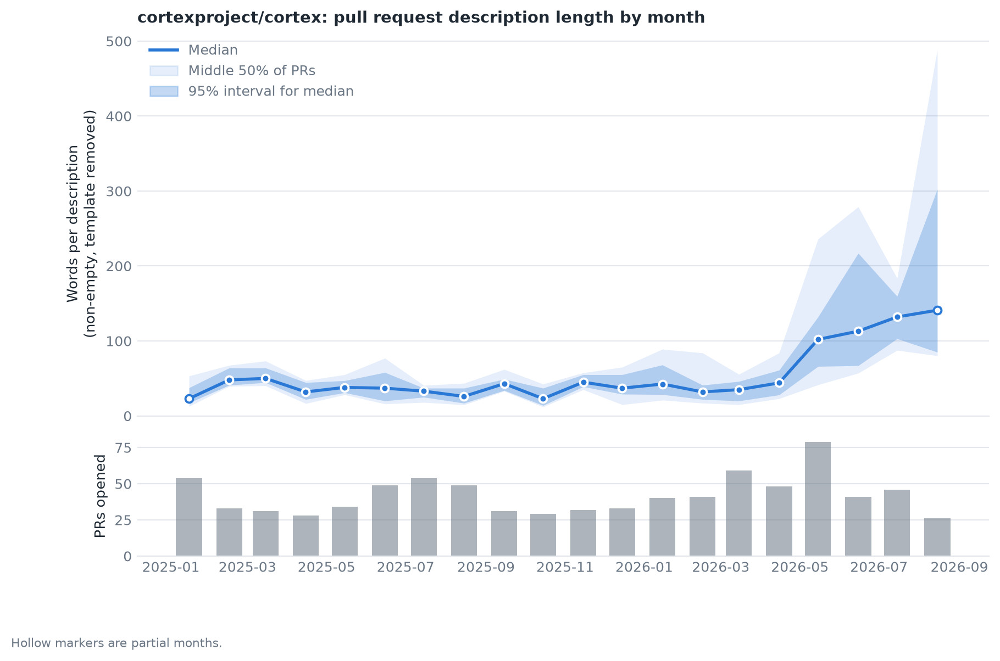
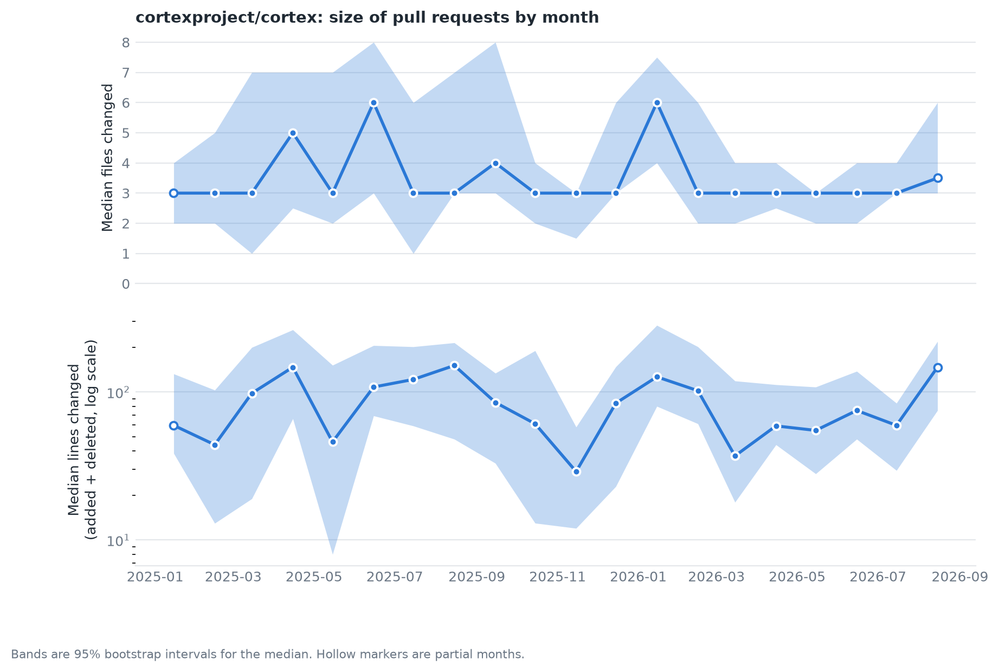
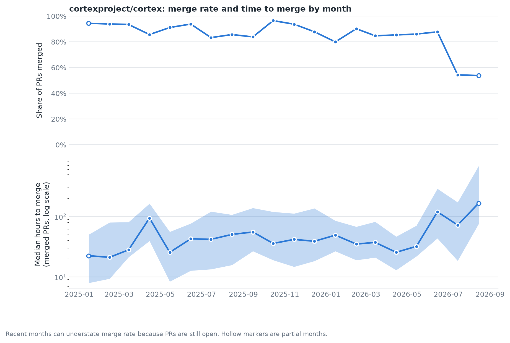
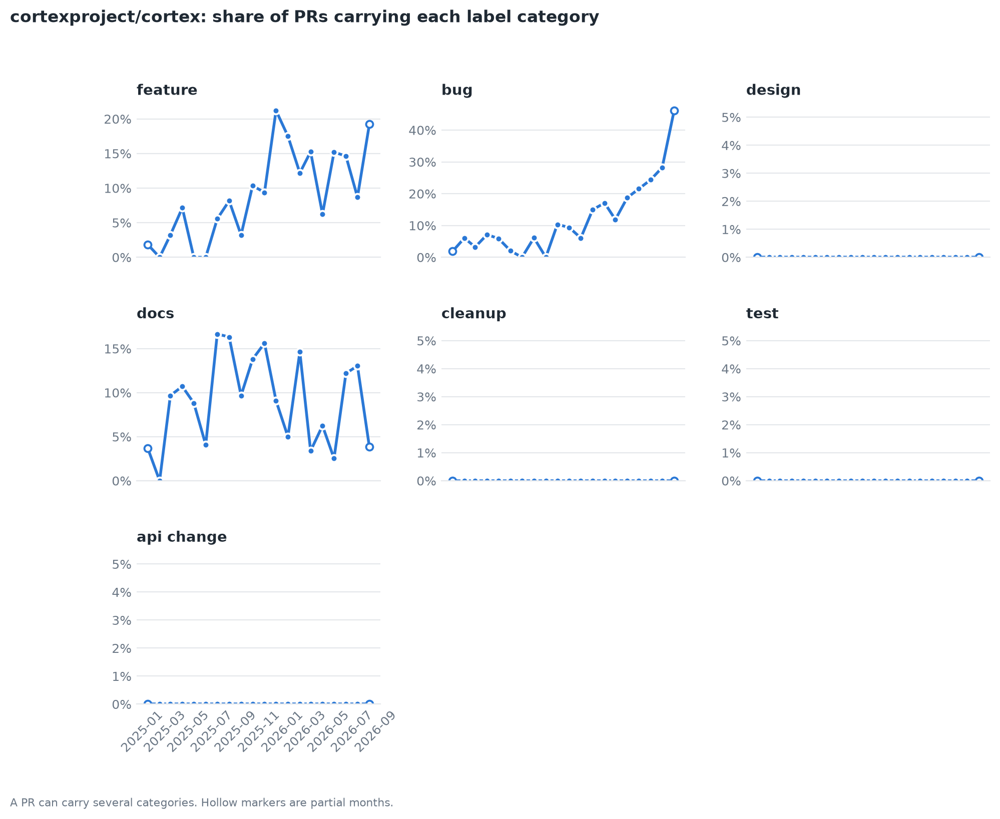
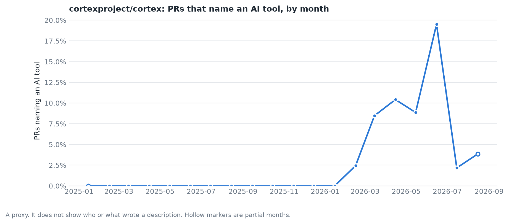

# Pull requests in cortexproject/cortex: description length, size, speed and labels

Window 2025-01-06 to 2026-08-17 (UTC). Data fetched 2026-11-20. prwords 3.0.0, generated 2026-11-26. Method fixed in advance in `docs/ANALYSIS_PLAN.md`.

## 1. Data

- Repository primary language: Go
- Pull requests opened in the window: 1,076
- Removed as bot accounts: 239
- Analysed: 837 PRs from 77 authors
- Merged: 715 (85.4%). Closed without merging: 66 (7.9%). Still open: 56
- Follow-up: merge outcomes use a 30-day follow-up. PRs without enough follow-up: 0
- Empty descriptions after cleaning: 1.6%

## 2. Did the PR template change?

Lines that appeared or disappeared across the window (full list in `template_audit.csv`):

| line                                                                                   | first_month   | last_month   |   months |   peak_share | change_event   |
|:---------------------------------------------------------------------------------------|:--------------|:-------------|---------:|-------------:|:---------------|
| fixes #                                                                                | 2025-01       | 2026-05      |        6 |         0.65 | removed        |
| `docs/configuration/v1-guarantees.md` updated if this pr introduces experimental flags | 2026-05       | 2026-08      |        2 |         0.57 | added          |

Distinct template lines detected: 8.

## 3. First 28 days versus last 28 days

First window 2025-01-06 to 2025-02-02. Last window 2026-07-21 to 2026-08-17. Ratios are last median divided by first median. Bootstrap intervals, 2,000 resamples.

| Metric                                |   n first |   n last |   Median first |   Median last |   Ratio |   Ratio low |   Ratio high |       p |   Cliff's delta |
|:--------------------------------------|----------:|---------:|---------------:|--------------:|--------:|------------:|-------------:|--------:|----------------:|
| Description words (non-empty)         |        52 |       40 |          23    |        131.5  |    5.72 |        3.26 |         7.86 | 1.6e-09 |            0.74 |
| Files changed                         |        54 |       40 |           3    |          3.5  |    1.17 |        0.75 |         2    | 0.14    |            0.18 |
| Lines added                           |        54 |       40 |          55    |         93    |    1.69 |        0.68 |         4.78 | 0.13    |            0.18 |
| Lines deleted                         |        54 |       40 |           8    |          8.5  |    1.06 |        0.48 |         3.4  | 0.73    |            0.04 |
| Net lines (added minus deleted)       |        54 |       40 |          42    |         77    |    1.83 |        0.77 |         6.16 | 0.093   |            0.2  |
| Lines changed (added plus deleted)    |        54 |       40 |          59.5  |         94.5  |    1.59 |        0.61 |         3.3  | 0.16    |            0.17 |
| Hours from open to merge (merged PRs) |        51 |       25 |          22.49 |         71.17 |    3.16 |        0.69 |        10.25 | 0.041   |            0.29 |
| Commits                               |        54 |       40 |           2    |          2    |    1    |        1    |         2.5  | 0.15    |            0.17 |
| Comments                              |        54 |       40 |           0    |          0    |  nan    |      nan    |       nan    | 0.77    |            0.03 |
| Reviews                               |        54 |       40 |           2    |          1    |    0.5  |        0.5  |         1    | 0.031   |           -0.25 |

| Measure                             |   n first |   n last | Share first   | Share last   |   Change (points) |       p |
|:------------------------------------|----------:|---------:|:--------------|:-------------|------------------:|--------:|
| Merged within follow-up period      |        54 |       40 | 87.0%         | 52.5%        |             -34.5 | 0.00036 |
| Closed without merging              |        54 |       40 | 5.6%          | 10.0%        |               4.4 | 0.45    |
| Opened as draft                     |        54 |       40 | 1.9%          | 5.0%         |               3.1 | 0.57    |
| From outside contributors           |        54 |       40 | 42.6%         | 62.5%        |              19.9 | 0.064   |
| Has a kind or type label            |        54 |       40 | 7.4%          | 85.0%        |              77.6 | 4.2e-15 |
| Description text repeated elsewhere |        54 |       40 | 3.7%          | 2.5%         |              -1.2 | 1       |
| Names an AI tool (disclosure)       |        54 |       40 | 0.0%          | 2.5%         |               2.5 | 0.43    |
| Label category: feature             |        54 |       40 | 1.9%          | 12.5%        |              10.6 | 0.08    |
| Label category: bug                 |        54 |       40 | 1.9%          | 40.0%        |              38.1 | 1.7e-06 |
| Label category: design              |        54 |       40 | 0.0%          | 0.0%         |               0   | 1       |
| Label category: docs                |        54 |       40 | 3.7%          | 10.0%        |               6.3 | 0.4     |
| Label category: cleanup             |        54 |       40 | 0.0%          | 0.0%         |               0   | 1       |
| Label category: test                |        54 |       40 | 0.0%          | 0.0%         |               0   | 1       |
| Label category: api_change          |        54 |       40 | 0.0%          | 0.0%         |               0   | 1       |

## 4. Monthly trends

Theil-Sen slope per month and Kendall tau over full months only.

| metric                     |   months |   slope_per_month |   slope_ci_low |   slope_ci_high |     tau |       p |
|:---------------------------|---------:|------------------:|---------------:|----------------:|--------:|--------:|
| median_words               |       18 |             1.222 |         -0.333 |           5.333 |   0.23  |   0.184 |
| median_files_changed       |       18 |            -0     |         -0     |          -0     |  -0.197 |   0.318 |
| median_additions           |       18 |            -0.5   |         -3.833 |           2.071 |  -0.072 |   0.676 |
| median_deletions           |       18 |            -0.429 |         -0.6   |          -0     |  -0.313 |   0.074 |
| median_churn               |       18 |            -2.278 |         -6.25  |           1.938 |  -0.176 |   0.33  |
| median_hours_to_merge      |       18 |             0.914 |         -1.134 |           2.961 |   0.111 |   0.55  |
| merge_rate                 |       18 |            -0.005 |         -0.013 |           0     |  -0.315 |   0.069 |
| share_outside_contributors |       18 |            -0.004 |         -0.022 |           0.01  |  -0.079 |   0.649 |
| share_ai_disclosed         |       18 |             0.002 |         -0     |           0.007 |   0.65  |   0.001 |
| median_comments            |       18 |            -0     |         -0     |          -0     |  -0.314 |   0.122 |
| median_reviews             |       18 |            -0     |         -0.071 |          -0     |  -0.477 |   0.017 |
| share_feature              |       18 |             0.008 |          0.004 |           0.012 |   0.497 |   0.004 |
| share_bug                  |       18 |             0.014 |          0.009 |           0.019 |   0.651 |   0     |
| share_design               |       18 |            -0     |         -0     |          -0     | nan     | nan     |
| share_docs                 |       18 |            -0.001 |         -0.005 |           0.006 |  -0.026 |   0.879 |
| share_cleanup              |       18 |            -0     |         -0     |          -0     | nan     | nan     |
| share_test                 |       18 |            -0     |         -0     |          -0     | nan     | nan     |
| share_api_change           |       18 |            -0     |         -0     |          -0     | nan     | nan     |

## 5. Labels

Share of PRs with a kind or type label: 47.3% overall. Label coverage by month is in `monthly_summary.csv` (`share_has_kind_label`).

| category            |   n_prs |   share |   median_words |   median_files |   median_churn |   merge_rate |   median_hours_to_merge |   share_ai_disclosed |
|:--------------------|--------:|--------:|---------------:|---------------:|---------------:|-------------:|------------------------:|---------------------:|
| feature             |      76 |   0.091 |             66 |              8 |          345.5 |        0.737 |                 271.618 |                0.039 |
| bug                 |     101 |   0.121 |             89 |              3 |           69   |        0.772 |                  56.668 |                0.089 |
| design              |       0 |   0     |            nan |            nan |          nan   |      nan     |                 nan     |              nan     |
| docs                |      72 |   0.086 |             31 |              1 |           38   |        0.847 |                  48.573 |                0.014 |
| cleanup             |       0 |   0     |            nan |            nan |          nan   |      nan     |                 nan     |              nan     |
| test                |       0 |   0     |            nan |            nan |          nan   |      nan     |                 nan     |              nan     |
| api_change          |       0 |   0     |            nan |            nan |          nan   |      nan     |                 nan     |              nan     |
| (no category label) |     589 |   0.704 |             40 |              3 |           75   |        0.885 |                  33.596 |                0.025 |

Cross-check against the repository's own size labels (coverage 98.3%, Spearman rho between size label and lines changed 0.86):

| size_label   |   n_prs |   median_churn |   p10_churn |   p90_churn |
|:-------------|--------:|---------------:|------------:|------------:|
| XS           |     184 |              3 |           1 |          10 |
| S            |     125 |             18 |          11 |          29 |
| M            |     193 |             60 |          35 |          98 |
| L            |     238 |            193 |         109 |         466 |
| XL           |      46 |            745 |         547 |        1413 |
| XXL          |      37 |           1970 |        1257 |        5208 |

## 6. Are PRs with signs of AI involvement smaller or larger?

Authorship is not observable. The proxy is `ai_disclosed`, defined in the analysis plan: 28 PRs (3.35%). 28 disclosed PRs are listed in `ai_disclosure_samples.csv` for manual audit.

### ai_disclosed

**Verdict: not testable.** Too few exposed PRs.

Pattern: lines changed: not estimated; files changed: not estimated; lines added: not estimated; lines deleted: not estimated; hours to merge: not estimated.

Not estimated: fewer than 30 exposed PRs (exposed PRs: 28).

### Robustness by tool (lines changed)

| tool        |   n exposed | status                    |
|:------------|------------:|:--------------------------|
| unspecified |          26 | fewer than 30 exposed PRs |
| claude      |           2 | fewer than 30 exposed PRs |

### File type check

Not run. Use `--file-check N` to sample N exposed PRs and matching unexposed PRs.

## 7. Other checks

- Outside contributors: 54.2% of PRs overall.
- Top 10 authors opened 73.8% of PRs.
- PRs whose description text is repeated elsewhere (10 or more words): 3.7%.

## 8. Limitations

- Word count and size describe PRs, not who wrote them. Proxies for AI involvement are noisy and omit undisclosed use.
- Added and deleted lines include generated or vendored files unless the project avoids committing them.
- Disclosure mostly captures tools that add attribution by default, so it is tool-skewed.
- Template removal is heuristic. Check `template_audit.csv`.
- One repository cannot support general claims. See the plan for replication.
- Months at the edges of the window are partial and are excluded from trend tests.

