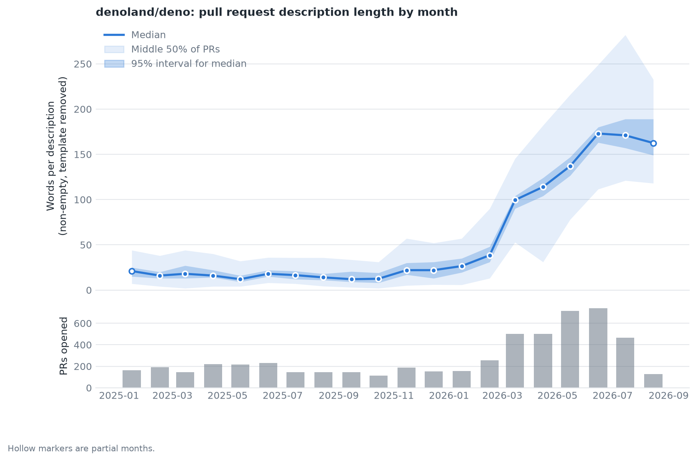
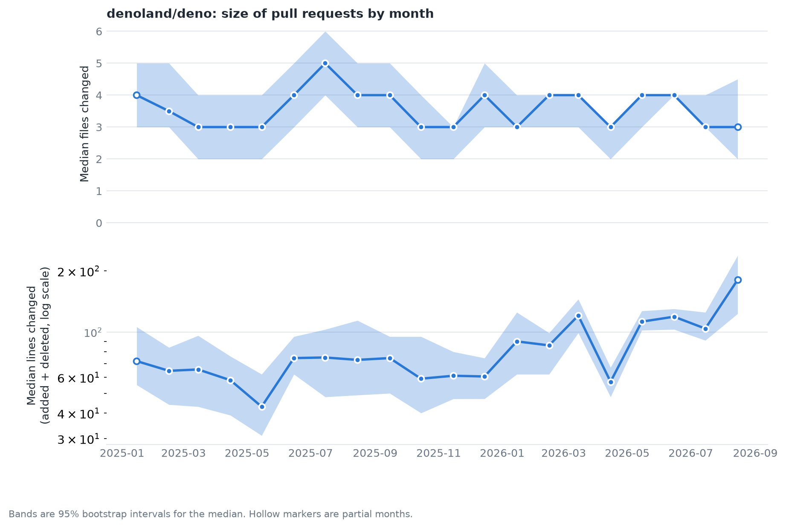
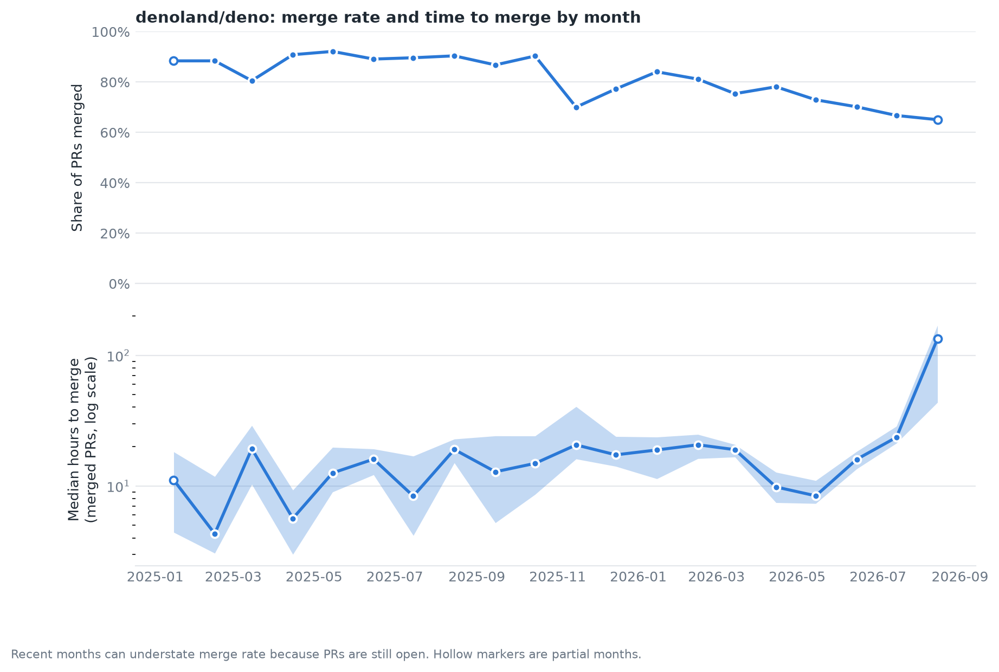
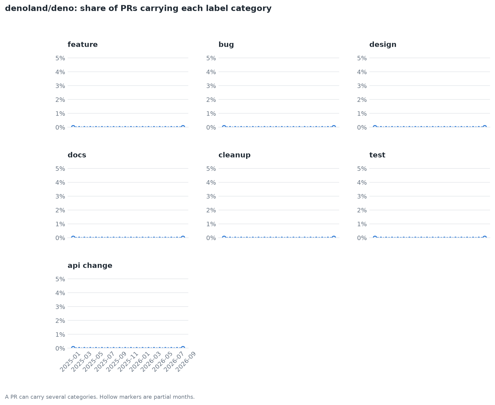
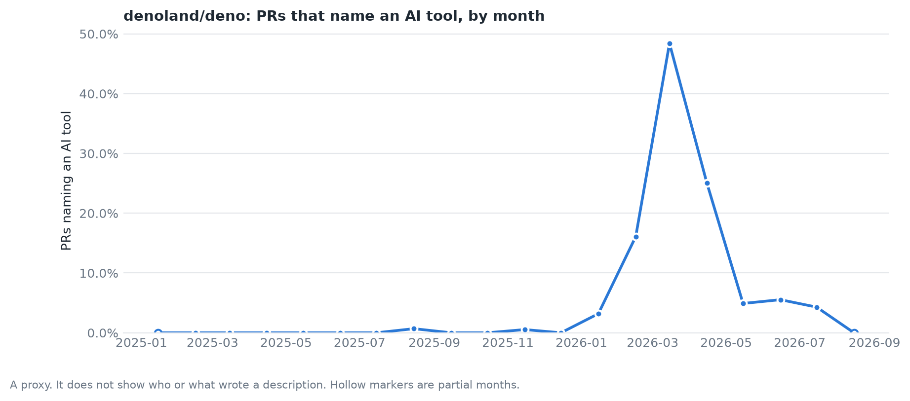
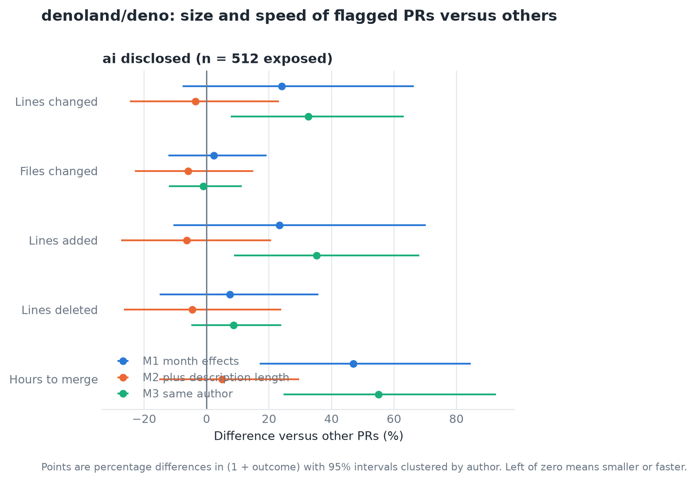

# Pull requests in denoland/deno: description length, size, speed and labels

Window 2025-01-06 to 2026-08-17 (UTC). Data fetched 2026-11-19. prwords 3.0.0, generated 2026-11-26. Method fixed in advance in `docs/ANALYSIS_PLAN.md`.

## 1. Data

- Repository primary language: Rust
- Pull requests opened in the window: 5,586
- Removed as bot accounts: 70
- Analysed: 5,516 PRs from 421 authors
- Merged: 4,316 (78.2%). Closed without merging: 1,002 (18.2%). Still open: 198
- Follow-up: merge outcomes use a 30-day follow-up. PRs without enough follow-up: 0
- Empty descriptions after cleaning: 7.3%

## 2. Did the PR template change?

Lines that appeared or disappeared across the window (full list in `template_audit.csv`):

| line         | first_month   | last_month   |   months |   peak_share | change_event   |
|:-------------|:--------------|:-------------|---------:|-------------:|:---------------|
| ## test plan | 2026-03       | 2026-05      |        3 |         0.79 | added          |

Distinct template lines detected: 3.

## 3. First 28 days versus last 28 days

First window 2025-01-06 to 2025-02-02. Last window 2026-07-21 to 2026-08-17. Ratios are last median divided by first median. Bootstrap intervals, 2,000 resamples.

| Metric                                |   n first |   n last |   Median first |   Median last |   Ratio |   Ratio low |   Ratio high |       p |   Cliff's delta |
|:--------------------------------------|----------:|---------:|---------------:|--------------:|--------:|------------:|-------------:|--------:|----------------:|
| Description words (non-empty)         |       148 |      248 |          21    |        162    |    7.71 |        6.23 |        10.68 | 2.9e-49 |            0.89 |
| Files changed                         |       175 |      251 |           4    |          3    |    0.75 |        0.6  |         1    | 0.078   |           -0.1  |
| Lines added                           |       175 |      251 |          55    |        116    |    2.11 |        1.48 |         3.22 | 4.6e-05 |            0.23 |
| Lines deleted                         |       175 |      251 |          14    |         10    |    0.71 |        0.43 |         1.1  | 0.023   |           -0.13 |
| Net lines (added minus deleted)       |       175 |      251 |          24    |         93    |    3.88 |        2.38 |         6.34 | 1.2e-09 |            0.35 |
| Lines changed (added plus deleted)    |       175 |      251 |          71    |        136    |    1.92 |        1.35 |         2.67 | 0.0018  |            0.18 |
| Hours from open to merge (merged PRs) |       156 |      163 |          13.51 |         89.02 |    6.59 |        2.98 |        14.8  | 7.6e-10 |            0.4  |
| Commits                               |       175 |      251 |           3    |          2    |    0.67 |        0.67 |         1    | 9.4e-07 |           -0.27 |
| Comments                              |       175 |      251 |           0    |          0    |  nan    |      nan    |       nan    | 0.45    |            0.04 |
| Reviews                               |       175 |      251 |           1    |          1    |    1    |        0.5  |         1    | 2.1e-16 |           -0.44 |

| Measure                             |   n first |   n last | Share first   | Share last   |   Change (points) |       p |
|:------------------------------------|----------:|---------:|:--------------|:-------------|------------------:|--------:|
| Merged within follow-up period      |       175 |      251 | 85.1%         | 62.9%        |             -22.2 | 3.6e-07 |
| Closed without merging              |       175 |      251 | 10.9%         | 10.0%        |              -0.9 | 0.87    |
| Opened as draft                     |       175 |      251 | 3.4%          | 1.2%         |              -2.2 | 0.17    |
| From outside contributors           |       175 |      251 | 57.7%         | 29.1%        |             -28.6 | 4.7e-09 |
| Has a kind or type label            |       175 |      251 | 0.0%          | 0.0%         |               0   | 1       |
| Description text repeated elsewhere |       175 |      251 | 0.0%          | 0.8%         |               0.8 | 0.51    |
| Names an AI tool (disclosure)       |       175 |      251 | 0.0%          | 4.4%         |               4.4 | 0.0035  |
| Label category: feature             |       175 |      251 | 0.0%          | 0.0%         |               0   | 1       |
| Label category: bug                 |       175 |      251 | 0.0%          | 0.0%         |               0   | 1       |
| Label category: design              |       175 |      251 | 0.0%          | 0.0%         |               0   | 1       |
| Label category: docs                |       175 |      251 | 0.0%          | 0.0%         |               0   | 1       |
| Label category: cleanup             |       175 |      251 | 0.0%          | 0.0%         |               0   | 1       |
| Label category: test                |       175 |      251 | 0.0%          | 0.0%         |               0   | 1       |
| Label category: api_change          |       175 |      251 | 0.0%          | 0.0%         |               0   | 1       |

## 4. Monthly trends

Theil-Sen slope per month and Kendall tau over full months only.

| metric                     |   months |   slope_per_month |   slope_ci_low |   slope_ci_high |     tau |       p |
|:---------------------------|---------:|------------------:|---------------:|----------------:|--------:|--------:|
| median_words               |       18 |             6.5   |          1.667 |          11.769 |   0.669 |   0     |
| median_files_changed       |       18 |            -0     |         -0     |           0.031 |   0.074 |   0.705 |
| median_additions           |       18 |             3     |          0.812 |           4.643 |   0.459 |   0.008 |
| median_deletions           |       18 |            -0.2   |         -0.643 |           0.067 |  -0.281 |   0.109 |
| median_churn               |       18 |             2.5   |          0.5   |           4.357 |   0.393 |   0.023 |
| median_hours_to_merge      |       18 |             0.534 |         -0.031 |           1.194 |   0.294 |   0.096 |
| merge_rate                 |       18 |            -0.013 |         -0.018 |          -0.007 |  -0.569 |   0.001 |
| share_outside_contributors |       18 |            -0.009 |         -0.019 |          -0.002 |  -0.399 |   0.021 |
| share_ai_disclosed         |       18 |             0.004 |         -0     |           0.006 |   0.62  |   0.001 |
| median_comments            |       18 |            -0     |         -0     |          -0     |   0.057 |   0.779 |
| median_reviews             |       18 |            -0     |         -0     |          -0     |  -0.167 |   0.4   |
| share_feature              |       18 |            -0     |         -0     |          -0     | nan     | nan     |
| share_bug                  |       18 |            -0     |         -0     |          -0     | nan     | nan     |
| share_design               |       18 |            -0     |         -0     |          -0     | nan     | nan     |
| share_docs                 |       18 |            -0     |         -0     |          -0     | nan     | nan     |
| share_cleanup              |       18 |            -0     |         -0     |          -0     | nan     | nan     |
| share_test                 |       18 |            -0     |         -0     |          -0     | nan     | nan     |
| share_api_change           |       18 |            -0     |         -0     |          -0     | nan     | nan     |

## 5. Labels

Share of PRs with a kind or type label: 0.0% overall. Label coverage by month is in `monthly_summary.csv` (`share_has_kind_label`).

| category            |   n_prs |   share |   median_words |   median_files |   median_churn |   merge_rate |   median_hours_to_merge |   share_ai_disclosed |
|:--------------------|--------:|--------:|---------------:|---------------:|---------------:|-------------:|------------------------:|---------------------:|
| feature             |       0 |       0 |            nan |            nan |            nan |      nan     |                 nan     |              nan     |
| bug                 |       0 |       0 |            nan |            nan |            nan |      nan     |                 nan     |              nan     |
| design              |       0 |       0 |            nan |            nan |            nan |      nan     |                 nan     |              nan     |
| docs                |       0 |       0 |            nan |            nan |            nan |      nan     |                 nan     |              nan     |
| cleanup             |       0 |       0 |            nan |            nan |            nan |      nan     |                 nan     |              nan     |
| test                |       0 |       0 |            nan |            nan |            nan |      nan     |                 nan     |              nan     |
| api_change          |       0 |       0 |            nan |            nan |            nan |      nan     |                 nan     |              nan     |
| (no category label) |    5516 |       1 |             77 |              3 |             86 |        0.782 |                  15.181 |                0.093 |

## 6. Are PRs with signs of AI involvement smaller or larger?

Authorship is not observable. The proxy is `ai_disclosed`, defined in the analysis plan: 512 PRs (9.28%). 50 disclosed PRs are listed in `ai_disclosure_samples.csv` for manual audit.

### ai_disclosed

**Verdict: no difference detected.** The same-month interval for lines changed runs from -7.6% to +66.4%.

Pattern: lines changed: no clear difference; files changed: no clear difference; lines added: no clear difference; lines deleted: no clear difference; hours to merge: slower.

Within-author permutation p-value, lines changed: 0.0035.

| Outcome        | Model                      |    n |   n exposed |   Median exposed |   Median others | Difference (95% CI)     |       p |   p (Holm) |
|:---------------|:---------------------------|-----:|------------:|-----------------:|----------------:|:------------------------|--------:|-----------:|
| Lines changed  | M1 month effects           | 5516 |         512 |            102.5 |            85   | +24.0% (-7.6 to +66.4)  | 0.15    |     0.61   |
| Lines changed  | M2 plus description length | 5516 |         512 |            102.5 |            85   | -3.6% (-24.5 to +23.2)  | 0.77    |     1      |
| Lines changed  | M3 same author             | 5516 |         512 |            102.5 |            85   | +32.6% (+7.8 to +63.2)  | 0.0076  |     0.026  |
| Files changed  | M1 month effects           | 5516 |         512 |              4   |             3   | +2.3% (-12.2 to +19.1)  | 0.77    |     1      |
| Files changed  | M2 plus description length | 5516 |         512 |              4   |             3   | -5.9% (-22.9 to +14.9)  | 0.55    |     1      |
| Files changed  | M3 same author             | 5516 |         512 |              4   |             3   | -1.1% (-12.1 to +11.3)  | 0.86    |     0.86   |
| Lines added    | M1 month effects           | 5516 |         512 |             85.5 |            67   | +23.3% (-10.7 to +70.2) | 0.2     |     0.61   |
| Lines added    | M2 plus description length | 5516 |         512 |             85.5 |            67   | -6.4% (-27.3 to +20.6)  | 0.61    |     1      |
| Lines added    | M3 same author             | 5516 |         512 |             85.5 |            67   | +35.2% (+8.8 to +68.1)  | 0.0066  |     0.026  |
| Lines deleted  | M1 month effects           | 5516 |         512 |              8   |             8   | +7.4% (-15.1 to +35.9)  | 0.55    |     1      |
| Lines deleted  | M2 plus description length | 5516 |         512 |              8   |             8   | -4.6% (-26.5 to +23.8)  | 0.72    |     1      |
| Lines deleted  | M3 same author             | 5516 |         512 |              8   |             8   | +8.6% (-4.8 to +24.0)   | 0.22    |     0.44   |
| Hours to merge | M1 month effects           | 4316 |         372 |             20.3 |            14.6 | +47.0% (+17.0 to +84.5) | 0.00092 |     0.0046 |
| Hours to merge | M2 plus description length | 4316 |         372 |             20.3 |            14.6 | +4.9% (-15.1 to +29.7)  | 0.66    |     1      |
| Hours to merge | M3 same author             | 4316 |         372 |             20.3 |            14.6 | +55.0% (+24.7 to +92.7) | 8e-05   |     0.0004 |

### Robustness by tool (lines changed)

| tool        |   n exposed | Same month              | Same author            | call                | status                    |
|:------------|------------:|:------------------------|:-----------------------|:--------------------|:--------------------------|
| unspecified |         487 | +22.0% (-11.1 to +67.4) | +31.1% (+5.1 to +63.7) | no clear difference | ok                        |
| claude      |          22 | n/a                     | n/a                    | nan                 | fewer than 30 exposed PRs |
| codex       |           2 | n/a                     | n/a                    | nan                 | fewer than 30 exposed PRs |
| chatgpt     |           1 | n/a                     | n/a                    | nan                 | fewer than 30 exposed PRs |

### File type check

Sample: 298 exposed and 297 unexposed PRs from the same months. 5 PRs with more than 100 files were excluded.

Share of changed lines by file type:

| group     |   n_prs | code   | tests   | docs   | config   | generated   | other   |   median_code_test_lines |
|:----------|--------:|:-------|:--------|:-------|:---------|:------------|:--------|-------------------------:|
| exposed   |     298 | 59.6%  | 34.5%   | 0.3%   | 0.3%     | 1.5%        | 3.8%    |                       87 |
| unexposed |     297 | 78.1%  | 12.7%   | 0.7%   | 6.0%     | 0.9%        | 1.6%    |                       85 |

Code and test lines only, same month: +31.4% (95% CI -5.7 to +83.1), p = 0.11. This is a robustness check and does not change the verdict.

## 7. Other checks

- Outside contributors: 55.1% of PRs overall.
- Top 10 authors opened 71.8% of PRs.
- PRs whose description text is repeated elsewhere (10 or more words): 0.6%.

## 8. Limitations

- Word count and size describe PRs, not who wrote them. Proxies for AI involvement are noisy and omit undisclosed use.
- Added and deleted lines include generated or vendored files unless the project avoids committing them.
- Disclosure mostly captures tools that add attribution by default, so it is tool-skewed.
- Template removal is heuristic. Check `template_audit.csv`.
- One repository cannot support general claims. See the plan for replication.
- Months at the edges of the window are partial and are excluded from trend tests.

