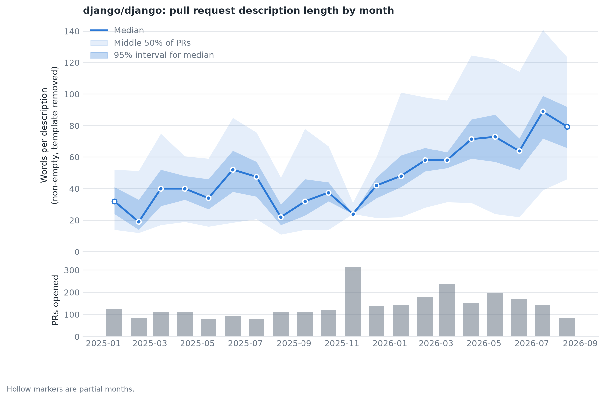
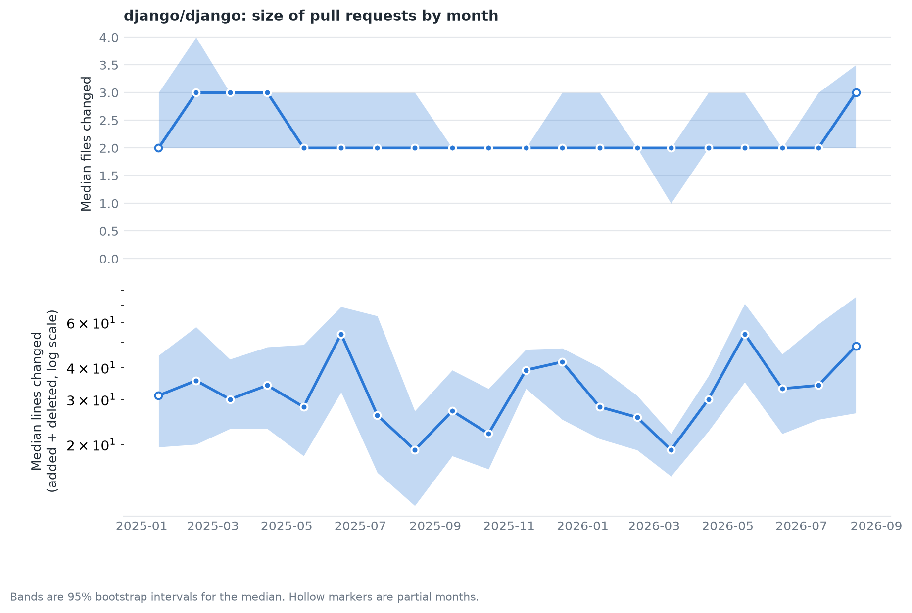
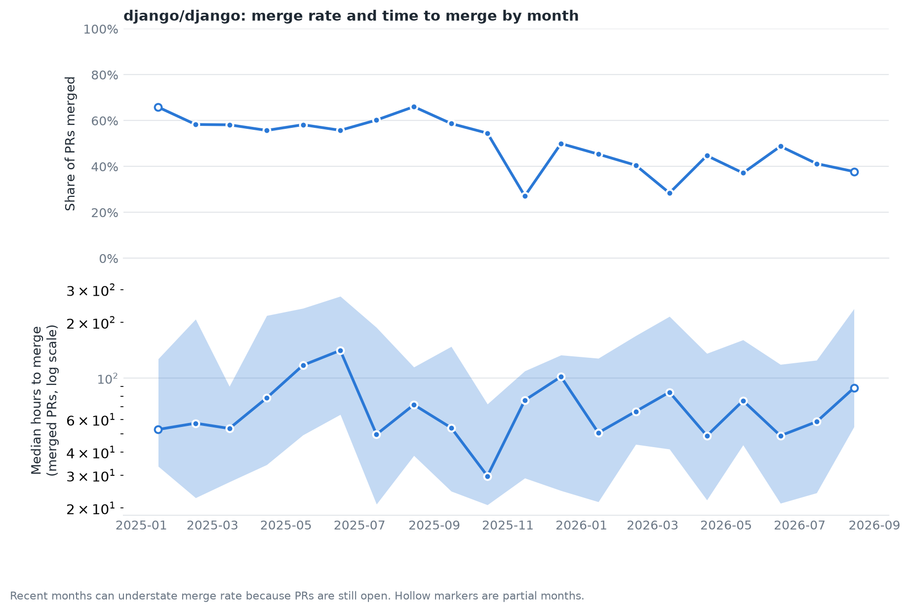
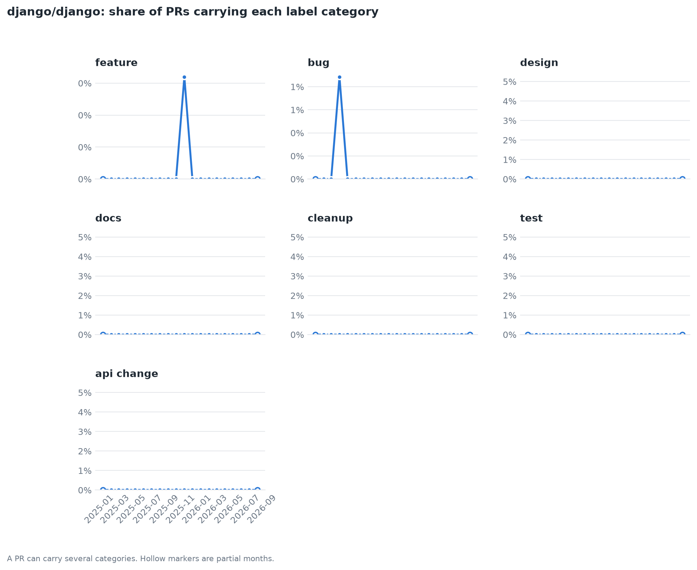
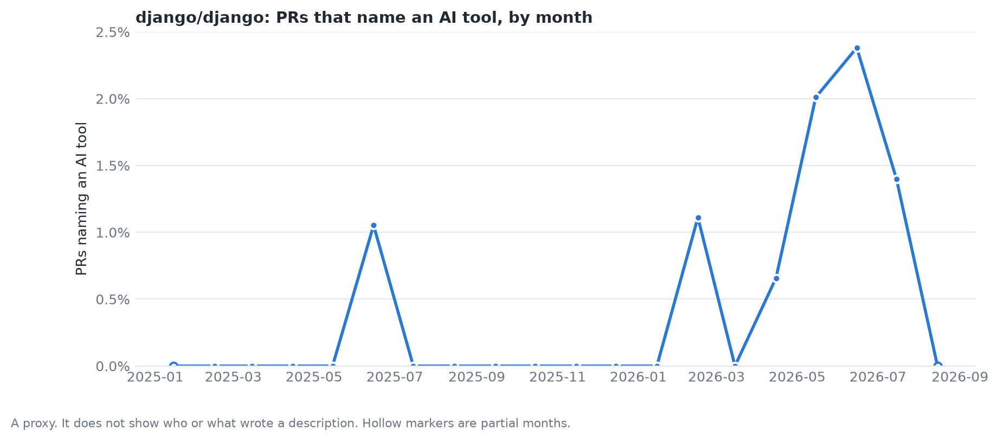

# Pull requests in django/django: description length, size, speed and labels

Window 2025-01-06 to 2026-08-17 (UTC). Data fetched 2026-11-19. prwords 3.0.0, generated 2026-11-26. Method fixed in advance in `docs/ANALYSIS_PLAN.md`.

## 1. Data

- Repository primary language: Python
- Pull requests opened in the window: 2,780
- Removed as bot accounts: 0
- Analysed: 2,780 PRs from 809 authors
- Merged: 1,281 (46.1%). Closed without merging: 1,236 (44.5%). Still open: 263
- Follow-up: merge outcomes use a 30-day follow-up. PRs without enough follow-up: 0
- Empty descriptions after cleaning: 2.7%

## 2. Did the PR template change?

Lines that appeared or disappeared across the window (full list in `template_audit.csv`):

| line                                                                                                                              | first_month   | last_month   |   months |   peak_share | change_event   |
|:----------------------------------------------------------------------------------------------------------------------------------|:--------------|:-------------|---------:|-------------:|:---------------|
| the commit message is written in past tense, mentions the ticket number, and ends with a period.                                  | 2025-01       | 2026-03      |       15 |         0.76 | removed        |
| this pr was automatically generated by stitch remote swe.                                                                         | 2025-11       | 2025-11      |        1 |         0.55 | added          |
| 🎯 task details                                                                                                                    | 2025-11       | 2025-11      |        1 |         0.55 | added          |
| #### ai assistance disclosure (required)                                                                                          | 2026-01       | 2026-08      |        8 |         0.83 | added          |
| this pr follows the contribution guidelines.                                                                                      | 2026-01       | 2026-08      |        8 |         0.82 | added          |
| **if ai tools were used**, i have disclosed which ones, and fully reviewed and verified their output.                             | 2026-01       | 2026-08      |        8 |         0.78 | added          |
| this pr **does not** disclose a security vulnerability (see vulnerability reporting).                                             | 2026-01       | 2026-08      |        8 |         0.76 | added          |
| **no ai tools were used** in preparing this pr.                                                                                   | 2026-01       | 2026-08      |        8 |         0.74 | added          |
| i have not requested, and will not request, an automated ai review for this pr.                                                   | 2026-03       | 2026-08      |        6 |         0.83 | added          |
| the commit message is written in past tense, mentions the ticket number, and ends with a period (see guidelines).                 | 2026-03       | 2026-07      |        5 |         0.62 | added          |
| the commit message is written in past tense, mentions the ticket number (if applicable), and ends with a period (see guidelines). | 2026-07       | 2026-08      |        2 |         0.65 | added          |

Distinct template lines detected: 20.

## 3. First 28 days versus last 28 days

First window 2025-01-06 to 2025-02-02. Last window 2026-07-21 to 2026-08-17. Ratios are last median divided by first median. Bootstrap intervals, 2,000 resamples.

| Metric                                |   n first |   n last |   Median first |   Median last |   Ratio |   Ratio low |   Ratio high |       p |   Cliff's delta |
|:--------------------------------------|----------:|---------:|---------------:|--------------:|--------:|------------:|-------------:|--------:|----------------:|
| Description words (non-empty)         |       124 |      143 |          31    |          75   |    2.42 |        1.76 |         3.35 | 1.1e-10 |            0.46 |
| Files changed                         |       129 |      145 |           2    |           3   |    1.5  |        0.67 |         1.5  | 0.044   |            0.14 |
| Lines added                           |       129 |      145 |          24    |          33   |    1.38 |        0.74 |         2.45 | 0.085   |            0.12 |
| Lines deleted                         |       129 |      145 |           3    |           3   |    1    |        0.5  |         1.5  | 0.83    |           -0.02 |
| Net lines (added minus deleted)       |       129 |      145 |          14    |          25   |    1.79 |        1    |         3.91 | 0.0096  |            0.18 |
| Lines changed (added plus deleted)    |       129 |      145 |          30    |          37   |    1.23 |        0.72 |         2.47 | 0.16    |            0.1  |
| Hours from open to merge (merged PRs) |        84 |       58 |          52.03 |          59.9 |    1.15 |        0.46 |         2.29 | 0.89    |           -0.01 |
| Commits                               |       129 |      145 |           1    |           1   |    1    |        1    |         1    | 0.13    |           -0.07 |
| Comments                              |       129 |      145 |           1    |           1   |    1    |        1    |         1    | 0.35    |            0.06 |
| Reviews                               |       129 |      145 |           2    |           1   |    0.5  |        0.5  |         1    | 0.00038 |           -0.24 |

| Measure                             |   n first |   n last | Share first   | Share last   |   Change (points) |     p |
|:------------------------------------|----------:|---------:|:--------------|:-------------|------------------:|------:|
| Merged within follow-up period      |       129 |      145 | 55.0%         | 35.2%        |             -19.9 | 0.001 |
| Closed without merging              |       129 |      145 | 33.3%         | 40.0%        |               6.7 | 0.26  |
| Opened as draft                     |       129 |      145 | 4.7%          | 3.4%         |              -1.2 | 0.76  |
| From outside contributors           |       129 |      145 | 57.4%         | 67.6%        |              10.2 | 0.1   |
| Has a kind or type label            |       129 |      145 | 0.0%          | 0.0%         |               0   | 1     |
| Description text repeated elsewhere |       129 |      145 | 7.0%          | 16.6%        |               9.6 | 0.016 |
| Names an AI tool (disclosure)       |       129 |      145 | 0.0%          | 0.7%         |               0.7 | 1     |
| Label category: feature             |       129 |      145 | 0.0%          | 0.0%         |               0   | 1     |
| Label category: bug                 |       129 |      145 | 0.0%          | 0.0%         |               0   | 1     |
| Label category: design              |       129 |      145 | 0.0%          | 0.0%         |               0   | 1     |
| Label category: docs                |       129 |      145 | 0.0%          | 0.0%         |               0   | 1     |
| Label category: cleanup             |       129 |      145 | 0.0%          | 0.0%         |               0   | 1     |
| Label category: test                |       129 |      145 | 0.0%          | 0.0%         |               0   | 1     |
| Label category: api_change          |       129 |      145 | 0.0%          | 0.0%         |               0   | 1     |

## 4. Monthly trends

Theil-Sen slope per month and Kendall tau over full months only.

| metric                     |   months |   slope_per_month |   slope_ci_low |   slope_ci_high |     tau |       p |
|:---------------------------|---------:|------------------:|---------------:|----------------:|--------:|--------:|
| median_words               |       18 |             2.846 |          1.6   |           5     |   0.612 |   0     |
| median_files_changed       |       18 |            -0     |         -0     |          -0     |  -0.542 |   0.008 |
| median_additions           |       18 |             0.091 |         -0.583 |           0.833 |   0.033 |   0.849 |
| median_deletions           |       18 |            -0     |         -0.154 |          -0     |  -0.238 |   0.205 |
| median_churn               |       18 |            -0     |         -1     |           1.083 |   0     |   1     |
| median_hours_to_merge      |       18 |            -0.513 |         -3.479 |           1.729 |  -0.137 |   0.454 |
| merge_rate                 |       18 |            -0.012 |         -0.021 |          -0.006 |  -0.503 |   0.003 |
| share_outside_contributors |       18 |             0.01  |          0.001 |           0.022 |   0.373 |   0.032 |
| share_ai_disclosed         |       18 |            -0     |         -0     |           0.001 |   0.529 |   0.006 |
| median_comments            |       18 |            -0     |         -0     |          -0     |  -0.01  |   0.961 |
| median_reviews             |       18 |            -0.059 |         -0.091 |          -0     |  -0.557 |   0.005 |
| share_feature              |       18 |            -0     |         -0     |          -0     |   0.02  |   0.923 |
| share_bug                  |       18 |            -0     |         -0     |          -0     |  -0.255 |   0.21  |
| share_design               |       18 |            -0     |         -0     |          -0     | nan     | nan     |
| share_docs                 |       18 |            -0     |         -0     |          -0     | nan     | nan     |
| share_cleanup              |       18 |            -0     |         -0     |          -0     | nan     | nan     |
| share_test                 |       18 |            -0     |         -0     |          -0     | nan     | nan     |
| share_api_change           |       18 |            -0     |         -0     |          -0     | nan     | nan     |

## 5. Labels

Share of PRs with a kind or type label: 0.0% overall. Label coverage by month is in `monthly_summary.csv` (`share_has_kind_label`).

| category            |   n_prs |   share |   median_words |   median_files |   median_churn |   merge_rate |   median_hours_to_merge |   share_ai_disclosed |
|:--------------------|--------:|--------:|---------------:|---------------:|---------------:|-------------:|------------------------:|---------------------:|
| feature             |       1 |   0     |              8 |             14 |            233 |         1    |                 644.826 |                0     |
| bug                 |       1 |   0     |             53 |              5 |             38 |         1    |                  26.774 |                0     |
| design              |       0 |   0     |            nan |            nan |            nan |       nan    |                 nan     |              nan     |
| docs                |       0 |   0     |            nan |            nan |            nan |       nan    |                 nan     |              nan     |
| cleanup             |       0 |   0     |            nan |            nan |            nan |       nan    |                 nan     |              nan     |
| test                |       0 |   0     |            nan |            nan |            nan |       nan    |                 nan     |              nan     |
| api_change          |       0 |   0     |            nan |            nan |            nan |       nan    |                 nan     |              nan     |
| (no category label) |    2778 |   0.999 |             44 |              2 |             31 |         0.46 |                  66.706 |                0.005 |

## 6. Are PRs with signs of AI involvement smaller or larger?

Authorship is not observable. The proxy is `ai_disclosed`, defined in the analysis plan: 14 PRs (0.50%). 14 disclosed PRs are listed in `ai_disclosure_samples.csv` for manual audit.

### ai_disclosed

**Verdict: not testable.** Too few exposed PRs.

Pattern: lines changed: not estimated; files changed: not estimated; lines added: not estimated; lines deleted: not estimated; hours to merge: not estimated.

Not estimated: fewer than 30 exposed PRs (exposed PRs: 14).

### Robustness by tool (lines changed)

| tool        |   n exposed | status                    |
|:------------|------------:|:--------------------------|
| claude      |           6 | fewer than 30 exposed PRs |
| unspecified |           5 | fewer than 30 exposed PRs |
| codex       |           2 | fewer than 30 exposed PRs |
| copilot     |           1 | fewer than 30 exposed PRs |

### File type check

Not run. Use `--file-check N` to sample N exposed PRs and matching unexposed PRs.

## 7. Other checks

- Outside contributors: 72.2% of PRs overall.
- Top 10 authors opened 34.5% of PRs.
- PRs whose description text is repeated elsewhere (10 or more words): 13.5%.

## 8. Limitations

- Word count and size describe PRs, not who wrote them. Proxies for AI involvement are noisy and omit undisclosed use.
- Added and deleted lines include generated or vendored files unless the project avoids committing them.
- Disclosure mostly captures tools that add attribution by default, so it is tool-skewed.
- Template removal is heuristic. Check `template_audit.csv`.
- One repository cannot support general claims. See the plan for replication.
- Months at the edges of the window are partial and are excluded from trend tests.

