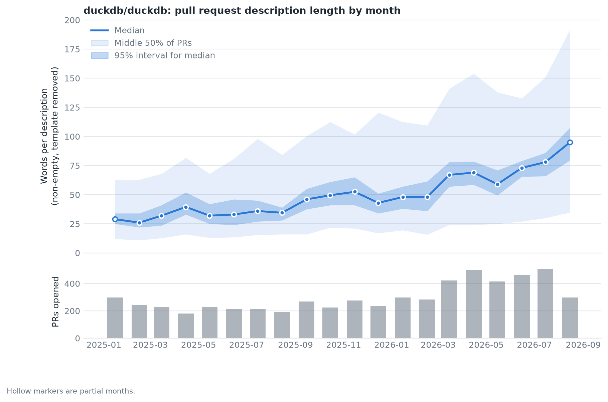
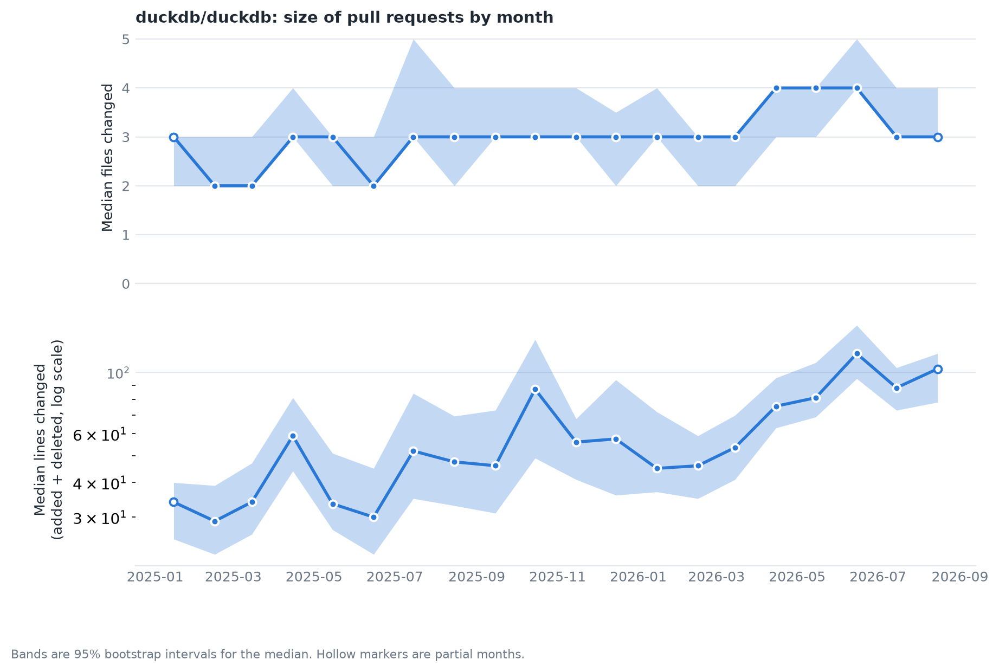
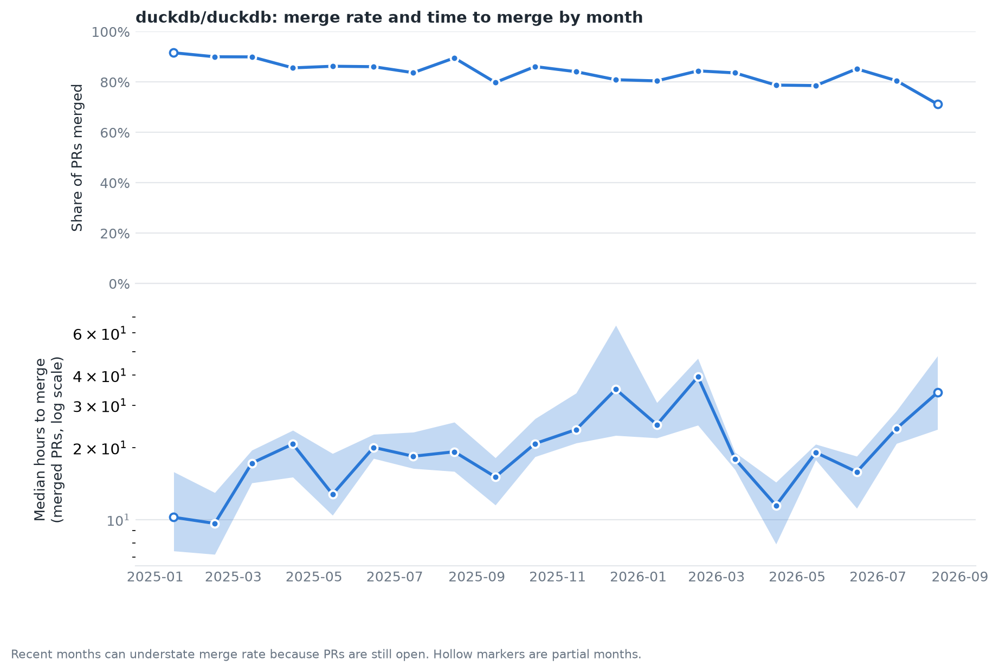
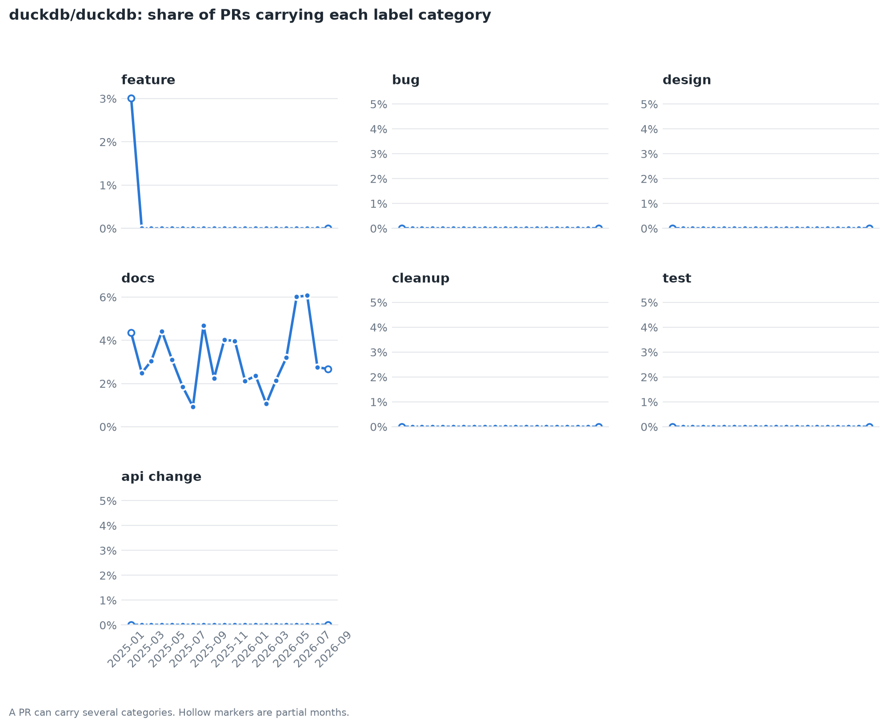
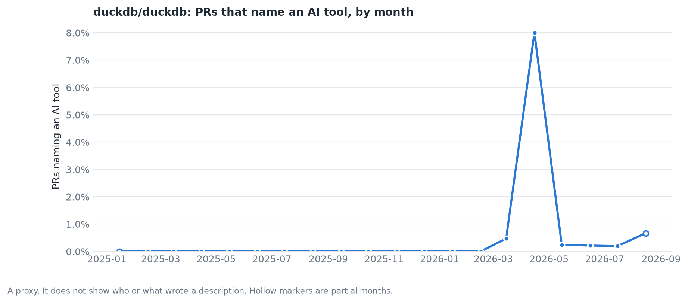
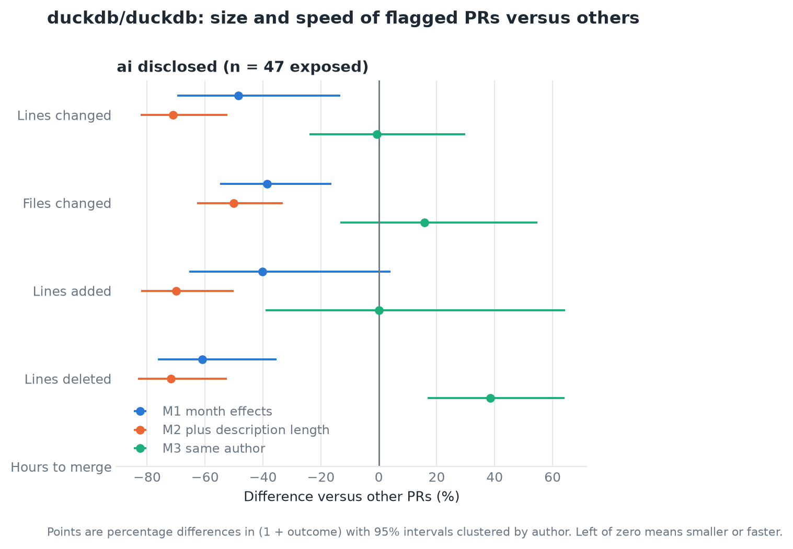

# Pull requests in duckdb/duckdb: description length, size, speed and labels

Window 2025-01-06 to 2026-08-17 (UTC). Data fetched 2026-11-19. prwords 3.0.0, generated 2026-11-26. Method fixed in advance in `docs/ANALYSIS_PLAN.md`.

## 1. Data

- Repository primary language: C++
- Pull requests opened in the window: 5,992
- Removed as bot accounts: 0
- Analysed: 5,992 PRs from 508 authors
- Merged: 4,985 (83.2%). Closed without merging: 934 (15.6%). Still open: 73
- Follow-up: merge outcomes use a 30-day follow-up. PRs without enough follow-up: 0
- Empty descriptions after cleaning: 10.5%

## 2. Did the PR template change?

No template line appeared or disappeared with a share of 50% or more. Template text was detected monthly and removed before counting words.

Distinct template lines detected: 0.

## 3. First 28 days versus last 28 days

First window 2025-01-06 to 2025-02-02. Last window 2026-07-21 to 2026-08-17. Ratios are last median divided by first median. Bootstrap intervals, 2,000 resamples.

| Metric                                |   n first |   n last |   Median first |   Median last |   Ratio |   Ratio low |   Ratio high |       p |   Cliff's delta |
|:--------------------------------------|----------:|---------:|---------------:|--------------:|--------:|------------:|-------------:|--------:|----------------:|
| Description words (non-empty)         |       247 |      500 |          29    |         87.5  |    3.02 |        2.42 |         3.72 | 8.9e-25 |            0.46 |
| Files changed                         |       304 |      520 |           3    |          3    |    1    |        1    |         2    | 4.4e-06 |            0.19 |
| Lines added                           |       304 |      520 |          21    |         81.5  |    3.88 |        2.96 |         5.09 | 2.6e-18 |            0.36 |
| Lines deleted                         |       304 |      520 |           5    |          7    |    1.4  |        0.92 |         2.38 | 0.054   |            0.08 |
| Net lines (added minus deleted)       |       304 |      520 |          10    |         64    |    6.4  |        4.07 |        10.16 | 2.3e-20 |            0.39 |
| Lines changed (added plus deleted)    |       304 |      520 |          33    |        105    |    3.18 |        2.63 |         4.33 | 2.1e-17 |            0.35 |
| Hours from open to merge (merged PRs) |       279 |      388 |          10.14 |         26.65 |    2.63 |        1.64 |         4.78 | 1.1e-08 |            0.26 |
| Commits                               |       304 |      520 |           2    |          2    |    1    |        0.5  |         1    | 0.17    |           -0.06 |
| Comments                              |       304 |      520 |           1    |          1    |    1    |        1    |         1    | 0.0045  |            0.11 |
| Reviews                               |       304 |      520 |           0    |          0    |  nan    |      nan    |       nan    | 0.16    |            0.04 |

| Measure                             |   n first |   n last | Share first   | Share last   |   Change (points) |       p |
|:------------------------------------|----------:|---------:|:--------------|:-------------|------------------:|--------:|
| Merged within follow-up period      |       304 |      520 | 88.2%         | 71.3%        |             -16.8 | 9e-09   |
| Closed without merging              |       304 |      520 | 8.2%          | 16.9%        |               8.7 | 0.00035 |
| Opened as draft                     |       304 |      520 | 1.0%          | 6.0%         |               5   | 0.00022 |
| From outside contributors           |       304 |      520 | 15.1%         | 43.7%        |              28.5 | 5.9e-18 |
| Has a kind or type label            |       304 |      520 | 0.0%          | 0.0%         |               0   | 1       |
| Description text repeated elsewhere |       304 |      520 | 0.0%          | 0.4%         |               0.4 | 0.53    |
| Names an AI tool (disclosure)       |       304 |      520 | 0.0%          | 0.4%         |               0.4 | 0.53    |
| Label category: feature             |       304 |      520 | 3.0%          | 0.0%         |              -3   | 0.00012 |
| Label category: bug                 |       304 |      520 | 0.0%          | 0.0%         |               0   | 1       |
| Label category: design              |       304 |      520 | 0.0%          | 0.0%         |               0   | 1       |
| Label category: docs                |       304 |      520 | 4.3%          | 2.9%         |              -1.4 | 0.32    |
| Label category: cleanup             |       304 |      520 | 0.0%          | 0.0%         |               0   | 1       |
| Label category: test                |       304 |      520 | 0.0%          | 0.0%         |               0   | 1       |
| Label category: api_change          |       304 |      520 | 0.0%          | 0.0%         |               0   | 1       |

## 4. Monthly trends

Theil-Sen slope per month and Kendall tau over full months only.

| metric                     |   months |   slope_per_month |   slope_ci_low |   slope_ci_high |     tau |       p |
|:---------------------------|---------:|------------------:|---------------:|----------------:|--------:|--------:|
| median_words               |       18 |             2.75  |          2     |           3.3   |   0.809 |   0     |
| median_files_changed       |       18 |             0     |         -0     |           0.111 |   0.638 |   0.001 |
| median_additions           |       18 |             2.471 |          1.25  |           3.5   |   0.63  |   0     |
| median_deletions           |       18 |             0.1   |         -0.056 |           0.321 |   0.22  |   0.218 |
| median_churn               |       18 |             3.321 |          1.455 |           4.462 |   0.538 |   0.002 |
| median_hours_to_merge      |       18 |             0.466 |         -0.182 |           1.137 |   0.242 |   0.175 |
| merge_rate                 |       18 |            -0.005 |         -0.008 |          -0.002 |  -0.542 |   0.001 |
| share_outside_contributors |       18 |             0.005 |          0     |           0.01  |   0.373 |   0.032 |
| share_ai_disclosed         |       18 |            -0     |         -0     |           0     |   0.532 |   0.006 |
| median_comments            |       18 |            -0     |         -0     |          -0     | nan     | nan     |
| median_reviews             |       18 |            -0     |         -0     |          -0     | nan     | nan     |
| share_feature              |       18 |            -0     |         -0     |          -0     | nan     | nan     |
| share_bug                  |       18 |            -0     |         -0     |          -0     | nan     | nan     |
| share_design               |       18 |            -0     |         -0     |          -0     | nan     | nan     |
| share_docs                 |       18 |             0     |         -0.001 |           0.002 |   0.111 |   0.55  |
| share_cleanup              |       18 |            -0     |         -0     |          -0     | nan     | nan     |
| share_test                 |       18 |            -0     |         -0     |          -0     | nan     | nan     |
| share_api_change           |       18 |            -0     |         -0     |          -0     | nan     | nan     |

## 5. Labels

Share of PRs with a kind or type label: 0.0% overall. Label coverage by month is in `monthly_summary.csv` (`share_has_kind_label`).

| category            |   n_prs |   share |   median_words |   median_files |   median_churn |   merge_rate |   median_hours_to_merge |   share_ai_disclosed |
|:--------------------|--------:|--------:|---------------:|---------------:|---------------:|-------------:|------------------------:|---------------------:|
| feature             |       9 |   0.002 |             38 |              5 |            140 |        0.889 |                 574.549 |                0     |
| bug                 |       0 |   0     |            nan |            nan |            nan |      nan     |                 nan     |              nan     |
| design              |       0 |   0     |            nan |            nan |            nan |      nan     |                 nan     |              nan     |
| docs                |     197 |   0.033 |            117 |             12 |            401 |        0.939 |                  40.792 |                0.015 |
| cleanup             |       0 |   0     |            nan |            nan |            nan |      nan     |                 nan     |              nan     |
| test                |       0 |   0     |            nan |            nan |            nan |      nan     |                 nan     |              nan     |
| api_change          |       0 |   0     |            nan |            nan |            nan |      nan     |                 nan     |              nan     |
| (no category label) |    5787 |   0.966 |             49 |              3 |             54 |        0.828 |                  18.713 |                0.008 |

## 6. Are PRs with signs of AI involvement smaller or larger?

Authorship is not observable. The proxy is `ai_disclosed`, defined in the analysis plan: 47 PRs (0.78%). 47 disclosed PRs are listed in `ai_disclosure_samples.csv` for manual audit.

### ai_disclosed

**Verdict: no difference detected.** The same-month gap does not hold within the same author, so it reflects who discloses AI use, not the PRs themselves.

Pattern: lines changed: no clear difference; files changed: no clear difference; lines added: no clear difference; lines deleted: no clear difference; hours to merge: not estimated.

Within-author permutation p-value, lines changed: 0.5132.

| Outcome       | Model                      |    n |   n exposed |   Median exposed |   Median others | Difference (95% CI)     |       p |   p (Holm) |
|:--------------|:---------------------------|-----:|------------:|-----------------:|----------------:|:------------------------|--------:|-----------:|
| Lines changed | M1 month effects           | 5992 |          47 |               39 |              59 | -48.6% (-69.5 to -13.2) | 0.013   |    0.026   |
| Lines changed | M2 plus description length | 5992 |          47 |               39 |              59 | -71.0% (-82.3 to -52.3) | 1e-06   |    4.1e-06 |
| Lines changed | M3 same author             | 5992 |          47 |               39 |              59 | -0.7% (-24.0 to +29.8)  | 0.96    |    1       |
| Files changed | M1 month effects           | 5992 |          47 |                2 |               3 | -38.5% (-54.8 to -16.3) | 0.002   |    0.0059  |
| Files changed | M2 plus description length | 5992 |          47 |                2 |               3 | -50.1% (-62.8 to -33.2) | 3.2e-06 |    6.3e-06 |
| Files changed | M3 same author             | 5992 |          47 |                2 |               3 | +15.8% (-13.4 to +54.7) | 0.32    |    0.97    |
| Lines added   | M1 month effects           | 5992 |          47 |               36 |              42 | -40.1% (-65.5 to +4.1)  | 0.069   |    0.069   |
| Lines added   | M2 plus description length | 5992 |          47 |               36 |              42 | -70.0% (-82.0 to -50.0) | 3.9e-06 |    6.3e-06 |
| Lines added   | M3 same author             | 5992 |          47 |               36 |              42 | +0.1% (-39.0 to +64.4)  | 1       |    1       |
| Lines deleted | M1 month effects           | 5992 |          47 |                3 |               6 | -60.9% (-76.4 to -35.3) | 0.00026 |    0.001   |
| Lines deleted | M2 plus description length | 5992 |          47 |                3 |               6 | -71.7% (-83.1 to -52.5) | 1.7e-06 |    5.1e-06 |
| Lines deleted | M3 same author             | 5992 |          47 |                3 |               6 | +38.5% (+16.9 to +64.1) | 0.00017 |    0.00068 |

### Robustness by tool (lines changed)

| tool        |   n exposed | Same month              | Same author            | call                | status                    |
|:------------|------------:|:------------------------|:-----------------------|:--------------------|:--------------------------|
| unspecified |          46 | -48.9% (-69.8 to -13.4) | -0.6% (-24.2 to +30.2) | no clear difference | ok                        |
| claude      |           1 | n/a                     | n/a                    | nan                 | fewer than 30 exposed PRs |

### File type check

Sample: 47 exposed and 45 unexposed PRs from the same months. 2 PRs with more than 100 files were excluded.

Share of changed lines by file type:

| group     |   n_prs | code   | tests   | docs   | config   | generated   | other   |   median_code_test_lines |
|:----------|--------:|:-------|:--------|:-------|:---------|:------------|:--------|-------------------------:|
| exposed   |      47 | 58.4%  | 40.3%   | 0.1%   | 1.0%     | 0.0%        | 0.2%    |                       39 |
| unexposed |      45 | 65.3%  | 24.2%   | 4.5%   | 5.5%     | 0.3%        | 0.2%    |                       69 |

Code and test lines only, same month: -5.1% (95% CI -41.9 to +55.1), p = 0.84. This is a robustness check and does not change the verdict.

## 7. Other checks

- Outside contributors: 28.4% of PRs overall.
- Top 10 authors opened 53.1% of PRs.
- PRs whose description text is repeated elsewhere (10 or more words): 1.2%.

## 8. Limitations

- Word count and size describe PRs, not who wrote them. Proxies for AI involvement are noisy and omit undisclosed use.
- Added and deleted lines include generated or vendored files unless the project avoids committing them.
- Disclosure mostly captures tools that add attribution by default, so it is tool-skewed.
- Template removal is heuristic. Check `template_audit.csv`.
- One repository cannot support general claims. See the plan for replication.
- Months at the edges of the window are partial and are excluded from trend tests.

