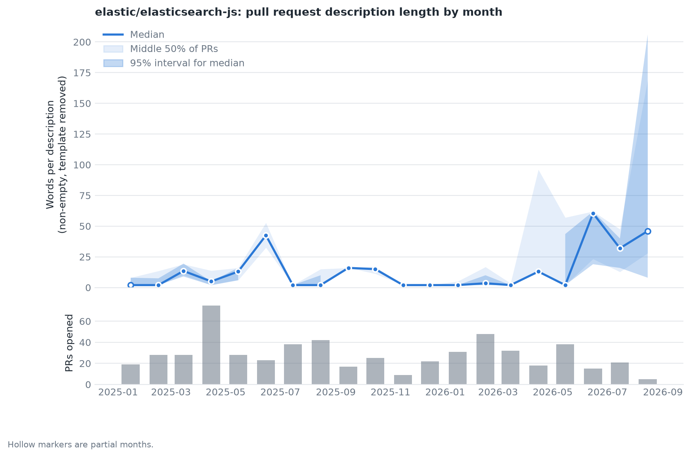
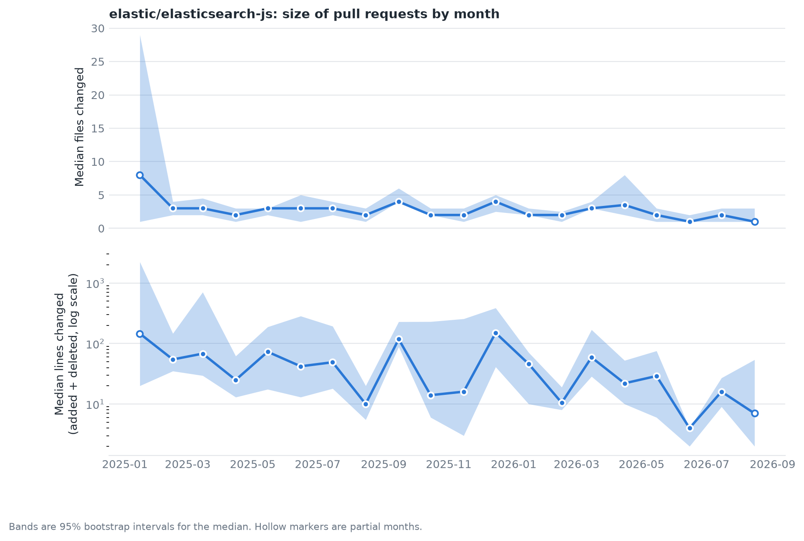
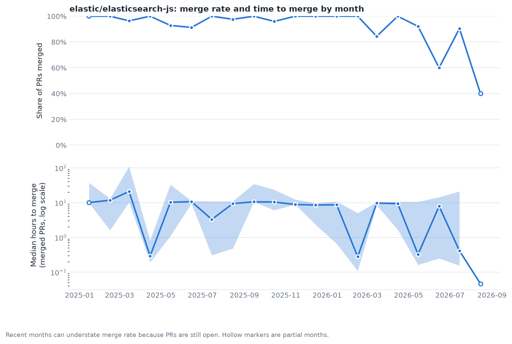
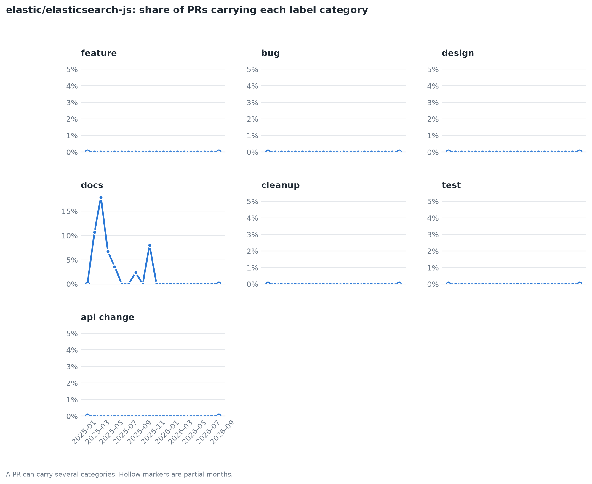
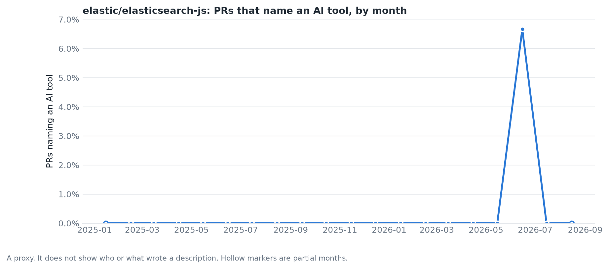

# Pull requests in elastic/elasticsearch-js: description length, size, speed and labels

Window 2025-01-06 to 2026-08-17 (UTC). Data fetched 2026-11-20. prwords 3.0.0, generated 2026-11-26. Method fixed in advance in `docs/ANALYSIS_PLAN.md`.

## 1. Data

- Repository primary language: TypeScript
- Pull requests opened in the window: 777
- Removed as bot accounts: 215
- Analysed: 562 PRs from 25 authors
- Merged: 536 (95.4%). Closed without merging: 25 (4.4%). Still open: 1
- Follow-up: merge outcomes use a 30-day follow-up. PRs without enough follow-up: 0
- Empty descriptions after cleaning: 32.7%

## 2. Did the PR template change?

No template line appeared or disappeared with a share of 50% or more. Template text was detected monthly and removed before counting words.

Distinct template lines detected: 1.

## 3. First 28 days versus last 28 days

First window 2025-01-06 to 2025-02-02. Last window 2026-07-21 to 2026-08-17. Ratios are last median divided by first median. Bootstrap intervals, 2,000 resamples.

| Metric                                |   n first |   n last |   Median first |   Median last |   Ratio |   Ratio low |   Ratio high |       p |   Cliff's delta |
|:--------------------------------------|----------:|---------:|---------------:|--------------:|--------:|------------:|-------------:|--------:|----------------:|
| Description words (non-empty)         |        17 |       15 |           2    |         34    |   17    |        4    |        45.5  | 0.00036 |            0.73 |
| Files changed                         |        19 |       16 |           8    |          2    |    0.25 |        0.07 |         1.5  | 0.0091  |           -0.51 |
| Lines added                           |        19 |       16 |         130    |         10.5  |    0.08 |        0.01 |         0.81 | 0.022   |           -0.46 |
| Lines deleted                         |        19 |       16 |          16    |          1    |    0.06 |        0    |         1    | 0.015   |           -0.48 |
| Net lines (added minus deleted)       |        19 |       16 |         114    |          9.5  |    0.08 |        0.01 |        15    | 0.19    |           -0.26 |
| Lines changed (added plus deleted)    |        19 |       16 |         146    |         12.5  |    0.09 |        0.01 |         0.63 | 0.019   |           -0.47 |
| Hours from open to merge (merged PRs) |        19 |       12 |          10.07 |          0.35 |    0.03 |        0    |         1.33 | 0.041   |           -0.45 |
| Commits                               |        19 |       16 |           1    |          1    |    1    |        1    |         2    | 0.29    |            0.17 |
| Comments                              |        19 |       16 |           0    |          0    |  nan    |      nan    |       nan    | 0.34    |            0.15 |
| Reviews                               |        19 |       16 |           1    |          0    |    0    |        0    |         1    | 0.26    |           -0.2  |

| Measure                             |   n first |   n last | Share first   | Share last   |   Change (points) |     p |
|:------------------------------------|----------:|---------:|:--------------|:-------------|------------------:|------:|
| Merged within follow-up period      |        19 |       16 | 100.0%        | 75.0%        |             -25   | 0.035 |
| Closed without merging              |        19 |       16 | 0.0%          | 18.8%        |              18.8 | 0.086 |
| Opened as draft                     |        19 |       16 | 0.0%          | 6.2%         |               6.2 | 0.46  |
| From outside contributors           |        19 |       16 | 0.0%          | 6.2%         |               6.2 | 0.46  |
| Has a kind or type label            |        19 |       16 | 0.0%          | 0.0%         |               0   | 1     |
| Description text repeated elsewhere |        19 |       16 | 10.5%         | 0.0%         |             -10.5 | 0.49  |
| Names an AI tool (disclosure)       |        19 |       16 | 0.0%          | 0.0%         |               0   | 1     |
| Label category: feature             |        19 |       16 | 0.0%          | 0.0%         |               0   | 1     |
| Label category: bug                 |        19 |       16 | 0.0%          | 0.0%         |               0   | 1     |
| Label category: design              |        19 |       16 | 0.0%          | 0.0%         |               0   | 1     |
| Label category: docs                |        19 |       16 | 0.0%          | 0.0%         |               0   | 1     |
| Label category: cleanup             |        19 |       16 | 0.0%          | 0.0%         |               0   | 1     |
| Label category: test                |        19 |       16 | 0.0%          | 0.0%         |               0   | 1     |
| Label category: api_change          |        19 |       16 | 0.0%          | 0.0%         |               0   | 1     |

## 4. Monthly trends

Theil-Sen slope per month and Kendall tau over full months only.

| metric                     |   months |   slope_per_month |   slope_ci_low |   slope_ci_high |     tau |       p |
|:---------------------------|---------:|------------------:|---------------:|----------------:|--------:|--------:|
| median_words               |       18 |            -0     |         -0.333 |           1.375 |   0.058 |   0.75  |
| median_files_changed       |       18 |            -0     |         -0.125 |          -0     |  -0.256 |   0.179 |
| median_additions           |       18 |            -1.2   |         -2.8   |           0.444 |  -0.32  |   0.068 |
| median_deletions           |       18 |            -0.714 |         -1     |          -0.125 |  -0.436 |   0.012 |
| median_churn               |       18 |            -2     |         -4.75  |           0.571 |  -0.262 |   0.129 |
| median_hours_to_merge      |       18 |            -0.276 |         -0.818 |          -0.086 |  -0.425 |   0.014 |
| merge_rate                 |       18 |            -0     |         -0.008 |          -0     |  -0.232 |   0.208 |
| share_outside_contributors |       18 |            -0.005 |         -0.008 |          -0     |  -0.366 |   0.042 |
| share_ai_disclosed         |       18 |            -0     |         -0     |          -0     |   0.294 |   0.148 |
| median_comments            |       18 |            -0     |         -0     |          -0     |   0.341 |   0.088 |
| median_reviews             |       18 |            -0     |         -0.071 |          -0     |  -0.373 |   0.061 |
| share_feature              |       18 |            -0     |         -0     |          -0     | nan     | nan     |
| share_bug                  |       18 |            -0     |         -0     |          -0     | nan     | nan     |
| share_design               |       18 |            -0     |         -0     |          -0     | nan     | nan     |
| share_docs                 |       18 |            -0.002 |         -0.006 |          -0     |  -0.598 |   0.002 |
| share_cleanup              |       18 |            -0     |         -0     |          -0     | nan     | nan     |
| share_test                 |       18 |            -0     |         -0     |          -0     | nan     | nan     |
| share_api_change           |       18 |            -0     |         -0     |          -0     | nan     | nan     |

## 5. Labels

Share of PRs with a kind or type label: 0.0% overall. Label coverage by month is in `monthly_summary.csv` (`share_has_kind_label`).

| category            |   n_prs |   share |   median_words |   median_files |   median_churn |   merge_rate |   median_hours_to_merge |   share_ai_disclosed |
|:--------------------|--------:|--------:|---------------:|---------------:|---------------:|-------------:|------------------------:|---------------------:|
| feature             |       0 |    0    |            nan |            nan |            nan |      nan     |                 nan     |              nan     |
| bug                 |       0 |    0    |            nan |            nan |            nan |      nan     |                 nan     |              nan     |
| design              |       0 |    0    |            nan |            nan |            nan |      nan     |                 nan     |              nan     |
| docs                |      17 |    0.03 |             19 |              2 |             19 |        0.941 |                  24.85  |                0     |
| cleanup             |       0 |    0    |            nan |            nan |            nan |      nan     |                 nan     |              nan     |
| test                |       0 |    0    |            nan |            nan |            nan |      nan     |                 nan     |              nan     |
| api_change          |       0 |    0    |            nan |            nan |            nan |      nan     |                 nan     |              nan     |
| (no category label) |     545 |    0.97 |              2 |              3 |             35 |        0.954 |                   8.792 |                0.002 |

## 6. Are PRs with signs of AI involvement smaller or larger?

Authorship is not observable. The proxy is `ai_disclosed`, defined in the analysis plan: 1 PRs (0.18%). 1 disclosed PRs are listed in `ai_disclosure_samples.csv` for manual audit.

### ai_disclosed

**Verdict: not testable.** Too few exposed PRs.

Pattern: lines changed: not estimated; files changed: not estimated; lines added: not estimated; lines deleted: not estimated; hours to merge: not estimated.

Not estimated: fewer than 30 exposed PRs (exposed PRs: 1).

### Robustness by tool (lines changed)

| tool        |   n exposed | status                    |
|:------------|------------:|:--------------------------|
| unspecified |           1 | fewer than 30 exposed PRs |

### File type check

Not run. Use `--file-check N` to sample N exposed PRs and matching unexposed PRs.

## 7. Other checks

- Outside contributors: 5.3% of PRs overall.
- Top 10 authors opened 97.2% of PRs.
- PRs whose description text is repeated elsewhere (10 or more words): 0.4%.

## 8. Limitations

- Word count and size describe PRs, not who wrote them. Proxies for AI involvement are noisy and omit undisclosed use.
- Added and deleted lines include generated or vendored files unless the project avoids committing them.
- Disclosure mostly captures tools that add attribution by default, so it is tool-skewed.
- Template removal is heuristic. Check `template_audit.csv`.
- One repository cannot support general claims. See the plan for replication.
- Months at the edges of the window are partial and are excluded from trend tests.

