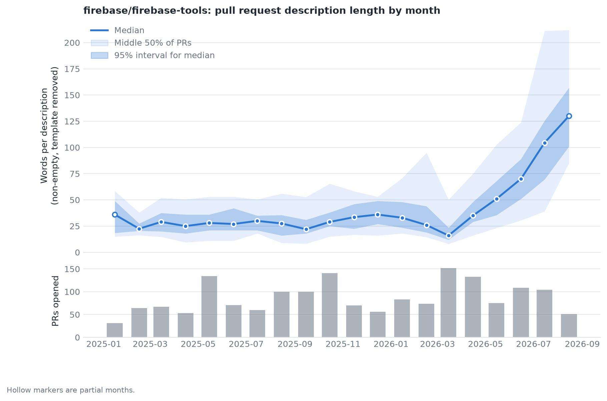
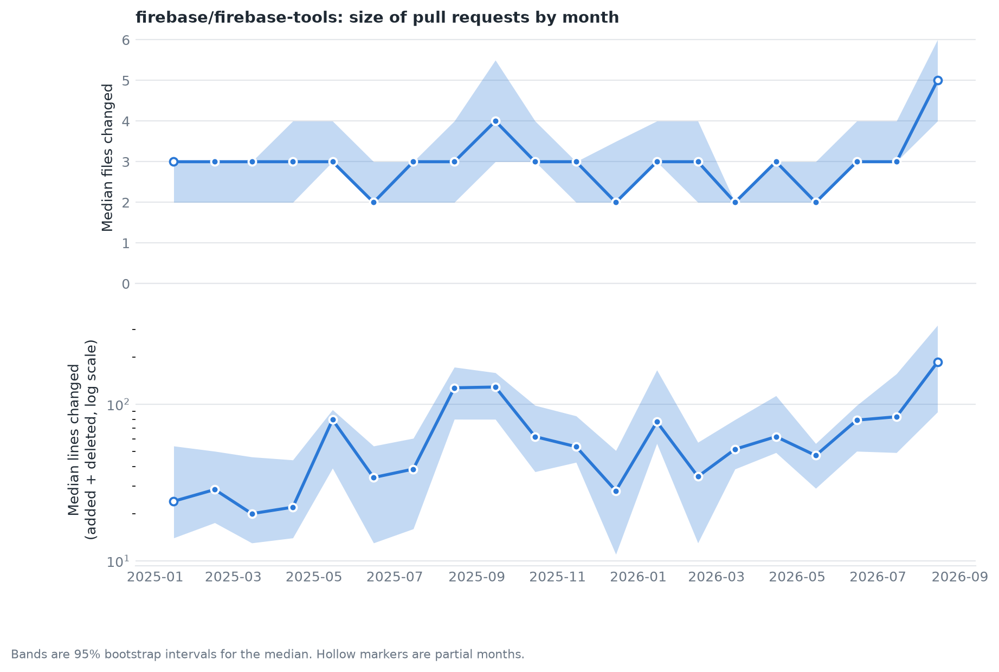
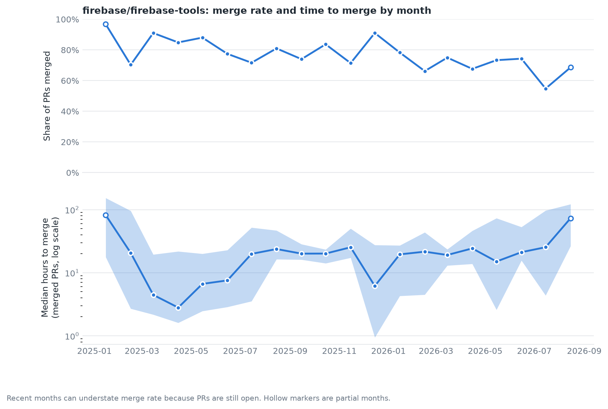
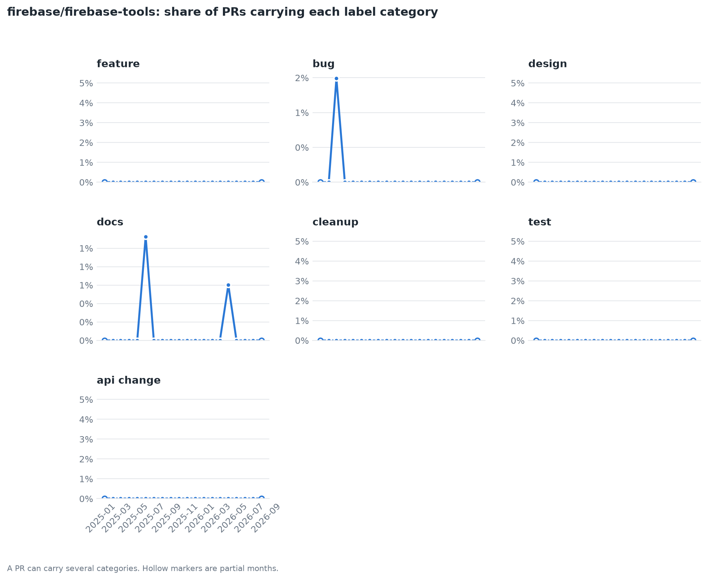
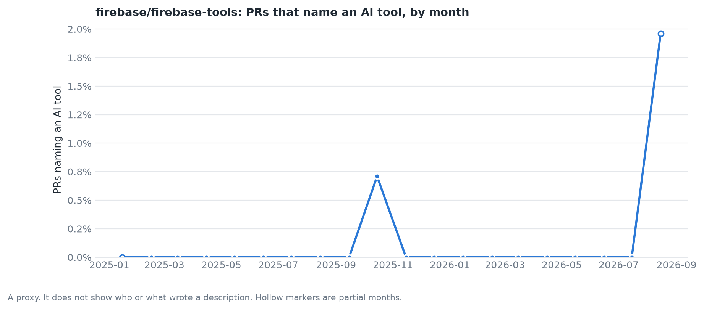

# Pull requests in firebase/firebase-tools: description length, size, speed and labels

Window 2025-01-06 to 2026-08-17 (UTC). Data fetched 2026-11-20. prwords 3.0.0, generated 2026-11-26. Method fixed in advance in `docs/ANALYSIS_PLAN.md`.

## 1. Data

- Repository primary language: TypeScript
- Pull requests opened in the window: 2,071
- Removed as bot accounts: 343
- Analysed: 1,728 PRs from 201 authors
- Merged: 1,317 (76.2%). Closed without merging: 238 (13.8%). Still open: 173
- Follow-up: merge outcomes use a 30-day follow-up. PRs without enough follow-up: 0
- Empty descriptions after cleaning: 11.6%

## 2. Did the PR template change?

Lines that appeared or disappeared across the window (full list in `template_audit.csv`):

| line                 | first_month   | last_month   |   months |   peak_share | change_event   |
|:---------------------|:--------------|:-------------|---------:|-------------:|:---------------|
| ### scenarios tested | 2025-02       | 2026-07      |        9 |         0.58 | removed        |

Distinct template lines detected: 3.

## 3. First 28 days versus last 28 days

First window 2025-01-06 to 2025-02-02. Last window 2026-07-21 to 2026-08-17. Ratios are last median divided by first median. Bootstrap intervals, 2,000 resamples.

| Metric                                |   n first |   n last |   Median first |   Median last |   Ratio |   Ratio low |   Ratio high |       p |   Cliff's delta |
|:--------------------------------------|----------:|---------:|---------------:|--------------:|--------:|------------:|-------------:|--------:|----------------:|
| Description words (non-empty)         |        29 |       84 |          37    |        140.5  |    3.8  |        2.53 |         7.03 | 9.5e-07 |            0.61 |
| Files changed                         |        32 |       91 |           3    |          4    |    1.33 |        1    |         2.5  | 0.0074  |            0.32 |
| Lines added                           |        32 |       91 |          13    |        120    |    9.23 |        2.69 |        15    | 8e-05   |            0.47 |
| Lines deleted                         |        32 |       91 |           6    |          8    |    1.33 |        0.48 |         4    | 0.68    |            0.05 |
| Net lines (added minus deleted)       |        32 |       91 |           6.5  |         79    |   12.15 |        4.5  |        25.23 | 0.00019 |            0.44 |
| Lines changed (added plus deleted)    |        32 |       91 |          26    |        135    |    5.19 |        2.07 |         9.64 | 0.00031 |            0.43 |
| Hours from open to merge (merged PRs) |        30 |       58 |          81.93 |         67.94 |    0.83 |        0.26 |         4.62 | 0.56    |           -0.08 |
| Commits                               |        32 |       91 |           3    |          4    |    1.33 |        0.67 |         2    | 0.55    |            0.07 |
| Comments                              |        32 |       91 |           0    |          1    |  nan    |        0    |         2    | 0.11    |            0.18 |
| Reviews                               |        32 |       91 |           1    |          3    |    3    |        1.5  |         4    | 8.5e-05 |            0.46 |

| Measure                             |   n first |   n last | Share first   | Share last   |   Change (points) |       p |
|:------------------------------------|----------:|---------:|:--------------|:-------------|------------------:|--------:|
| Merged within follow-up period      |        32 |       91 | 87.5%         | 61.5%        |             -26   | 0.0075  |
| Closed without merging              |        32 |       91 | 0.0%          | 7.7%         |               7.7 | 0.19    |
| Opened as draft                     |        32 |       91 | 0.0%          | 7.7%         |               7.7 | 0.19    |
| From outside contributors           |        32 |       91 | 31.2%         | 69.2%        |              38   | 0.00029 |
| Has a kind or type label            |        32 |       91 | 0.0%          | 0.0%         |               0   | 1       |
| Description text repeated elsewhere |        32 |       91 | 0.0%          | 2.2%         |               2.2 | 1       |
| Names an AI tool (disclosure)       |        32 |       91 | 0.0%          | 1.1%         |               1.1 | 1       |
| Label category: feature             |        32 |       91 | 0.0%          | 0.0%         |               0   | 1       |
| Label category: bug                 |        32 |       91 | 0.0%          | 0.0%         |               0   | 1       |
| Label category: design              |        32 |       91 | 0.0%          | 0.0%         |               0   | 1       |
| Label category: docs                |        32 |       91 | 0.0%          | 0.0%         |               0   | 1       |
| Label category: cleanup             |        32 |       91 | 0.0%          | 0.0%         |               0   | 1       |
| Label category: test                |        32 |       91 | 0.0%          | 0.0%         |               0   | 1       |
| Label category: api_change          |        32 |       91 | 0.0%          | 0.0%         |               0   | 1       |

## 4. Monthly trends

Theil-Sen slope per month and Kendall tau over full months only.

| metric                     |   months |   slope_per_month |   slope_ci_low |   slope_ci_high |     tau |       p |
|:---------------------------|---------:|------------------:|---------------:|----------------:|--------:|--------:|
| median_words               |       18 |             1.125 |          0.5   |           2.75  |   0.472 |   0.006 |
| median_files_changed       |       18 |            -0     |         -0     |          -0     |  -0.165 |   0.407 |
| median_additions           |       18 |             1.714 |         -0.545 |           3.571 |   0.27  |   0.12  |
| median_deletions           |       18 |             0.154 |         -0     |           0.333 |   0.293 |   0.104 |
| median_churn               |       18 |             2.333 |         -0.05  |           4.167 |   0.315 |   0.069 |
| median_hours_to_merge      |       18 |             0.604 |          0.031 |           1.508 |   0.359 |   0.039 |
| merge_rate                 |       18 |            -0.01  |         -0.018 |          -0.001 |  -0.346 |   0.048 |
| share_outside_contributors |       18 |             0.001 |         -0.01  |           0.02  |   0.046 |   0.823 |
| share_ai_disclosed         |       18 |            -0     |         -0     |          -0     |  -0.02  |   0.923 |
| median_comments            |       18 |            -0     |         -0     |           0.077 |   0.343 |   0.091 |
| median_reviews             |       18 |            -0     |         -0     |           0.077 |   0.233 |   0.228 |
| share_feature              |       18 |            -0     |         -0     |          -0     | nan     | nan     |
| share_bug                  |       18 |            -0     |         -0     |          -0     |  -0.294 |   0.148 |
| share_design               |       18 |            -0     |         -0     |          -0     | nan     | nan     |
| share_docs                 |       18 |            -0     |         -0     |          -0     |   0.014 |   0.944 |
| share_cleanup              |       18 |            -0     |         -0     |          -0     | nan     | nan     |
| share_test                 |       18 |            -0     |         -0     |          -0     | nan     | nan     |
| share_api_change           |       18 |            -0     |         -0     |          -0     | nan     | nan     |

## 5. Labels

Share of PRs with a kind or type label: 0.1% overall. Label coverage by month is in `monthly_summary.csv` (`share_has_kind_label`).

| category            |   n_prs |   share |   median_words |   median_files |   median_churn |   merge_rate |   median_hours_to_merge |   share_ai_disclosed |
|:--------------------|--------:|--------:|---------------:|---------------:|---------------:|-------------:|------------------------:|---------------------:|
| feature             |       0 |   0     |            nan |            nan |            nan |      nan     |                 nan     |              nan     |
| bug                 |       1 |   0.001 |             23 |              4 |             24 |        1     |                  17.105 |                0     |
| design              |       0 |   0     |            nan |            nan |            nan |      nan     |                 nan     |              nan     |
| docs                |       2 |   0.001 |             34 |              1 |              8 |        1     |                 338.021 |                0     |
| cleanup             |       0 |   0     |            nan |            nan |            nan |      nan     |                 nan     |              nan     |
| test                |       0 |   0     |            nan |            nan |            nan |      nan     |                 nan     |              nan     |
| api_change          |       0 |   0     |            nan |            nan |            nan |      nan     |                 nan     |              nan     |
| (no category label) |    1725 |   0.998 |             33 |              3 |             55 |        0.762 |                  20.054 |                0.001 |

## 6. Are PRs with signs of AI involvement smaller or larger?

Authorship is not observable. The proxy is `ai_disclosed`, defined in the analysis plan: 2 PRs (0.12%). 2 disclosed PRs are listed in `ai_disclosure_samples.csv` for manual audit.

### ai_disclosed

**Verdict: not testable.** Too few exposed PRs.

Pattern: lines changed: not estimated; files changed: not estimated; lines added: not estimated; lines deleted: not estimated; hours to merge: not estimated.

Not estimated: fewer than 30 exposed PRs (exposed PRs: 2).

### Robustness by tool (lines changed)

| tool        |   n exposed | status                    |
|:------------|------------:|:--------------------------|
| unspecified |           2 | fewer than 30 exposed PRs |

### File type check

Not run. Use `--file-check N` to sample N exposed PRs and matching unexposed PRs.

## 7. Other checks

- Outside contributors: 61.6% of PRs overall.
- Top 10 authors opened 55.6% of PRs.
- PRs whose description text is repeated elsewhere (10 or more words): 1.2%.

## 8. Limitations

- Word count and size describe PRs, not who wrote them. Proxies for AI involvement are noisy and omit undisclosed use.
- Added and deleted lines include generated or vendored files unless the project avoids committing them.
- Disclosure mostly captures tools that add attribution by default, so it is tool-skewed.
- Template removal is heuristic. Check `template_audit.csv`.
- One repository cannot support general claims. See the plan for replication.
- Months at the edges of the window are partial and are excluded from trend tests.

