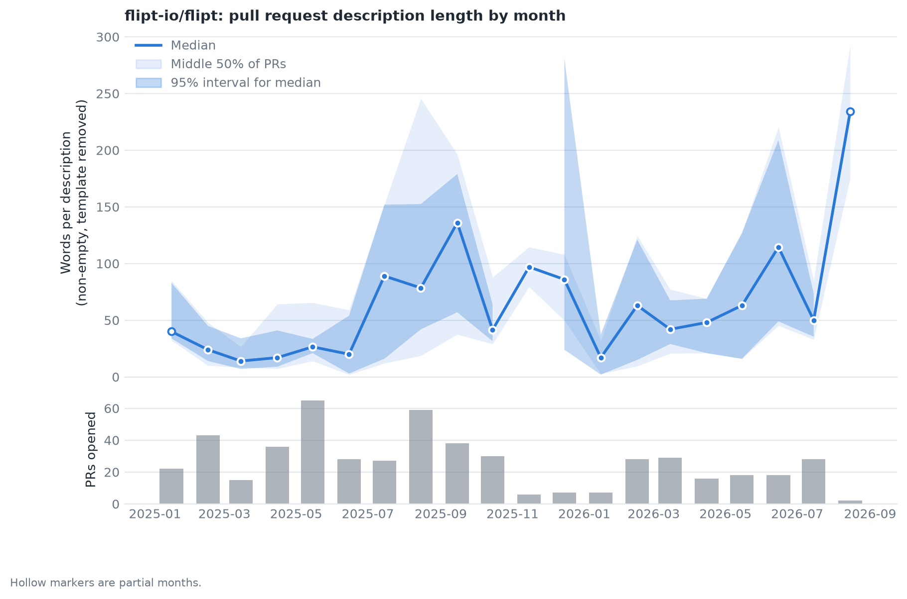
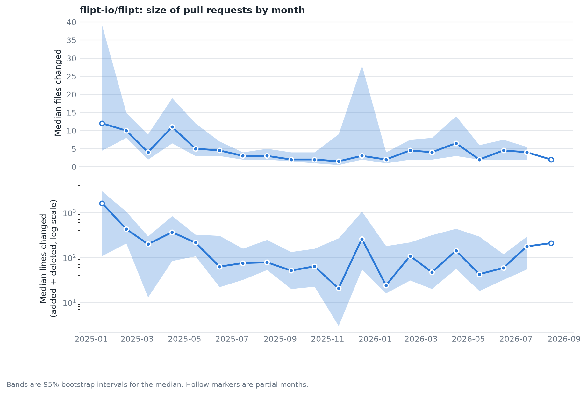
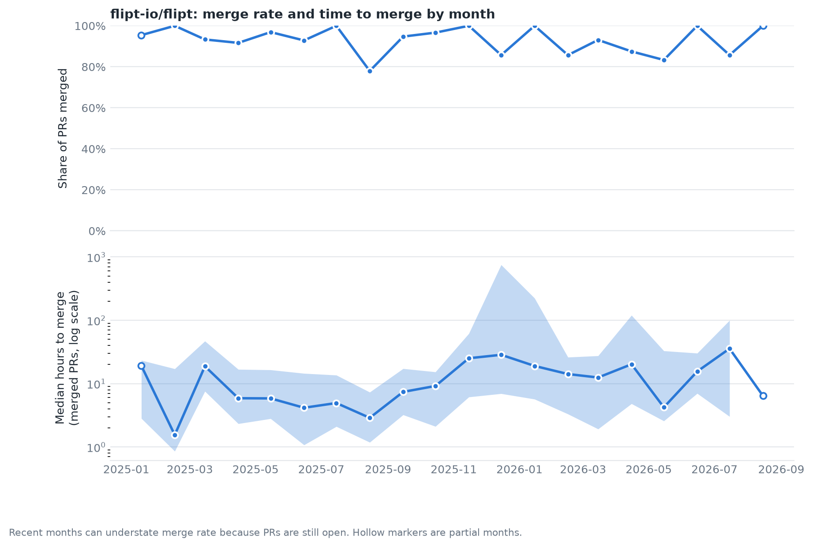
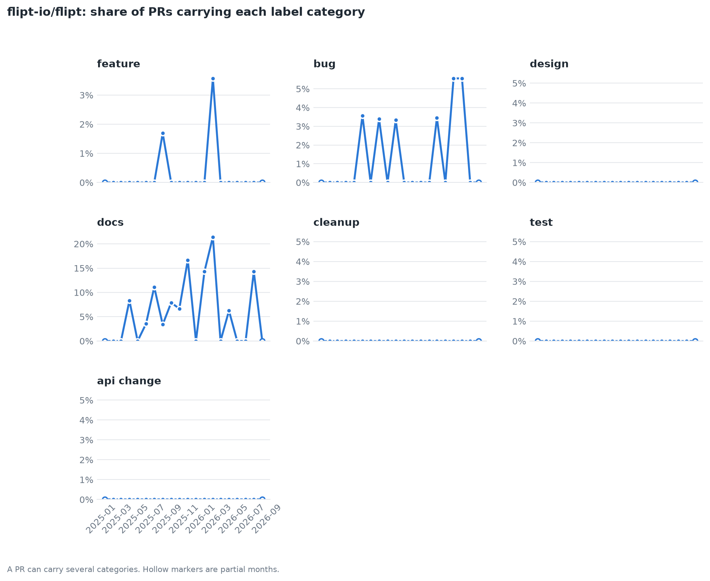
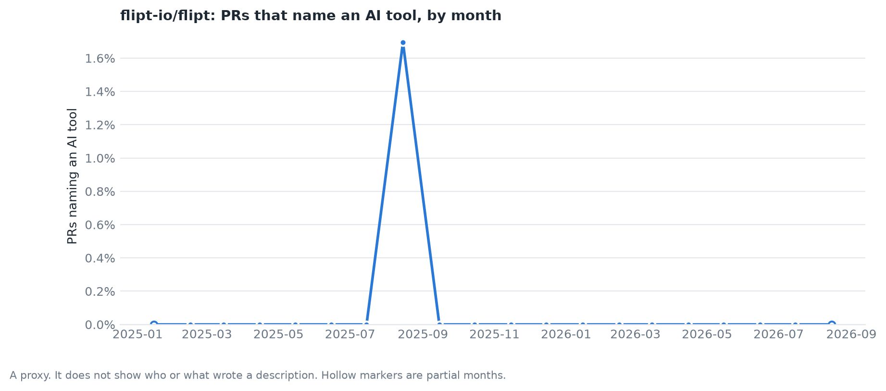

# Pull requests in flipt-io/flipt: description length, size, speed and labels

Window 2025-01-06 to 2026-08-17 (UTC). Data fetched 2026-11-20. prwords 3.0.0, generated 2026-11-26. Method fixed in advance in `docs/ANALYSIS_PLAN.md`.

## 1. Data

- Repository primary language: Go
- Pull requests opened in the window: 2,390
- Removed as bot accounts: 1,868
- Analysed: 522 PRs from 34 authors
- Merged: 481 (92.1%). Closed without merging: 41 (7.9%). Still open: 0
- Follow-up: merge outcomes use a 30-day follow-up. PRs without enough follow-up: 0
- Empty descriptions after cleaning: 16.3%

## 2. Did the PR template change?

No template line appeared or disappeared with a share of 50% or more. Template text was detected monthly and removed before counting words.

Distinct template lines detected: 0.

## 3. First 28 days versus last 28 days

First window 2025-01-06 to 2025-02-02. Last window 2026-07-21 to 2026-08-17. Ratios are last median divided by first median. Bootstrap intervals, 2,000 resamples.

| Metric                                |   n first |   n last |   Median first |   Median last |   Ratio |   Ratio low |   Ratio high |      p |   Cliff's delta |
|:--------------------------------------|----------:|---------:|---------------:|--------------:|--------:|------------:|-------------:|-------:|----------------:|
| Description words (non-empty)         |        18 |       10 |          40    |         72    |    1.8  |        0.53 |         4.07 | 0.26   |            0.27 |
| Files changed                         |        22 |       11 |          12    |          2    |    0.17 |        0.05 |         0.8  | 0.042  |           -0.44 |
| Lines added                           |        22 |       11 |         299    |        164    |    0.55 |        0.07 |         6.14 | 0.48   |           -0.16 |
| Lines deleted                         |        22 |       11 |         674    |         12    |    0.02 |        0    |         0.9  | 0.036  |           -0.46 |
| Net lines (added minus deleted)       |        22 |       11 |          -3.5  |         74    |  nan    |        7.5  |       350    | 0.0013 |            0.7  |
| Lines changed (added plus deleted)    |        22 |       11 |        1621    |        197    |    0.12 |        0.02 |         1.62 | 0.13   |           -0.33 |
| Hours from open to merge (merged PRs) |        21 |        9 |          19.12 |          9.96 |    0.52 |        0.12 |       143.31 | 0.39   |            0.21 |
| Commits                               |        22 |       11 |           3.5  |          2    |    0.57 |        0.15 |         2    | 0.25   |           -0.25 |
| Comments                              |        22 |       11 |           1    |          2    |    2    |        1    |         6    | 0.0042 |            0.59 |
| Reviews                               |        22 |       11 |           1    |          2    |    2    |        1    |         2    | 0.024  |            0.45 |

| Measure                             |   n first |   n last | Share first   | Share last   |   Change (points) |       p |
|:------------------------------------|----------:|---------:|:--------------|:-------------|------------------:|--------:|
| Merged within follow-up period      |        22 |       11 | 95.5%         | 63.6%        |             -31.8 | 0.033   |
| Closed without merging              |        22 |       11 | 4.5%          | 18.2%        |              13.6 | 0.25    |
| Opened as draft                     |        22 |       11 | 4.5%          | 9.1%         |               4.5 | 1       |
| From outside contributors           |        22 |       11 | 18.2%         | 100.0%       |              81.8 | 7.1e-06 |
| Has a kind or type label            |        22 |       11 | 0.0%          | 0.0%         |               0   | 1       |
| Description text repeated elsewhere |        22 |       11 | 0.0%          | 0.0%         |               0   | 1       |
| Names an AI tool (disclosure)       |        22 |       11 | 0.0%          | 0.0%         |               0   | 1       |
| Label category: feature             |        22 |       11 | 0.0%          | 0.0%         |               0   | 1       |
| Label category: bug                 |        22 |       11 | 0.0%          | 0.0%         |               0   | 1       |
| Label category: design              |        22 |       11 | 0.0%          | 0.0%         |               0   | 1       |
| Label category: docs                |        22 |       11 | 0.0%          | 9.1%         |               9.1 | 0.33    |
| Label category: cleanup             |        22 |       11 | 0.0%          | 0.0%         |               0   | 1       |
| Label category: test                |        22 |       11 | 0.0%          | 0.0%         |               0   | 1       |
| Label category: api_change          |        22 |       11 | 0.0%          | 0.0%         |               0   | 1       |

## 4. Monthly trends

Theil-Sen slope per month and Kendall tau over full months only.

| metric                     |   months |   slope_per_month |   slope_ci_low |   slope_ci_high |     tau |       p |
|:---------------------------|---------:|------------------:|---------------:|----------------:|--------:|--------:|
| median_words               |       18 |             2.318 |         -0.6   |           5.5   |   0.309 |   0.075 |
| median_files_changed       |       18 |            -0.1   |         -0.458 |           0.083 |  -0.206 |   0.249 |
| median_additions           |       18 |            -3.167 |         -9.2   |           2.188 |  -0.236 |   0.172 |
| median_deletions           |       18 |            -0.833 |         -8.273 |           0.571 |  -0.145 |   0.403 |
| median_churn               |       18 |            -7.25  |        -20.643 |           1.75  |  -0.307 |   0.081 |
| median_hours_to_merge      |       18 |             0.943 |          0.179 |           1.605 |   0.399 |   0.021 |
| merge_rate                 |       18 |            -0.004 |         -0.01  |           0.004 |  -0.191 |   0.282 |
| share_outside_contributors |       18 |             0.041 |          0.025 |           0.053 |   0.691 |   0     |
| share_ai_disclosed         |       18 |            -0     |         -0     |          -0     |  -0.098 |   0.63  |
| median_comments            |       18 |            -0     |         -0     |          -0     |   0.127 |   0.512 |
| median_reviews             |       18 |            -0     |         -0     |           0.042 |   0.611 |   0.002 |
| share_feature              |       18 |            -0     |         -0     |          -0     |   0.042 |   0.834 |
| share_bug                  |       18 |            -0     |         -0     |           0.002 |   0.244 |   0.203 |
| share_design               |       18 |            -0     |         -0     |          -0     | nan     | nan     |
| share_docs                 |       18 |            -0     |         -0.003 |           0.011 |   0.134 |   0.457 |
| share_cleanup              |       18 |            -0     |         -0     |          -0     | nan     | nan     |
| share_test                 |       18 |            -0     |         -0     |          -0     | nan     | nan     |
| share_api_change           |       18 |            -0     |         -0     |          -0     | nan     | nan     |

## 5. Labels

Share of PRs with a kind or type label: 0.0% overall. Label coverage by month is in `monthly_summary.csv` (`share_has_kind_label`).

| category            |   n_prs |   share |   median_words |   median_files |   median_churn |   merge_rate |   median_hours_to_merge |   share_ai_disclosed |
|:--------------------|--------:|--------:|---------------:|---------------:|---------------:|-------------:|------------------------:|---------------------:|
| feature             |       2 |   0.004 |            437 |              4 |            500 |        1     |                   2.147 |                  0.5 |
| bug                 |       7 |   0.013 |             59 |              3 |             95 |        0.857 |                   3.334 |                  0   |
| design              |       0 |   0     |            nan |            nan |            nan |      nan     |                 nan     |                nan   |
| docs                |      27 |   0.052 |            105 |             14 |            574 |        0.963 |                  43.435 |                  0   |
| cleanup             |       0 |   0     |            nan |            nan |            nan |      nan     |                 nan     |                nan   |
| test                |       0 |   0     |            nan |            nan |            nan |      nan     |                 nan     |                nan   |
| api_change          |       0 |   0     |            nan |            nan |            nan |      nan     |                 nan     |                nan   |
| (no category label) |     487 |   0.933 |             41 |              4 |             99 |        0.92  |                   7.186 |                  0   |

## 6. Are PRs with signs of AI involvement smaller or larger?

Authorship is not observable. The proxy is `ai_disclosed`, defined in the analysis plan: 1 PRs (0.19%). 1 disclosed PRs are listed in `ai_disclosure_samples.csv` for manual audit.

### ai_disclosed

**Verdict: not testable.** Too few exposed PRs.

Pattern: lines changed: not estimated; files changed: not estimated; lines added: not estimated; lines deleted: not estimated; hours to merge: not estimated.

Not estimated: fewer than 30 exposed PRs (exposed PRs: 1).

### Robustness by tool (lines changed)

| tool        |   n exposed | status                    |
|:------------|------------:|:--------------------------|
| unspecified |           1 | fewer than 30 exposed PRs |

### File type check

Not run. Use `--file-check N` to sample N exposed PRs and matching unexposed PRs.

## 7. Other checks

- Outside contributors: 42.3% of PRs overall.
- Top 10 authors opened 95.2% of PRs.
- PRs whose description text is repeated elsewhere (10 or more words): 0.0%.

## 8. Limitations

- Word count and size describe PRs, not who wrote them. Proxies for AI involvement are noisy and omit undisclosed use.
- Added and deleted lines include generated or vendored files unless the project avoids committing them.
- Disclosure mostly captures tools that add attribution by default, so it is tool-skewed.
- Template removal is heuristic. Check `template_audit.csv`.
- One repository cannot support general claims. See the plan for replication.
- Months at the edges of the window are partial and are excluded from trend tests.

