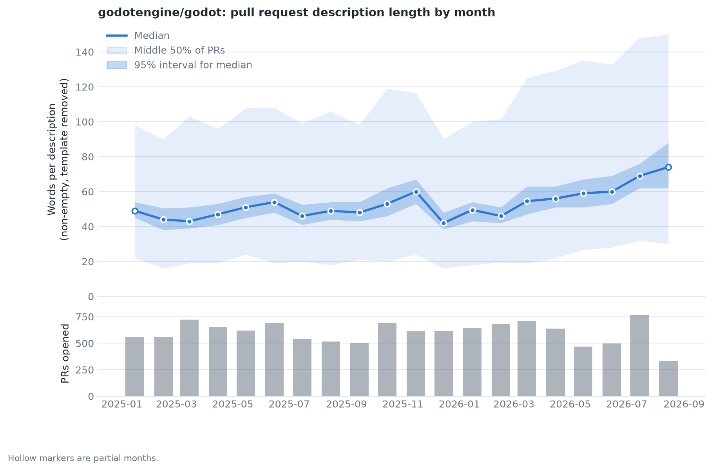
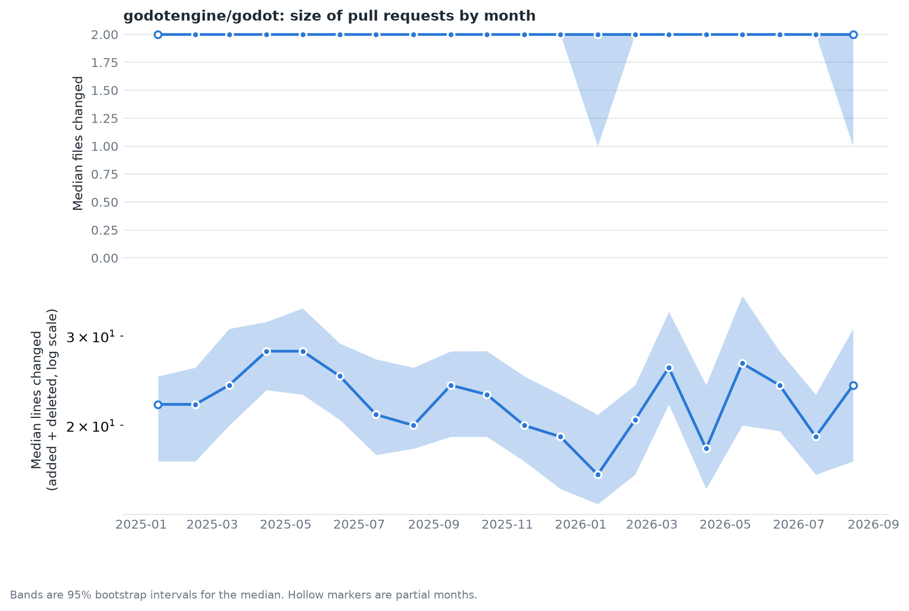
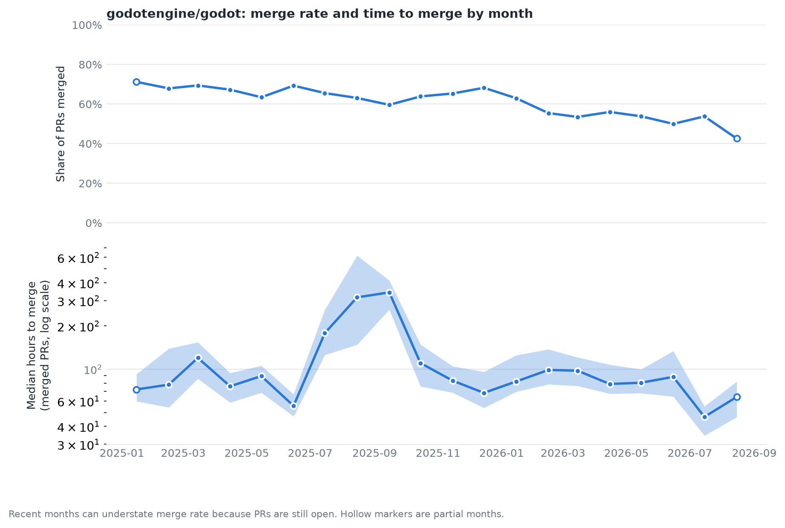
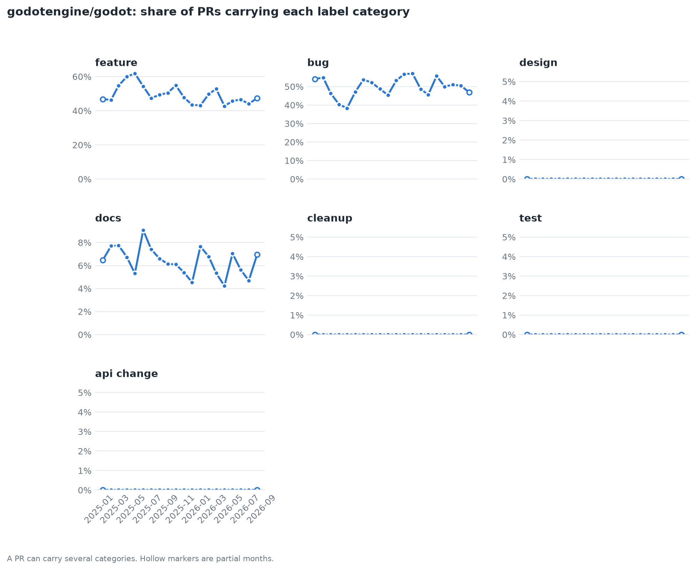
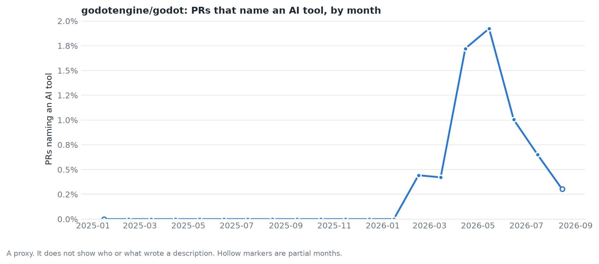
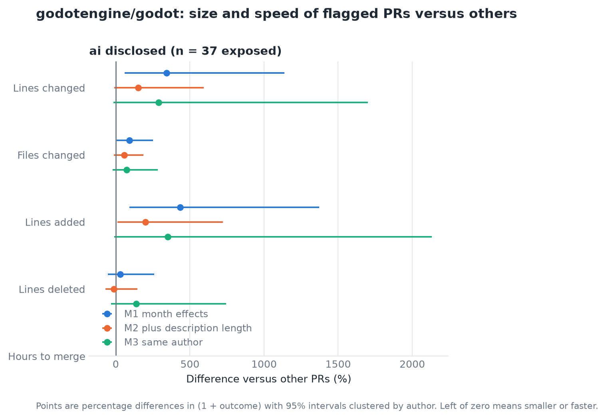

# Pull requests in godotengine/godot: description length, size, speed and labels

Window 2025-01-06 to 2026-08-17 (UTC). Data fetched 2026-11-19. prwords 3.0.0, generated 2026-11-26. Method fixed in advance in `docs/ANALYSIS_PLAN.md`.

## 1. Data

- Repository primary language: C++
- Pull requests opened in the window: 12,019
- Removed as bot accounts: 1
- Analysed: 12,018 PRs from 1,924 authors
- Merged: 7,406 (61.6%). Closed without merging: 1,716 (14.3%). Still open: 2,896
- Follow-up: merge outcomes use a 30-day follow-up. PRs without enough follow-up: 0
- Empty descriptions after cleaning: 1.7%

## 2. Did the PR template change?

No template line appeared or disappeared with a share of 50% or more. Template text was detected monthly and removed before counting words.

Distinct template lines detected: 2.

## 3. First 28 days versus last 28 days

First window 2025-01-06 to 2025-02-02. Last window 2026-07-21 to 2026-08-17. Ratios are last median divided by first median. Bootstrap intervals, 2,000 resamples.

| Metric                                |   n first |   n last |   Median first |   Median last |   Ratio |   Ratio low |   Ratio high |       p |   Cliff's delta |
|:--------------------------------------|----------:|---------:|---------------:|--------------:|--------:|------------:|-------------:|--------:|----------------:|
| Description words (non-empty)         |       590 |      598 |          49    |         74    |    1.51 |        1.34 |         1.72 | 5.2e-10 |            0.21 |
| Files changed                         |       596 |      599 |           2    |          2    |    1    |        1    |         1    | 0.6     |           -0.02 |
| Lines added                           |       596 |      599 |          12    |         16    |    1.33 |        1    |         1.81 | 0.5     |            0.02 |
| Lines deleted                         |       596 |      599 |           4    |          4    |    1    |        0.75 |         1.33 | 0.74    |           -0.01 |
| Net lines (added minus deleted)       |       596 |      599 |           4    |          5    |    1.25 |        0.8  |         2    | 0.14    |            0.05 |
| Lines changed (added plus deleted)    |       596 |      599 |          21    |         24    |    1.14 |        0.91 |         1.65 | 0.75    |            0.01 |
| Hours from open to merge (merged PRs) |       426 |      284 |          73.97 |         64.33 |    0.87 |        0.56 |         1.09 | 0.012   |           -0.11 |
| Commits                               |       596 |      599 |           1    |          1    |    1    |        1    |         1    | 3.6e-06 |            0.08 |
| Comments                              |       596 |      599 |           2    |          1    |    0.5  |        0.5  |         0.5  | 1.2e-15 |           -0.26 |
| Reviews                               |       596 |      599 |           2    |          1    |    0.5  |        0.5  |         1    | 2e-14   |           -0.25 |

| Measure                             |   n first |   n last | Share first   | Share last   |   Change (points) |       p |
|:------------------------------------|----------:|---------:|:--------------|:-------------|------------------:|--------:|
| Merged within follow-up period      |       596 |      599 | 53.0%         | 41.7%        |             -11.3 | 0.0001  |
| Closed without merging              |       596 |      599 | 14.8%         | 19.7%        |               4.9 | 0.026   |
| Opened as draft                     |       596 |      599 | 5.0%          | 5.8%         |               0.8 | 0.61    |
| From outside contributors           |       596 |      599 | 57.7%         | 68.9%        |              11.2 | 5.8e-05 |
| Has a kind or type label            |       596 |      599 | 0.0%          | 0.0%         |               0   | 1       |
| Description text repeated elsewhere |       596 |      599 | 0.3%          | 2.8%         |               2.5 | 0.00067 |
| Names an AI tool (disclosure)       |       596 |      599 | 0.0%          | 0.5%         |               0.5 | 0.25    |
| Label category: feature             |       596 |      599 | 46.6%         | 44.1%        |              -2.6 | 0.38    |
| Label category: bug                 |       596 |      599 | 54.2%         | 50.3%        |              -3.9 | 0.18    |
| Label category: design              |       596 |      599 | 0.0%          | 0.0%         |               0   | 1       |
| Label category: docs                |       596 |      599 | 6.9%          | 6.5%         |              -0.4 | 0.82    |
| Label category: cleanup             |       596 |      599 | 0.0%          | 0.0%         |               0   | 1       |
| Label category: test                |       596 |      599 | 0.0%          | 0.0%         |               0   | 1       |
| Label category: api_change          |       596 |      599 | 0.0%          | 0.0%         |               0   | 1       |

## 4. Monthly trends

Theil-Sen slope per month and Kendall tau over full months only.

| metric                     |   months |   slope_per_month |   slope_ci_low |   slope_ci_high |     tau |       p |
|:---------------------------|---------:|------------------:|---------------:|----------------:|--------:|--------:|
| median_words               |       18 |             1     |          0.455 |           1.5   |   0.533 |   0.002 |
| median_files_changed       |       18 |            -0     |         -0     |          -0     | nan     | nan     |
| median_additions           |       18 |            -0.167 |         -0.444 |           0.083 |  -0.238 |   0.18  |
| median_deletions           |       18 |            -0     |         -0.125 |          -0     |  -0.455 |   0.02  |
| median_churn               |       18 |            -0.25  |         -0.7   |           0.125 |  -0.273 |   0.119 |
| median_hours_to_merge      |       18 |            -1.059 |         -5.714 |           1.26  |  -0.163 |   0.369 |
| merge_rate                 |       18 |            -0.01  |         -0.013 |          -0.006 |  -0.66  |   0     |
| share_outside_contributors |       18 |             0.005 |          0.001 |           0.009 |   0.386 |   0.026 |
| share_ai_disclosed         |       18 |             0     |         -0     |           0.001 |   0.65  |   0.001 |
| median_comments            |       18 |            -0     |         -0     |          -0     |  -0.475 |   0.019 |
| median_reviews             |       18 |            -0     |         -0     |          -0     |  -0.325 |   0.11  |
| share_feature              |       18 |            -0.006 |         -0.012 |          -0.001 |  -0.399 |   0.021 |
| share_bug                  |       18 |             0.003 |         -0.002 |           0.008 |   0.19  |   0.293 |
| share_design               |       18 |            -0     |         -0     |          -0     | nan     | nan     |
| share_docs                 |       18 |            -0.002 |         -0.003 |          -0     |  -0.412 |   0.017 |
| share_cleanup              |       18 |            -0     |         -0     |          -0     | nan     | nan     |
| share_test                 |       18 |            -0     |         -0     |          -0     | nan     | nan     |
| share_api_change           |       18 |            -0     |         -0     |          -0     | nan     | nan     |

## 5. Labels

Share of PRs with a kind or type label: 0.0% overall. Label coverage by month is in `monthly_summary.csv` (`share_has_kind_label`).

| category            |   n_prs |   share |   median_words |   median_files |   median_churn |   merge_rate |   median_hours_to_merge |   share_ai_disclosed |
|:--------------------|--------:|--------:|---------------:|---------------:|---------------:|-------------:|------------------------:|---------------------:|
| feature             |    5974 |   0.497 |             62 |              3 |           51.5 |        0.541 |                 218.95  |                0.003 |
| bug                 |    5971 |   0.497 |             45 |              1 |           11   |        0.736 |                  58.635 |                0.001 |
| design              |       0 |   0     |            nan |            nan |          nan   |      nan     |                 nan     |              nan     |
| docs                |     763 |   0.063 |             27 |              1 |            4   |        0.624 |                  97.284 |                0.003 |
| cleanup             |       0 |   0     |            nan |            nan |          nan   |      nan     |                 nan     |              nan     |
| test                |       0 |   0     |            nan |            nan |          nan   |      nan     |                 nan     |              nan     |
| api_change          |       0 |   0     |            nan |            nan |          nan   |      nan     |                 nan     |              nan     |
| (no category label) |     402 |   0.033 |             66 |              2 |           29.5 |        0.07  |                  35.344 |                0.032 |

## 6. Are PRs with signs of AI involvement smaller or larger?

Authorship is not observable. The proxy is `ai_disclosed`, defined in the analysis plan: 37 PRs (0.31%). 37 disclosed PRs are listed in `ai_disclosure_samples.csv` for manual audit.

### ai_disclosed

**Verdict: no difference detected.** The same-month gap does not hold within the same author, so it reflects who discloses AI use, not the PRs themselves.

Pattern: lines changed: no clear difference; files changed: no clear difference; lines added: no clear difference; lines deleted: no clear difference; hours to merge: not estimated.

Within-author permutation p-value, lines changed: 0.0030.

| Outcome       | Model                      |     n |   n exposed |   Median exposed |   Median others | Difference (95% CI)        |      p |   p (Holm) |
|:--------------|:---------------------------|------:|------------:|-----------------:|----------------:|:---------------------------|-------:|-----------:|
| Lines changed | M1 month effects           | 12018 |          37 |               78 |              22 | +342.9% (+58.4 to +1138.1) | 0.0046 |     0.014  |
| Lines changed | M2 plus description length | 12018 |          37 |               78 |              22 | +150.7% (-9.4 to +593.4)   | 0.077  |     0.23   |
| Lines changed | M3 same author             | 12018 |          37 |               78 |              22 | +288.8% (-16.0 to +1700.1) | 0.082  |     0.26   |
| Files changed | M1 month effects           | 12018 |          37 |                2 |               2 | +91.9% (+4.8 to +251.4)    | 0.035  |     0.069  |
| Files changed | M2 plus description length | 12018 |          37 |                2 |               2 | +56.4% (-14.2 to +185.0)   | 0.14   |     0.29   |
| Files changed | M3 same author             | 12018 |          37 |                2 |               2 | +73.8% (-21.1 to +283.1)   | 0.17   |     0.34   |
| Lines added   | M1 month effects           | 12018 |          37 |               39 |              15 | +433.2% (+93.1 to +1372.0) | 0.0012 |     0.0049 |
| Lines added   | M2 plus description length | 12018 |          37 |               39 |              15 | +200.7% (+10.0 to +722.0)  | 0.032  |     0.13   |
| Lines added   | M3 same author             | 12018 |          37 |               39 |              15 | +350.2% (-9.3 to +2133.2)  | 0.066  |     0.26   |
| Lines deleted | M1 month effects           | 12018 |          37 |                1 |               4 | +29.1% (-53.7 to +260.2)   | 0.63   |     0.63   |
| Lines deleted | M2 plus description length | 12018 |          37 |                1 |               4 | -13.0% (-69.3 to +146.5)   | 0.79   |     0.79   |
| Lines deleted | M3 same author             | 12018 |          37 |                1 |               4 | +137.7% (-33.1 to +744.8)  | 0.18   |     0.34   |

### Robustness by tool (lines changed)

| tool        |   n exposed | Same month                 | Same author                | call                | status                    |
|:------------|------------:|:---------------------------|:---------------------------|:--------------------|:--------------------------|
| unspecified |          33 | +311.2% (+33.2 to +1169.2) | +206.1% (-39.9 to +1458.6) | no clear difference | ok                        |
| claude      |           2 | n/a                        | n/a                        | nan                 | fewer than 30 exposed PRs |
| chatgpt     |           2 | n/a                        | n/a                        | nan                 | fewer than 30 exposed PRs |

### File type check

Sample: 33 exposed and 36 unexposed PRs from the same months. 5 PRs with more than 100 files were excluded.

Share of changed lines by file type:

| group     |   n_prs | code   | tests   | docs   | config   | generated   | other   |   median_code_test_lines |
|:----------|--------:|:-------|:--------|:-------|:---------|:------------|:--------|-------------------------:|
| exposed   |      33 | 94.7%  | 3.2%    | 1.8%   | 0.0%     | 0.0%        | 0.3%    |                     35   |
| unexposed |      36 | 72.2%  | 4.6%    | 5.7%   | 16.7%    | 0.0%        | 0.9%    |                     29.5 |

Code and test lines only, same month: +10.8% (95% CI -58.8 to +198.2), p = 0.84. This is a robustness check and does not change the verdict.

## 7. Other checks

- Outside contributors: 61.5% of PRs overall.
- Top 10 authors opened 29.1% of PRs.
- PRs whose description text is repeated elsewhere (10 or more words): 0.6%.

## 8. Limitations

- Word count and size describe PRs, not who wrote them. Proxies for AI involvement are noisy and omit undisclosed use.
- Added and deleted lines include generated or vendored files unless the project avoids committing them.
- Disclosure mostly captures tools that add attribution by default, so it is tool-skewed.
- Template removal is heuristic. Check `template_audit.csv`.
- One repository cannot support general claims. See the plan for replication.
- Months at the edges of the window are partial and are excluded from trend tests.

