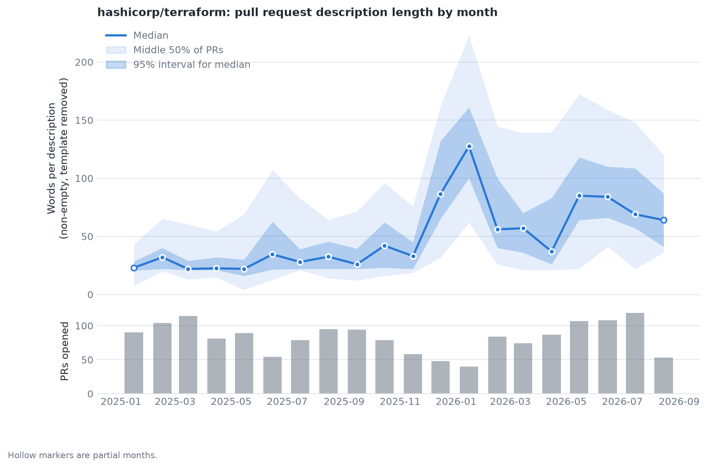
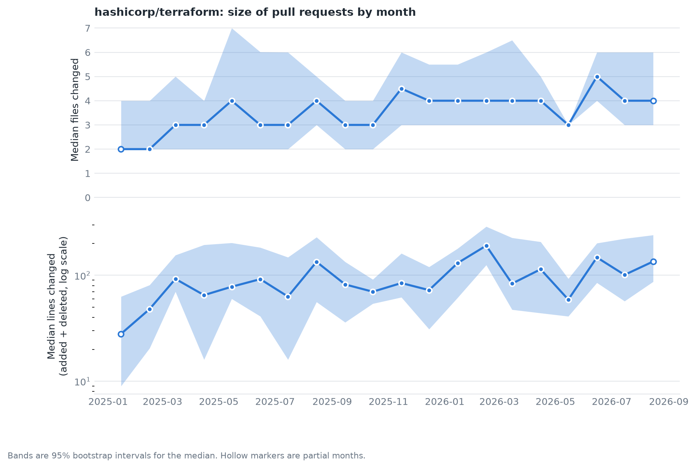
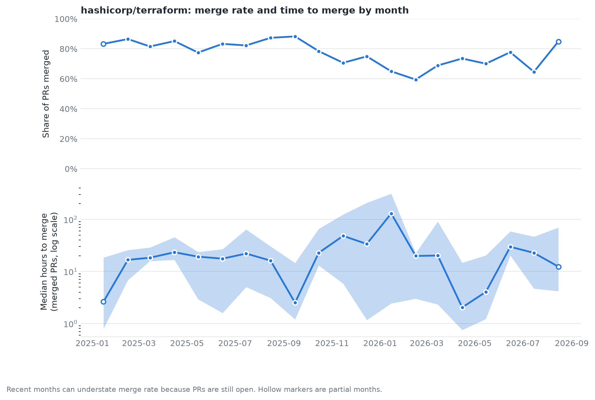
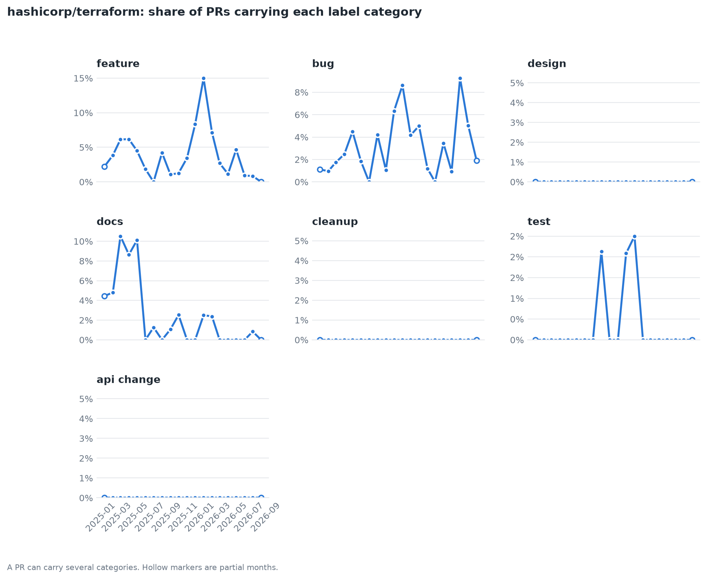
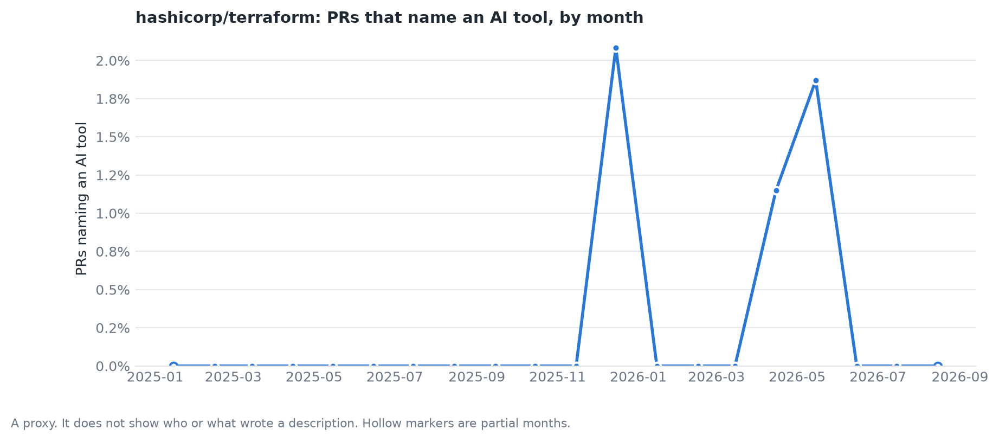

# Pull requests in hashicorp/terraform: description length, size, speed and labels

Window 2025-01-06 to 2026-08-17 (UTC). Data fetched 2026-11-19. prwords 3.0.0, generated 2026-11-26. Method fixed in advance in `docs/ANALYSIS_PLAN.md`.

## 1. Data

- Repository primary language: Go
- Pull requests opened in the window: 2,062
- Removed as bot accounts: 405
- Analysed: 1,657 PRs from 237 authors
- Merged: 1,283 (77.4%). Closed without merging: 326 (19.7%). Still open: 48
- Follow-up: merge outcomes use a 30-day follow-up. PRs without enough follow-up: 0
- Empty descriptions after cleaning: 1.9%

## 2. Did the PR template change?

Lines that appeared or disappeared across the window (full list in `template_audit.csv`):

| line                                                                                                                    | first_month   | last_month   |   months |   peak_share | change_event   |
|:------------------------------------------------------------------------------------------------------------------------|:--------------|:-------------|---------:|-------------:|:---------------|
| 11.x                                                                                                                    | 2025-01       | 2025-02      |        2 |         0.52 | removed        |
| ## rollback plan                                                                                                        | 2025-05       | 2026-08      |       14 |         0.77 | added          |
| if a change needs to be reverted, we will roll out an update to the code within 7 days.                                 | 2025-05       | 2026-08      |       14 |         0.77 | added          |
| ## changes to security controls                                                                                         | 2025-05       | 2026-08      |       14 |         0.77 | added          |
| are there any changes to security controls (access controls, encryption, logging) in this pull request? if so, explain. | 2025-05       | 2026-08      |       14 |         0.75 | added          |
| 14.x                                                                                                                    | 2025-07       | 2025-09      |        3 |         0.56 | added          |
| 15.x                                                                                                                    | 2025-10       | 2026-02      |        2 |         0.62 | added          |
| 16.x                                                                                                                    | 2026-04       | 2026-07      |        4 |         0.56 | added          |
| 17.x                                                                                                                    | 2026-08       | 2026-08      |        1 |         0.68 | added          |

Distinct template lines detected: 16.

## 3. First 28 days versus last 28 days

First window 2025-01-06 to 2025-02-02. Last window 2026-07-21 to 2026-08-17. Ratios are last median divided by first median. Bootstrap intervals, 2,000 resamples.

| Metric                                |   n first |   n last |   Median first |   Median last |   Ratio |   Ratio low |   Ratio high |       p |   Cliff's delta |
|:--------------------------------------|----------:|---------:|---------------:|--------------:|--------:|------------:|-------------:|--------:|----------------:|
| Description words (non-empty)         |        88 |      100 |          23    |         79    |    3.43 |        2.17 |         4.14 | 2.8e-09 |            0.5  |
| Files changed                         |        90 |      100 |           2    |          4    |    2    |        1.11 |         2.5  | 0.0032  |            0.24 |
| Lines added                           |        90 |      100 |          20.5  |         82    |    4    |        1.77 |        13    | 0.00026 |            0.31 |
| Lines deleted                         |        90 |      100 |           4    |         13    |    3.25 |        1.25 |         9.25 | 0.0036  |            0.24 |
| Net lines (added minus deleted)       |        90 |      100 |           7    |         40.5  |    5.79 |        1.5  |        14.14 | 0.046   |            0.17 |
| Lines changed (added plus deleted)    |        90 |      100 |          28    |        126.5  |    4.52 |        1.49 |        13.32 | 7.7e-05 |            0.33 |
| Hours from open to merge (merged PRs) |        75 |       77 |           2.61 |         12.37 |    4.73 |        0.6  |        19.88 | 0.025   |            0.21 |
| Commits                               |        90 |      100 |           1.5  |          2    |    1.33 |        0.75 |         2    | 0.54    |            0.05 |
| Comments                              |        90 |      100 |           1    |          1    |    1    |        1    |         1    | 0.98    |            0    |
| Reviews                               |        90 |      100 |           1    |          1    |    1    |        0.5  |         2    | 0.37    |           -0.07 |

| Measure                             |   n first |   n last | Share first   | Share last   |   Change (points) |       p |
|:------------------------------------|----------:|---------:|:--------------|:-------------|------------------:|--------:|
| Merged within follow-up period      |        90 |      100 | 83.3%         | 76.0%        |              -7.3 | 0.28    |
| Closed without merging              |        90 |      100 | 15.6%         | 22.0%        |               6.4 | 0.27    |
| Opened as draft                     |        90 |      100 | 5.6%          | 6.0%         |               0.4 | 1       |
| From outside contributors           |        90 |      100 | 62.2%         | 32.0%        |             -30.2 | 4.1e-05 |
| Has a kind or type label            |        90 |      100 | 0.0%          | 0.0%         |               0   | 1       |
| Description text repeated elsewhere |        90 |      100 | 22.2%         | 3.0%         |             -19.2 | 7.2e-05 |
| Names an AI tool (disclosure)       |        90 |      100 | 0.0%          | 0.0%         |               0   | 1       |
| Label category: feature             |        90 |      100 | 2.2%          | 1.0%         |              -1.2 | 0.6     |
| Label category: bug                 |        90 |      100 | 1.1%          | 4.0%         |               2.9 | 0.37    |
| Label category: design              |        90 |      100 | 0.0%          | 0.0%         |               0   | 1       |
| Label category: docs                |        90 |      100 | 4.4%          | 0.0%         |              -4.4 | 0.049   |
| Label category: cleanup             |        90 |      100 | 0.0%          | 0.0%         |               0   | 1       |
| Label category: test                |        90 |      100 | 0.0%          | 0.0%         |               0   | 1       |
| Label category: api_change          |        90 |      100 | 0.0%          | 0.0%         |               0   | 1       |

## 4. Monthly trends

Theil-Sen slope per month and Kendall tau over full months only.

| metric                     |   months |   slope_per_month |   slope_ci_low |   slope_ci_high |     tau |       p |
|:---------------------------|---------:|------------------:|---------------:|----------------:|--------:|--------:|
| median_words               |       18 |             3.136 |          1.364 |           4.591 |   0.59  |   0.001 |
| median_files_changed       |       18 |             0.077 |         -0     |           0.143 |   0.492 |   0.011 |
| median_additions           |       18 |             1.643 |         -0.333 |           4.35  |   0.294 |   0.096 |
| median_deletions           |       18 |             0.125 |         -0.562 |           0.583 |   0.046 |   0.823 |
| median_churn               |       18 |             2.562 |         -0.462 |           5.667 |   0.294 |   0.096 |
| median_hours_to_merge      |       18 |             0.249 |         -1.02  |           1.01  |   0.111 |   0.55  |
| merge_rate                 |       18 |            -0.011 |         -0.017 |          -0.005 |  -0.503 |   0.003 |
| share_outside_contributors |       18 |            -0.006 |         -0.016 |           0.006 |  -0.203 |   0.26  |
| share_ai_disclosed         |       18 |            -0     |         -0     |          -0     |   0.303 |   0.126 |
| median_comments            |       18 |            -0     |         -0     |          -0     |   0.277 |   0.173 |
| median_reviews             |       18 |            -0     |         -0     |          -0     | nan     | nan     |
| share_feature              |       18 |            -0.001 |         -0.004 |           0.002 |  -0.176 |   0.33  |
| share_bug                  |       18 |             0.002 |         -0.001 |           0.005 |   0.184 |   0.289 |
| share_design               |       18 |            -0     |         -0     |          -0     | nan     | nan     |
| share_docs                 |       18 |            -0.002 |         -0.006 |          -0     |  -0.456 |   0.012 |
| share_cleanup              |       18 |            -0     |         -0     |          -0     | nan     | nan     |
| share_test                 |       18 |            -0     |         -0     |          -0     |   0.07  |   0.724 |
| share_api_change           |       18 |            -0     |         -0     |          -0     | nan     | nan     |

## 5. Labels

Share of PRs with a kind or type label: 0.0% overall. Label coverage by month is in `monthly_summary.csv` (`share_has_kind_label`).

| category            |   n_prs |   share |   median_words |   median_files |   median_churn |   merge_rate |   median_hours_to_merge |   share_ai_disclosed |
|:--------------------|--------:|--------:|---------------:|---------------:|---------------:|-------------:|------------------------:|---------------------:|
| feature             |      57 |   0.034 |             92 |            3   |          155   |        0.316 |                 192.47  |                0     |
| bug                 |      52 |   0.031 |             87 |            3   |           57.5 |        0.481 |                  96.426 |                0.019 |
| design              |       0 |   0     |            nan |          nan   |          nan   |      nan     |                 nan     |              nan     |
| docs                |      45 |   0.027 |             19 |            1   |            6   |        0.778 |                  21.799 |                0     |
| cleanup             |       0 |   0     |            nan |          nan   |          nan   |      nan     |                 nan     |              nan     |
| test                |       4 |   0.002 |             18 |            2.5 |           95   |        0.75  |                   4.218 |                0     |
| api_change          |       0 |   0     |            nan |          nan   |          nan   |      nan     |                 nan     |              nan     |
| (no category label) |    1500 |   0.905 |             40 |            4   |           91   |        0.802 |                  17.214 |                0.002 |

## 6. Are PRs with signs of AI involvement smaller or larger?

Authorship is not observable. The proxy is `ai_disclosed`, defined in the analysis plan: 4 PRs (0.24%). 4 disclosed PRs are listed in `ai_disclosure_samples.csv` for manual audit.

### ai_disclosed

**Verdict: not testable.** Too few exposed PRs.

Pattern: lines changed: not estimated; files changed: not estimated; lines added: not estimated; lines deleted: not estimated; hours to merge: not estimated.

Not estimated: fewer than 30 exposed PRs (exposed PRs: 4).

### Robustness by tool (lines changed)

| tool        |   n exposed | status                    |
|:------------|------------:|:--------------------------|
| unspecified |           2 | fewer than 30 exposed PRs |
| claude      |           1 | fewer than 30 exposed PRs |
| copilot     |           1 | fewer than 30 exposed PRs |

### File type check

Not run. Use `--file-check N` to sample N exposed PRs and matching unexposed PRs.

## 7. Other checks

- Outside contributors: 51.9% of PRs overall.
- Top 10 authors opened 75.9% of PRs.
- PRs whose description text is repeated elsewhere (10 or more words): 11.6%.

## 8. Limitations

- Word count and size describe PRs, not who wrote them. Proxies for AI involvement are noisy and omit undisclosed use.
- Added and deleted lines include generated or vendored files unless the project avoids committing them.
- Disclosure mostly captures tools that add attribution by default, so it is tool-skewed.
- Template removal is heuristic. Check `template_audit.csv`.
- One repository cannot support general claims. See the plan for replication.
- Months at the edges of the window are partial and are excluded from trend tests.

