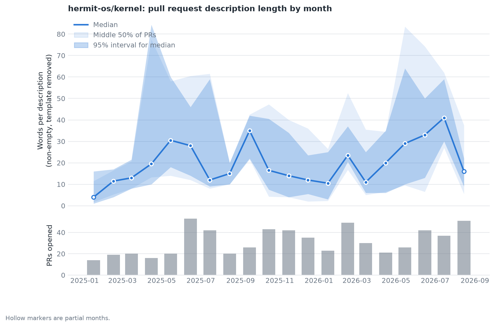
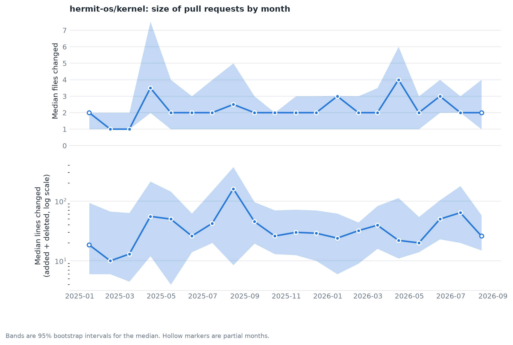
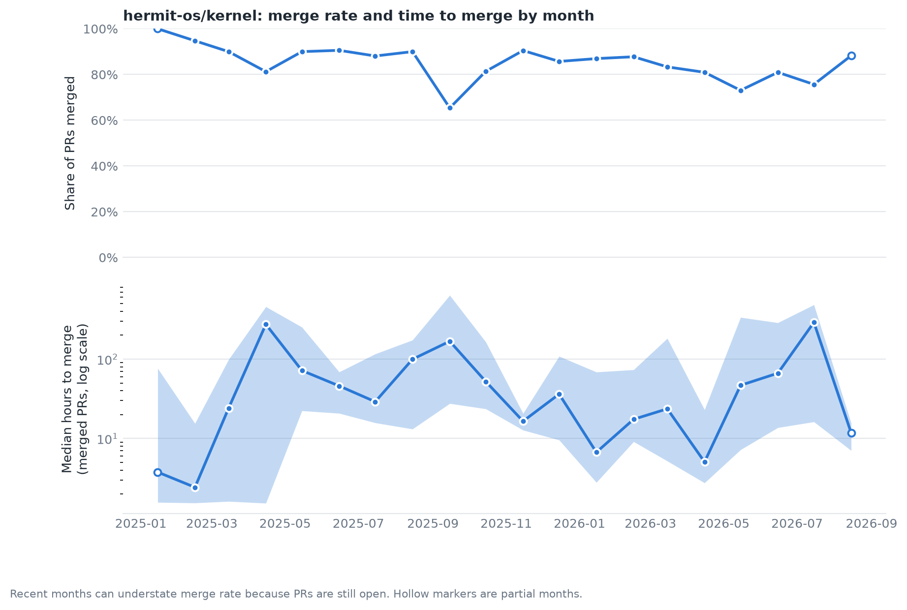
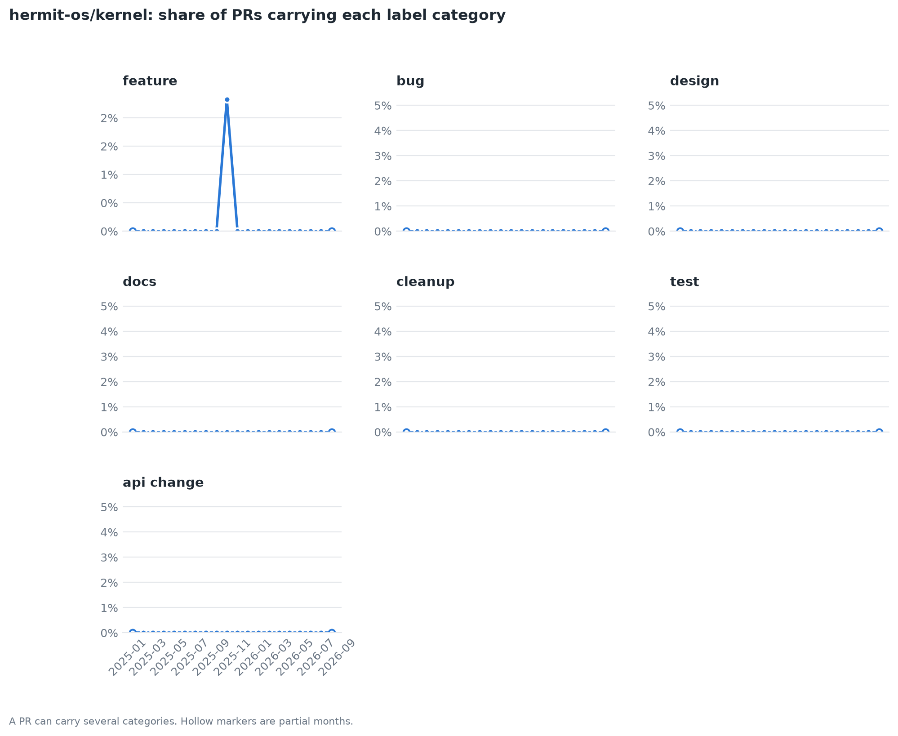
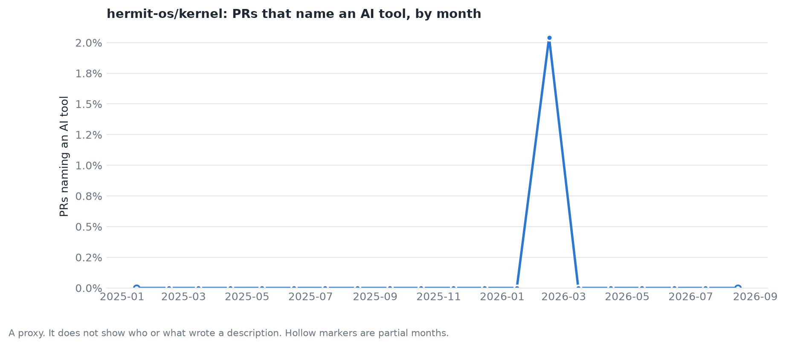

# Pull requests in hermit-os/kernel: description length, size, speed and labels

Window 2025-01-06 to 2026-08-17 (UTC). Data fetched 2026-11-20. prwords 3.0.0, generated 2026-11-26. Method fixed in advance in `docs/ANALYSIS_PLAN.md`.

## 1. Data

- Repository primary language: Rust
- Pull requests opened in the window: 995
- Removed as bot accounts: 366
- Analysed: 629 PRs from 27 authors
- Merged: 535 (85.1%). Closed without merging: 63 (10.0%). Still open: 31
- Follow-up: merge outcomes use a 30-day follow-up. PRs without enough follow-up: 0
- Empty descriptions after cleaning: 32.3%

## 2. Did the PR template change?

No template line appeared or disappeared with a share of 50% or more. Template text was detected monthly and removed before counting words.

Distinct template lines detected: 0.

## 3. First 28 days versus last 28 days

First window 2025-01-06 to 2025-02-02. Last window 2026-07-21 to 2026-08-17. Ratios are last median divided by first median. Bootstrap intervals, 2,000 resamples.

| Metric                                |   n first |   n last |   Median first |   Median last |   Ratio |   Ratio low |   Ratio high |      p |   Cliff's delta |
|:--------------------------------------|----------:|---------:|---------------:|--------------:|--------:|------------:|-------------:|-------:|----------------:|
| Description words (non-empty)         |         8 |       51 |           4    |         20    |    5    |        1.19 |        19    | 0.0089 |            0.58 |
| Files changed                         |        14 |       59 |           2    |          2    |    1    |        0.8  |         3    | 0.16   |            0.23 |
| Lines added                           |        14 |       59 |          14    |         16    |    1.14 |        0.19 |         7.21 | 0.49   |            0.12 |
| Lines deleted                         |        14 |       59 |           2.5  |         10    |    4    |        0.92 |        11.2  | 0.062  |            0.32 |
| Net lines (added minus deleted)       |        14 |       59 |           2.5  |          0    |    0    |       -0.33 |         1.6  | 0.5    |           -0.12 |
| Lines changed (added plus deleted)    |        14 |       59 |          18.5  |         29    |    1.57 |        0.26 |         7.51 | 0.24   |            0.2  |
| Hours from open to merge (merged PRs) |        14 |       52 |           3.77 |         11.85 |    3.15 |        0.14 |         7.97 | 0.43   |            0.14 |
| Commits                               |        14 |       59 |           1    |          1    |    1    |        1    |         2    | 0.025  |            0.34 |
| Comments                              |        14 |       59 |           0    |          0    |  nan    |      nan    |       nan    | 0.16   |            0.2  |
| Reviews                               |        14 |       59 |           0.5  |          1    |    2    |        1    |         2    | 0.031  |            0.35 |

| Measure                             |   n first |   n last | Share first   | Share last   |   Change (points) |    p |
|:------------------------------------|----------:|---------:|:--------------|:-------------|------------------:|-----:|
| Merged within follow-up period      |        14 |       59 | 92.9%         | 83.1%        |              -9.8 | 0.68 |
| Closed without merging              |        14 |       59 | 0.0%          | 5.1%         |               5.1 | 1    |
| Opened as draft                     |        14 |       59 | 0.0%          | 8.5%         |               8.5 | 0.58 |
| From outside contributors           |        14 |       59 | 21.4%         | 22.0%        |               0.6 | 1    |
| Has a kind or type label            |        14 |       59 | 0.0%          | 0.0%         |               0   | 1    |
| Description text repeated elsewhere |        14 |       59 | 0.0%          | 0.0%         |               0   | 1    |
| Names an AI tool (disclosure)       |        14 |       59 | 0.0%          | 0.0%         |               0   | 1    |
| Label category: feature             |        14 |       59 | 0.0%          | 0.0%         |               0   | 1    |
| Label category: bug                 |        14 |       59 | 0.0%          | 0.0%         |               0   | 1    |
| Label category: design              |        14 |       59 | 0.0%          | 0.0%         |               0   | 1    |
| Label category: docs                |        14 |       59 | 0.0%          | 0.0%         |               0   | 1    |
| Label category: cleanup             |        14 |       59 | 0.0%          | 0.0%         |               0   | 1    |
| Label category: test                |        14 |       59 | 0.0%          | 0.0%         |               0   | 1    |
| Label category: api_change          |        14 |       59 | 0.0%          | 0.0%         |               0   | 1    |

## 4. Monthly trends

Theil-Sen slope per month and Kendall tau over full months only.

| metric                     |   months |   slope_per_month |   slope_ci_low |   slope_ci_high |     tau |       p |
|:---------------------------|---------:|------------------:|---------------:|----------------:|--------:|--------:|
| median_words               |       18 |             0.6   |         -0.25  |           1.75  |   0.223 |   0.197 |
| median_files_changed       |       18 |            -0     |         -0     |           0.091 |   0.297 |   0.118 |
| median_additions           |       18 |             0.333 |         -0.786 |           1.412 |   0.079 |   0.649 |
| median_deletions           |       18 |             0.083 |         -0.5   |           0.5   |   0.054 |   0.76  |
| median_churn               |       18 |             0.567 |         -2     |           2.208 |   0.059 |   0.733 |
| median_hours_to_merge      |       18 |             0.079 |         -5.598 |           5.324 |   0.007 |   1     |
| merge_rate                 |       18 |            -0.008 |         -0.012 |          -0.003 |  -0.497 |   0.004 |
| share_outside_contributors |       18 |             0.003 |         -0.016 |           0.016 |   0.052 |   0.762 |
| share_ai_disclosed         |       18 |            -0     |         -0     |          -0     |   0.137 |   0.5   |
| median_comments            |       18 |            -0     |         -0     |          -0     | nan     | nan     |
| median_reviews             |       18 |            -0     |         -0     |           0.091 |   0.369 |   0.056 |
| share_feature              |       18 |            -0     |         -0     |          -0     |  -0.02  |   0.923 |
| share_bug                  |       18 |            -0     |         -0     |          -0     | nan     | nan     |
| share_design               |       18 |            -0     |         -0     |          -0     | nan     | nan     |
| share_docs                 |       18 |            -0     |         -0     |          -0     | nan     | nan     |
| share_cleanup              |       18 |            -0     |         -0     |          -0     | nan     | nan     |
| share_test                 |       18 |            -0     |         -0     |          -0     | nan     | nan     |
| share_api_change           |       18 |            -0     |         -0     |          -0     | nan     | nan     |

## 5. Labels

Share of PRs with a kind or type label: 0.0% overall. Label coverage by month is in `monthly_summary.csv` (`share_has_kind_label`).

| category            |   n_prs |   share |   median_words |   median_files |   median_churn |   merge_rate |   median_hours_to_merge |   share_ai_disclosed |
|:--------------------|--------:|--------:|---------------:|---------------:|---------------:|-------------:|------------------------:|---------------------:|
| feature             |       1 |   0.002 |             41 |              3 |           26   |        0     |                 nan     |                0     |
| bug                 |       0 |   0     |            nan |            nan |          nan   |      nan     |                 nan     |              nan     |
| design              |       0 |   0     |            nan |            nan |          nan   |      nan     |                 nan     |              nan     |
| docs                |       0 |   0     |            nan |            nan |          nan   |      nan     |                 nan     |              nan     |
| cleanup             |       0 |   0     |            nan |            nan |          nan   |      nan     |                 nan     |              nan     |
| test                |       0 |   0     |            nan |            nan |          nan   |      nan     |                 nan     |              nan     |
| api_change          |       0 |   0     |            nan |            nan |          nan   |      nan     |                 nan     |              nan     |
| (no category label) |     628 |   0.998 |             20 |              2 |           32.5 |        0.852 |                  22.947 |                0.002 |

## 6. Are PRs with signs of AI involvement smaller or larger?

Authorship is not observable. The proxy is `ai_disclosed`, defined in the analysis plan: 1 PRs (0.16%). 1 disclosed PRs are listed in `ai_disclosure_samples.csv` for manual audit.

### ai_disclosed

**Verdict: not testable.** Too few exposed PRs.

Pattern: lines changed: not estimated; files changed: not estimated; lines added: not estimated; lines deleted: not estimated; hours to merge: not estimated.

Not estimated: fewer than 30 exposed PRs (exposed PRs: 1).

### Robustness by tool (lines changed)

| tool        |   n exposed | status                    |
|:------------|------------:|:--------------------------|
| unspecified |           1 | fewer than 30 exposed PRs |

### File type check

Not run. Use `--file-check N` to sample N exposed PRs and matching unexposed PRs.

## 7. Other checks

- Outside contributors: 26.1% of PRs overall.
- Top 10 authors opened 95.7% of PRs.
- PRs whose description text is repeated elsewhere (10 or more words): 0.0%.

## 8. Limitations

- Word count and size describe PRs, not who wrote them. Proxies for AI involvement are noisy and omit undisclosed use.
- Added and deleted lines include generated or vendored files unless the project avoids committing them.
- Disclosure mostly captures tools that add attribution by default, so it is tool-skewed.
- Template removal is heuristic. Check `template_audit.csv`.
- One repository cannot support general claims. See the plan for replication.
- Months at the edges of the window are partial and are excluded from trend tests.

