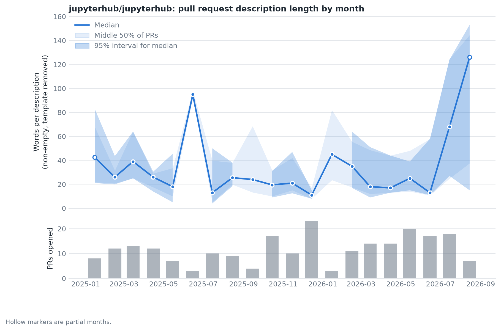
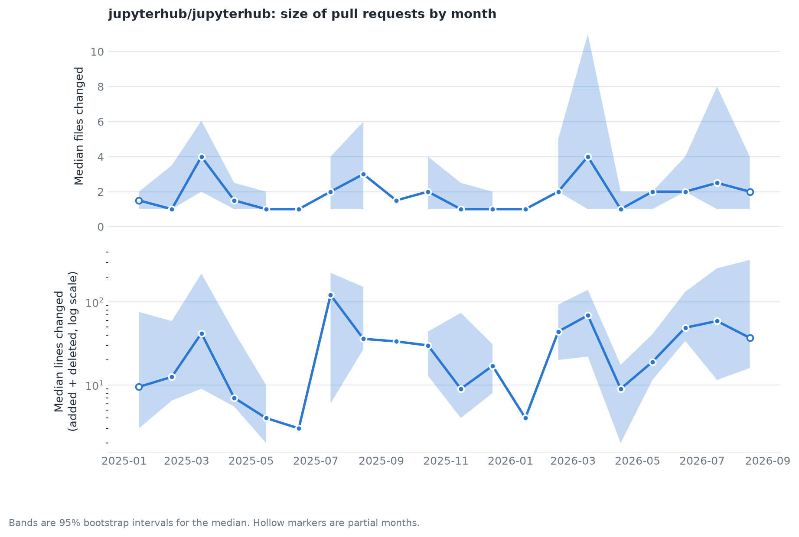
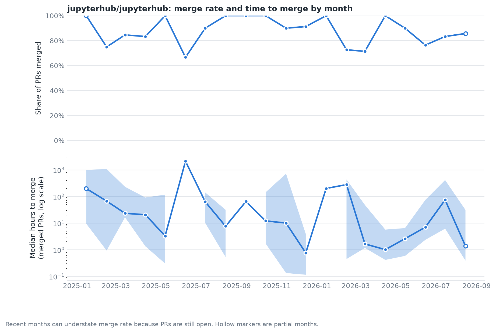
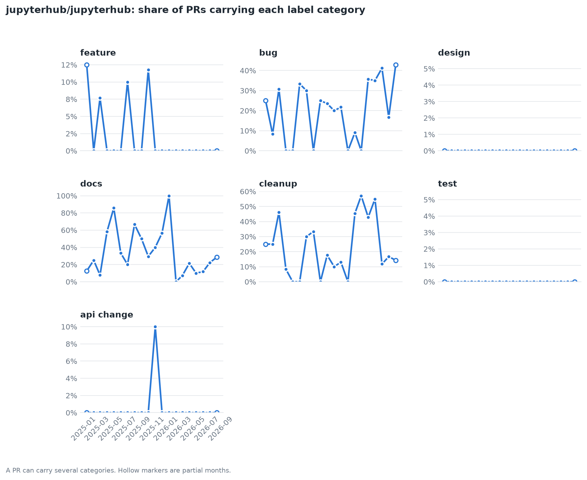
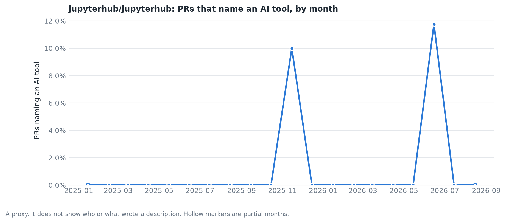

# Pull requests in jupyterhub/jupyterhub: description length, size, speed and labels

Window 2025-01-06 to 2026-08-17 (UTC). Data fetched 2026-11-20. prwords 3.0.0, generated 2026-11-26. Method fixed in advance in `docs/ANALYSIS_PLAN.md`.

## 1. Data

- Repository primary language: Python
- Pull requests opened in the window: 401
- Removed as bot accounts: 169
- Analysed: 232 PRs from 49 authors
- Merged: 203 (87.5%). Closed without merging: 24 (10.3%). Still open: 5
- Follow-up: merge outcomes use a 30-day follow-up. PRs without enough follow-up: 0
- Empty descriptions after cleaning: 6.9%

## 2. Did the PR template change?

No template line appeared or disappeared with a share of 50% or more. Template text was detected monthly and removed before counting words.

Distinct template lines detected: 0.

## 3. First 28 days versus last 28 days

First window 2025-01-06 to 2025-02-02. Last window 2026-07-21 to 2026-08-17. Ratios are last median divided by first median. Bootstrap intervals, 2,000 resamples.

| Metric                                |   n first |   n last |   Median first |   Median last |   Ratio |   Ratio low |   Ratio high |     p |   Cliff's delta |
|:--------------------------------------|----------:|---------:|---------------:|--------------:|--------:|------------:|-------------:|------:|----------------:|
| Description words (non-empty)         |         8 |       14 |          42.5  |         126   |    2.96 |        1.09 |         6.18 | 0.07  |            0.48 |
| Files changed                         |         8 |       14 |           1.5  |           2   |    1.33 |        1    |         4    | 0.14  |            0.38 |
| Lines added                           |         8 |       14 |           9    |          85   |    9.44 |        0.62 |        89.4  | 0.037 |            0.55 |
| Lines deleted                         |         8 |       14 |           2    |           8   |    4    |        0.25 |        19    | 0.39  |            0.23 |
| Net lines (added minus deleted)       |         8 |       14 |           8    |          76   |    9.5  |        1.04 |       156    | 0.022 |            0.61 |
| Lines changed (added plus deleted)    |         8 |       14 |           9.5  |          89   |    9.37 |        0.49 |        45.86 | 0.018 |            0.62 |
| Hours from open to merge (merged PRs) |         8 |       12 |         199.15 |          13.4 |    0.07 |        0    |         2.72 | 0.098 |           -0.46 |
| Commits                               |         8 |       14 |           1.5  |           2   |    1.33 |        0.25 |         3    | 1     |           -0.01 |
| Comments                              |         8 |       14 |           1    |           0   |    0    |        0    |         1    | 0.11  |           -0.39 |
| Reviews                               |         8 |       14 |           0.5  |           0.5 |    1    |        0    |         4    | 1     |            0    |

| Measure                             |   n first |   n last | Share first   | Share last   |   Change (points) |    p |
|:------------------------------------|----------:|---------:|:--------------|:-------------|------------------:|-----:|
| Merged within follow-up period      |         8 |       14 | 62.5%         | 85.7%        |              23.2 | 0.31 |
| Closed without merging              |         8 |       14 | 0.0%          | 14.3%        |              14.3 | 0.52 |
| Opened as draft                     |         8 |       14 | 0.0%          | 7.1%         |               7.1 | 1    |
| From outside contributors           |         8 |       14 | 25.0%         | 35.7%        |              10.7 | 1    |
| Has a kind or type label            |         8 |       14 | 0.0%          | 0.0%         |               0   | 1    |
| Description text repeated elsewhere |         8 |       14 | 0.0%          | 0.0%         |               0   | 1    |
| Names an AI tool (disclosure)       |         8 |       14 | 0.0%          | 0.0%         |               0   | 1    |
| Label category: feature             |         8 |       14 | 12.5%         | 0.0%         |             -12.5 | 0.36 |
| Label category: bug                 |         8 |       14 | 25.0%         | 28.6%        |               3.6 | 1    |
| Label category: design              |         8 |       14 | 0.0%          | 0.0%         |               0   | 1    |
| Label category: docs                |         8 |       14 | 12.5%         | 14.3%        |               1.8 | 1    |
| Label category: cleanup             |         8 |       14 | 25.0%         | 21.4%        |              -3.6 | 1    |
| Label category: test                |         8 |       14 | 0.0%          | 0.0%         |               0   | 1    |
| Label category: api_change          |         8 |       14 | 0.0%          | 0.0%         |               0   | 1    |

## 4. Monthly trends

Theil-Sen slope per month and Kendall tau over full months only.

| metric                     |   months |   slope_per_month |   slope_ci_low |   slope_ci_high |     tau |       p |
|:---------------------------|---------:|------------------:|---------------:|----------------:|--------:|--------:|
| median_words               |       18 |            -0.4   |         -1.5   |           0.9   |  -0.172 |   0.324 |
| median_files_changed       |       18 |            -0     |         -0     |           0.1   |   0.162 |   0.382 |
| median_additions           |       18 |             1.182 |         -0.321 |           2.5   |   0.272 |   0.119 |
| median_deletions           |       18 |             0.111 |         -0.333 |           0.5   |   0.074 |   0.675 |
| median_churn               |       18 |             1.25  |         -1.714 |           3.5   |   0.204 |   0.24  |
| median_hours_to_merge      |       18 |            -1.089 |         -4.757 |           1.13  |  -0.19  |   0.293 |
| merge_rate                 |       18 |            -0     |         -0.012 |           0.013 |   0     |   1     |
| share_outside_contributors |       18 |             0.01  |         -0.011 |           0.032 |   0.172 |   0.323 |
| share_ai_disclosed         |       18 |            -0     |         -0     |          -0     |   0.239 |   0.234 |
| median_comments            |       18 |            -0     |         -0.1   |          -0     |  -0.163 |   0.392 |
| median_reviews             |       18 |            -0     |         -0.077 |          -0     |  -0.378 |   0.051 |
| share_feature              |       18 |            -0     |         -0     |          -0     |  -0.233 |   0.239 |
| share_bug                  |       18 |             0.004 |         -0.01  |           0.021 |   0.128 |   0.466 |
| share_design               |       18 |            -0     |         -0     |          -0     | nan     | nan     |
| share_docs                 |       18 |            -0.013 |         -0.045 |           0.017 |  -0.19  |   0.293 |
| share_cleanup              |       18 |             0.009 |         -0.011 |           0.03  |   0.167 |   0.341 |
| share_test                 |       18 |            -0     |         -0     |          -0     | nan     | nan     |
| share_api_change           |       18 |            -0     |         -0     |          -0     |   0.02  |   0.923 |

## 5. Labels

Share of PRs with a kind or type label: 0.0% overall. Label coverage by month is in `monthly_summary.csv` (`share_has_kind_label`).

| category            |   n_prs |   share |   median_words |   median_files |   median_churn |   merge_rate |   median_hours_to_merge |   share_ai_disclosed |
|:--------------------|--------:|--------:|---------------:|---------------:|---------------:|-------------:|------------------------:|---------------------:|
| feature             |       5 |   0.022 |           40   |              1 |             44 |        1     |                 231.51  |                0     |
| bug                 |      49 |   0.211 |           17   |              2 |             16 |        0.98  |                   5.67  |                0     |
| design              |       0 |   0     |          nan   |            nan |            nan |      nan     |                 nan     |              nan     |
| docs                |      68 |   0.293 |           18   |              1 |             11 |        0.971 |                   6.651 |                0     |
| cleanup             |      61 |   0.263 |           24.5 |              2 |             19 |        0.951 |                   2.61  |                0.016 |
| test                |       0 |   0     |          nan   |            nan |            nan |      nan     |                 nan     |              nan     |
| api_change          |       1 |   0.004 |           81   |             35 |           3612 |        1     |                5273.43  |                0     |
| (no category label) |      48 |   0.207 |           47   |              3 |            105 |        0.521 |                 470.899 |                0.042 |

## 6. Are PRs with signs of AI involvement smaller or larger?

Authorship is not observable. The proxy is `ai_disclosed`, defined in the analysis plan: 3 PRs (1.29%). 3 disclosed PRs are listed in `ai_disclosure_samples.csv` for manual audit.

### ai_disclosed

**Verdict: not testable.** Too few exposed PRs.

Pattern: lines changed: not estimated; files changed: not estimated; lines added: not estimated; lines deleted: not estimated; hours to merge: not estimated.

Not estimated: fewer than 30 exposed PRs (exposed PRs: 3).

### Robustness by tool (lines changed)

| tool        |   n exposed | status                    |
|:------------|------------:|:--------------------------|
| unspecified |           3 | fewer than 30 exposed PRs |

### File type check

Not run. Use `--file-check N` to sample N exposed PRs and matching unexposed PRs.

## 7. Other checks

- Outside contributors: 47.0% of PRs overall.
- Top 10 authors opened 78.4% of PRs.
- PRs whose description text is repeated elsewhere (10 or more words): 0.0%.

## 8. Limitations

- Word count and size describe PRs, not who wrote them. Proxies for AI involvement are noisy and omit undisclosed use.
- Added and deleted lines include generated or vendored files unless the project avoids committing them.
- Disclosure mostly captures tools that add attribution by default, so it is tool-skewed.
- Template removal is heuristic. Check `template_audit.csv`.
- One repository cannot support general claims. See the plan for replication.
- Months at the edges of the window are partial and are excluded from trend tests.

