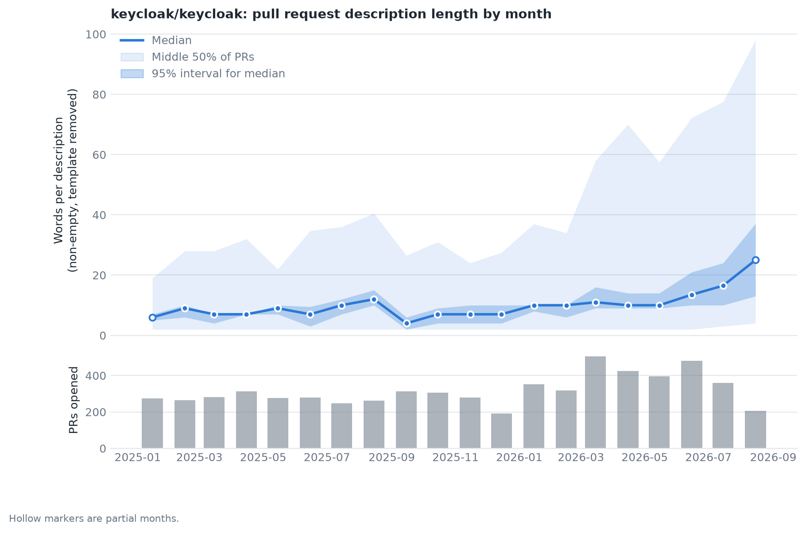
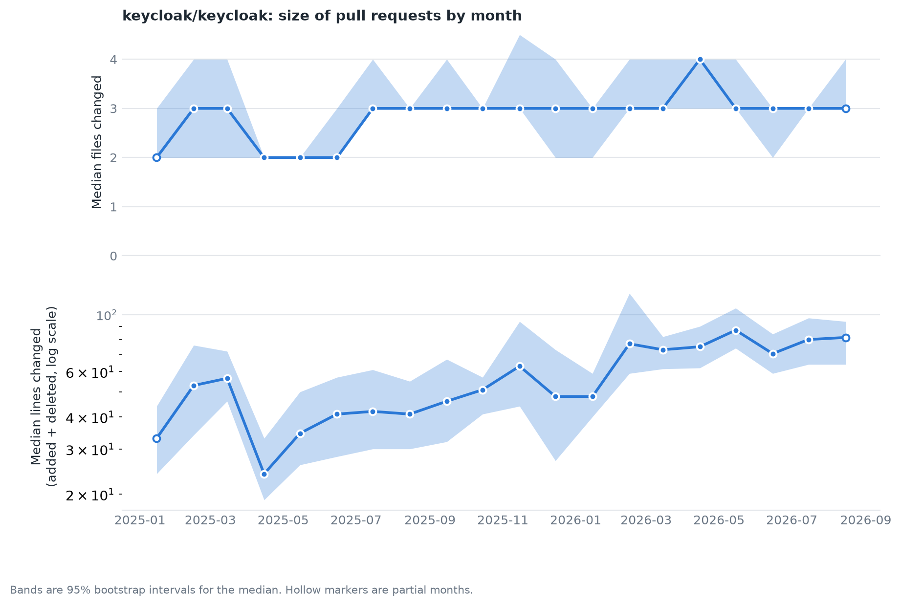
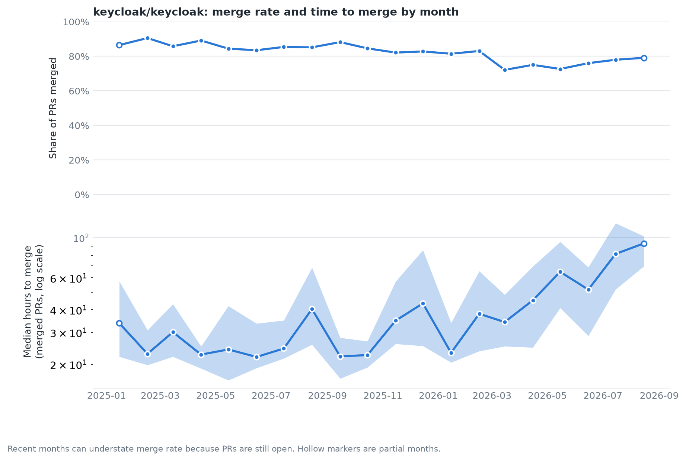
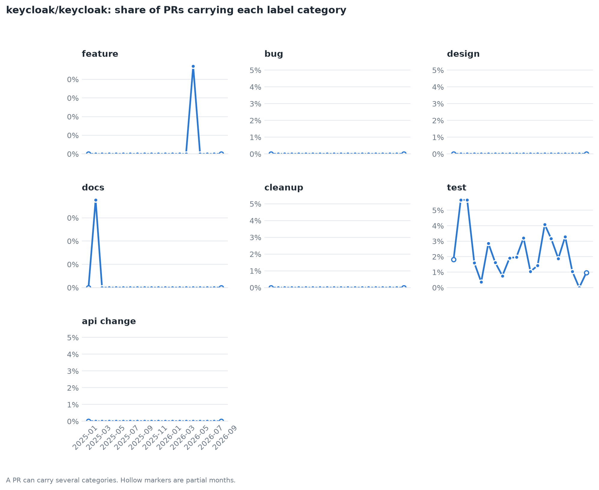
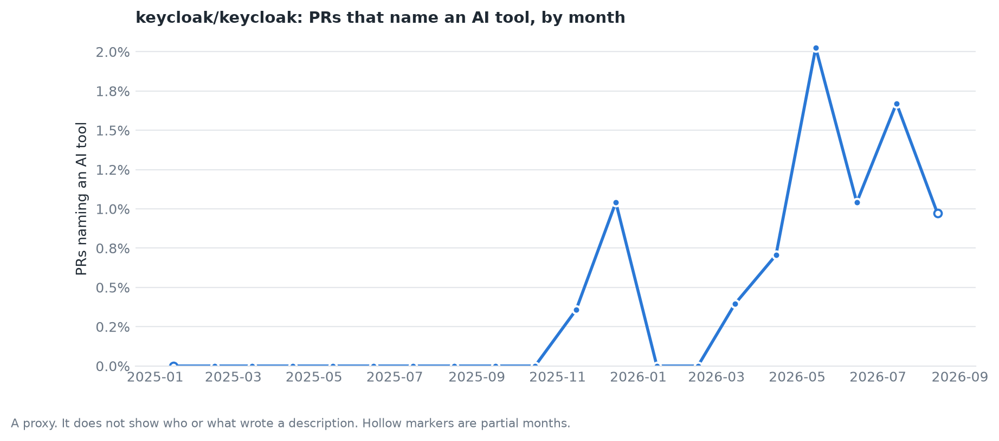

# Pull requests in keycloak/keycloak: description length, size, speed and labels

Window 2025-01-06 to 2026-08-17 (UTC). Data fetched 2026-11-19. prwords 3.0.0, generated 2026-11-26. Method fixed in advance in `docs/ANALYSIS_PLAN.md`.

## 1. Data

- Repository primary language: Java
- Pull requests opened in the window: 7,041
- Removed as bot accounts: 710
- Analysed: 6,331 PRs from 705 authors
- Merged: 5,153 (81.4%). Closed without merging: 892 (14.1%). Still open: 286
- Follow-up: merge outcomes use a 30-day follow-up. PRs without enough follow-up: 0
- Empty descriptions after cleaning: 2.3%

## 2. Did the PR template change?

No template line appeared or disappeared with a share of 50% or more. Template text was detected monthly and removed before counting words.

Distinct template lines detected: 0.

## 3. First 28 days versus last 28 days

First window 2025-01-06 to 2025-02-02. Last window 2026-07-21 to 2026-08-17. Ratios are last median divided by first median. Bootstrap intervals, 2,000 resamples.

| Metric                                |   n first |   n last |   Median first |   Median last |   Ratio |   Ratio low |   Ratio high |       p |   Cliff's delta |
|:--------------------------------------|----------:|---------:|---------------:|--------------:|--------:|------------:|-------------:|--------:|----------------:|
| Description words (non-empty)         |       270 |      324 |           6    |         23    |    3.83 |        2.14 |         5.8  | 1e-12   |            0.34 |
| Files changed                         |       275 |      328 |           2    |          3    |    1.5  |        1    |         2    | 7.4e-05 |            0.18 |
| Lines added                           |       275 |      328 |          21    |         73    |    3.48 |        2.21 |         6.09 | 9.2e-11 |            0.31 |
| Lines deleted                         |       275 |      328 |           6    |          5    |    0.83 |        0.62 |         1.2  | 0.22    |           -0.06 |
| Net lines (added minus deleted)       |       275 |      328 |           4    |         59.5  |   14.88 |        6.93 |        17.5  | 1.4e-12 |            0.33 |
| Lines changed (added plus deleted)    |       275 |      328 |          32    |         84.5  |    2.64 |        1.78 |         3.58 | 2.3e-08 |            0.26 |
| Hours from open to merge (merged PRs) |       238 |      261 |          33.89 |        119.26 |    3.52 |        1.77 |         5.5  | 2.8e-13 |            0.38 |
| Commits                               |       275 |      328 |           1    |          1    |    1    |        1    |         1    | 0.021   |            0.09 |
| Comments                              |       275 |      328 |           1    |          1    |    1    |        1    |         1    | 0.033   |            0.1  |
| Reviews                               |       275 |      328 |           2    |          4    |    2    |        2    |         2.5  | 5.7e-27 |            0.5  |

| Measure                             |   n first |   n last | Share first   | Share last   |   Change (points) |     p |
|:------------------------------------|----------:|---------:|:--------------|:-------------|------------------:|------:|
| Merged within follow-up period      |       275 |      328 | 83.6%         | 73.8%        |              -9.9 | 0.004 |
| Closed without merging              |       275 |      328 | 13.1%         | 9.8%         |              -3.3 | 0.2   |
| Opened as draft                     |       275 |      328 | 4.7%          | 3.4%         |              -1.4 | 0.41  |
| From outside contributors           |       275 |      328 | 79.3%         | 84.1%        |               4.9 | 0.14  |
| Has a kind or type label            |       275 |      328 | 0.0%          | 0.0%         |               0   | 1     |
| Description text repeated elsewhere |       275 |      328 | 8.0%          | 4.9%         |              -3.1 | 0.13  |
| Names an AI tool (disclosure)       |       275 |      328 | 0.0%          | 1.8%         |               1.8 | 0.034 |
| Label category: feature             |       275 |      328 | 0.0%          | 0.0%         |               0   | 1     |
| Label category: bug                 |       275 |      328 | 0.0%          | 0.0%         |               0   | 1     |
| Label category: design              |       275 |      328 | 0.0%          | 0.0%         |               0   | 1     |
| Label category: docs                |       275 |      328 | 0.0%          | 0.0%         |               0   | 1     |
| Label category: cleanup             |       275 |      328 | 0.0%          | 0.0%         |               0   | 1     |
| Label category: test                |       275 |      328 | 1.8%          | 0.6%         |              -1.2 | 0.25  |
| Label category: api_change          |       275 |      328 | 0.0%          | 0.0%         |               0   | 1     |

## 4. Monthly trends

Theil-Sen slope per month and Kendall tau over full months only.

| metric                     |   months |   slope_per_month |   slope_ci_low |   slope_ci_high |     tau |       p |
|:---------------------------|---------:|------------------:|---------------:|----------------:|--------:|--------:|
| median_words               |       18 |             0.3   |         -0     |           0.6   |   0.481 |   0.009 |
| median_files_changed       |       18 |            -0     |         -0     |          -0     |   0.432 |   0.031 |
| median_additions           |       18 |             2.833 |          1.773 |           3.357 |   0.638 |   0     |
| median_deletions           |       18 |            -0.067 |         -0.25  |           0.143 |  -0.11  |   0.539 |
| median_churn               |       18 |             2.95  |          1.571 |           4.25  |   0.599 |   0.001 |
| median_hours_to_merge      |       18 |             2.017 |          0.718 |           3.294 |   0.556 |   0.001 |
| merge_rate                 |       18 |            -0.008 |         -0.011 |          -0.005 |  -0.673 |   0     |
| share_outside_contributors |       18 |             0.001 |         -0.004 |           0.007 |   0.124 |   0.501 |
| share_ai_disclosed         |       18 |             0.001 |         -0     |           0.001 |   0.665 |   0     |
| median_comments            |       18 |            -0     |         -0     |          -0     |   0.029 |   0.888 |
| median_reviews             |       18 |            -0     |         -0     |          -0     |   0.146 |   0.464 |
| share_feature              |       18 |            -0     |         -0     |          -0     |   0.216 |   0.289 |
| share_bug                  |       18 |            -0     |         -0     |          -0     | nan     | nan     |
| share_design               |       18 |            -0     |         -0     |          -0     | nan     | nan     |
| share_docs                 |       18 |            -0     |         -0     |          -0     |  -0.333 |   0.101 |
| share_cleanup              |       18 |            -0     |         -0     |          -0     | nan     | nan     |
| share_test                 |       18 |            -0.001 |         -0.003 |           0.001 |  -0.131 |   0.448 |
| share_api_change           |       18 |            -0     |         -0     |          -0     | nan     | nan     |

## 5. Labels

Share of PRs with a kind or type label: 0.0% overall. Label coverage by month is in `monthly_summary.csv` (`share_has_kind_label`).

| category            |   n_prs |   share |   median_words |   median_files |   median_churn |   merge_rate |   median_hours_to_merge |   share_ai_disclosed |
|:--------------------|--------:|--------:|---------------:|---------------:|---------------:|-------------:|------------------------:|---------------------:|
| feature             |       1 |   0     |            541 |            222 |          35500 |        1     |                 536.251 |                1     |
| bug                 |       0 |   0     |            nan |            nan |            nan |      nan     |                 nan     |              nan     |
| design              |       0 |   0     |            nan |            nan |            nan |      nan     |                 nan     |              nan     |
| docs                |       1 |   0     |             37 |              1 |             15 |        1     |                 107.727 |                0     |
| cleanup             |       0 |   0     |            nan |            nan |            nan |      nan     |                 nan     |              nan     |
| test                |     141 |   0.022 |              3 |              6 |            276 |        0.858 |                  97.507 |                0     |
| api_change          |       0 |   0     |            nan |            nan |            nan |      nan     |                 nan     |              nan     |
| (no category label) |    6188 |   0.977 |             10 |              3 |             54 |        0.813 |                  30.3   |                0.005 |

## 6. Are PRs with signs of AI involvement smaller or larger?

Authorship is not observable. The proxy is `ai_disclosed`, defined in the analysis plan: 29 PRs (0.46%). 29 disclosed PRs are listed in `ai_disclosure_samples.csv` for manual audit.

### ai_disclosed

**Verdict: not testable.** Too few exposed PRs.

Pattern: lines changed: not estimated; files changed: not estimated; lines added: not estimated; lines deleted: not estimated; hours to merge: not estimated.

Not estimated: fewer than 30 exposed PRs (exposed PRs: 29).

### Robustness by tool (lines changed)

| tool        |   n exposed | status                    |
|:------------|------------:|:--------------------------|
| claude      |          13 | fewer than 30 exposed PRs |
| unspecified |          12 | fewer than 30 exposed PRs |
| copilot     |           3 | fewer than 30 exposed PRs |
| chatgpt     |           1 | fewer than 30 exposed PRs |

### File type check

Not run. Use `--file-check N` to sample N exposed PRs and matching unexposed PRs.

## 7. Other checks

- Outside contributors: 80.5% of PRs overall.
- Top 10 authors opened 49.1% of PRs.
- PRs whose description text is repeated elsewhere (10 or more words): 4.6%.

## 8. Limitations

- Word count and size describe PRs, not who wrote them. Proxies for AI involvement are noisy and omit undisclosed use.
- Added and deleted lines include generated or vendored files unless the project avoids committing them.
- Disclosure mostly captures tools that add attribution by default, so it is tool-skewed.
- Template removal is heuristic. Check `template_audit.csv`.
- One repository cannot support general claims. See the plan for replication.
- Months at the edges of the window are partial and are excluded from trend tests.

