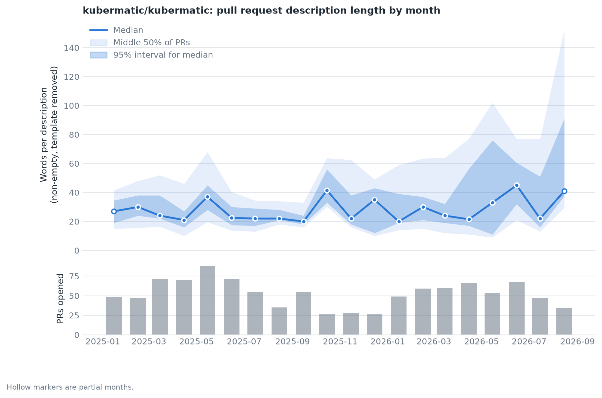
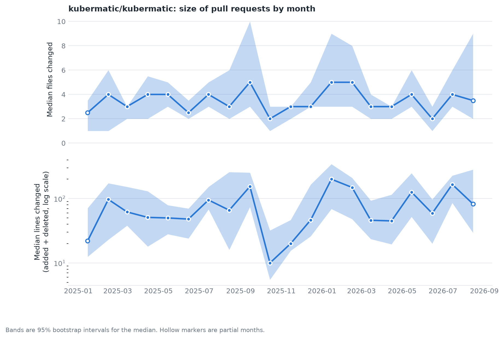
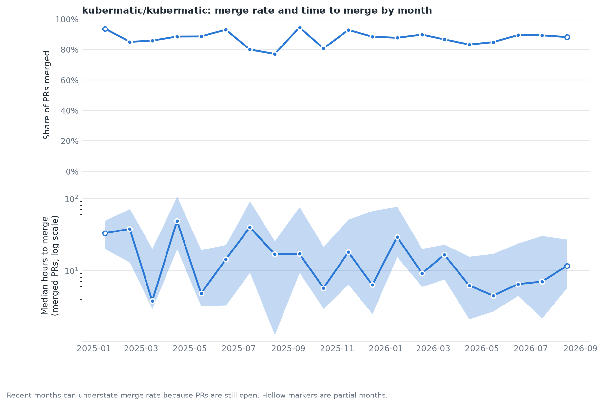
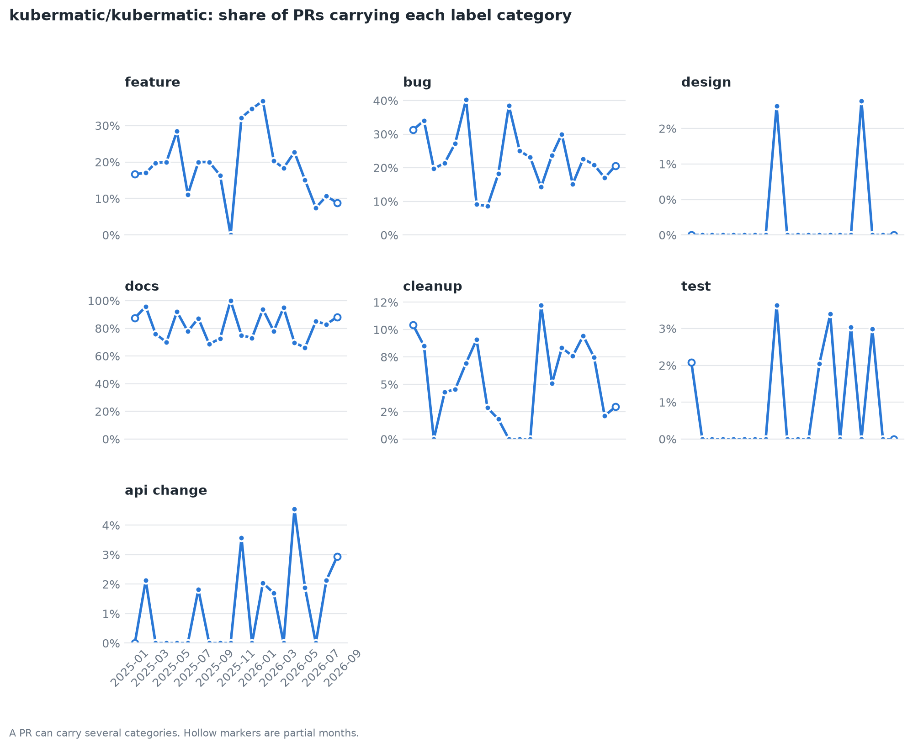
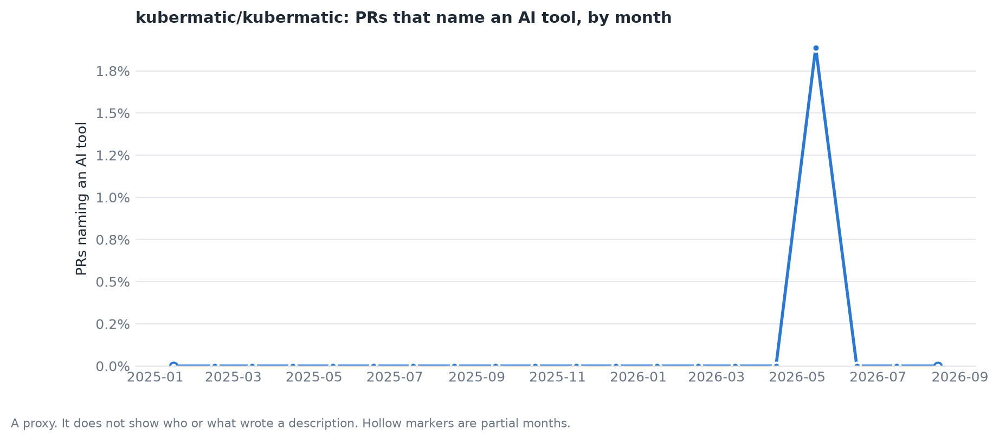

# Pull requests in kubermatic/kubermatic: description length, size, speed and labels

Window 2025-01-06 to 2026-08-17 (UTC). Data fetched 2026-11-20. prwords 3.0.0, generated 2026-11-26. Method fixed in advance in `docs/ANALYSIS_PLAN.md`.

## 1. Data

- Repository primary language: Go
- Pull requests opened in the window: 1,511
- Removed as bot accounts: 455
- Analysed: 1,056 PRs from 52 authors
- Merged: 926 (87.7%). Closed without merging: 108 (10.2%). Still open: 22
- Follow-up: merge outcomes use a 30-day follow-up. PRs without enough follow-up: 0
- Empty descriptions after cleaning: 1.1%

## 2. Did the PR template change?

Lines that appeared or disappeared across the window (full list in `template_audit.csv`):

| line           | first_month   | last_month   |   months |   peak_share | change_event   |
|:---------------|:--------------|:-------------|---------:|-------------:|:---------------|
| fixes #        | 2025-04       | 2026-07      |       12 |         0.78 | added          |
| /kind chore    | 2025-04       | 2026-06      |        3 |         0.5  | added          |
| *test issue**: | 2026-04       | 2026-08      |        5 |         1    | added          |

Distinct template lines detected: 10.

## 3. First 28 days versus last 28 days

First window 2025-01-06 to 2025-02-02. Last window 2026-07-21 to 2026-08-17. Ratios are last median divided by first median. Bootstrap intervals, 2,000 resamples.

| Metric                                |   n first |   n last |   Median first |   Median last |   Ratio |   Ratio low |   Ratio high |      p |   Cliff's delta |
|:--------------------------------------|----------:|---------:|---------------:|--------------:|--------:|------------:|-------------:|-------:|----------------:|
| Description words (non-empty)         |        49 |       52 |          26    |         39    |    1.5  |        1.11 |         2.82 | 0.0058 |            0.32 |
| Files changed                         |        49 |       52 |           2    |          5    |    2.5  |        1    |         6    | 0.0077 |            0.3  |
| Lines added                           |        49 |       52 |          14    |         99.5  |    7.11 |        1.87 |        11.7  | 0.0029 |            0.34 |
| Lines deleted                         |        49 |       52 |           2    |         19    |    9.5  |        2    |        31.5  | 0.044  |            0.23 |
| Net lines (added minus deleted)       |        49 |       52 |           8    |         12    |    1.5  |        0.33 |         8    | 0.39   |            0.1  |
| Lines changed (added plus deleted)    |        49 |       52 |          18    |        135.5  |    7.53 |        1.74 |        17.57 | 0.01   |            0.3  |
| Hours from open to merge (merged PRs) |        46 |       48 |          28.38 |         14.26 |    0.5  |        0.13 |         1.58 | 0.24   |           -0.14 |
| Commits                               |        49 |       52 |           1    |          1.5  |    1.5  |        0.5  |         2    | 0.84   |            0.02 |
| Comments                              |        49 |       52 |           5    |          5    |    1    |        0.67 |         1.25 | 0.59   |           -0.06 |
| Reviews                               |        49 |       52 |           1    |          1    |    1    |        1    |         1    | 0.46   |           -0.08 |

| Measure                             |   n first |   n last | Share first   | Share last   |   Change (points) |     p |
|:------------------------------------|----------:|---------:|:--------------|:-------------|------------------:|------:|
| Merged within follow-up period      |        49 |       52 | 91.8%         | 90.4%        |              -1.5 | 1     |
| Closed without merging              |        49 |       52 | 4.1%          | 1.9%         |              -2.2 | 0.61  |
| Opened as draft                     |        49 |       52 | 2.0%          | 0.0%         |              -2   | 0.49  |
| From outside contributors           |        49 |       52 | 65.3%         | 86.5%        |              21.2 | 0.018 |
| Has a kind or type label            |        49 |       52 | 85.7%         | 80.8%        |              -4.9 | 0.6   |
| Description text repeated elsewhere |        49 |       52 | 4.1%          | 1.9%         |              -2.2 | 0.61  |
| Names an AI tool (disclosure)       |        49 |       52 | 0.0%          | 0.0%         |               0   | 1     |
| Label category: feature             |        49 |       52 | 16.3%         | 11.5%        |              -4.8 | 0.57  |
| Label category: bug                 |        49 |       52 | 32.7%         | 17.3%        |             -15.3 | 0.11  |
| Label category: design              |        49 |       52 | 0.0%          | 0.0%         |               0   | 1     |
| Label category: docs                |        49 |       52 | 87.8%         | 84.6%        |              -3.1 | 0.78  |
| Label category: cleanup             |        49 |       52 | 10.2%         | 1.9%         |              -8.3 | 0.11  |
| Label category: test                |        49 |       52 | 2.0%          | 0.0%         |              -2   | 0.49  |
| Label category: api_change          |        49 |       52 | 0.0%          | 3.8%         |               3.8 | 0.5   |

## 4. Monthly trends

Theil-Sen slope per month and Kendall tau over full months only.

| metric                     |   months |   slope_per_month |   slope_ci_low |   slope_ci_high |    tau |     p |
|:---------------------------|---------:|------------------:|---------------:|----------------:|-------:|------:|
| median_words               |       18 |            -0     |         -0.4   |           0.9   |  0.027 | 0.879 |
| median_files_changed       |       18 |            -0     |         -0.1   |           0.083 | -0.037 | 0.843 |
| median_additions           |       18 |             1.875 |         -1.375 |           4.5   |  0.17  | 0.324 |
| median_deletions           |       18 |            -0     |         -0.364 |           0.429 | -0.041 | 0.817 |
| median_churn               |       18 |             0.8   |         -2.625 |           7.667 |  0.033 | 0.881 |
| median_hours_to_merge      |       18 |            -0.888 |         -2.253 |           0.181 | -0.19  | 0.293 |
| merge_rate                 |       18 |             0.001 |         -0.005 |           0.007 |  0.059 | 0.765 |
| share_outside_contributors |       18 |            -0.003 |         -0.018 |           0.016 | -0.052 | 0.762 |
| share_ai_disclosed         |       18 |            -0     |         -0     |          -0     |  0.255 | 0.21  |
| median_comments            |       18 |            -0     |         -0     |           0.125 |  0.197 | 0.294 |
| median_reviews             |       18 |            -0     |         -0     |          -0     |  0.176 | 0.386 |
| share_feature              |       18 |            -0.001 |         -0.011 |           0.008 | -0.066 | 0.704 |
| share_bug                  |       18 |            -0.004 |         -0.011 |           0.006 | -0.15  | 0.41  |
| share_design               |       18 |            -0     |         -0     |          -0     |  0.155 | 0.441 |
| share_docs                 |       18 |            -0.003 |         -0.015 |           0.01  | -0.072 | 0.709 |
| share_cleanup              |       18 |             0.001 |         -0.004 |           0.006 |  0.1   | 0.568 |
| share_test                 |       18 |            -0     |         -0     |          -0     |  0.289 | 0.134 |
| share_api_change           |       18 |            -0     |         -0     |           0.002 |  0.242 | 0.195 |

## 5. Labels

Share of PRs with a kind or type label: 81.2% overall. Label coverage by month is in `monthly_summary.csv` (`share_has_kind_label`).

| category            |   n_prs |   share |   median_words |   median_files |   median_churn |   merge_rate |   median_hours_to_merge |   share_ai_disclosed |
|:--------------------|--------:|--------:|---------------:|---------------:|---------------:|-------------:|------------------------:|---------------------:|
| feature             |     199 |   0.188 |             40 |              7 |          280   |        0.869 |                  48.335 |                0     |
| bug                 |     244 |   0.231 |             45 |              2 |           23.5 |        0.898 |                  19.26  |                0.004 |
| design              |       2 |   0.002 |            135 |              5 |           31   |        1     |                 315.507 |                0     |
| docs                |     861 |   0.815 |             33 |              3 |           64   |        0.861 |                  18.92  |                0.001 |
| cleanup             |      59 |   0.056 |             38 |              6 |          140   |        0.864 |                  29.403 |                0     |
| test                |      10 |   0.009 |             42 |              1 |           16.5 |        0.8   |                  15.31  |                0     |
| api_change          |      11 |   0.01  |            101 |             14 |          833   |        0.818 |                 100.077 |                0     |
| (no category label) |     163 |   0.154 |             12 |              3 |           66   |        0.945 |                   3.215 |                0     |

Cross-check against the repository's own size labels (coverage 99.8%, Spearman rho between size label and lines changed 0.98):

| size_label   |   n_prs |   median_churn |   p10_churn |   p90_churn |
|:-------------|--------:|---------------:|------------:|------------:|
| XS           |     212 |              4 |           2 |           9 |
| S            |     199 |             17 |          10 |          26 |
| M            |     196 |             59 |          34 |          86 |
| L            |     283 |            248 |         124 |         403 |
| XL           |      61 |            659 |         517 |         872 |
| XXL          |     103 |           3394 |        1079 |       52349 |

## 6. Are PRs with signs of AI involvement smaller or larger?

Authorship is not observable. The proxy is `ai_disclosed`, defined in the analysis plan: 1 PRs (0.09%). 1 disclosed PRs are listed in `ai_disclosure_samples.csv` for manual audit.

### ai_disclosed

**Verdict: not testable.** Too few exposed PRs.

Pattern: lines changed: not estimated; files changed: not estimated; lines added: not estimated; lines deleted: not estimated; hours to merge: not estimated.

Not estimated: fewer than 30 exposed PRs (exposed PRs: 1).

### Robustness by tool (lines changed)

| tool   |   n exposed | status                    |
|:-------|------------:|:--------------------------|
| claude |           1 | fewer than 30 exposed PRs |

### File type check

Not run. Use `--file-check N` to sample N exposed PRs and matching unexposed PRs.

## 7. Other checks

- Outside contributors: 66.5% of PRs overall.
- Top 10 authors opened 83.4% of PRs.
- PRs whose description text is repeated elsewhere (10 or more words): 10.5%.

## 8. Limitations

- Word count and size describe PRs, not who wrote them. Proxies for AI involvement are noisy and omit undisclosed use.
- Added and deleted lines include generated or vendored files unless the project avoids committing them.
- Disclosure mostly captures tools that add attribution by default, so it is tool-skewed.
- Template removal is heuristic. Check `template_audit.csv`.
- One repository cannot support general claims. See the plan for replication.
- Months at the edges of the window are partial and are excluded from trend tests.

