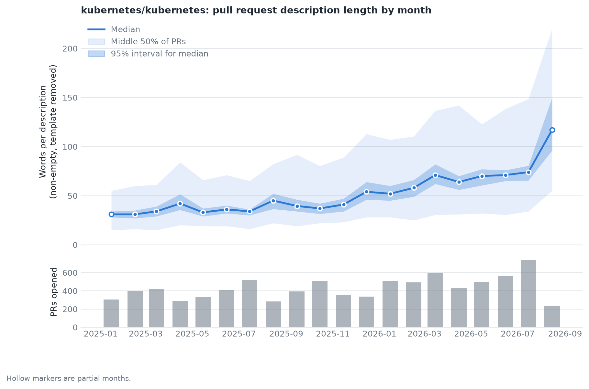
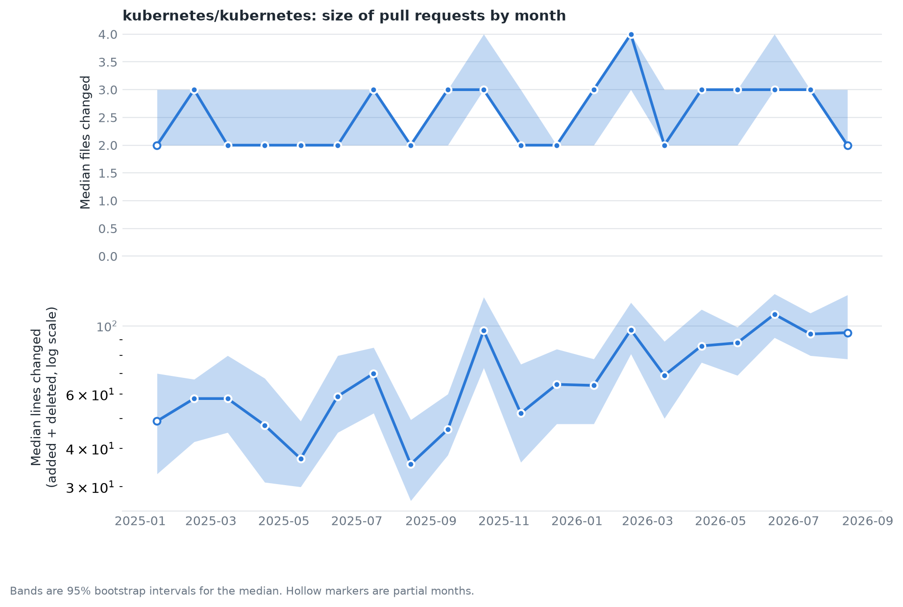
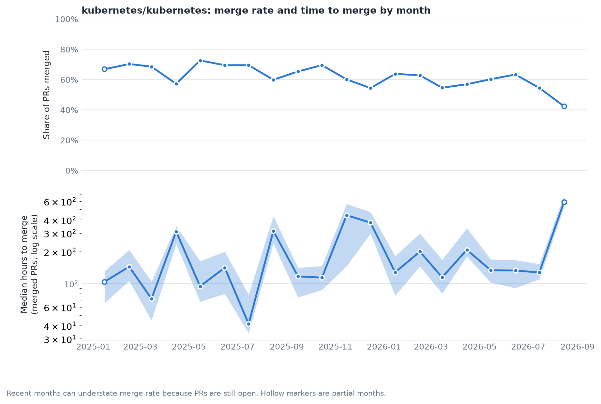
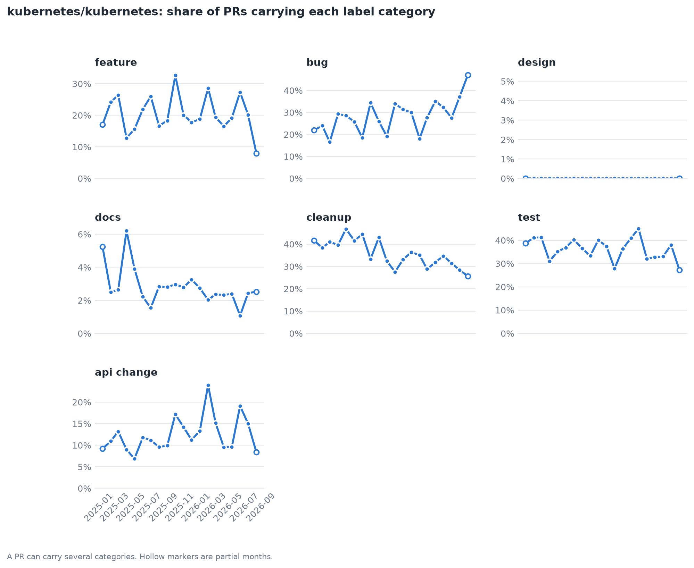
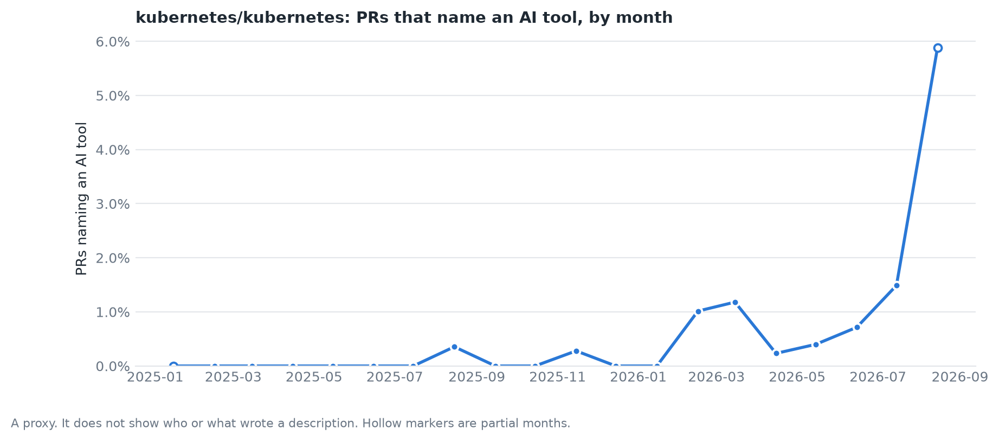
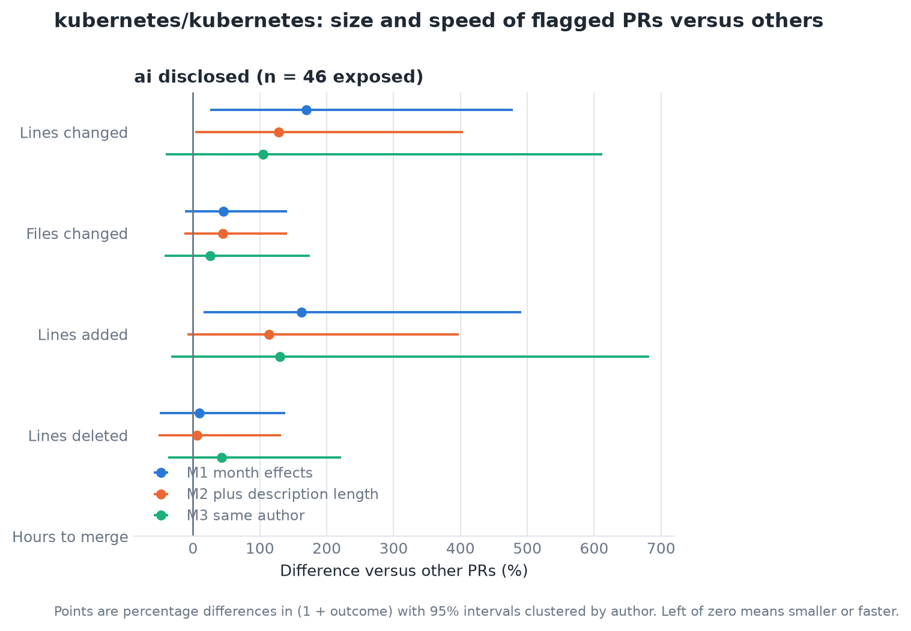

# Pull requests in kubernetes/kubernetes: description length, size, speed and labels

Window 2025-01-06 to 2026-08-17 (UTC). Data fetched 2026-11-19. prwords 3.0.0, generated 2026-11-26. Method fixed in advance in `docs/ANALYSIS_PLAN.md`.

## 1. Data

- Repository primary language: Go
- Pull requests opened in the window: 8,615
- Removed as bot accounts: 0
- Analysed: 8,615 PRs from 1,628 authors
- Merged: 5,368 (62.3%). Closed without merging: 2,697 (31.3%). Still open: 550
- Follow-up: merge outcomes use a 30-day follow-up. PRs without enough follow-up: 0
- Empty descriptions after cleaning: 3.2%

## 2. Did the PR template change?

Lines that appeared or disappeared across the window (full list in `template_audit.csv`):

| line                                       | first_month   | last_month   |   months |   peak_share | change_event   |
|:-------------------------------------------|:--------------|:-------------|---------:|-------------:|:---------------|
| #### which issue(s) this pr fixes:         | 2025-01       | 2025-05      |        5 |         0.72 | removed        |
| #### which issue(s) this pr is related to: | 2025-06       | 2026-08      |       15 |         0.8  | added          |

Distinct template lines detected: 11.

## 3. First 28 days versus last 28 days

First window 2025-01-06 to 2025-02-02. Last window 2026-07-21 to 2026-08-17. Ratios are last median divided by first median. Bootstrap intervals, 2,000 resamples.

| Metric                                |   n first |   n last |   Median first |   Median last |   Ratio |   Ratio low |   Ratio high |       p |   Cliff's delta |
|:--------------------------------------|----------:|---------:|---------------:|--------------:|--------:|------------:|-------------:|--------:|----------------:|
| Description words (non-empty)         |       303 |      464 |          31    |         94    |    3.03 |        2.56 |         3.55 | 4.7e-40 |            0.57 |
| Files changed                         |       311 |      475 |           2    |          2    |    1    |        0.67 |         1.5  | 0.25    |            0.05 |
| Lines added                           |       311 |      475 |          21    |         70    |    3.33 |        1.97 |         5.57 | 5.9e-10 |            0.26 |
| Lines deleted                         |       311 |      475 |          10    |          8    |    0.8  |        0.46 |         1.29 | 0.079   |           -0.07 |
| Net lines (added minus deleted)       |       311 |      475 |           4    |         42    |   10.5  |        5.12 |        47.05 | 3.6e-10 |            0.26 |
| Lines changed (added plus deleted)    |       311 |      475 |          50    |         85    |    1.7  |        1.19 |         2.62 | 1.2e-05 |            0.18 |
| Hours from open to merge (merged PRs) |       206 |      223 |         108.45 |        650.64 |    6    |        4.31 |         9.41 | 6.9e-09 |            0.32 |
| Commits                               |       311 |      475 |           1    |          1    |    1    |        1    |         1    | 0.53    |           -0.02 |
| Comments                              |       311 |      475 |           9    |          9    |    1    |        0.89 |         1.12 | 0.65    |            0.02 |
| Reviews                               |       311 |      475 |           1    |          1    |    1    |        0    |         1    | 3.3e-05 |           -0.17 |

| Measure                             |   n first |   n last | Share first   | Share last   |   Change (points) |       p |
|:------------------------------------|----------:|---------:|:--------------|:-------------|------------------:|--------:|
| Merged within follow-up period      |       311 |      475 | 54.3%         | 27.2%        |             -27.2 | 2.1e-14 |
| Closed without merging              |       311 |      475 | 33.1%         | 28.2%        |              -4.9 | 0.15    |
| Opened as draft                     |       311 |      475 | 3.9%          | 3.6%         |              -0.3 | 0.85    |
| From outside contributors           |       311 |      475 | 56.9%         | 72.0%        |              15.1 | 1.6e-05 |
| Has a kind or type label            |       311 |      475 | 92.6%         | 93.7%        |               1.1 | 0.56    |
| Description text repeated elsewhere |       311 |      475 | 6.8%          | 3.6%         |              -3.2 | 0.06    |
| Names an AI tool (disclosure)       |       311 |      475 | 0.0%          | 3.8%         |               3.8 | 0.00012 |
| Label category: feature             |       311 |      475 | 16.7%         | 11.6%        |              -5.1 | 0.044   |
| Label category: bug                 |       311 |      475 | 21.9%         | 42.7%        |              20.9 | 1.1e-09 |
| Label category: design              |       311 |      475 | 0.0%          | 0.0%         |               0   | 1       |
| Label category: docs                |       311 |      475 | 5.1%          | 2.7%         |              -2.4 | 0.085   |
| Label category: cleanup             |       311 |      475 | 41.8%         | 29.9%        |             -11.9 | 0.00073 |
| Label category: test                |       311 |      475 | 38.9%         | 34.5%        |              -4.4 | 0.23    |
| Label category: api_change          |       311 |      475 | 9.0%          | 8.6%         |              -0.4 | 0.9     |

## 4. Monthly trends

Theil-Sen slope per month and Kendall tau over full months only.

| metric                     |   months |   slope_per_month |   slope_ci_low |   slope_ci_high |     tau |       p |
|:---------------------------|---------:|------------------:|---------------:|----------------:|--------:|--------:|
| median_words               |       18 |             2.75  |          2.133 |           3.333 |   0.796 |   0     |
| median_files_changed       |       18 |            -0     |         -0     |           0.083 |   0.351 |   0.078 |
| median_additions           |       18 |             2.633 |          1     |           4     |   0.581 |   0.001 |
| median_deletions           |       18 |            -0     |         -0.273 |           0.167 |  -0.083 |   0.644 |
| median_churn               |       18 |             3     |          1.5   |           4.812 |   0.525 |   0.002 |
| median_hours_to_merge      |       18 |             1.502 |         -6.852 |           7.148 |   0.072 |   0.709 |
| merge_rate                 |       18 |            -0.008 |         -0.013 |          -0.002 |  -0.412 |   0.017 |
| share_outside_contributors |       18 |             0.013 |          0.009 |           0.017 |   0.66  |   0     |
| share_ai_disclosed         |       18 |             0     |         -0     |           0.001 |   0.607 |   0.001 |
| median_comments            |       18 |            -0     |         -0.062 |          -0     |  -0.307 |   0.119 |
| median_reviews             |       18 |            -0.062 |         -0.1   |          -0     |  -0.709 |   0     |
| share_feature              |       18 |             0.001 |         -0.005 |           0.005 |   0.085 |   0.654 |
| share_bug                  |       18 |             0.005 |         -0.001 |           0.011 |   0.32  |   0.068 |
| share_design               |       18 |            -0     |         -0     |          -0     | nan     | nan     |
| share_docs                 |       18 |            -0.001 |         -0.001 |           0     |  -0.294 |   0.096 |
| share_cleanup              |       18 |            -0.007 |         -0.013 |          -0.003 |  -0.49  |   0.004 |
| share_test                 |       18 |            -0.002 |         -0.006 |           0.003 |  -0.124 |   0.501 |
| share_api_change           |       18 |             0.003 |         -0     |           0.007 |   0.307 |   0.081 |

## 5. Labels

Share of PRs with a kind or type label: 93.7% overall. Label coverage by month is in `monthly_summary.csv` (`share_has_kind_label`).

| category            |   n_prs |   share |   median_words |   median_files |   median_churn |   merge_rate |   median_hours_to_merge |   share_ai_disclosed |
|:--------------------|--------:|--------:|---------------:|---------------:|---------------:|-------------:|------------------------:|---------------------:|
| feature             |    1828 |   0.212 |             51 |              6 |          211.5 |        0.654 |                 214.749 |                0.005 |
| bug                 |    2396 |   0.278 |             65 |              2 |           66   |        0.611 |                 185.293 |                0.006 |
| design              |       0 |   0     |            nan |            nan |          nan   |      nan     |                 nan     |              nan     |
| docs                |     230 |   0.027 |             36 |              1 |           14   |        0.604 |                 171.493 |                0.004 |
| cleanup             |    3049 |   0.354 |             41 |              3 |           52   |        0.721 |                  93.331 |                0.005 |
| test                |    3174 |   0.368 |             49 |              3 |           86   |        0.698 |                 154.994 |                0.005 |
| api_change          |    1127 |   0.131 |             58 |             13 |          346   |        0.565 |                 389.967 |                0.006 |
| (no category label) |     465 |   0.054 |             39 |              2 |           47   |        0.12  |                  14.316 |                0.002 |

Cross-check against the repository's own size labels (coverage 100.0%, Spearman rho between size label and lines changed 0.95):

| size_label   |   n_prs |   median_churn |   p10_churn |   p90_churn |
|:-------------|--------:|---------------:|------------:|------------:|
| XS           |    1727 |              4 |           2 |           8 |
| S            |    1445 |             18 |          11 |          28 |
| M            |    1950 |             61 |          35 |          98 |
| L            |    2343 |            220 |         117 |         468 |
| XL           |     513 |            718 |         537 |        1282 |
| XXL          |     637 |           2552 |        1186 |       20164 |

## 6. Are PRs with signs of AI involvement smaller or larger?

Authorship is not observable. The proxy is `ai_disclosed`, defined in the analysis plan: 46 PRs (0.53%). 46 disclosed PRs are listed in `ai_disclosure_samples.csv` for manual audit.

### ai_disclosed

**Verdict: no difference detected.** The same-month gap does not hold within the same author, so it reflects who discloses AI use, not the PRs themselves.

Pattern: lines changed: no clear difference; files changed: no clear difference; lines added: no clear difference; lines deleted: no clear difference; hours to merge: not estimated.

Within-author permutation p-value, lines changed: 0.0990.

| Outcome       | Model                      |    n |   n exposed |   Median exposed |   Median others | Difference (95% CI)       |     p |   p (Holm) |
|:--------------|:---------------------------|-----:|------------:|-----------------:|----------------:|:--------------------------|------:|-----------:|
| Lines changed | M1 month effects           | 8615 |          46 |            215.5 |              70 | +169.7% (+25.7 to +478.3) | 0.011 |      0.043 |
| Lines changed | M2 plus description length | 8615 |          46 |            215.5 |              70 | +128.2% (+3.4 to +403.8)  | 0.041 |      0.16  |
| Lines changed | M3 same author             | 8615 |          46 |            215.5 |              70 | +105.1% (-40.9 to +612.1) | 0.26  |      0.77  |
| Files changed | M1 month effects           | 8615 |          46 |              3.5 |               3 | +45.4% (-12.1 to +140.5)  | 0.14  |      0.29  |
| Files changed | M2 plus description length | 8615 |          46 |              3.5 |               3 | +44.5% (-13.0 to +140.2)  | 0.16  |      0.31  |
| Files changed | M3 same author             | 8615 |          46 |              3.5 |               3 | +25.2% (-42.9 to +174.8)  | 0.57  |      0.78  |
| Lines added   | M1 month effects           | 8615 |          46 |            153.5 |              45 | +161.9% (+16.1 to +490.8) | 0.02  |      0.061 |
| Lines added   | M2 plus description length | 8615 |          46 |            153.5 |              45 | +113.6% (-8.3 to +397.6)  | 0.079 |      0.24  |
| Lines added   | M3 same author             | 8615 |          46 |            153.5 |              45 | +129.6% (-32.6 to +682.6) | 0.18  |      0.74  |
| Lines deleted | M1 month effects           | 8615 |          46 |              8.5 |               8 | +9.1% (-50.0 to +138.2)   | 0.83  |      0.83  |
| Lines deleted | M2 plus description length | 8615 |          46 |              8.5 |               8 | +6.1% (-51.5 to +131.9)   | 0.88  |      0.88  |
| Lines deleted | M3 same author             | 8615 |          46 |              8.5 |               8 | +42.7% (-36.8 to +221.9)  | 0.39  |      0.78  |

### Robustness by tool (lines changed)

| tool        |   n exposed | Same month                | Same author               | call                | status                    |
|:------------|------------:|:--------------------------|:--------------------------|:--------------------|:--------------------------|
| unspecified |          37 | +155.3% (+14.8 to +467.7) | +136.2% (-30.1 to +698.3) | no clear difference | ok                        |
| cursor      |           4 | n/a                       | n/a                       | nan                 | fewer than 30 exposed PRs |
| claude      |           3 | n/a                       | n/a                       | nan                 | fewer than 30 exposed PRs |
| gemini      |           2 | n/a                       | n/a                       | nan                 | fewer than 30 exposed PRs |

### File type check

Sample: 42 exposed and 44 unexposed PRs from the same months. 6 PRs with more than 100 files were excluded.

Share of changed lines by file type:

| group     |   n_prs | code   | tests   | docs   | config   | generated   | other   |   median_code_test_lines |
|:----------|--------:|:-------|:--------|:-------|:---------|:------------|:--------|-------------------------:|
| exposed   |      42 | 24.1%  | 53.6%   | 0.6%   | 0.0%     | 21.6%       | 0.1%    |                      154 |
| unexposed |      44 | 30.9%  | 41.3%   | 1.1%   | 1.6%     | 25.0%       | 0.1%    |                       74 |

Code and test lines only, same month: +58.8% (95% CI -21.7 to +221.9), p = 0.2. This is a robustness check and does not change the verdict.

## 7. Other checks

- Outside contributors: 64.1% of PRs overall.
- Top 10 authors opened 18.0% of PRs.
- PRs whose description text is repeated elsewhere (10 or more words): 7.0%.

## 8. Limitations

- Word count and size describe PRs, not who wrote them. Proxies for AI involvement are noisy and omit undisclosed use.
- Added and deleted lines include generated or vendored files unless the project avoids committing them.
- Disclosure mostly captures tools that add attribution by default, so it is tool-skewed.
- Template removal is heuristic. Check `template_audit.csv`.
- One repository cannot support general claims. See the plan for replication.
- Months at the edges of the window are partial and are excluded from trend tests.

