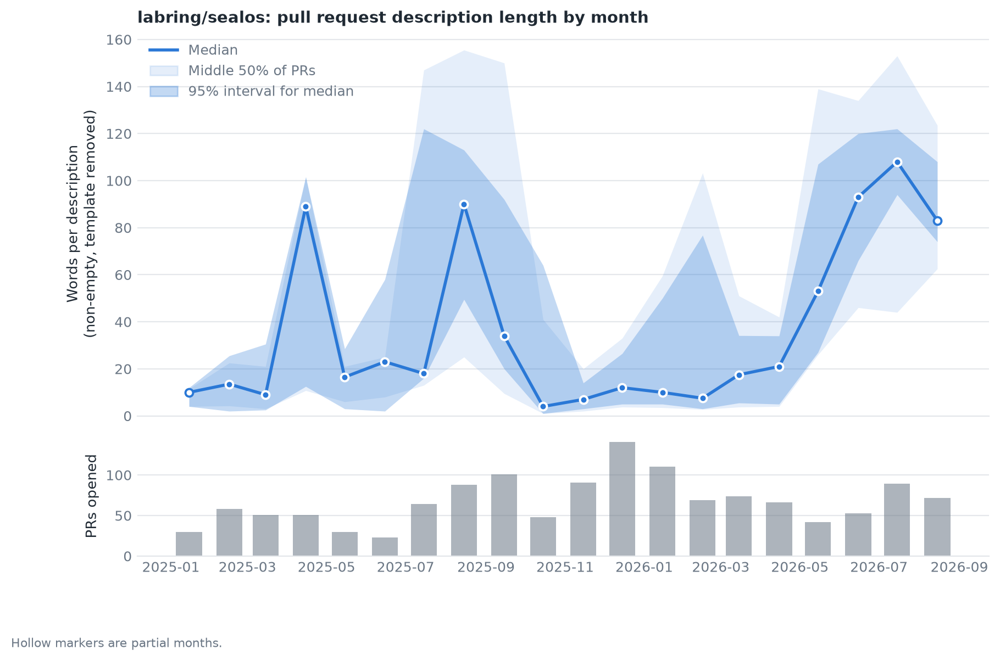
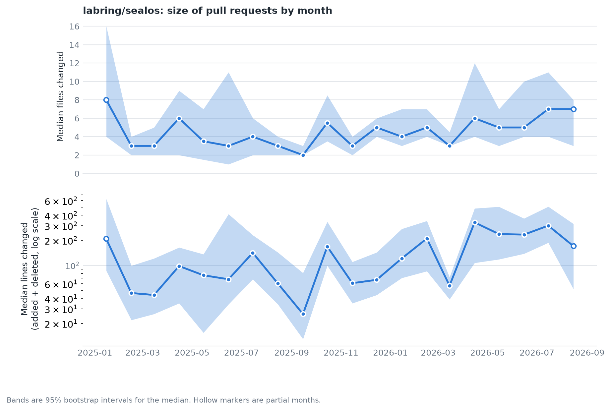
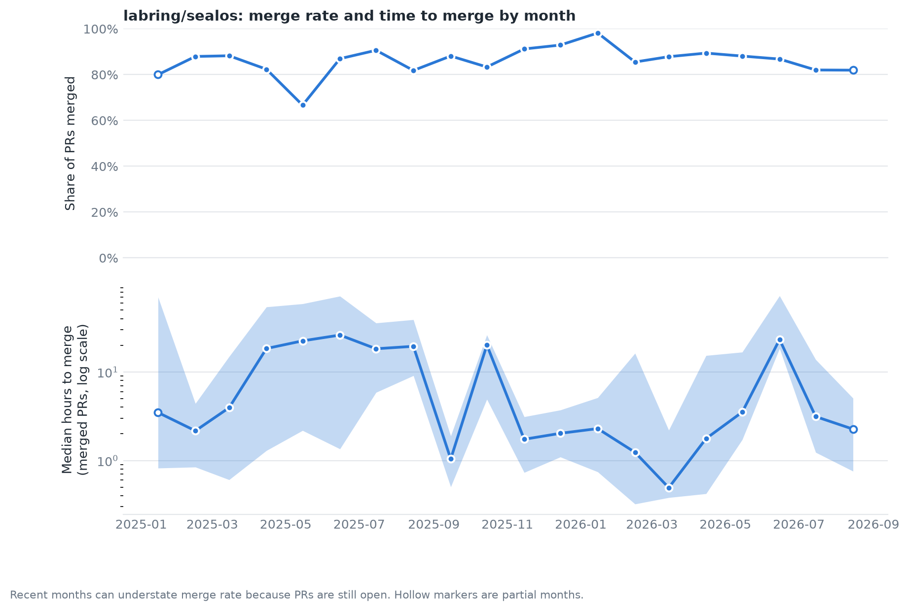
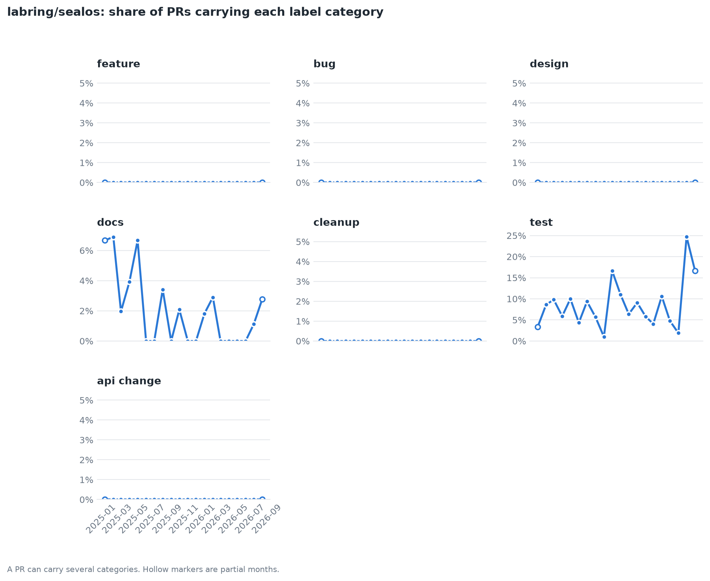
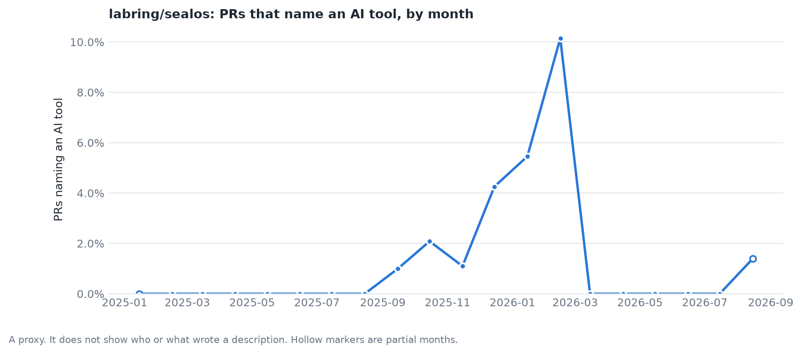

# Pull requests in labring/sealos: description length, size, speed and labels

Window 2025-01-06 to 2026-08-17 (UTC). Data fetched 2026-11-20. prwords 3.0.0, generated 2026-11-26. Method fixed in advance in `docs/ANALYSIS_PLAN.md`.

## 1. Data

- Repository primary language: Go
- Pull requests opened in the window: 1,587
- Removed as bot accounts: 236
- Analysed: 1,351 PRs from 50 authors
- Merged: 1,181 (87.4%). Closed without merging: 163 (12.1%). Still open: 7
- Follow-up: merge outcomes use a 30-day follow-up. PRs without enough follow-up: 0
- Empty descriptions after cleaning: 61.6%

## 2. Did the PR template change?

No template line appeared or disappeared with a share of 50% or more. Template text was detected monthly and removed before counting words.

Distinct template lines detected: 3.

## 3. First 28 days versus last 28 days

First window 2025-01-06 to 2025-02-02. Last window 2026-07-21 to 2026-08-17. Ratios are last median divided by first median. Bootstrap intervals, 2,000 resamples.

| Metric                                |   n first |   n last |   Median first |   Median last |   Ratio |   Ratio low |   Ratio high |       p |   Cliff's delta |
|:--------------------------------------|----------:|---------:|---------------:|--------------:|--------:|------------:|-------------:|--------:|----------------:|
| Description words (non-empty)         |         7 |      102 |          10    |          84   |    8.4  |        6.37 |        26.88 | 0.00063 |            0.78 |
| Files changed                         |        30 |      130 |           8    |           8   |    1    |        0.44 |         2    | 0.72    |            0.04 |
| Lines added                           |        30 |      130 |         108    |         111   |    1.03 |        0.24 |         4.65 | 0.53    |           -0.07 |
| Lines deleted                         |        30 |      130 |          29    |          21   |    0.72 |        0.16 |         2.05 | 0.61    |           -0.06 |
| Net lines (added minus deleted)       |        30 |      130 |          31.5  |          34.5 |    1.1  |        0.24 |        17.75 | 0.88    |            0.02 |
| Lines changed (added plus deleted)    |        30 |      130 |         208.5  |         267.5 |    1.28 |        0.37 |         3.93 | 0.69    |            0.05 |
| Hours from open to merge (merged PRs) |        24 |      109 |           3.48 |           1.9 |    0.55 |        0.03 |         3.61 | 0.1     |           -0.21 |
| Commits                               |        30 |      130 |           1    |           2   |    2    |        0.5  |         2    | 0.95    |            0.01 |
| Comments                              |        30 |      130 |           1    |           1   |    1    |        0.5  |         1    | 0.0035  |           -0.33 |
| Reviews                               |        30 |      130 |           1    |           1   |    1    |        1    |         1    | 0.94    |            0.01 |

| Measure                             |   n first |   n last | Share first   | Share last   |   Change (points) |     p |
|:------------------------------------|----------:|---------:|:--------------|:-------------|------------------:|------:|
| Merged within follow-up period      |        30 |      130 | 73.3%         | 83.8%        |              10.5 | 0.19  |
| Closed without merging              |        30 |      130 | 20.0%         | 15.4%        |              -4.6 | 0.58  |
| Opened as draft                     |        30 |      130 | 0.0%          | 2.3%         |               2.3 | 1     |
| From outside contributors           |        30 |      130 | 26.7%         | 8.5%         |             -18.2 | 0.011 |
| Has a kind or type label            |        30 |      130 | 6.7%          | 1.5%         |              -5.1 | 0.16  |
| Description text repeated elsewhere |        30 |      130 | 0.0%          | 0.0%         |               0   | 1     |
| Names an AI tool (disclosure)       |        30 |      130 | 0.0%          | 0.8%         |               0.8 | 1     |
| Label category: feature             |        30 |      130 | 0.0%          | 0.0%         |               0   | 1     |
| Label category: bug                 |        30 |      130 | 0.0%          | 0.0%         |               0   | 1     |
| Label category: design              |        30 |      130 | 0.0%          | 0.0%         |               0   | 1     |
| Label category: docs                |        30 |      130 | 6.7%          | 1.5%         |              -5.1 | 0.16  |
| Label category: cleanup             |        30 |      130 | 0.0%          | 0.0%         |               0   | 1     |
| Label category: test                |        30 |      130 | 3.3%          | 20.0%        |              16.7 | 0.029 |
| Label category: api_change          |        30 |      130 | 0.0%          | 0.0%         |               0   | 1     |

## 4. Monthly trends

Theil-Sen slope per month and Kendall tau over full months only.

| metric                     |   months |   slope_per_month |   slope_ci_low |   slope_ci_high |     tau |       p |
|:---------------------------|---------:|------------------:|---------------:|----------------:|--------:|--------:|
| median_words               |       18 |             1.267 |         -0.643 |           4.167 |   0.229 |   0.201 |
| median_files_changed       |       18 |             0.143 |         -0     |           0.25  |   0.369 |   0.043 |
| median_additions           |       18 |             6.923 |          1.2   |          11.167 |   0.438 |   0.011 |
| median_deletions           |       18 |             0.786 |         -0.111 |           1.5   |   0.296 |   0.088 |
| median_churn               |       18 |            12.154 |          2.556 |          18.4   |   0.464 |   0.007 |
| median_hours_to_merge      |       18 |            -0.165 |         -1.497 |           0.278 |  -0.15  |   0.41  |
| merge_rate                 |       18 |             0.001 |         -0.003 |           0.007 |   0.072 |   0.709 |
| share_outside_contributors |       18 |            -0.007 |         -0.018 |           0.002 |  -0.255 |   0.152 |
| share_ai_disclosed         |       18 |            -0     |         -0     |           0.001 |   0.217 |   0.256 |
| median_comments            |       18 |            -0     |         -0.083 |          -0     |  -0.458 |   0.024 |
| median_reviews             |       18 |            -0     |         -0     |          -0     | nan     | nan     |
| share_feature              |       18 |            -0     |         -0     |          -0     | nan     | nan     |
| share_bug                  |       18 |            -0     |         -0     |          -0     | nan     | nan     |
| share_design               |       18 |            -0     |         -0     |          -0     | nan     | nan     |
| share_docs                 |       18 |            -0.001 |         -0.004 |          -0     |  -0.396 |   0.031 |
| share_cleanup              |       18 |            -0     |         -0     |          -0     | nan     | nan     |
| share_test                 |       18 |            -0.001 |         -0.005 |           0.004 |  -0.072 |   0.709 |
| share_api_change           |       18 |            -0     |         -0     |          -0     | nan     | nan     |

## 5. Labels

Share of PRs with a kind or type label: 1.6% overall. Label coverage by month is in `monthly_summary.csv` (`share_has_kind_label`).

| category            |   n_prs |   share |   median_words |   median_files |   median_churn |   merge_rate |   median_hours_to_merge |   share_ai_disclosed |
|:--------------------|--------:|--------:|---------------:|---------------:|---------------:|-------------:|------------------------:|---------------------:|
| feature             |       0 |   0     |            nan |          nan   |          nan   |      nan     |                 nan     |              nan     |
| bug                 |       0 |   0     |            nan |          nan   |          nan   |      nan     |                 nan     |              nan     |
| design              |       0 |   0     |            nan |          nan   |          nan   |      nan     |                 nan     |              nan     |
| docs                |      22 |   0.016 |             16 |            6.5 |          250   |        0.545 |                  22.134 |                0     |
| cleanup             |       0 |   0     |            nan |          nan   |          nan   |      nan     |                 nan     |              nan     |
| test                |     118 |   0.087 |             69 |           16.5 |          914.5 |        0.712 |                  22.031 |                0.034 |
| api_change          |       0 |   0     |            nan |          nan   |          nan   |      nan     |                 nan     |              nan     |
| (no category label) |    1215 |   0.899 |             40 |            4   |           84   |        0.893 |                   2.636 |                0.016 |

Cross-check against the repository's own size labels (coverage 98.1%, Spearman rho between size label and lines changed 0.97):

| size_label   |   n_prs |   median_churn |   p10_churn |   p90_churn |
|:-------------|--------:|---------------:|------------:|------------:|
| XS           |     240 |              4 |           1 |           8 |
| S            |     168 |             18 |          11 |          26 |
| M            |     255 |             53 |          33 |          93 |
| L            |     364 |            232 |         119 |         446 |
| XL           |     111 |            675 |         526 |         915 |
| XXL          |     187 |           2991 |        1222 |       19272 |

## 6. Are PRs with signs of AI involvement smaller or larger?

Authorship is not observable. The proxy is `ai_disclosed`, defined in the analysis plan: 23 PRs (1.70%). 23 disclosed PRs are listed in `ai_disclosure_samples.csv` for manual audit.

### ai_disclosed

**Verdict: not testable.** Too few exposed PRs.

Pattern: lines changed: not estimated; files changed: not estimated; lines added: not estimated; lines deleted: not estimated; hours to merge: not estimated.

Not estimated: fewer than 30 exposed PRs (exposed PRs: 23).

### Robustness by tool (lines changed)

| tool        |   n exposed | status                    |
|:------------|------------:|:--------------------------|
| unspecified |          23 | fewer than 30 exposed PRs |

### File type check

Not run. Use `--file-check N` to sample N exposed PRs and matching unexposed PRs.

## 7. Other checks

- Outside contributors: 13.4% of PRs overall.
- Top 10 authors opened 83.0% of PRs.
- PRs whose description text is repeated elsewhere (10 or more words): 0.5%.

## 8. Limitations

- Word count and size describe PRs, not who wrote them. Proxies for AI involvement are noisy and omit undisclosed use.
- Added and deleted lines include generated or vendored files unless the project avoids committing them.
- Disclosure mostly captures tools that add attribution by default, so it is tool-skewed.
- Template removal is heuristic. Check `template_audit.csv`.
- One repository cannot support general claims. See the plan for replication.
- Months at the edges of the window are partial and are excluded from trend tests.

