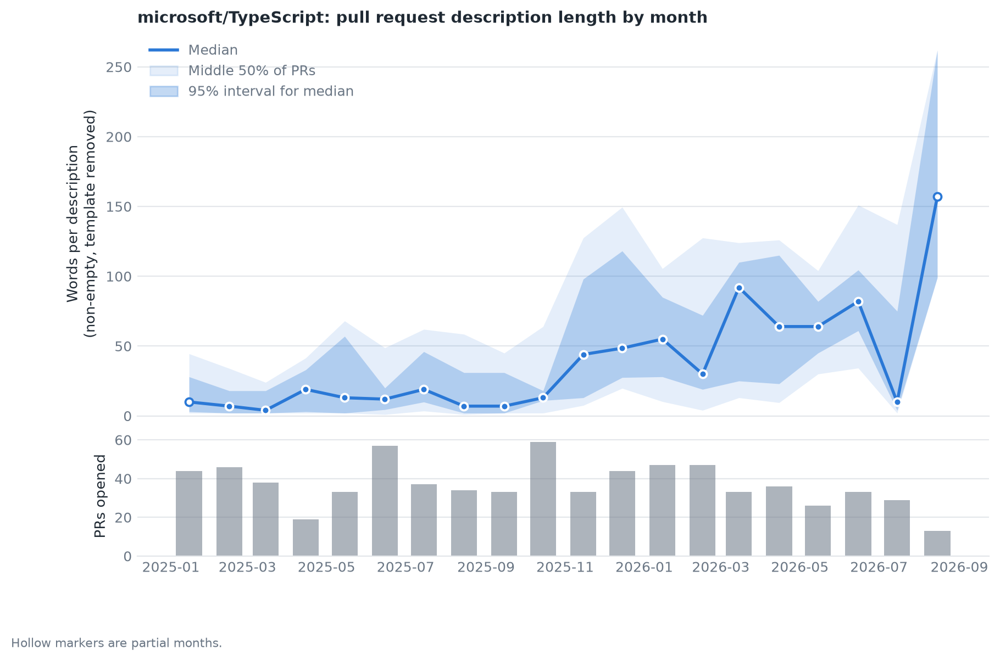
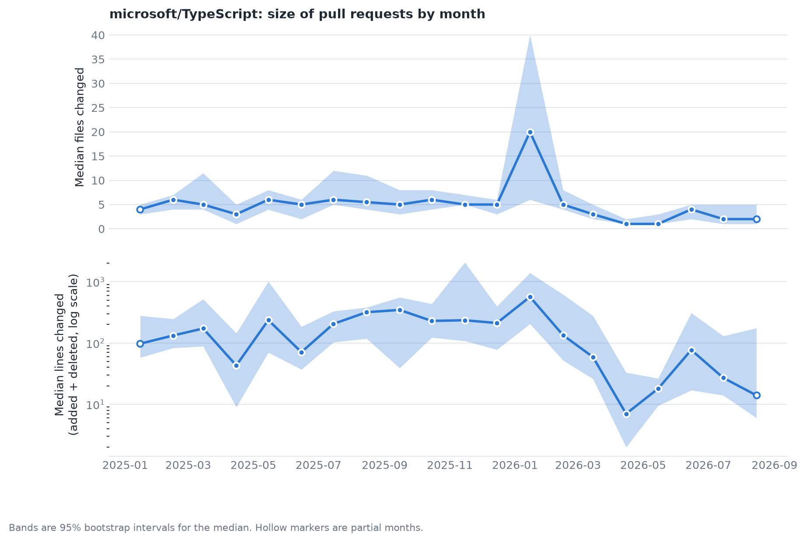
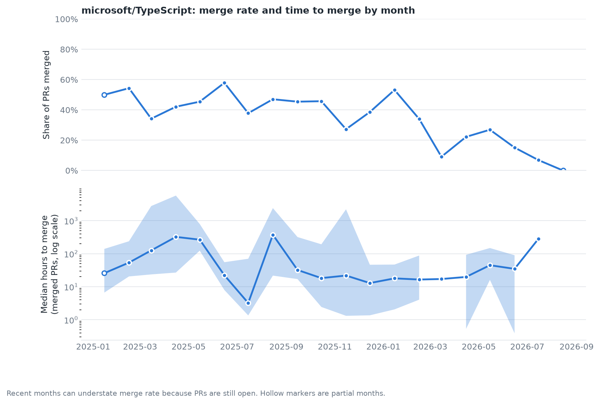
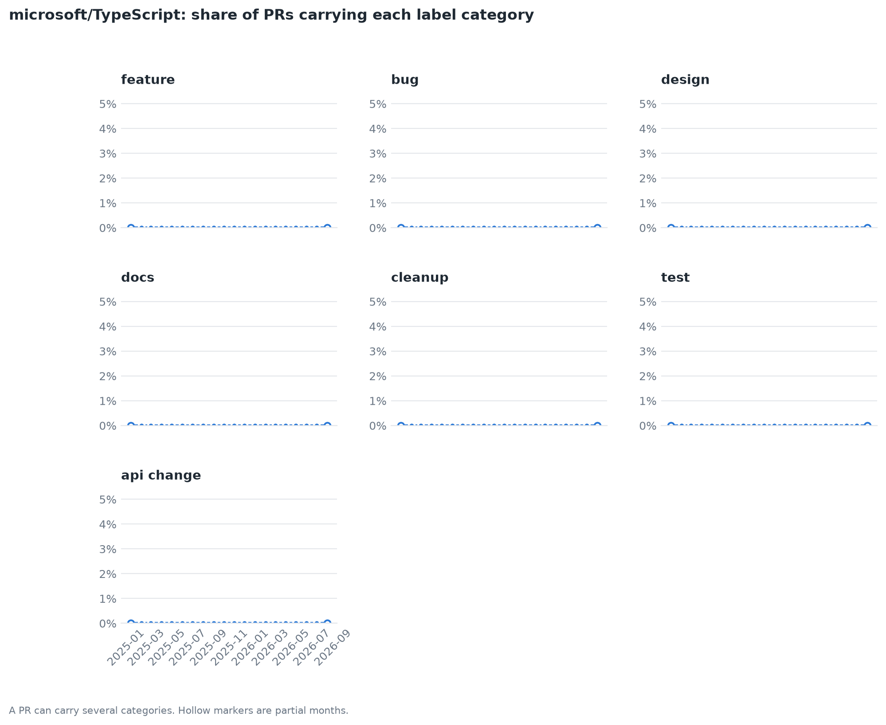
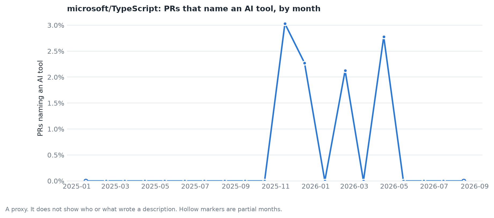

# Pull requests in microsoft/TypeScript: description length, size, speed and labels

Window 2025-01-06 to 2026-08-17 (UTC). Data fetched 2026-11-19. prwords 3.0.0, generated 2026-11-26. Method fixed in advance in `docs/ANALYSIS_PLAN.md`.

## 1. Data

- Repository primary language: Go
- Pull requests opened in the window: 907
- Removed as bot accounts: 166
- Analysed: 741 PRs from 283 authors
- Merged: 280 (37.8%). Closed without merging: 448 (60.5%). Still open: 13
- Follow-up: merge outcomes use a 30-day follow-up. PRs without enough follow-up: 0
- Empty descriptions after cleaning: 3.1%

## 2. Did the PR template change?

No template line appeared or disappeared with a share of 50% or more. Template text was detected monthly and removed before counting words.

Distinct template lines detected: 0.

## 3. First 28 days versus last 28 days

First window 2025-01-06 to 2025-02-02. Last window 2026-07-21 to 2026-08-17. Ratios are last median divided by first median. Bootstrap intervals, 2,000 resamples.

| Metric                                |   n first |   n last |   Median first |   Median last |   Ratio |   Ratio low |   Ratio high | p       |   Cliff's delta |
|:--------------------------------------|----------:|---------:|---------------:|--------------:|--------:|------------:|-------------:|:--------|----------------:|
| Description words (non-empty)         |        44 |       20 |           11.5 |         147   |   12.78 |        4.19 |        59.21 | 4.2e-06 |            0.72 |
| Files changed                         |        45 |       20 |            4   |           4   |    1    |        0.2  |         1.75 | 0.44    |           -0.12 |
| Lines added                           |        45 |       20 |           83   |          44   |    0.53 |        0.04 |         2.8  | 0.3     |           -0.16 |
| Lines deleted                         |        45 |       20 |            3   |           3.5 |    1.17 |        0.5  |         7.5  | 0.61    |            0.08 |
| Net lines (added minus deleted)       |        45 |       20 |           61   |          40.5 |    0.66 |        0.02 |         4.64 | 0.31    |           -0.16 |
| Lines changed (added plus deleted)    |        45 |       20 |          105   |          83.5 |    0.8  |        0.07 |         2.12 | 0.41    |           -0.13 |
| Hours from open to merge (merged PRs) |        22 |        1 |          nan   |         nan   |  nan    |      nan    |       nan    | n/a     |          nan    |
| Commits                               |        45 |       20 |            2   |           1   |    0.5  |        0.33 |         1    | 9.2e-05 |           -0.56 |
| Comments                              |        45 |       20 |            4   |           3   |    0.75 |        0.29 |         1.5  | 0.16    |           -0.22 |
| Reviews                               |        45 |       20 |            1   |           1   |    1    |        1    |         1    | 0.93    |            0.01 |

| Measure                             |   n first |   n last | Share first   | Share last   |   Change (points) |      p |
|:------------------------------------|----------:|---------:|:--------------|:-------------|------------------:|-------:|
| Merged within follow-up period      |        45 |       20 | 40.0%         | 5.0%         |             -35   | 0.0035 |
| Closed without merging              |        45 |       20 | 51.1%         | 70.0%        |              18.9 | 0.18   |
| Opened as draft                     |        45 |       20 | 4.4%          | 10.0%        |               5.6 | 0.58   |
| From outside contributors           |        45 |       20 | 60.0%         | 90.0%        |              30   | 0.02   |
| Has a kind or type label            |        45 |       20 | 0.0%          | 0.0%         |               0   | 1      |
| Description text repeated elsewhere |        45 |       20 | 0.0%          | 0.0%         |               0   | 1      |
| Names an AI tool (disclosure)       |        45 |       20 | 0.0%          | 0.0%         |               0   | 1      |
| Label category: feature             |        45 |       20 | 0.0%          | 0.0%         |               0   | 1      |
| Label category: bug                 |        45 |       20 | 0.0%          | 0.0%         |               0   | 1      |
| Label category: design              |        45 |       20 | 0.0%          | 0.0%         |               0   | 1      |
| Label category: docs                |        45 |       20 | 0.0%          | 0.0%         |               0   | 1      |
| Label category: cleanup             |        45 |       20 | 0.0%          | 0.0%         |               0   | 1      |
| Label category: test                |        45 |       20 | 0.0%          | 0.0%         |               0   | 1      |
| Label category: api_change          |        45 |       20 | 0.0%          | 0.0%         |               0   | 1      |

## 4. Monthly trends

Theil-Sen slope per month and Kendall tau over full months only.

| metric                     |   months |   slope_per_month |   slope_ci_low |   slope_ci_high |     tau |       p |
|:---------------------------|---------:|------------------:|---------------:|----------------:|--------:|--------:|
| median_words               |       18 |             4.15  |          1.571 |           5.5   |   0.54  |   0.002 |
| median_files_changed       |       18 |            -0.154 |         -0.318 |          -0     |  -0.425 |   0.019 |
| median_additions           |       18 |            -8.25  |        -18.556 |           3.667 |  -0.242 |   0.175 |
| median_deletions           |       18 |            -0.071 |         -0.286 |           0.25  |  -0.15  |   0.399 |
| median_churn               |       18 |            -7.633 |        -22.417 |           7.5   |  -0.203 |   0.26  |
| median_hours_to_merge      |       18 |            -1.005 |         -8.139 |           1.897 |  -0.15  |   0.41  |
| merge_rate                 |       18 |            -0.022 |         -0.032 |          -0.01  |  -0.511 |   0.003 |
| share_outside_contributors |       18 |             0.015 |          0.001 |           0.032 |   0.354 |   0.041 |
| share_ai_disclosed         |       18 |            -0     |         -0     |          -0     |   0.205 |   0.294 |
| median_comments            |       18 |            -0     |         -0.1   |          -0     |  -0.388 |   0.048 |
| median_reviews             |       18 |            -0     |         -0.111 |          -0     |  -0.355 |   0.066 |
| share_feature              |       18 |            -0     |         -0     |          -0     | nan     | nan     |
| share_bug                  |       18 |            -0     |         -0     |          -0     | nan     | nan     |
| share_design               |       18 |            -0     |         -0     |          -0     | nan     | nan     |
| share_docs                 |       18 |            -0     |         -0     |          -0     | nan     | nan     |
| share_cleanup              |       18 |            -0     |         -0     |          -0     | nan     | nan     |
| share_test                 |       18 |            -0     |         -0     |          -0     | nan     | nan     |
| share_api_change           |       18 |            -0     |         -0     |          -0     | nan     | nan     |

## 5. Labels

Share of PRs with a kind or type label: 0.0% overall. Label coverage by month is in `monthly_summary.csv` (`share_has_kind_label`).

| category            |   n_prs |   share |   median_words |   median_files |   median_churn |   merge_rate |   median_hours_to_merge |   share_ai_disclosed |
|:--------------------|--------:|--------:|---------------:|---------------:|---------------:|-------------:|------------------------:|---------------------:|
| feature             |       0 |       0 |            nan |            nan |            nan |      nan     |                 nan     |              nan     |
| bug                 |       0 |       0 |            nan |            nan |            nan |      nan     |                 nan     |              nan     |
| design              |       0 |       0 |            nan |            nan |            nan |      nan     |                 nan     |              nan     |
| docs                |       0 |       0 |            nan |            nan |            nan |      nan     |                 nan     |              nan     |
| cleanup             |       0 |       0 |            nan |            nan |            nan |      nan     |                 nan     |              nan     |
| test                |       0 |       0 |            nan |            nan |            nan |      nan     |                 nan     |              nan     |
| api_change          |       0 |       0 |            nan |            nan |            nan |      nan     |                 nan     |              nan     |
| (no category label) |     741 |       1 |             25 |              5 |            130 |        0.378 |                  32.036 |                0.005 |

## 6. Are PRs with signs of AI involvement smaller or larger?

Authorship is not observable. The proxy is `ai_disclosed`, defined in the analysis plan: 4 PRs (0.54%). 4 disclosed PRs are listed in `ai_disclosure_samples.csv` for manual audit.

### ai_disclosed

**Verdict: not testable.** Too few exposed PRs.

Pattern: lines changed: not estimated; files changed: not estimated; lines added: not estimated; lines deleted: not estimated; hours to merge: not estimated.

Not estimated: fewer than 30 exposed PRs (exposed PRs: 4).

### Robustness by tool (lines changed)

| tool        |   n exposed | status                    |
|:------------|------------:|:--------------------------|
| unspecified |           3 | fewer than 30 exposed PRs |
| claude      |           1 | fewer than 30 exposed PRs |

### File type check

Not run. Use `--file-check N` to sample N exposed PRs and matching unexposed PRs.

## 7. Other checks

- Outside contributors: 69.2% of PRs overall.
- Top 10 authors opened 46.8% of PRs.
- PRs whose description text is repeated elsewhere (10 or more words): 0.5%.

## 8. Limitations

- Word count and size describe PRs, not who wrote them. Proxies for AI involvement are noisy and omit undisclosed use.
- Added and deleted lines include generated or vendored files unless the project avoids committing them.
- Disclosure mostly captures tools that add attribution by default, so it is tool-skewed.
- Template removal is heuristic. Check `template_audit.csv`.
- One repository cannot support general claims. See the plan for replication.
- Months at the edges of the window are partial and are excluded from trend tests.

