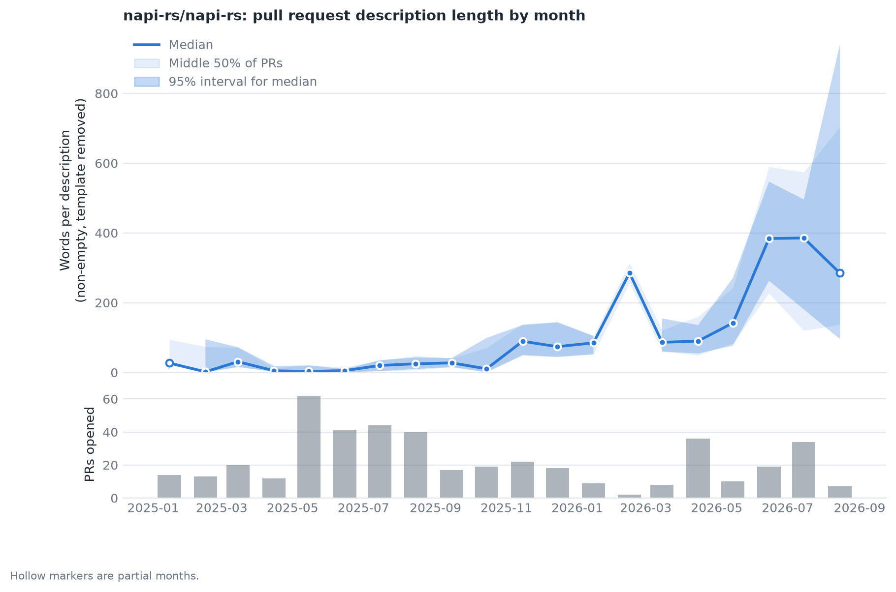
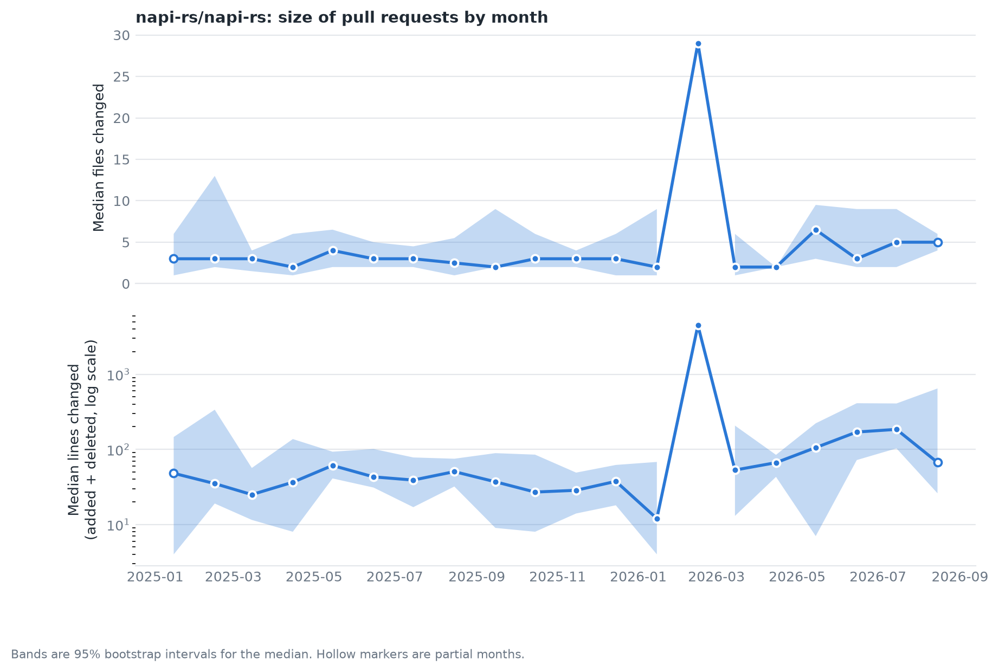
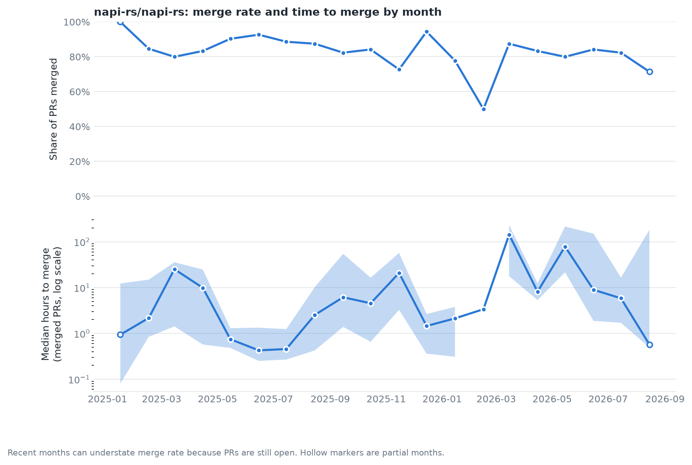
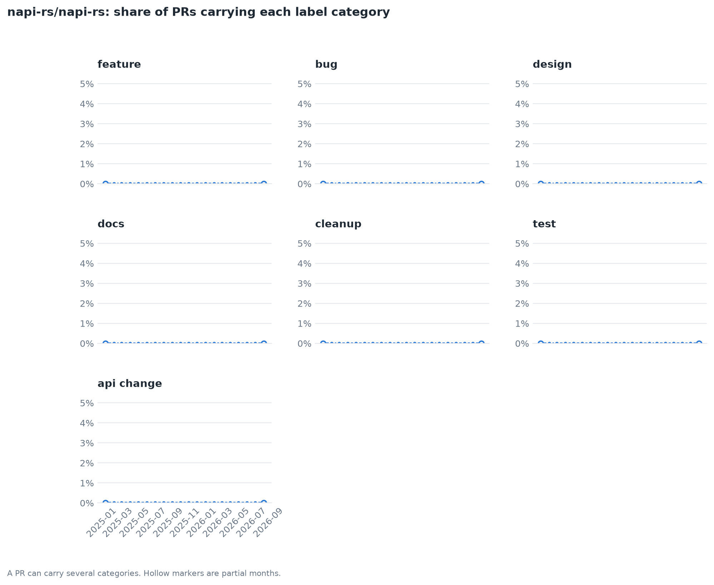
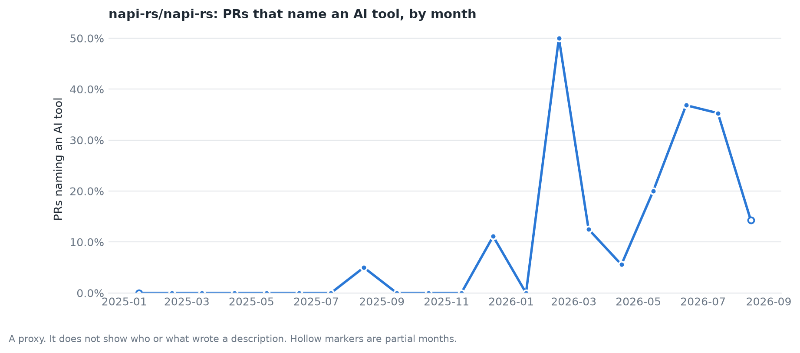
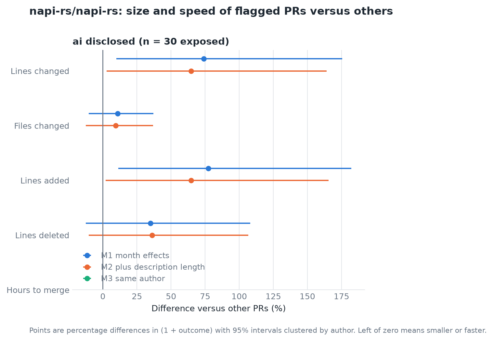

# Pull requests in napi-rs/napi-rs: description length, size, speed and labels

Window 2025-01-06 to 2026-08-17 (UTC). Data fetched 2026-11-20. prwords 3.0.0, generated 2026-11-26. Method fixed in advance in `docs/ANALYSIS_PLAN.md`.

## 1. Data

- Repository primary language: Rust
- Pull requests opened in the window: 818
- Removed as bot accounts: 371
- Analysed: 447 PRs from 74 authors
- Merged: 384 (85.9%). Closed without merging: 47 (10.5%). Still open: 16
- Follow-up: merge outcomes use a 30-day follow-up. PRs without enough follow-up: 0
- Empty descriptions after cleaning: 35.3%

## 2. Did the PR template change?

No template line appeared or disappeared with a share of 50% or more. Template text was detected monthly and removed before counting words.

Distinct template lines detected: 1.

## 3. First 28 days versus last 28 days

First window 2025-01-06 to 2025-02-02. Last window 2026-07-21 to 2026-08-17. Ratios are last median divided by first median. Bootstrap intervals, 2,000 resamples.

| Metric                                |   n first |   n last |   Median first |   Median last |   Ratio |   Ratio low |   Ratio high | p       |   Cliff's delta |
|:--------------------------------------|----------:|---------:|---------------:|--------------:|--------:|------------:|-------------:|:--------|----------------:|
| Description words (non-empty)         |         3 |       19 |         nan    |         nan   |  nan    |      nan    |       nan    | n/a     |          nan    |
| Files changed                         |        14 |       19 |           3    |           5   |    1.67 |        0.67 |         5    | 0.37    |            0.19 |
| Lines added                           |        14 |       19 |          24.5  |         136   |    5.55 |        1.05 |        42.84 | 0.077   |            0.37 |
| Lines deleted                         |        14 |       19 |          16    |          17   |    1.06 |        0.32 |        13    | 0.65    |            0.1  |
| Net lines (added minus deleted)       |        14 |       19 |           4    |          63   |   15.75 |        1.69 |       177    | 0.022   |            0.48 |
| Lines changed (added plus deleted)    |        14 |       19 |          48    |         149   |    3.1  |        0.65 |        39.32 | 0.084   |            0.36 |
| Hours from open to merge (merged PRs) |        14 |       15 |           0.94 |           1.7 |    1.82 |        0.1  |        45.86 | 0.35    |            0.21 |
| Commits                               |        14 |       19 |           1    |           1   |    1    |        1    |         2    | 0.034   |            0.37 |
| Comments                              |        14 |       19 |           1    |           2   |    2    |        1    |         5    | 0.00098 |            0.64 |
| Reviews                               |        14 |       19 |           1    |           1   |    1    |        0    |         3    | 0.31    |            0.2  |

| Measure                             |   n first |   n last | Share first   | Share last   |   Change (points) |     p |
|:------------------------------------|----------:|---------:|:--------------|:-------------|------------------:|------:|
| Merged within follow-up period      |        14 |       19 | 92.9%         | 78.9%        |             -13.9 | 0.37  |
| Closed without merging              |        14 |       19 | 0.0%          | 15.8%        |              15.8 | 0.24  |
| Opened as draft                     |        14 |       19 | 0.0%          | 10.5%        |              10.5 | 0.5   |
| From outside contributors           |        14 |       19 | 21.4%         | 57.9%        |              36.5 | 0.073 |
| Has a kind or type label            |        14 |       19 | 0.0%          | 0.0%         |               0   | 1     |
| Description text repeated elsewhere |        14 |       19 | 0.0%          | 0.0%         |               0   | 1     |
| Names an AI tool (disclosure)       |        14 |       19 | 0.0%          | 21.1%        |              21.1 | 0.12  |
| Label category: feature             |        14 |       19 | 0.0%          | 0.0%         |               0   | 1     |
| Label category: bug                 |        14 |       19 | 0.0%          | 0.0%         |               0   | 1     |
| Label category: design              |        14 |       19 | 0.0%          | 0.0%         |               0   | 1     |
| Label category: docs                |        14 |       19 | 0.0%          | 0.0%         |               0   | 1     |
| Label category: cleanup             |        14 |       19 | 0.0%          | 0.0%         |               0   | 1     |
| Label category: test                |        14 |       19 | 0.0%          | 0.0%         |               0   | 1     |
| Label category: api_change          |        14 |       19 | 0.0%          | 0.0%         |               0   | 1     |

## 4. Monthly trends

Theil-Sen slope per month and Kendall tau over full months only.

| metric                     |   months |   slope_per_month |   slope_ci_low |   slope_ci_high |     tau |       p |
|:---------------------------|---------:|------------------:|---------------:|----------------:|--------:|--------:|
| median_words               |       18 |            10.538 |          7.2   |          21.5   |   0.778 |   0     |
| median_files_changed       |       18 |            -0     |         -0.071 |           0.154 |   0.068 |   0.717 |
| median_additions           |       18 |             3.5   |          0.167 |           6.889 |   0.362 |   0.037 |
| median_deletions           |       18 |            -0.222 |         -0.692 |           0.562 |  -0.073 |   0.675 |
| median_churn               |       18 |             3.708 |          0.357 |           9.667 |   0.425 |   0.014 |
| median_hours_to_merge      |       18 |             0.4   |         -0.145 |           1.048 |   0.255 |   0.152 |
| merge_rate                 |       18 |            -0.003 |         -0.011 |           0.003 |  -0.213 |   0.224 |
| share_outside_contributors |       18 |             0.015 |         -0.014 |           0.038 |   0.163 |   0.369 |
| share_ai_disclosed         |       18 |             0.012 |         -0     |           0.024 |   0.638 |   0.001 |
| median_comments            |       18 |             0.033 |         -0     |           0.083 |   0.468 |   0.015 |
| median_reviews             |       18 |             0.056 |         -0     |           0.125 |   0.363 |   0.053 |
| share_feature              |       18 |            -0     |         -0     |          -0     | nan     | nan     |
| share_bug                  |       18 |            -0     |         -0     |          -0     | nan     | nan     |
| share_design               |       18 |            -0     |         -0     |          -0     | nan     | nan     |
| share_docs                 |       18 |            -0     |         -0     |          -0     | nan     | nan     |
| share_cleanup              |       18 |            -0     |         -0     |          -0     | nan     | nan     |
| share_test                 |       18 |            -0     |         -0     |          -0     | nan     | nan     |
| share_api_change           |       18 |            -0     |         -0     |          -0     | nan     | nan     |

## 5. Labels

Share of PRs with a kind or type label: 0.0% overall. Label coverage by month is in `monthly_summary.csv` (`share_has_kind_label`).

| category            |   n_prs |   share |   median_words |   median_files |   median_churn |   merge_rate |   median_hours_to_merge |   share_ai_disclosed |
|:--------------------|--------:|--------:|---------------:|---------------:|---------------:|-------------:|------------------------:|---------------------:|
| feature             |       0 |       0 |            nan |            nan |            nan |      nan     |                 nan     |              nan     |
| bug                 |       0 |       0 |            nan |            nan |            nan |      nan     |                 nan     |              nan     |
| design              |       0 |       0 |            nan |            nan |            nan |      nan     |                 nan     |              nan     |
| docs                |       0 |       0 |            nan |            nan |            nan |      nan     |                 nan     |              nan     |
| cleanup             |       0 |       0 |            nan |            nan |            nan |      nan     |                 nan     |              nan     |
| test                |       0 |       0 |            nan |            nan |            nan |      nan     |                 nan     |              nan     |
| api_change          |       0 |       0 |            nan |            nan |            nan |      nan     |                 nan     |              nan     |
| (no category label) |     447 |       1 |             62 |              3 |             51 |        0.859 |                   2.055 |                0.067 |

## 6. Are PRs with signs of AI involvement smaller or larger?

Authorship is not observable. The proxy is `ai_disclosed`, defined in the analysis plan: 30 PRs (6.71%). 30 disclosed PRs are listed in `ai_disclosure_samples.csv` for manual audit.

### ai_disclosed

**Verdict: not testable.** No author has both exposed and unexposed PRs, so the same-author check is impossible.

Pattern: lines changed: no clear difference; files changed: no clear difference; lines added: no clear difference; lines deleted: no clear difference; hours to merge: not estimated.

Within-author permutation p-value, lines changed: 0.0010.

| Outcome       | Model                      |   n |   n exposed |   Median exposed |   Median others | Difference (95% CI)      |     p |   p (Holm) |
|:--------------|:---------------------------|----:|------------:|-----------------:|----------------:|:-------------------------|------:|-----------:|
| Lines changed | M1 month effects           | 447 |          30 |            163.5 |              48 | +74.0% (+9.9 to +175.5)  | 0.018 |      0.063 |
| Lines changed | M2 plus description length | 447 |          30 |            163.5 |              48 | +64.7% (+2.7 to +164.1)  | 0.038 |      0.15  |
| Files changed | M1 month effects           | 447 |          30 |              4.5 |               3 | +10.8% (-10.3 to +37.0)  | 0.34  |      0.35  |
| Files changed | M2 plus description length | 447 |          30 |              4.5 |               3 | +9.5% (-12.5 to +36.9)   | 0.43  |      0.43  |
| Lines added   | M1 month effects           | 447 |          30 |            162   |              34 | +77.3% (+11.3 to +182.3) | 0.016 |      0.063 |
| Lines added   | M2 plus description length | 447 |          30 |            162   |              34 | +64.7% (+2.1 to +165.5)  | 0.041 |      0.15  |
| Lines deleted | M1 month effects           | 447 |          30 |             19.5 |               8 | +35.0% (-12.4 to +108.1) | 0.17  |      0.35  |
| Lines deleted | M2 plus description length | 447 |          30 |             19.5 |               8 | +36.2% (-10.3 to +106.8) | 0.15  |      0.29  |

### Robustness by tool (lines changed)

| tool        |   n exposed | status                    |
|:------------|------------:|:--------------------------|
| unspecified |          25 | fewer than 30 exposed PRs |
| claude      |           5 | fewer than 30 exposed PRs |

### File type check

Sample: 30 exposed and 30 unexposed PRs from the same months. 0 PRs with more than 100 files were excluded.

Share of changed lines by file type:

| group     |   n_prs | code   | tests   | docs   | config   | generated   | other   |   median_code_test_lines |
|:----------|--------:|:-------|:--------|:-------|:---------|:------------|:--------|-------------------------:|
| exposed   |      30 | 81.7%  | 9.8%    | 0.3%   | 1.3%     | 0.2%        | 6.6%    |                    127.5 |
| unexposed |      30 | 69.1%  | 7.6%    | 0.7%   | 1.1%     | 5.4%        | 16.2%   |                    113   |

Code and test lines only, same month: +23.0% (95% CI -42.8 to +164.4), p = 0.6. This is a robustness check and does not change the verdict.

## 7. Other checks

- Outside contributors: 41.4% of PRs overall.
- Top 10 authors opened 77.9% of PRs.
- PRs whose description text is repeated elsewhere (10 or more words): 0.0%.

## 8. Limitations

- Word count and size describe PRs, not who wrote them. Proxies for AI involvement are noisy and omit undisclosed use.
- Added and deleted lines include generated or vendored files unless the project avoids committing them.
- Disclosure mostly captures tools that add attribution by default, so it is tool-skewed.
- Template removal is heuristic. Check `template_audit.csv`.
- One repository cannot support general claims. See the plan for replication.
- Months at the edges of the window are partial and are excluded from trend tests.

