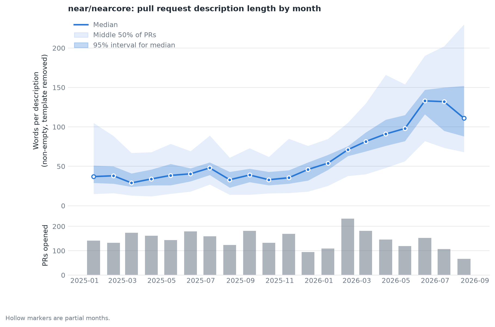
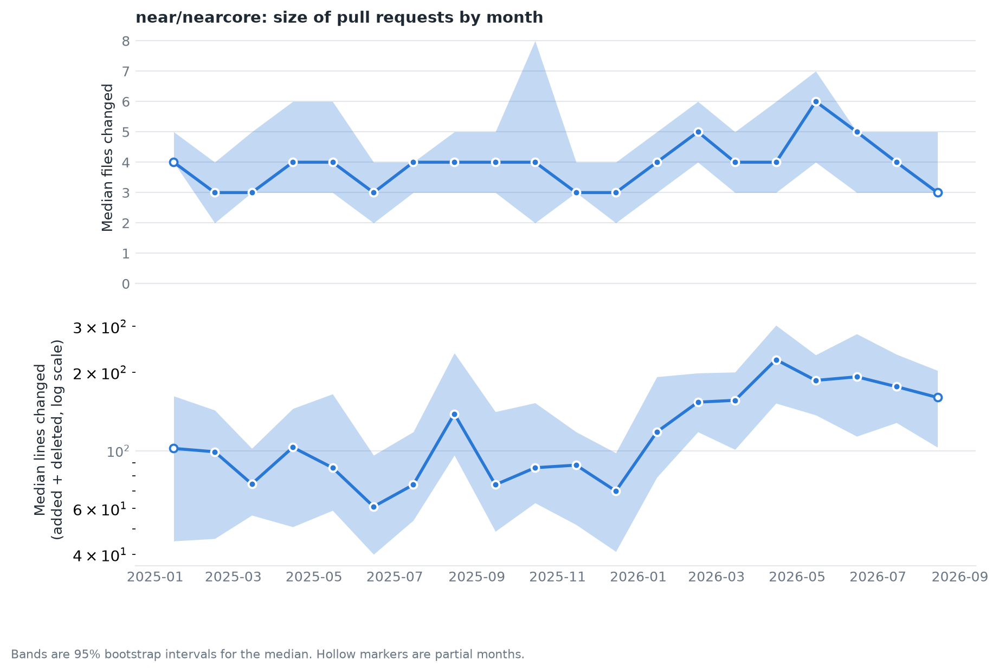
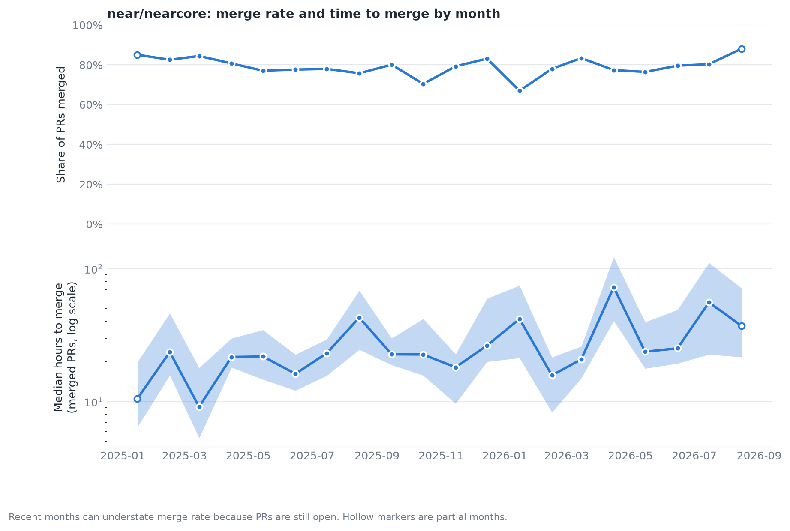
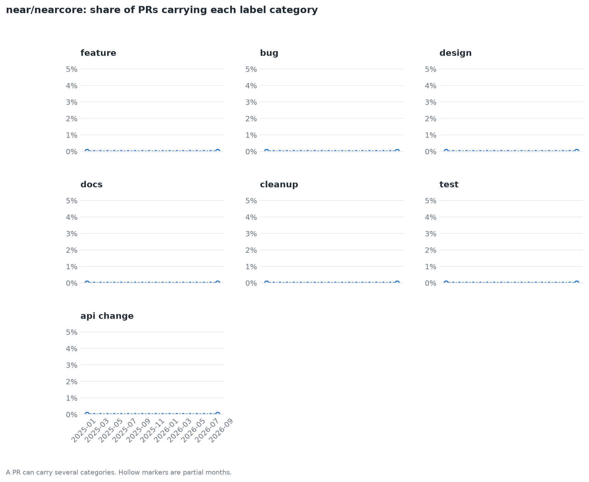
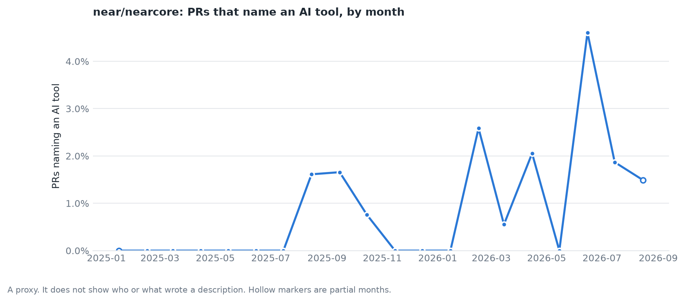

# Pull requests in near/nearcore: description length, size, speed and labels

Window 2025-01-06 to 2026-08-17 (UTC). Data fetched 2026-11-20. prwords 3.0.0, generated 2026-11-26. Method fixed in advance in `docs/ANALYSIS_PLAN.md`.

## 1. Data

- Repository primary language: Rust
- Pull requests opened in the window: 3,060
- Removed as bot accounts: 156
- Analysed: 2,904 PRs from 133 authors
- Merged: 2,300 (79.2%). Closed without merging: 510 (17.6%). Still open: 94
- Follow-up: merge outcomes use a 30-day follow-up. PRs without enough follow-up: 0
- Empty descriptions after cleaning: 15.3%

## 2. Did the PR template change?

No template line appeared or disappeared with a share of 50% or more. Template text was detected monthly and removed before counting words.

Distinct template lines detected: 0.

## 3. First 28 days versus last 28 days

First window 2025-01-06 to 2025-02-02. Last window 2026-07-21 to 2026-08-17. Ratios are last median divided by first median. Bootstrap intervals, 2,000 resamples.

| Metric                                |   n first |   n last |   Median first |   Median last |   Ratio |   Ratio low |   Ratio high |       p |   Cliff's delta |
|:--------------------------------------|----------:|---------:|---------------:|--------------:|--------:|------------:|-------------:|--------:|----------------:|
| Description words (non-empty)         |       110 |      107 |          37    |        115    |    3.11 |        2.11 |         4.21 | 2.4e-11 |            0.52 |
| Files changed                         |       142 |      108 |           4    |          4    |    1    |        0.6  |         1.33 | 0.99    |            0    |
| Lines added                           |       142 |      108 |          57    |        112.5  |    1.97 |        1.21 |         4.07 | 0.0011  |            0.24 |
| Lines deleted                         |       142 |      108 |          20.5  |         17.5  |    0.85 |        0.4  |         1.41 | 0.21    |           -0.09 |
| Net lines (added minus deleted)       |       142 |      108 |           6.5  |         72    |   11.08 |        3.8  |        43.81 | 5.2e-07 |            0.37 |
| Lines changed (added plus deleted)    |       142 |      108 |         102    |        149    |    1.46 |        0.85 |         3.35 | 0.018   |            0.18 |
| Hours from open to merge (merged PRs) |       120 |       94 |          10.52 |         27.61 |    2.62 |        1.4  |         7.42 | 1.4e-05 |            0.35 |
| Commits                               |       142 |      108 |           3    |          2    |    0.67 |        0.67 |         1.5  | 0.82    |           -0.02 |
| Comments                              |       142 |      108 |           1    |          3    |    3    |        3    |         3    | 2.5e-18 |            0.62 |
| Reviews                               |       142 |      108 |           1    |          3    |    3    |        1.5  |         3    | 1.5e-05 |            0.31 |

| Measure                             |   n first |   n last | Share first   | Share last   |   Change (points) |     p |
|:------------------------------------|----------:|---------:|:--------------|:-------------|------------------:|------:|
| Merged within follow-up period      |       142 |      108 | 83.8%         | 86.1%        |               2.3 | 0.72  |
| Closed without merging              |       142 |      108 | 14.8%         | 9.3%         |              -5.5 | 0.25  |
| Opened as draft                     |       142 |      108 | 7.0%          | 7.4%         |               0.4 | 1     |
| From outside contributors           |       142 |      108 | 100.0%        | 97.2%        |              -2.8 | 0.079 |
| Has a kind or type label            |       142 |      108 | 0.0%          | 0.0%         |               0   | 1     |
| Description text repeated elsewhere |       142 |      108 | 1.4%          | 0.0%         |              -1.4 | 0.51  |
| Names an AI tool (disclosure)       |       142 |      108 | 0.0%          | 1.9%         |               1.9 | 0.19  |
| Label category: feature             |       142 |      108 | 0.0%          | 0.0%         |               0   | 1     |
| Label category: bug                 |       142 |      108 | 0.0%          | 0.0%         |               0   | 1     |
| Label category: design              |       142 |      108 | 0.0%          | 0.0%         |               0   | 1     |
| Label category: docs                |       142 |      108 | 0.0%          | 0.0%         |               0   | 1     |
| Label category: cleanup             |       142 |      108 | 0.0%          | 0.0%         |               0   | 1     |
| Label category: test                |       142 |      108 | 0.0%          | 0.0%         |               0   | 1     |
| Label category: api_change          |       142 |      108 | 0.0%          | 0.0%         |               0   | 1     |

## 4. Monthly trends

Theil-Sen slope per month and Kendall tau over full months only.

| metric                     |   months |   slope_per_month |   slope_ci_low |   slope_ci_high |     tau |       p |
|:---------------------------|---------:|------------------:|---------------:|----------------:|--------:|--------:|
| median_words               |       18 |             4.778 |          3.25  |           7.25  |   0.708 |   0     |
| median_files_changed       |       18 |             0.059 |         -0     |           0.143 |   0.468 |   0.015 |
| median_additions           |       18 |             5     |          2.5   |           7.429 |   0.599 |   0.001 |
| median_deletions           |       18 |             0.444 |         -0.333 |           1.375 |   0.192 |   0.271 |
| median_churn               |       18 |             6.583 |          3.409 |          10.833 |   0.507 |   0.003 |
| median_hours_to_merge      |       18 |             0.658 |         -0.065 |           2.275 |   0.32  |   0.068 |
| merge_rate                 |       18 |            -0.001 |         -0.005 |           0.002 |  -0.098 |   0.601 |
| share_outside_contributors |       18 |             0     |         -0.002 |           0.002 |   0.039 |   0.82  |
| share_ai_disclosed         |       18 |             0.001 |         -0     |           0.002 |   0.451 |   0.015 |
| median_comments            |       18 |            -0     |         -0     |          -0     |   0.13  |   0.517 |
| median_reviews             |       18 |             0.062 |         -0     |           0.111 |   0.539 |   0.006 |
| share_feature              |       18 |            -0     |         -0     |          -0     | nan     | nan     |
| share_bug                  |       18 |            -0     |         -0     |          -0     | nan     | nan     |
| share_design               |       18 |            -0     |         -0     |          -0     | nan     | nan     |
| share_docs                 |       18 |            -0     |         -0     |          -0     | nan     | nan     |
| share_cleanup              |       18 |            -0     |         -0     |          -0     | nan     | nan     |
| share_test                 |       18 |            -0     |         -0     |          -0     | nan     | nan     |
| share_api_change           |       18 |            -0     |         -0     |          -0     | nan     | nan     |

## 5. Labels

Share of PRs with a kind or type label: 0.0% overall. Label coverage by month is in `monthly_summary.csv` (`share_has_kind_label`).

| category            |   n_prs |   share |   median_words |   median_files |   median_churn |   merge_rate |   median_hours_to_merge |   share_ai_disclosed |
|:--------------------|--------:|--------:|---------------:|---------------:|---------------:|-------------:|------------------------:|---------------------:|
| feature             |       0 |       0 |            nan |            nan |          nan   |      nan     |                 nan     |              nan     |
| bug                 |       0 |       0 |            nan |            nan |          nan   |      nan     |                 nan     |              nan     |
| design              |       0 |       0 |            nan |            nan |          nan   |      nan     |                 nan     |              nan     |
| docs                |       0 |       0 |            nan |            nan |          nan   |      nan     |                 nan     |              nan     |
| cleanup             |       0 |       0 |            nan |            nan |          nan   |      nan     |                 nan     |              nan     |
| test                |       0 |       0 |            nan |            nan |          nan   |      nan     |                 nan     |              nan     |
| api_change          |       0 |       0 |            nan |            nan |          nan   |      nan     |                 nan     |              nan     |
| (no category label) |    2904 |       1 |             55 |              4 |          114.5 |        0.792 |                  21.979 |                0.009 |

## 6. Are PRs with signs of AI involvement smaller or larger?

Authorship is not observable. The proxy is `ai_disclosed`, defined in the analysis plan: 26 PRs (0.90%). 26 disclosed PRs are listed in `ai_disclosure_samples.csv` for manual audit.

### ai_disclosed

**Verdict: not testable.** Too few exposed PRs.

Pattern: lines changed: not estimated; files changed: not estimated; lines added: not estimated; lines deleted: not estimated; hours to merge: not estimated.

Not estimated: fewer than 30 exposed PRs (exposed PRs: 26).

### Robustness by tool (lines changed)

| tool        |   n exposed | status                    |
|:------------|------------:|:--------------------------|
| unspecified |          23 | fewer than 30 exposed PRs |
| claude      |           3 | fewer than 30 exposed PRs |

### File type check

Not run. Use `--file-check N` to sample N exposed PRs and matching unexposed PRs.

## 7. Other checks

- Outside contributors: 98.0% of PRs overall.
- Top 10 authors opened 68.3% of PRs.
- PRs whose description text is repeated elsewhere (10 or more words): 1.8%.

## 8. Limitations

- Word count and size describe PRs, not who wrote them. Proxies for AI involvement are noisy and omit undisclosed use.
- Added and deleted lines include generated or vendored files unless the project avoids committing them.
- Disclosure mostly captures tools that add attribution by default, so it is tool-skewed.
- Template removal is heuristic. Check `template_audit.csv`.
- One repository cannot support general claims. See the plan for replication.
- Months at the edges of the window are partial and are excluded from trend tests.

