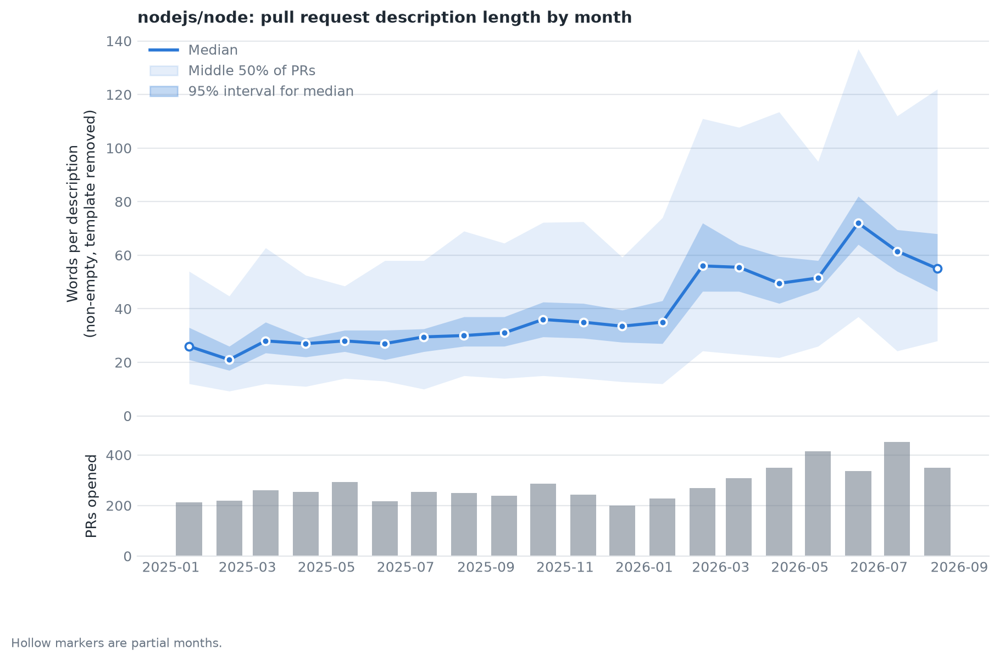
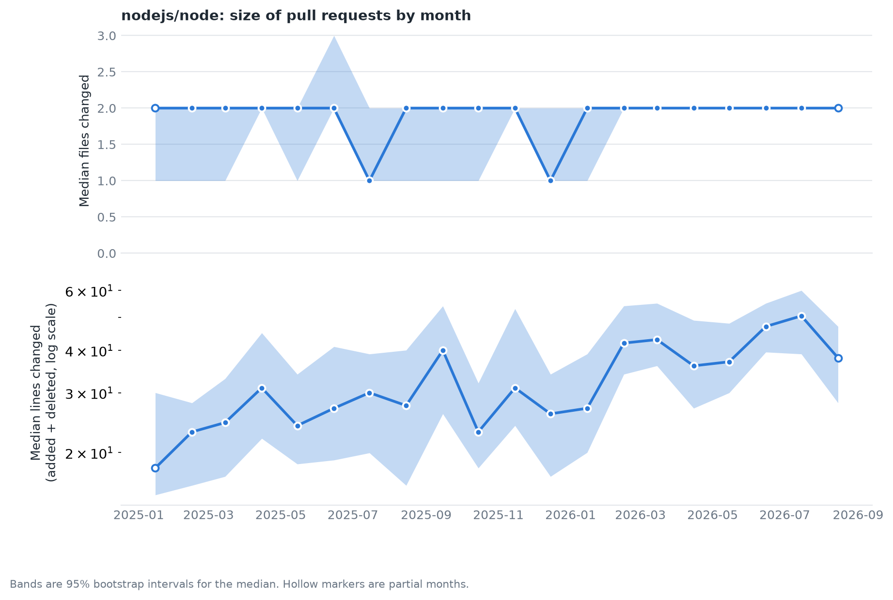
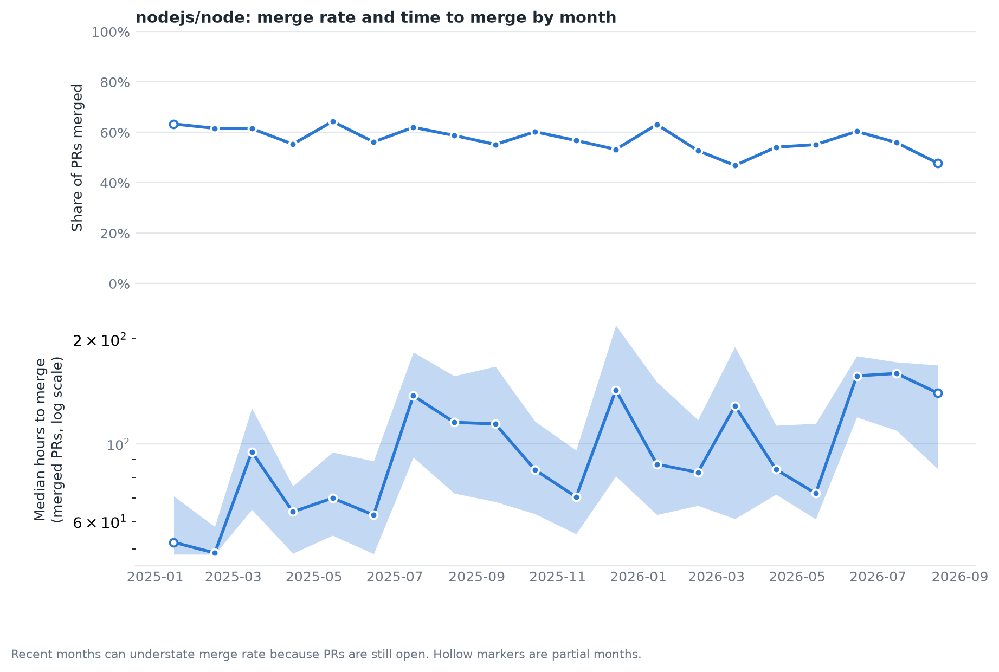
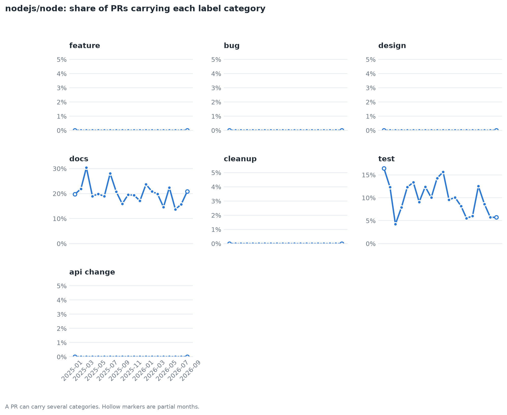
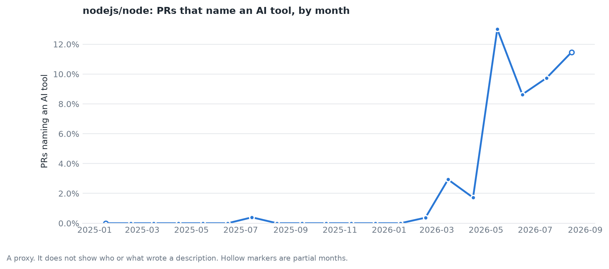
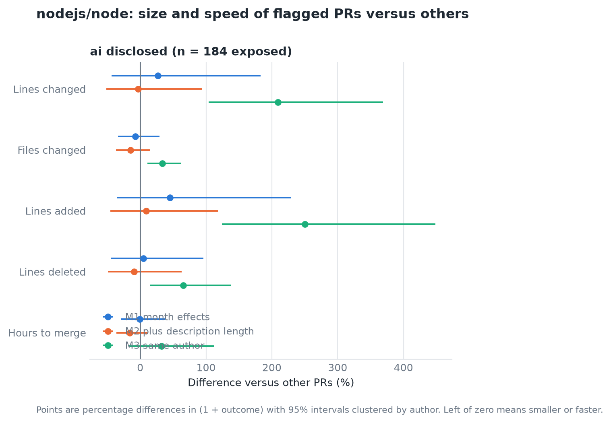

# Pull requests in nodejs/node: description length, size, speed and labels

Window 2025-01-06 to 2026-08-17 (UTC). Data fetched 2026-11-19. prwords 3.0.0, generated 2026-11-26. Method fixed in advance in `docs/ANALYSIS_PLAN.md`.

## 1. Data

- Repository primary language: JavaScript
- Pull requests opened in the window: 6,370
- Removed as bot accounts: 740
- Analysed: 5,630 PRs from 1,117 authors
- Merged: 3,204 (56.9%). Closed without merging: 2,158 (38.3%). Still open: 268
- Follow-up: merge outcomes use a 30-day follow-up. PRs without enough follow-up: 0
- Empty descriptions after cleaning: 9.2%

## 2. Did the PR template change?

No template line appeared or disappeared with a share of 50% or more. Template text was detected monthly and removed before counting words.

Distinct template lines detected: 2.

## 3. First 28 days versus last 28 days

First window 2025-01-06 to 2025-02-02. Last window 2026-07-21 to 2026-08-17. Ratios are last median divided by first median. Bootstrap intervals, 2,000 resamples.

| Metric                                |   n first |   n last |   Median first |   Median last |   Ratio |   Ratio low |   Ratio high |       p |   Cliff's delta |
|:--------------------------------------|----------:|---------:|---------------:|--------------:|--------:|------------:|-------------:|--------:|----------------:|
| Description words (non-empty)         |       194 |      491 |          24.5  |         58    |    2.37 |        1.79 |         3.12 | 4.6e-15 |            0.38 |
| Files changed                         |       222 |      514 |           2    |          2    |    1    |        1    |         2    | 0.019   |            0.1  |
| Lines added                           |       222 |      514 |          15    |         31    |    2.07 |        1.44 |         3.44 | 0.00056 |            0.16 |
| Lines deleted                         |       222 |      514 |           4    |          4    |    1    |        0.67 |         1.67 | 0.78    |           -0.01 |
| Net lines (added minus deleted)       |       222 |      514 |           4.5  |         22    |    4.89 |        2.28 |         9.76 | 0.00024 |            0.17 |
| Lines changed (added plus deleted)    |       222 |      514 |          21.5  |         38    |    1.77 |        1.07 |         2.72 | 0.0037  |            0.13 |
| Hours from open to merge (merged PRs) |       141 |      263 |          50.63 |        145.27 |    2.87 |        1.88 |         3.49 | 1.3e-07 |            0.32 |
| Commits                               |       222 |      514 |           1    |          1    |    1    |        1    |         1    | 0.021   |           -0.09 |
| Comments                              |       222 |      514 |           6    |          5    |    0.83 |        0.62 |         1    | 1.9e-06 |           -0.22 |
| Reviews                               |       222 |      514 |           4    |          2    |    0.5  |        0.5  |         0.5  | 3.8e-16 |           -0.37 |

| Measure                             |   n first |   n last | Share first   | Share last   |   Change (points) |       p |
|:------------------------------------|----------:|---------:|:--------------|:-------------|------------------:|--------:|
| Merged within follow-up period      |       222 |      514 | 58.6%         | 48.8%        |              -9.7 | 0.016   |
| Closed without merging              |       222 |      514 | 36.5%         | 38.1%        |               1.6 | 0.68    |
| Opened as draft                     |       222 |      514 | 1.4%          | 1.8%         |               0.4 | 1       |
| From outside contributors           |       222 |      514 | 42.8%         | 61.1%        |              18.3 | 5.6e-06 |
| Has a kind or type label            |       222 |      514 | 0.0%          | 0.0%         |               0   | 1       |
| Description text repeated elsewhere |       222 |      514 | 0.0%          | 1.6%         |               1.6 | 0.11    |
| Names an AI tool (disclosure)       |       222 |      514 | 0.0%          | 11.3%        |              11.3 | 5.4e-10 |
| Label category: feature             |       222 |      514 | 0.0%          | 0.0%         |               0   | 1       |
| Label category: bug                 |       222 |      514 | 0.0%          | 0.0%         |               0   | 1       |
| Label category: design              |       222 |      514 | 0.0%          | 0.0%         |               0   | 1       |
| Label category: docs                |       222 |      514 | 19.4%         | 19.1%        |              -0.3 | 0.92    |
| Label category: cleanup             |       222 |      514 | 0.0%          | 0.0%         |               0   | 1       |
| Label category: test                |       222 |      514 | 15.8%         | 5.8%         |              -9.9 | 3.1e-05 |
| Label category: api_change          |       222 |      514 | 0.0%          | 0.0%         |               0   | 1       |

## 4. Monthly trends

Theil-Sen slope per month and Kendall tau over full months only.

| metric                     |   months |   slope_per_month |   slope_ci_low |   slope_ci_high |     tau |       p |
|:---------------------------|---------:|------------------:|---------------:|----------------:|--------:|--------:|
| median_words               |       18 |             2.167 |          1.333 |           2.864 |   0.819 |   0     |
| median_files_changed       |       18 |            -0     |         -0     |          -0     |   0.057 |   0.779 |
| median_additions           |       18 |             1.2   |          0.667 |           1.818 |   0.74  |   0     |
| median_deletions           |       18 |            -0     |         -0.1   |           0.071 |  -0.051 |   0.783 |
| median_churn               |       18 |             1.167 |          0.75  |           1.778 |   0.581 |   0.001 |
| median_hours_to_merge      |       18 |             2.621 |          0.183 |           6.381 |   0.373 |   0.032 |
| merge_rate                 |       18 |            -0.003 |         -0.008 |           0     |  -0.32  |   0.068 |
| share_outside_contributors |       18 |             0.008 |          0.003 |           0.011 |   0.464 |   0.007 |
| share_ai_disclosed         |       18 |             0.001 |         -0     |           0.005 |   0.637 |   0.001 |
| median_comments            |       18 |            -0     |         -0     |          -0     |  -0.389 |   0.052 |
| median_reviews             |       18 |            -0.111 |         -0.143 |          -0     |  -0.732 |   0     |
| share_feature              |       18 |            -0     |         -0     |          -0     | nan     | nan     |
| share_bug                  |       18 |            -0     |         -0     |          -0     | nan     | nan     |
| share_design               |       18 |            -0     |         -0     |          -0     | nan     | nan     |
| share_docs                 |       18 |            -0.004 |         -0.008 |           0.001 |  -0.294 |   0.096 |
| share_cleanup              |       18 |            -0     |         -0     |          -0     | nan     | nan     |
| share_test                 |       18 |            -0.002 |         -0.005 |           0.002 |  -0.131 |   0.448 |
| share_api_change           |       18 |            -0     |         -0     |          -0     | nan     | nan     |

## 5. Labels

Share of PRs with a kind or type label: 0.0% overall. Label coverage by month is in `monthly_summary.csv` (`share_has_kind_label`).

| category            |   n_prs |   share |   median_words |   median_files |   median_churn |   merge_rate |   median_hours_to_merge |   share_ai_disclosed |
|:--------------------|--------:|--------:|---------------:|---------------:|---------------:|-------------:|------------------------:|---------------------:|
| feature             |       0 |   0     |            nan |            nan |            nan |      nan     |                 nan     |              nan     |
| bug                 |       0 |   0     |            nan |            nan |            nan |      nan     |                 nan     |              nan     |
| design              |       0 |   0     |            nan |            nan |            nan |      nan     |                 nan     |              nan     |
| docs                |    1119 |   0.199 |             34 |              1 |              8 |        0.603 |                  49.607 |                0.005 |
| cleanup             |       0 |   0     |            nan |            nan |            nan |      nan     |                 nan     |              nan     |
| test                |     544 |   0.097 |             35 |              1 |             17 |        0.697 |                  60.997 |                0.055 |
| api_change          |       0 |   0     |            nan |            nan |            nan |      nan     |                 nan     |              nan     |
| (no category label) |    3970 |   0.705 |             43 |              2 |             52 |        0.542 |                 119.924 |                0.037 |

## 6. Are PRs with signs of AI involvement smaller or larger?

Authorship is not observable. The proxy is `ai_disclosed`, defined in the analysis plan: 184 PRs (3.27%). 50 disclosed PRs are listed in `ai_disclosure_samples.csv` for manual audit.

### ai_disclosed

**Verdict: no difference detected.** The same-month interval for lines changed runs from -43.3% to +182.8%.

Pattern: lines changed: no clear difference; files changed: no clear difference; lines added: no clear difference; lines deleted: no clear difference; hours to merge: no clear difference.

Within-author permutation p-value, lines changed: 0.0005.

| Outcome        | Model                      |    n |   n exposed |   Median exposed |   Median others | Difference (95% CI)        |       p |   p (Holm) |
|:---------------|:---------------------------|-----:|------------:|-----------------:|----------------:|:---------------------------|--------:|-----------:|
| Lines changed  | M1 month effects           | 5630 |         184 |             56.5 |            32   | +26.7% (-43.3 to +182.8)   | 0.56    |    1       |
| Lines changed  | M2 plus description length | 5630 |         184 |             56.5 |            32   | -2.9% (-51.4 to +94.2)     | 0.93    |    1       |
| Lines changed  | M3 same author             | 5630 |         184 |             56.5 |            32   | +209.4% (+104.2 to +368.9) | 1e-07   |    4e-07   |
| Files changed  | M1 month effects           | 5630 |         184 |              2   |             2   | -7.2% (-33.5 to +29.4)     | 0.66    |    1       |
| Files changed  | M2 plus description length | 5630 |         184 |              2   |             2   | -14.5% (-36.7 to +15.5)    | 0.31    |    1       |
| Files changed  | M3 same author             | 5630 |         184 |              2   |             2   | +33.7% (+10.7 to +61.6)    | 0.0026  |    0.0078  |
| Lines added    | M1 month effects           | 5630 |         184 |             48   |            22   | +45.4% (-35.7 to +228.7)   | 0.37    |    1       |
| Lines added    | M2 plus description length | 5630 |         184 |             48   |            22   | +9.3% (-45.4 to +118.7)    | 0.8     |    1       |
| Lines added    | M3 same author             | 5630 |         184 |             48   |            22   | +250.5% (+123.9 to +448.8) | 4.2e-08 |    2.1e-07 |
| Lines deleted  | M1 month effects           | 5630 |         184 |              6   |             4   | +4.7% (-44.1 to +96.2)     | 0.89    |    1       |
| Lines deleted  | M2 plus description length | 5630 |         184 |              6   |             4   | -9.1% (-49.2 to +62.7)     | 0.75    |    1       |
| Lines deleted  | M3 same author             | 5630 |         184 |              6   |             4   | +65.1% (+14.7 to +137.5)   | 0.0069  |    0.014   |
| Hours to merge | M1 month effects           | 3204 |         135 |            168.2 |            89.4 | -0.8% (-28.6 to +37.8)     | 0.96    |    1       |
| Hours to merge | M2 plus description length | 3204 |         135 |            168.2 |            89.4 | -16.0% (-36.2 to +10.6)    | 0.21    |    1       |
| Hours to merge | M3 same author             | 3204 |         135 |            168.2 |            89.4 | +32.1% (-17.8 to +112.4)   | 0.25    |    0.25    |

### Robustness by tool (lines changed)

| tool        |   n exposed | Same month              | call                | status                    |
|:------------|------------:|:------------------------|:--------------------|:--------------------------|
| chatgpt     |         100 | -22.9% (-47.4 to +12.9) | no clear difference | ok                        |
| codex       |          39 | +2.5% (-41.7 to +80.2)  | no clear difference | ok                        |
| claude      |          24 | n/a                     | nan                 | fewer than 30 exposed PRs |
| unspecified |          20 | n/a                     | nan                 | fewer than 30 exposed PRs |
| copilot     |           1 | n/a                     | nan                 | fewer than 30 exposed PRs |

### File type check

Sample: 183 exposed and 178 unexposed PRs from the same months. 7 PRs with more than 100 files were excluded.

Share of changed lines by file type:

| group     |   n_prs | code   | tests   | docs   | config   | generated   | other   |   median_code_test_lines |
|:----------|--------:|:-------|:--------|:-------|:---------|:------------|:--------|-------------------------:|
| exposed   |     183 | 55.8%  | 37.2%   | 6.6%   | 0.1%     | 0.0%        | 0.3%    |                       51 |
| unexposed |     178 | 36.1%  | 27.9%   | 4.0%   | 0.6%     | 31.0%       | 0.4%    |                       20 |

Code and test lines only, same month: +228.7% (95% CI +82.6 to +491.7), p = 7.3e-05. This is a robustness check and does not change the verdict.

## 7. Other checks

- Outside contributors: 48.8% of PRs overall.
- Top 10 authors opened 31.7% of PRs.
- PRs whose description text is repeated elsewhere (10 or more words): 1.3%.

## 8. Limitations

- Word count and size describe PRs, not who wrote them. Proxies for AI involvement are noisy and omit undisclosed use.
- Added and deleted lines include generated or vendored files unless the project avoids committing them.
- Disclosure mostly captures tools that add attribution by default, so it is tool-skewed.
- Template removal is heuristic. Check `template_audit.csv`.
- One repository cannot support general claims. See the plan for replication.
- Months at the edges of the window are partial and are excluded from trend tests.

