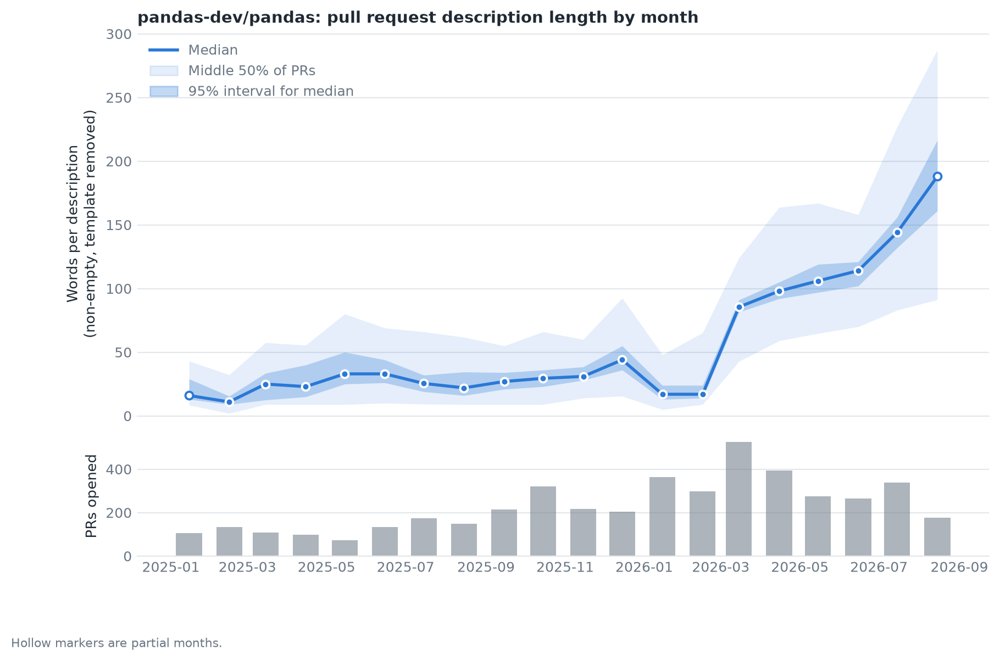
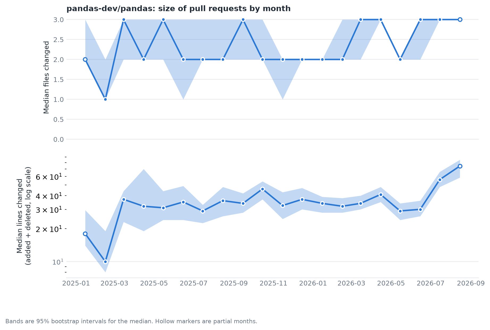
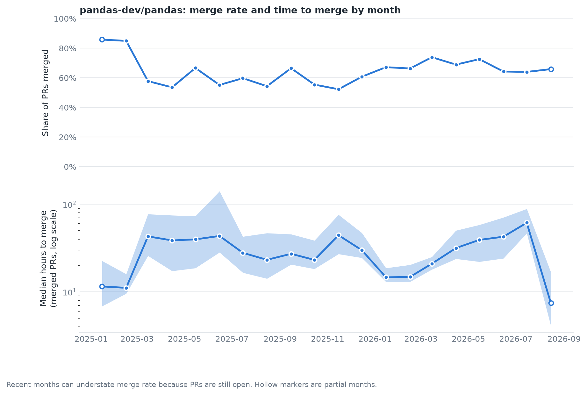
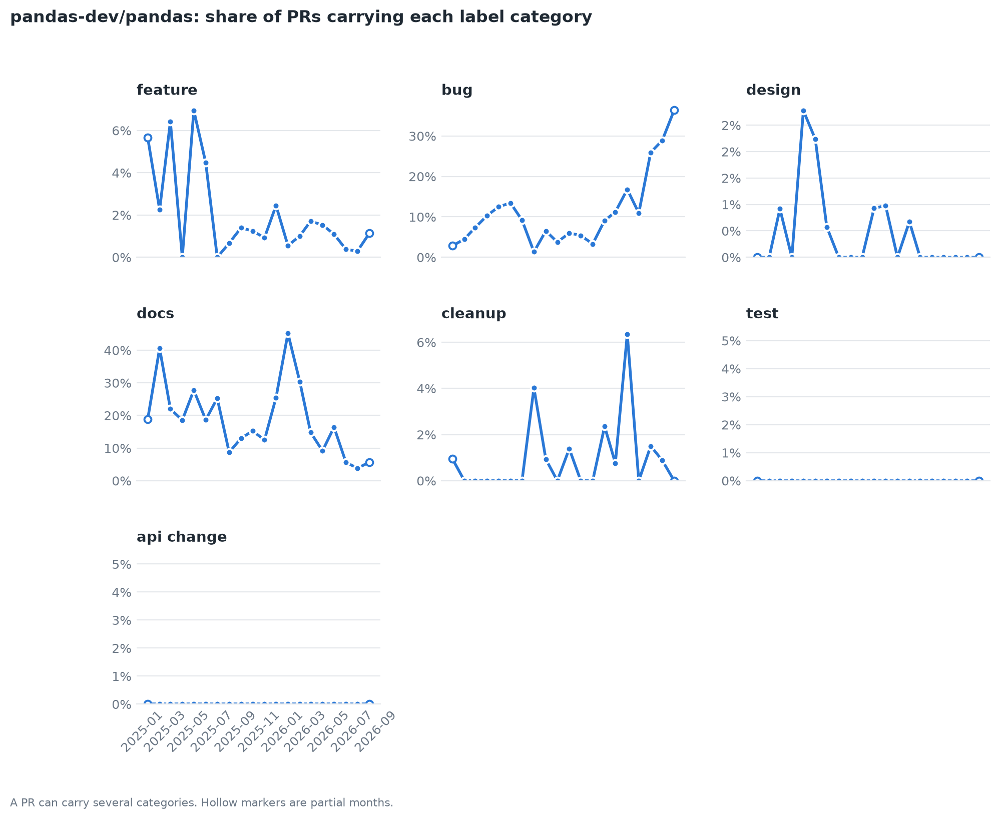
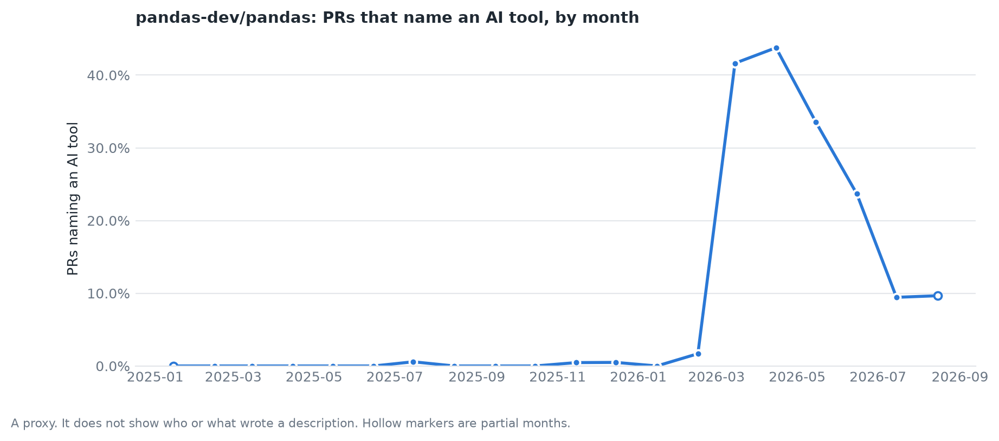
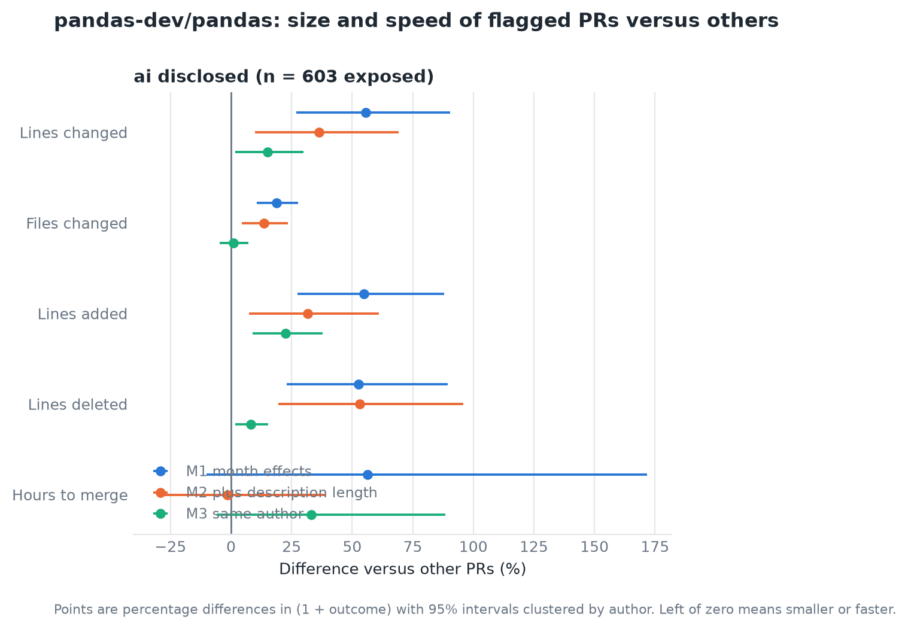

# Pull requests in pandas-dev/pandas: description length, size, speed and labels

Window 2025-01-06 to 2026-08-17 (UTC). Data fetched 2026-11-19. prwords 3.0.0, generated 2026-11-26. Method fixed in advance in `docs/ANALYSIS_PLAN.md`.

## 1. Data

- Repository primary language: Python
- Pull requests opened in the window: 4,699
- Removed as bot accounts: 135
- Analysed: 4,564 PRs from 1,137 authors
- Merged: 2,988 (65.5%). Closed without merging: 1,557 (34.1%). Still open: 19
- Follow-up: merge outcomes use a 30-day follow-up. PRs without enough follow-up: 0
- Empty descriptions after cleaning: 2.1%

## 2. Did the PR template change?

Lines that appeared or disappeared across the window (full list in `template_audit.csv`):

| line                                                                                                        | first_month   | last_month   |   months |   peak_share | change_event   |
|:------------------------------------------------------------------------------------------------------------|:--------------|:-------------|---------:|-------------:|:---------------|
| added an entry in the latest `doc/source/whatsnew/vx.x.x.rst` file if fixing a bug or adding a new feature. | 2025-01       | 2026-07      |       15 |         0.54 | removed        |
| ## summary                                                                                                  | 2026-03       | 2026-05      |        3 |         0.5  | added          |

Distinct template lines detected: 11.

## 3. First 28 days versus last 28 days

First window 2025-01-06 to 2025-02-02. Last window 2026-07-21 to 2026-08-17. Ratios are last median divided by first median. Bootstrap intervals, 2,000 resamples.

| Metric                                |   n first |   n last |   Median first |   Median last |   Ratio |   Ratio low |   Ratio high |       p |   Cliff's delta |
|:--------------------------------------|----------:|---------:|---------------:|--------------:|--------:|------------:|-------------:|--------:|----------------:|
| Description words (non-empty)         |       112 |      295 |          16    |        175    |   10.94 |        6.15 |        14.08 | 3.1e-31 |            0.75 |
| Files changed                         |       115 |      297 |           2    |          3    |    1.5  |        1    |         1.5  | 0.00093 |            0.21 |
| Lines added                           |       115 |      297 |          11    |         50    |    4.55 |        3.38 |         7.25 | 1.7e-11 |            0.43 |
| Lines deleted                         |       115 |      297 |           5    |          4    |    0.8  |        0.5  |         1.5  | 0.61    |           -0.03 |
| Net lines (added minus deleted)       |       115 |      297 |           4    |         39    |    9.75 |        4.38 |        21.62 | 5.9e-13 |            0.46 |
| Lines changed (added plus deleted)    |       115 |      297 |          20    |         66    |    3.3  |        2.5  |         4.64 | 1e-08   |            0.36 |
| Hours from open to merge (merged PRs) |        98 |      186 |          14.72 |         17.49 |    1.19 |        0.64 |         2.15 | 0.77    |            0.02 |
| Commits                               |       115 |      297 |           2    |          1    |    0.5  |        0.5  |         2    | 0.062   |           -0.11 |
| Comments                              |       115 |      297 |           1    |          1    |    1    |        0.5  |         1    | 0.0039  |           -0.18 |
| Reviews                               |       115 |      297 |           1    |          0    |    0    |        0    |         0    | 5e-06   |           -0.27 |

| Measure                             |   n first |   n last | Share first   | Share last   |   Change (points) |       p |
|:------------------------------------|----------:|---------:|:--------------|:-------------|------------------:|--------:|
| Merged within follow-up period      |       115 |      297 | 80.9%         | 59.9%        |             -20.9 | 4.6e-05 |
| Closed without merging              |       115 |      297 | 14.8%         | 35.0%        |              20.2 | 3.6e-05 |
| Opened as draft                     |       115 |      297 | 3.5%          | 6.4%         |               2.9 | 0.34    |
| From outside contributors           |       115 |      297 | 45.2%         | 44.1%        |              -1.1 | 0.91    |
| Has a kind or type label            |       115 |      297 | 0.0%          | 0.0%         |               0   | 1       |
| Description text repeated elsewhere |       115 |      297 | 7.8%          | 1.3%         |              -6.5 | 0.002   |
| Names an AI tool (disclosure)       |       115 |      297 | 0.0%          | 10.4%        |              10.4 | 3.5e-05 |
| Label category: feature             |       115 |      297 | 5.2%          | 0.7%         |              -4.5 | 0.0071  |
| Label category: bug                 |       115 |      297 | 2.6%          | 29.6%        |              27   | 3.8e-11 |
| Label category: design              |       115 |      297 | 0.0%          | 0.0%         |               0   | 1       |
| Label category: docs                |       115 |      297 | 20.0%         | 5.7%         |             -14.3 | 5.1e-05 |
| Label category: cleanup             |       115 |      297 | 0.9%          | 0.0%         |              -0.9 | 0.28    |
| Label category: test                |       115 |      297 | 0.0%          | 0.0%         |               0   | 1       |
| Label category: api_change          |       115 |      297 | 0.0%          | 0.0%         |               0   | 1       |

## 4. Monthly trends

Theil-Sen slope per month and Kendall tau over full months only.

| metric                     |   months |   slope_per_month |   slope_ci_low |   slope_ci_high |     tau |       p |
|:---------------------------|---------:|------------------:|---------------:|----------------:|--------:|--------:|
| median_words               |       18 |             5.731 |          1.571 |           8.045 |   0.546 |   0.002 |
| median_files_changed       |       18 |            -0     |         -0     |           0.083 |   0.286 |   0.151 |
| median_additions           |       18 |             0.4   |         -0     |           1.357 |   0.396 |   0.024 |
| median_deletions           |       18 |            -0     |         -0     |           0.143 |   0.257 |   0.172 |
| median_churn               |       18 |             0.3   |         -0.357 |           1.25  |   0.14  |   0.424 |
| median_hours_to_merge      |       18 |             0.283 |         -1.397 |           1.848 |   0.085 |   0.654 |
| merge_rate                 |       18 |             0.005 |         -0.003 |           0.013 |   0.216 |   0.229 |
| share_outside_contributors |       18 |            -0.02  |         -0.029 |          -0.003 |  -0.373 |   0.032 |
| share_ai_disclosed         |       18 |             0.002 |         -0     |           0.017 |   0.62  |   0.001 |
| median_comments            |       18 |            -0     |         -0     |          -0     |  -0.301 |   0.139 |
| median_reviews             |       18 |            -0     |         -0     |          -0     |  -0.483 |   0.016 |
| share_feature              |       18 |            -0.001 |         -0.003 |           0     |  -0.249 |   0.15  |
| share_bug                  |       18 |             0.008 |         -0.001 |           0.014 |   0.294 |   0.096 |
| share_design               |       18 |            -0     |         -0.001 |          -0     |  -0.294 |   0.119 |
| share_docs                 |       18 |            -0.01  |         -0.018 |          -0.002 |  -0.359 |   0.039 |
| share_cleanup              |       18 |             0     |         -0     |           0.002 |   0.373 |   0.045 |
| share_test                 |       18 |            -0     |         -0     |          -0     | nan     | nan     |
| share_api_change           |       18 |            -0     |         -0     |          -0     | nan     | nan     |

## 5. Labels

Share of PRs with a kind or type label: 0.0% overall. Label coverage by month is in `monthly_summary.csv` (`share_has_kind_label`).

| category            |   n_prs |   share |   median_words |   median_files |   median_churn |   merge_rate |   median_hours_to_merge |   share_ai_disclosed |
|:--------------------|--------:|--------:|---------------:|---------------:|---------------:|-------------:|------------------------:|---------------------:|
| feature             |      69 |   0.015 |             63 |              5 |            135 |        0.71  |                 320.764 |                0.145 |
| bug                 |     547 |   0.12  |            119 |              3 |             51 |        0.804 |                  57.656 |                0.26  |
| design              |      13 |   0.003 |             57 |              6 |            224 |        0.462 |                  96.262 |                0     |
| docs                |     825 |   0.181 |             21 |              1 |             21 |        0.89  |                  14.614 |                0.075 |
| cleanup             |      55 |   0.012 |             87 |              3 |             80 |        0.891 |                  23.504 |                0.545 |
| test                |       0 |   0     |            nan |            nan |            nan |      nan     |                 nan     |              nan     |
| api_change          |       0 |   0     |            nan |            nan |            nan |      nan     |                 nan     |              nan     |
| (no category label) |    3062 |   0.671 |             55 |              3 |             35 |        0.56  |                  25.379 |                0.117 |

## 6. Are PRs with signs of AI involvement smaller or larger?

Authorship is not observable. The proxy is `ai_disclosed`, defined in the analysis plan: 603 PRs (13.21%). 50 disclosed PRs are listed in `ai_disclosure_samples.csv` for manual audit.

### ai_disclosed

**Verdict: larger.** Both the same-month and same-author intervals exclude zero and agree, and no supporting size outcome contradicts them.

Pattern: lines changed: larger; files changed: no clear difference; lines added: larger; lines deleted: larger; hours to merge: no clear difference.

Within-author permutation p-value, lines changed: 0.2434.

| Outcome        | Model                      |    n |   n exposed |   Median exposed |   Median others | Difference (95% CI)      |       p |   p (Holm) |
|:---------------|:---------------------------|-----:|------------:|-----------------:|----------------:|:-------------------------|--------:|-----------:|
| Lines changed  | M1 month effects           | 4564 |         603 |             47   |            33   | +55.5% (+27.0 to +90.4)  | 1.9e-05 |    5.7e-05 |
| Lines changed  | M2 plus description length | 4564 |         603 |             47   |            33   | +36.4% (+9.8 to +69.3)   | 0.005   |    0.015   |
| Lines changed  | M3 same author             | 4564 |         603 |             47   |            33   | +15.0% (+1.8 to +30.0)   | 0.025   |    0.075   |
| Files changed  | M1 month effects           | 4564 |         603 |              3   |             2   | +18.9% (+10.6 to +27.8)  | 2.7e-06 |    1.4e-05 |
| Files changed  | M2 plus description length | 4564 |         603 |              3   |             2   | +13.6% (+4.5 to +23.5)   | 0.0028  |    0.011   |
| Files changed  | M3 same author             | 4564 |         603 |              3   |             2   | +1.1% (-4.7 to +7.2)     | 0.72    |    0.72    |
| Lines added    | M1 month effects           | 4564 |         603 |             36   |            26   | +54.8% (+27.5 to +87.9)  | 1e-05   |    4.1e-05 |
| Lines added    | M2 plus description length | 4564 |         603 |             36   |            26   | +31.6% (+7.5 to +61.1)   | 0.0078  |    0.016   |
| Lines added    | M3 same author             | 4564 |         603 |             36   |            26   | +22.4% (+8.8 to +37.8)   | 0.0008  |    0.004   |
| Lines deleted  | M1 month effects           | 4564 |         603 |              6   |             3   | +52.6% (+23.0 to +89.4)  | 0.00012 |    0.00024 |
| Lines deleted  | M2 plus description length | 4564 |         603 |              6   |             3   | +53.0% (+19.6 to +95.8)  | 0.00072 |    0.0036  |
| Lines deleted  | M3 same author             | 4564 |         603 |              6   |             3   | +8.3% (+1.8 to +15.2)    | 0.012   |    0.048   |
| Hours to merge | M1 month effects           | 2988 |         494 |             41.9 |            23.3 | +56.3% (-10.2 to +171.8) | 0.11    |    0.11    |
| Hours to merge | M2 plus description length | 2988 |         494 |             41.9 |            23.3 | -1.4% (-30.1 to +39.0)   | 0.93    |    0.93    |
| Hours to merge | M3 same author             | 2988 |         494 |             41.9 |            23.3 | +33.2% (-5.9 to +88.6)   | 0.11    |    0.21    |

### Robustness by tool (lines changed)

| tool        |   n exposed | Same month              | Same author           | call   | status                    |
|:------------|------------:|:------------------------|:----------------------|:-------|:--------------------------|
| unspecified |         574 | +50.4% (+23.1 to +83.6) | +9.6% (+0.8 to +19.3) | larger | ok                        |
| claude      |          24 | n/a                     | n/a                   | nan    | fewer than 30 exposed PRs |
| chatgpt     |           4 | n/a                     | n/a                   | nan    | fewer than 30 exposed PRs |
| gemini      |           1 | n/a                     | n/a                   | nan    | fewer than 30 exposed PRs |

### File type check

Sample: 299 exposed and 299 unexposed PRs from the same months. 2 PRs with more than 100 files were excluded.

Share of changed lines by file type:

| group     |   n_prs | code   | tests   | docs   | config   | generated   | other   |   median_code_test_lines |
|:----------|--------:|:-------|:--------|:-------|:---------|:------------|:--------|-------------------------:|
| exposed   |     299 | 37.7%  | 29.2%   | 1.9%   | 20.3%    | 0.0%        | 10.9%   |                       40 |
| unexposed |     299 | 8.9%   | 10.0%   | 2.0%   | 76.3%    | 0.0%        | 2.8%    |                       20 |

Code and test lines only, same month: +127.0% (95% CI +58.5 to +225.2), p = 7.8e-06. This is a robustness check and does not change the verdict.

## 7. Other checks

- Outside contributors: 56.6% of PRs overall.
- Top 10 authors opened 49.0% of PRs.
- PRs whose description text is repeated elsewhere (10 or more words): 6.2%.

## 8. Limitations

- Word count and size describe PRs, not who wrote them. Proxies for AI involvement are noisy and omit undisclosed use.
- Added and deleted lines include generated or vendored files unless the project avoids committing them.
- Disclosure mostly captures tools that add attribution by default, so it is tool-skewed.
- Template removal is heuristic. Check `template_audit.csv`.
- One repository cannot support general claims. See the plan for replication.
- Months at the edges of the window are partial and are excluded from trend tests.

