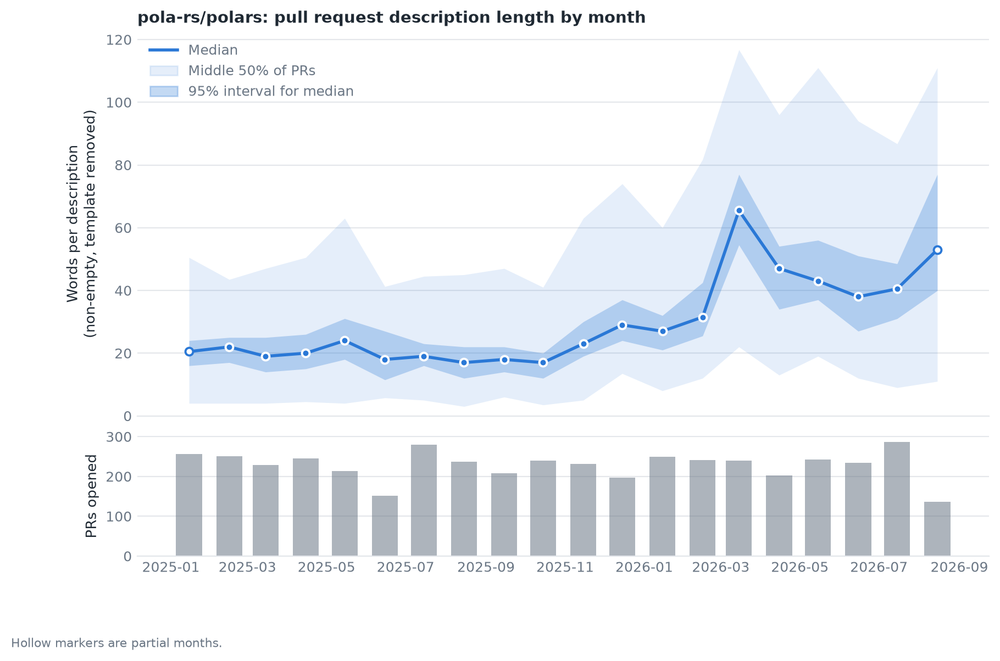
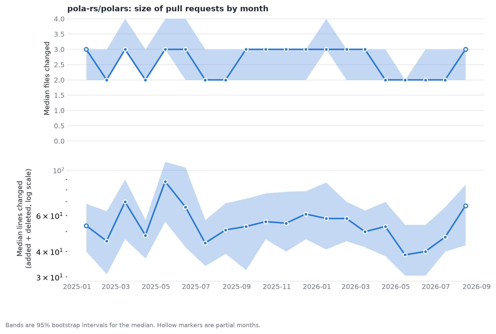
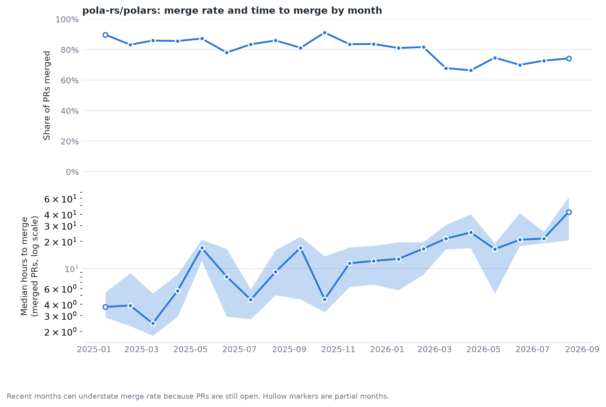
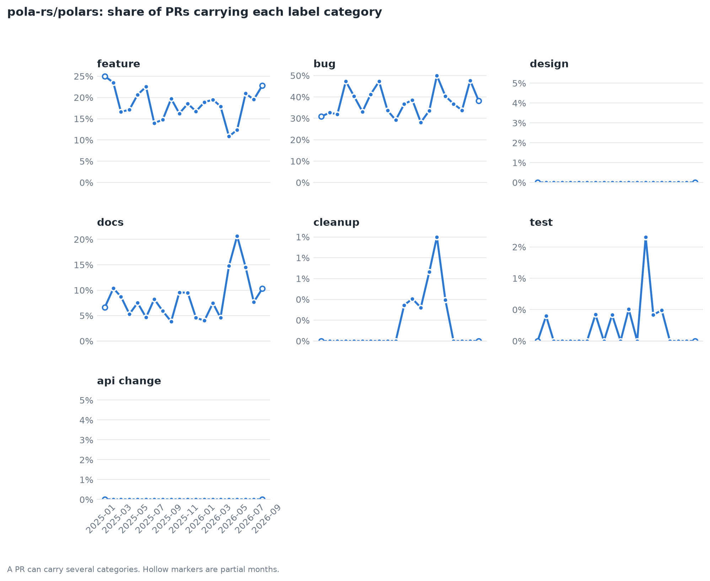
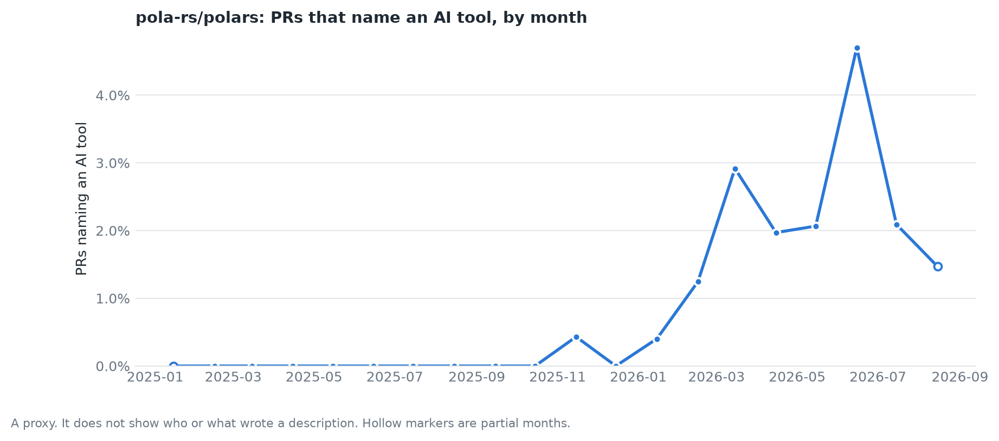
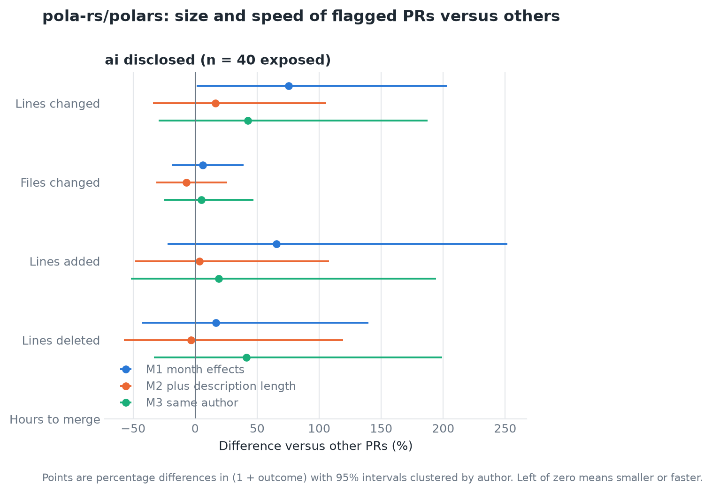

# Pull requests in pola-rs/polars: description length, size, speed and labels

Window 2025-01-06 to 2026-08-17 (UTC). Data fetched 2026-11-19. prwords 3.0.0, generated 2026-11-26. Method fixed in advance in `docs/ANALYSIS_PLAN.md`.

## 1. Data

- Repository primary language: Rust
- Pull requests opened in the window: 4,657
- Removed as bot accounts: 87
- Analysed: 4,570 PRs from 500 authors
- Merged: 3,686 (80.7%). Closed without merging: 667 (14.6%). Still open: 217
- Follow-up: merge outcomes use a 30-day follow-up. PRs without enough follow-up: 0
- Empty descriptions after cleaning: 14.4%

## 2. Did the PR template change?

No template line appeared or disappeared with a share of 50% or more. Template text was detected monthly and removed before counting words.

Distinct template lines detected: 0.

## 3. First 28 days versus last 28 days

First window 2025-01-06 to 2025-02-02. Last window 2026-07-21 to 2026-08-17. Ratios are last median divided by first median. Bootstrap intervals, 2,000 resamples.

| Metric                                |   n first |   n last |   Median first |   Median last |   Ratio |   Ratio low |   Ratio high |       p |   Cliff's delta |
|:--------------------------------------|----------:|---------:|---------------:|--------------:|--------:|------------:|-------------:|--------:|----------------:|
| Description words (non-empty)         |       210 |      225 |          19.5  |         52    |    2.67 |        1.91 |         3.73 | 2.1e-08 |            0.31 |
| Files changed                         |       262 |      240 |           3    |          2    |    0.67 |        0.67 |         1.5  | 0.65    |           -0.02 |
| Lines added                           |       262 |      240 |          37.5  |         41    |    1.09 |        0.77 |         1.62 | 0.43    |            0.04 |
| Lines deleted                         |       262 |      240 |           8    |         10.5  |    1.31 |        0.8  |         1.92 | 0.87    |            0.01 |
| Net lines (added minus deleted)       |       262 |      240 |          14.5  |         23    |    1.59 |        0.86 |         2.17 | 0.44    |            0.04 |
| Lines changed (added plus deleted)    |       262 |      240 |          52    |         60    |    1.15 |        0.78 |         1.78 | 0.27    |            0.06 |
| Hours from open to merge (merged PRs) |       236 |      170 |           3.86 |         32.88 |    8.51 |        4.47 |        13.57 | 2.3e-11 |            0.39 |
| Commits                               |       262 |      240 |           1    |          2    |    2    |        1    |         2    | 0.046   |            0.1  |
| Comments                              |       262 |      240 |           1    |          1    |    1    |        1    |         2    | 0.027   |            0.11 |
| Reviews                               |       262 |      240 |           0    |          1    |  nan    |      nan    |       nan    | 1.2e-06 |            0.23 |

| Measure                             |   n first |   n last | Share first   | Share last   |   Change (points) |       p |
|:------------------------------------|----------:|---------:|:--------------|:-------------|------------------:|--------:|
| Merged within follow-up period      |       262 |      240 | 88.9%         | 70.4%        |             -18.5 | 2e-07   |
| Closed without merging              |       262 |      240 | 6.9%          | 20.8%        |              14   | 6.1e-06 |
| Opened as draft                     |       262 |      240 | 5.3%          | 6.7%         |               1.3 | 0.58    |
| From outside contributors           |       262 |      240 | 32.8%         | 38.3%        |               5.5 | 0.22    |
| Has a kind or type label            |       262 |      240 | 0.0%          | 0.0%         |               0   | 1       |
| Description text repeated elsewhere |       262 |      240 | 0.0%          | 2.1%         |               2.1 | 0.024   |
| Names an AI tool (disclosure)       |       262 |      240 | 0.0%          | 2.9%         |               2.9 | 0.0055  |
| Label category: feature             |       262 |      240 | 25.2%         | 21.2%        |              -3.9 | 0.34    |
| Label category: bug                 |       262 |      240 | 31.3%         | 45.0%        |              13.7 | 0.0017  |
| Label category: design              |       262 |      240 | 0.0%          | 0.0%         |               0   | 1       |
| Label category: docs                |       262 |      240 | 6.5%          | 7.9%         |               1.4 | 0.6     |
| Label category: cleanup             |       262 |      240 | 0.0%          | 0.0%         |               0   | 1       |
| Label category: test                |       262 |      240 | 0.0%          | 0.0%         |               0   | 1       |
| Label category: api_change          |       262 |      240 | 0.0%          | 0.0%         |               0   | 1       |

## 4. Monthly trends

Theil-Sen slope per month and Kendall tau over full months only.

| metric                     |   months |   slope_per_month |   slope_ci_low |   slope_ci_high |     tau |       p |
|:---------------------------|---------:|------------------:|---------------:|----------------:|--------:|--------:|
| median_words               |       18 |             1.625 |          0.792 |           2.25  |   0.488 |   0.005 |
| median_files_changed       |       18 |            -0     |         -0     |          -0     |  -0.127 |   0.534 |
| median_additions           |       18 |            -0.438 |         -1.2   |           0.222 |  -0.239 |   0.171 |
| median_deletions           |       18 |            -0     |         -0.333 |           0.222 |  -0.068 |   0.702 |
| median_churn               |       18 |            -1     |         -2     |           0.571 |  -0.23  |   0.184 |
| median_hours_to_merge      |       18 |             1.057 |          0.744 |           1.451 |   0.647 |   0     |
| merge_rate                 |       18 |            -0.008 |         -0.013 |          -0.003 |  -0.464 |   0.007 |
| share_outside_contributors |       18 |             0.012 |          0.005 |           0.022 |   0.425 |   0.014 |
| share_ai_disclosed         |       18 |             0.001 |          0     |           0.002 |   0.747 |   0     |
| median_comments            |       18 |            -0     |         -0     |          -0     |   0.2   |   0.325 |
| median_reviews             |       18 |            -0     |         -0     |           0.071 |   0.632 |   0.002 |
| share_feature              |       18 |            -0.001 |         -0.005 |           0.003 |  -0.085 |   0.654 |
| share_bug                  |       18 |             0.001 |         -0.005 |           0.009 |   0.15  |   0.41  |
| share_design               |       18 |            -0     |         -0     |          -0     | nan     | nan     |
| share_docs                 |       18 |             0.001 |         -0.002 |           0.006 |   0.085 |   0.654 |
| share_cleanup              |       18 |            -0     |         -0     |           0     |   0.355 |   0.062 |
| share_test                 |       18 |            -0     |         -0     |           0     |   0.123 |   0.515 |
| share_api_change           |       18 |            -0     |         -0     |          -0     | nan     | nan     |

## 5. Labels

Share of PRs with a kind or type label: 0.0% overall. Label coverage by month is in `monthly_summary.csv` (`share_has_kind_label`).

| category            |   n_prs |   share |   median_words |   median_files |   median_churn |   merge_rate |   median_hours_to_merge |   share_ai_disclosed |
|:--------------------|--------:|--------:|---------------:|---------------:|---------------:|-------------:|------------------------:|---------------------:|
| feature             |     836 |   0.183 |           39   |            6   |          166.5 |        0.78  |                  29.755 |                0.011 |
| bug                 |    1724 |   0.377 |           26.5 |            2   |           37   |        0.801 |                  10.708 |                0.012 |
| design              |       0 |   0     |          nan   |          nan   |          nan   |      nan     |                 nan     |              nan     |
| docs                |     387 |   0.085 |           27   |            1   |           13   |        0.773 |                   6.994 |                0     |
| cleanup             |       9 |   0.002 |           23   |            3   |           47   |        0.889 |                   3.091 |                0     |
| test                |      10 |   0.002 |           26   |            1.5 |           14.5 |        1     |                   3.604 |                0     |
| api_change          |       0 |   0     |          nan   |          nan   |          nan   |      nan     |                 nan     |              nan     |
| (no category label) |    1638 |   0.358 |           23   |            3   |           66   |        0.833 |                   5.604 |                0.007 |

## 6. Are PRs with signs of AI involvement smaller or larger?

Authorship is not observable. The proxy is `ai_disclosed`, defined in the analysis plan: 40 PRs (0.88%). 40 disclosed PRs are listed in `ai_disclosure_samples.csv` for manual audit.

### ai_disclosed

**Verdict: no difference detected.** The same-month gap does not hold within the same author, so it reflects who discloses AI use, not the PRs themselves.

Pattern: lines changed: no clear difference; files changed: no clear difference; lines added: no clear difference; lines deleted: no clear difference; hours to merge: not estimated.

Within-author permutation p-value, lines changed: 0.1959.

| Outcome       | Model                      |    n |   n exposed |   Median exposed |   Median others | Difference (95% CI)      |     p |   p (Holm) |
|:--------------|:---------------------------|-----:|------------:|-----------------:|----------------:|:-------------------------|------:|-----------:|
| Lines changed | M1 month effects           | 4570 |          40 |               76 |              52 | +75.2% (+1.3 to +203.0)  | 0.045 |       0.18 |
| Lines changed | M2 plus description length | 4570 |          40 |               76 |              52 | +16.4% (-34.0 to +105.5) | 0.6   |       1    |
| Lines changed | M3 same author             | 4570 |          40 |               76 |              52 | +42.4% (-29.5 to +187.3) | 0.32  |       1    |
| Files changed | M1 month effects           | 4570 |          40 |                2 |               3 | +6.2% (-18.8 to +38.9)   | 0.66  |       1    |
| Files changed | M2 plus description length | 4570 |          40 |                2 |               3 | -6.9% (-31.2 to +25.9)   | 0.64  |       1    |
| Files changed | M3 same author             | 4570 |          40 |                2 |               3 | +5.0% (-25.0 to +47.1)   | 0.78  |       1    |
| Lines added   | M1 month effects           | 4570 |          40 |               59 |              37 | +65.6% (-22.1 to +251.9) | 0.19  |       0.57 |
| Lines added   | M2 plus description length | 4570 |          40 |               59 |              37 | +3.6% (-48.4 to +107.8)  | 0.92  |       1    |
| Lines added   | M3 same author             | 4570 |          40 |               59 |              37 | +19.0% (-51.9 to +194.3) | 0.71  |       1    |
| Lines deleted | M1 month effects           | 4570 |          40 |               10 |               8 | +16.8% (-43.1 to +139.9) | 0.67  |       1    |
| Lines deleted | M2 plus description length | 4570 |          40 |               10 |               8 | -3.3% (-57.4 to +119.2)  | 0.94  |       1    |
| Lines deleted | M3 same author             | 4570 |          40 |               10 |               8 | +41.2% (-33.4 to +199.3) | 0.37  |       1    |

### Robustness by tool (lines changed)

| tool        |   n exposed | status                    |
|:------------|------------:|:--------------------------|
| unspecified |          24 | fewer than 30 exposed PRs |
| claude      |          15 | fewer than 30 exposed PRs |
| codex       |           1 | fewer than 30 exposed PRs |

### File type check

Sample: 40 exposed and 39 unexposed PRs from the same months. 1 PRs with more than 100 files were excluded.

Share of changed lines by file type:

| group     |   n_prs | code   | tests   | docs   | config   | generated   | other   |   median_code_test_lines |
|:----------|--------:|:-------|:--------|:-------|:---------|:------------|:--------|-------------------------:|
| exposed   |      40 | 63.5%  | 35.7%   | 0.5%   | 0.1%     | 0.1%        | 0.1%    |                       74 |
| unexposed |      39 | 66.8%  | 27.3%   | 2.5%   | 3.1%     | 0.3%        | 0.1%    |                       22 |

Code and test lines only, same month: +244.9% (95% CI +48.8 to +699.6), p = 0.0039. This is a robustness check and does not change the verdict.

## 7. Other checks

- Outside contributors: 31.7% of PRs overall.
- Top 10 authors opened 67.1% of PRs.
- PRs whose description text is repeated elsewhere (10 or more words): 0.4%.

## 8. Limitations

- Word count and size describe PRs, not who wrote them. Proxies for AI involvement are noisy and omit undisclosed use.
- Added and deleted lines include generated or vendored files unless the project avoids committing them.
- Disclosure mostly captures tools that add attribution by default, so it is tool-skewed.
- Template removal is heuristic. Check `template_audit.csv`.
- One repository cannot support general claims. See the plan for replication.
- Months at the edges of the window are partial and are excluded from trend tests.

