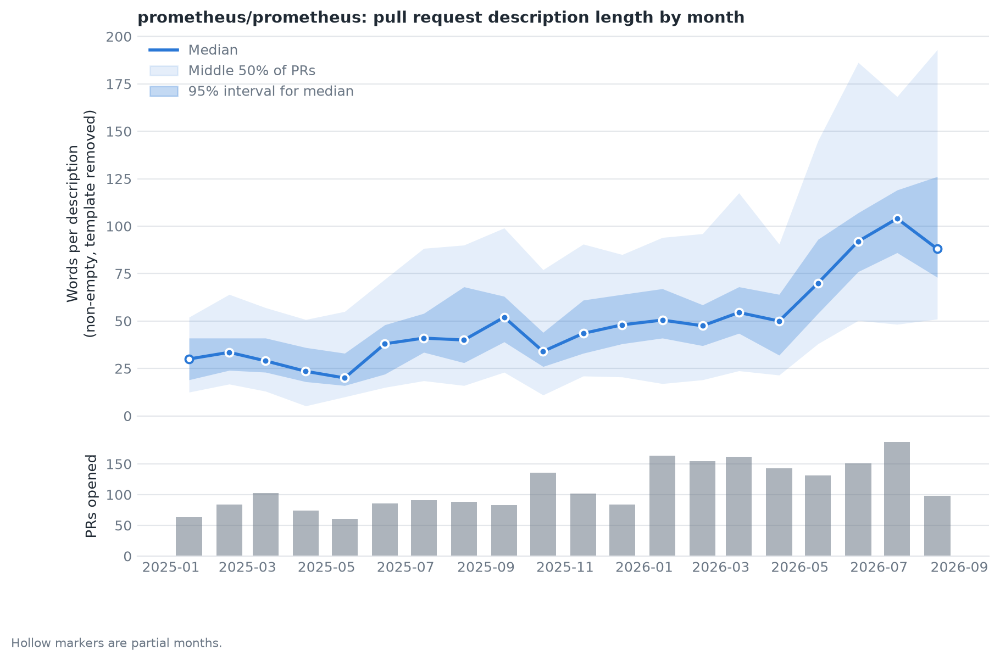
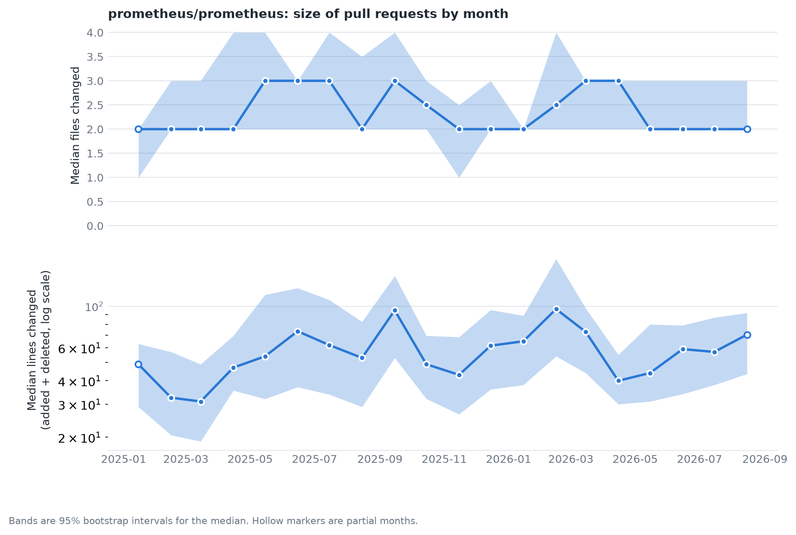
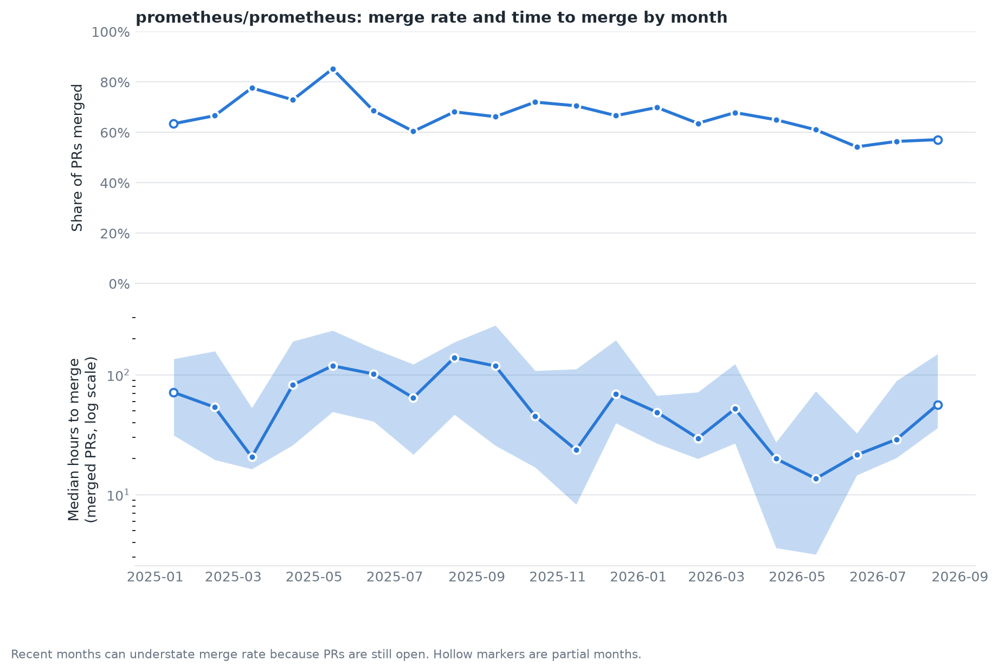
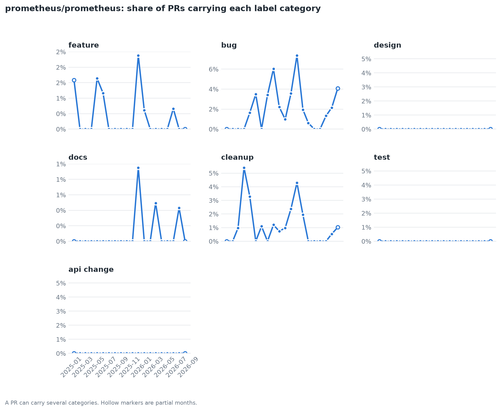
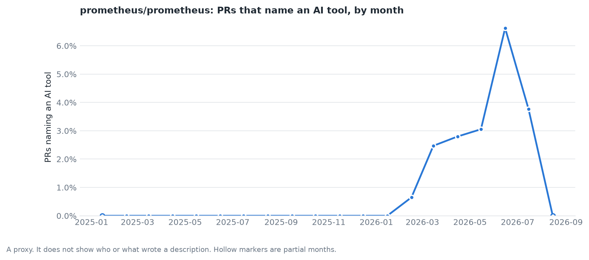
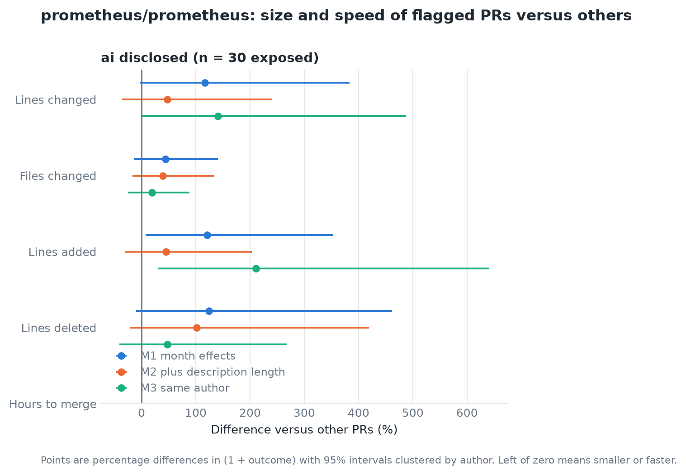

# Pull requests in prometheus/prometheus: description length, size, speed and labels

Window 2025-01-06 to 2026-08-17 (UTC). Data fetched 2026-11-19. prwords 3.0.0, generated 2026-11-26. Method fixed in advance in `docs/ANALYSIS_PLAN.md`.

## 1. Data

- Repository primary language: Go
- Pull requests opened in the window: 2,810
- Removed as bot accounts: 567
- Analysed: 2,243 PRs from 558 authors
- Merged: 1,475 (65.8%). Closed without merging: 520 (23.2%). Still open: 248
- Follow-up: merge outcomes use a 30-day follow-up. PRs without enough follow-up: 0
- Empty descriptions after cleaning: 8.8%

## 2. Did the PR template change?

Lines that appeared or disappeared across the window (full list in `template_audit.csv`):

| line                                                                   | first_month   | last_month   |   months |   peak_share | change_event   |
|:-----------------------------------------------------------------------|:--------------|:-------------|---------:|-------------:|:---------------|
| #### does this pr introduce a user-facing change?                      | 2025-08       | 2026-03      |        8 |         0.91 | removed        |
| #### release notes for end users (**all** commits must be considered). | 2026-04       | 2026-08      |        5 |         0.75 | added          |
| reviewers should verify clarity and quality.*                          | 2026-04       | 2026-08      |        5 |         0.65 | added          |

Distinct template lines detected: 4.

## 3. First 28 days versus last 28 days

First window 2025-01-06 to 2025-02-02. Last window 2026-07-21 to 2026-08-17. Ratios are last median divided by first median. Bootstrap intervals, 2,000 resamples.

| Metric                                |   n first |   n last |   Median first |   Median last |   Ratio |   Ratio low |   Ratio high |       p |   Cliff's delta |
|:--------------------------------------|----------:|---------:|---------------:|--------------:|--------:|------------:|-------------:|--------:|----------------:|
| Description words (non-empty)         |        61 |      141 |          30    |        104    |    3.47 |        2.32 |         5.6  | 3.4e-12 |            0.62 |
| Files changed                         |        65 |      147 |           2    |          2    |    1    |        1    |         2    | 0.13    |            0.13 |
| Lines added                           |        65 |      147 |          33    |         59    |    1.79 |        1.08 |         3.78 | 0.045   |            0.17 |
| Lines deleted                         |        65 |      147 |           9    |          5    |    0.56 |        0.19 |         1.2  | 0.049   |           -0.17 |
| Net lines (added minus deleted)       |        65 |      147 |          13    |         43    |    3.31 |        1.22 |         9.6  | 0.0059  |            0.24 |
| Lines changed (added plus deleted)    |        65 |      147 |          49    |         76    |    1.55 |        0.93 |         2.88 | 0.11    |            0.14 |
| Hours from open to merge (merged PRs) |        41 |       83 |          72.43 |         91.08 |    1.26 |        0.51 |         2.64 | 0.4     |            0.09 |
| Commits                               |        65 |      147 |           2    |          1    |    0.5  |        0.5  |         1    | 0.091   |           -0.13 |
| Comments                              |        65 |      147 |           1    |          1    |    1    |        0    |         1    | 0.0087  |           -0.22 |
| Reviews                               |        65 |      147 |           2    |          1    |    0.5  |        0.5  |         1    | 0.012   |           -0.21 |

| Measure                             |   n first |   n last | Share first   | Share last   |   Change (points) |     p |
|:------------------------------------|----------:|---------:|:--------------|:-------------|------------------:|------:|
| Merged within follow-up period      |        65 |      147 | 60.0%         | 48.3%        |             -11.7 | 0.14  |
| Closed without merging              |        65 |      147 | 30.8%         | 17.0%        |             -13.8 | 0.029 |
| Opened as draft                     |        65 |      147 | 12.3%         | 6.1%         |              -6.2 | 0.17  |
| From outside contributors           |        65 |      147 | 73.8%         | 74.8%        |               1   | 0.87  |
| Has a kind or type label            |        65 |      147 | 3.1%          | 4.1%         |               1   | 1     |
| Description text repeated elsewhere |        65 |      147 | 0.0%          | 6.1%         |               6.1 | 0.06  |
| Names an AI tool (disclosure)       |        65 |      147 | 0.0%          | 0.7%         |               0.7 | 1     |
| Label category: feature             |        65 |      147 | 1.5%          | 0.0%         |              -1.5 | 0.31  |
| Label category: bug                 |        65 |      147 | 0.0%          | 3.4%         |               3.4 | 0.33  |
| Label category: design              |        65 |      147 | 0.0%          | 0.0%         |               0   | 1     |
| Label category: docs                |        65 |      147 | 0.0%          | 0.0%         |               0   | 1     |
| Label category: cleanup             |        65 |      147 | 0.0%          | 0.7%         |               0.7 | 1     |
| Label category: test                |        65 |      147 | 0.0%          | 0.0%         |               0   | 1     |
| Label category: api_change          |        65 |      147 | 0.0%          | 0.0%         |               0   | 1     |

## 4. Monthly trends

Theil-Sen slope per month and Kendall tau over full months only.

| metric                     |   months |   slope_per_month |   slope_ci_low |   slope_ci_high |     tau |       p |
|:---------------------------|---------:|------------------:|---------------:|----------------:|--------:|--------:|
| median_words               |       18 |             2.857 |          1.682 |           4.417 |   0.739 |   0     |
| median_files_changed       |       18 |            -0     |         -0     |          -0     |  -0.067 |   0.731 |
| median_additions           |       18 |             1.267 |         -0.333 |           2.5   |   0.275 |   0.111 |
| median_deletions           |       18 |            -0.25  |         -0.4   |          -0.091 |  -0.488 |   0.006 |
| median_churn               |       18 |             0.889 |         -0.833 |           2.955 |   0.176 |   0.33  |
| median_hours_to_merge      |       18 |            -4.34  |         -7.551 |          -0.311 |  -0.399 |   0.021 |
| merge_rate                 |       18 |            -0.009 |         -0.015 |          -0.003 |  -0.511 |   0.003 |
| share_outside_contributors |       18 |            -0.004 |         -0.014 |           0.003 |  -0.19  |   0.293 |
| share_ai_disclosed         |       18 |             0.002 |         -0     |           0.003 |   0.737 |   0     |
| median_comments            |       18 |            -0     |         -0.071 |          -0     |  -0.337 |   0.081 |
| median_reviews             |       18 |            -0     |         -0     |          -0     |   0     |   1     |
| share_feature              |       18 |            -0     |         -0     |          -0     |  -0.009 |   0.961 |
| share_bug                  |       18 |             0     |         -0.001 |           0.002 |   0.11  |   0.536 |
| share_design               |       18 |            -0     |         -0     |          -0     | nan     | nan     |
| share_docs                 |       18 |            -0     |         -0     |          -0     |   0.303 |   0.126 |
| share_cleanup              |       18 |            -0     |         -0.002 |           0     |  -0.169 |   0.348 |
| share_test                 |       18 |            -0     |         -0     |          -0     | nan     | nan     |
| share_api_change           |       18 |            -0     |         -0     |          -0     | nan     | nan     |

## 5. Labels

Share of PRs with a kind or type label: 4.9% overall. Label coverage by month is in `monthly_summary.csv` (`share_has_kind_label`).

| category            |   n_prs |   share |   median_words |   median_files |   median_churn |   merge_rate |   median_hours_to_merge |   share_ai_disclosed |
|:--------------------|--------:|--------:|---------------:|---------------:|---------------:|-------------:|------------------------:|---------------------:|
| feature             |       7 |   0.003 |            118 |             26 |           4617 |        0.429 |                1392.37  |                0     |
| bug                 |      45 |   0.02  |             75 |              2 |             67 |        0.822 |                  51.421 |                0     |
| design              |       0 |   0     |            nan |            nan |            nan |      nan     |                 nan     |              nan     |
| docs                |       3 |   0.001 |             87 |              3 |             48 |        0.333 |                 140.855 |                0     |
| cleanup             |      25 |   0.011 |             41 |              3 |             77 |        0.84  |                  39     |                0     |
| test                |       0 |   0     |            nan |            nan |            nan |      nan     |                 nan     |              nan     |
| api_change          |       0 |   0     |            nan |            nan |            nan |      nan     |                 nan     |              nan     |
| (no category label) |    2164 |   0.965 |             50 |              2 |             53 |        0.653 |                  45.749 |                0.014 |

## 6. Are PRs with signs of AI involvement smaller or larger?

Authorship is not observable. The proxy is `ai_disclosed`, defined in the analysis plan: 30 PRs (1.34%). 30 disclosed PRs are listed in `ai_disclosure_samples.csv` for manual audit.

### ai_disclosed

**Verdict: no difference detected.** The same-month interval for lines changed runs from -3.1% to +383.1%.

Pattern: lines changed: no clear difference; files changed: no clear difference; lines added: larger; lines deleted: no clear difference; hours to merge: not estimated.

Within-author permutation p-value, lines changed: 0.2134.

| Outcome       | Model                      |    n |   n exposed |   Median exposed |   Median others | Difference (95% CI)       |     p |   p (Holm) |
|:--------------|:---------------------------|-----:|------------:|-----------------:|----------------:|:--------------------------|------:|-----------:|
| Lines changed | M1 month effects           | 2243 |          30 |            115.5 |              54 | +116.4% (-3.1 to +383.1)  | 0.06  |      0.18  |
| Lines changed | M2 plus description length | 2243 |          30 |            115.5 |              54 | +47.9% (-35.6 to +239.8)  | 0.36  |      0.64  |
| Lines changed | M3 same author             | 2243 |          30 |            115.5 |              54 | +141.2% (-1.0 to +487.3)  | 0.053 |      0.16  |
| Files changed | M1 month effects           | 2243 |          30 |              3   |               2 | +43.9% (-13.9 to +140.5)  | 0.16  |      0.18  |
| Files changed | M2 plus description length | 2243 |          30 |              3   |               2 | +39.5% (-16.9 to +134.3)  | 0.21  |      0.62  |
| Files changed | M3 same author             | 2243 |          30 |              3   |               2 | +19.2% (-24.8 to +88.7)   | 0.45  |      0.81  |
| Lines added   | M1 month effects           | 2243 |          30 |             83   |              39 | +120.9% (+7.6 to +353.6)  | 0.031 |      0.12  |
| Lines added   | M2 plus description length | 2243 |          30 |             83   |              39 | +45.2% (-30.6 to +203.4)  | 0.32  |      0.64  |
| Lines added   | M3 same author             | 2243 |          30 |             83   |              39 | +210.8% (+30.5 to +640.6) | 0.01  |      0.042 |
| Lines deleted | M1 month effects           | 2243 |          30 |             17.5 |               6 | +124.4% (-10.3 to +461.5) | 0.084 |      0.18  |
| Lines deleted | M2 plus description length | 2243 |          30 |             17.5 |               6 | +101.9% (-21.5 to +419.0) | 0.14  |      0.58  |
| Lines deleted | M3 same author             | 2243 |          30 |             17.5 |               6 | +47.7% (-40.7 to +267.9)  | 0.4   |      0.81  |

### Robustness by tool (lines changed)

| tool        |   n exposed | status                    |
|:------------|------------:|:--------------------------|
| unspecified |          17 | fewer than 30 exposed PRs |
| claude      |          12 | fewer than 30 exposed PRs |
| copilot     |           1 | fewer than 30 exposed PRs |

### File type check

Sample: 29 exposed and 30 unexposed PRs from the same months. 1 PRs with more than 100 files were excluded.

Share of changed lines by file type:

| group     |   n_prs | code   | tests   | docs   | config   | generated   | other   |   median_code_test_lines |
|:----------|--------:|:-------|:--------|:-------|:---------|:------------|:--------|-------------------------:|
| exposed   |      29 | 52.7%  | 36.5%   | 9.0%   | 1.5%     | 0.2%        | 0.0%    |                       92 |
| unexposed |      30 | 59.7%  | 35.9%   | 1.6%   | 0.6%     | 1.4%        | 0.9%    |                       62 |

Code and test lines: not estimated (fewer than 30 exposed PRs in the sample).

## 7. Other checks

- Outside contributors: 60.4% of PRs overall.
- Top 10 authors opened 41.5% of PRs.
- PRs whose description text is repeated elsewhere (10 or more words): 8.7%.

## 8. Limitations

- Word count and size describe PRs, not who wrote them. Proxies for AI involvement are noisy and omit undisclosed use.
- Added and deleted lines include generated or vendored files unless the project avoids committing them.
- Disclosure mostly captures tools that add attribution by default, so it is tool-skewed.
- Template removal is heuristic. Check `template_audit.csv`.
- One repository cannot support general claims. See the plan for replication.
- Months at the edges of the window are partial and are excluded from trend tests.

