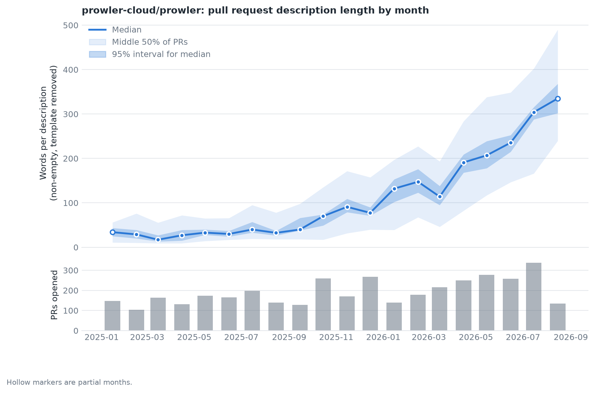
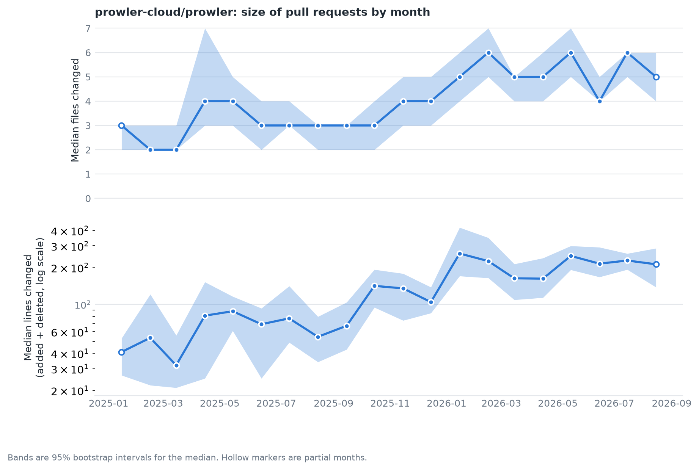
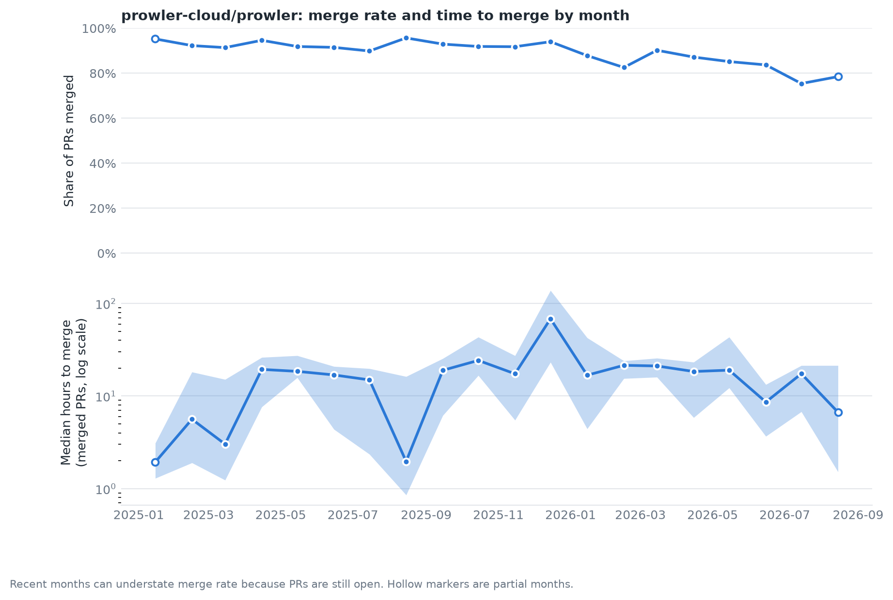
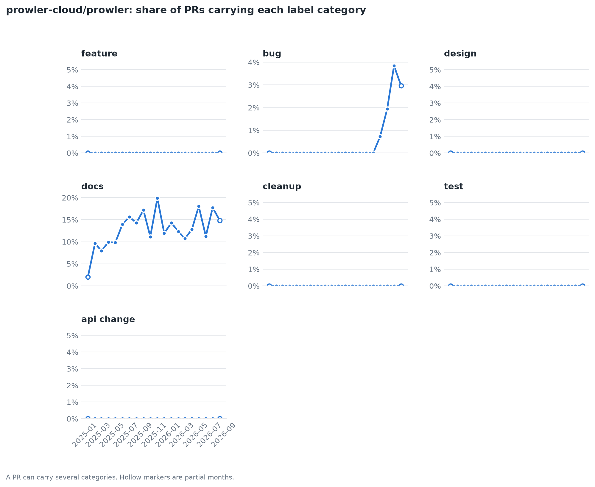
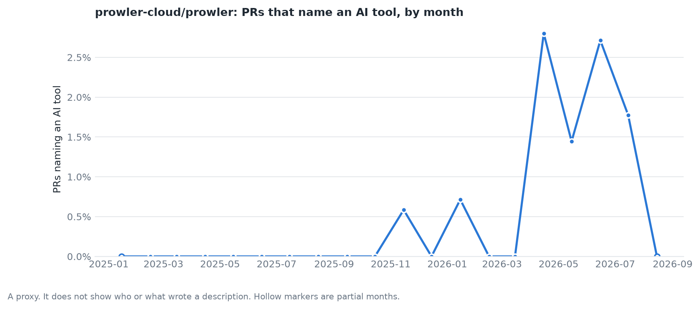

# Pull requests in prowler-cloud/prowler: description length, size, speed and labels

Window 2025-01-06 to 2026-08-17 (UTC). Data fetched 2026-11-20. prwords 3.0.0, generated 2026-11-26. Method fixed in advance in `docs/ANALYSIS_PLAN.md`.

## 1. Data

- Repository primary language: Python
- Pull requests opened in the window: 5,665
- Removed as bot accounts: 1,825
- Analysed: 3,840 PRs from 237 authors
- Merged: 3,394 (88.4%). Closed without merging: 365 (9.5%). Still open: 81
- Follow-up: merge outcomes use a 30-day follow-up. PRs without enough follow-up: 0
- Empty descriptions after cleaning: 0.2%

## 2. Did the PR template change?

Lines that appeared or disappeared across the window (full list in `template_audit.csv`):

| line                                                                                              | first_month   | last_month   |   months |   peak_share | change_event   |
|:--------------------------------------------------------------------------------------------------|:--------------|:-------------|---------:|-------------:|:---------------|
| if so, do we need to update permissions for the provider? please review this carefully.           | 2025-01       | 2026-06      |       18 |         0.95 | removed        |
| are there new checks included in this pr? yes / no                                                | 2025-01       | 2026-06      |       18 |         0.94 | removed        |
| ensure new entries are added to changelog.md, if applicable.                                      | 2025-02       | 2026-06      |       17 |         0.98 | added          |
| check if version updates are required (e.g., specs, poetry, etc.).                                | 2025-02       | 2026-04      |       15 |         0.98 | added          |
| #### api                                                                                          | 2025-02       | 2026-08      |       19 |         0.97 | added          |
| verify if api specs need to be regenerated.                                                       | 2025-02       | 2026-07      |       18 |         0.97 | added          |
| ### steps to review                                                                               | 2025-08       | 2026-08      |       13 |         0.84 | added          |
| #### ui                                                                                           | 2025-11       | 2026-08      |       10 |         0.61 | added          |
| all issue/task requirements work as expected on the ui                                            | 2025-11       | 2026-08      |       10 |         0.6  | added          |
| screenshots/video of the functionality flow (if applicable) - mobile (x x 1024px)                 | 2025-11       | 2026-08      |       10 |         0.59 | added          |
| community checklist                                                                               | 2026-01       | 2026-08      |        8 |         0.71 | added          |
| this feature/issue is listed in here or roadmap.prowler.com                                       | 2026-01       | 2026-06      |        6 |         0.66 | added          |
| #### sdk/cli                                                                                      | 2026-01       | 2026-08      |        8 |         0.65 | added          |
| is it assigned to me, if not, request it via the issue/feature in here or prowler community slack | 2026-01       | 2026-06      |        6 |         0.65 | added          |
| all issue/task requirements work as expected on the api                                           | 2026-01       | 2026-07      |        7 |         0.51 | added          |
| any other relevant evidence of the implementation (if applicable)                                 | 2026-01       | 2026-07      |        7 |         0.51 | added          |
| endpoint response output (if applicable)                                                          | 2026-01       | 2026-07      |        7 |         0.51 | added          |
| explain analyze output for new/modified queries or indexes (if applicable)                        | 2026-01       | 2026-07      |        7 |         0.51 | added          |
| performance test results (if applicable)                                                          | 2026-01       | 2026-07      |        7 |         0.51 | added          |
| ## summary by coderabbit                                                                          | 2026-06       | 2026-08      |        3 |         0.9  | added          |

Distinct template lines detected: 44.

## 3. First 28 days versus last 28 days

First window 2025-01-06 to 2025-02-02. Last window 2026-07-21 to 2026-08-17. Ratios are last median divided by first median. Bootstrap intervals, 2,000 resamples.

| Metric                                |   n first |   n last |   Median first |   Median last |   Ratio |   Ratio low |   Ratio high |       p |   Cliff's delta |
|:--------------------------------------|----------:|---------:|---------------:|--------------:|--------:|------------:|-------------:|--------:|----------------:|
| Description words (non-empty)         |       149 |      308 |          34    |        311    |    9.15 |        7.07 |        12.67 | 1.3e-63 |            0.97 |
| Files changed                         |       149 |      308 |           3    |          6    |    2    |        1.67 |         3    | 1.9e-07 |            0.3  |
| Lines added                           |       149 |      308 |          25    |        216.5  |    8.66 |        5.74 |        16.46 | 2.7e-14 |            0.44 |
| Lines deleted                         |       149 |      308 |           7    |          4    |    0.57 |        0.23 |         1    | 0.0012  |           -0.19 |
| Net lines (added minus deleted)       |       149 |      308 |           3    |        191    |   63.67 |       24.68 |       190.5  | 9.6e-22 |            0.55 |
| Lines changed (added plus deleted)    |       149 |      308 |          42    |        239.5  |    5.7  |        4.02 |         9.44 | 5.8e-11 |            0.38 |
| Hours from open to merge (merged PRs) |       141 |      225 |           1.93 |         18.38 |    9.51 |        2.06 |        15.16 | 8e-05   |            0.24 |
| Commits                               |       149 |      308 |           2    |          3    |    1.5  |        1    |         3    | 1.4e-06 |            0.27 |
| Comments                              |       149 |      308 |           1    |          5    |    5    |        4.5  |         5    | 3.1e-60 |            0.94 |
| Reviews                               |       149 |      308 |           1    |          4    |    4    |        3    |         4    | 2.7e-24 |            0.58 |

| Measure                             |   n first |   n last | Share first   | Share last   |   Change (points) |       p |
|:------------------------------------|----------:|---------:|:--------------|:-------------|------------------:|--------:|
| Merged within follow-up period      |       149 |      308 | 94.6%         | 71.8%        |             -22.9 | 1.4e-09 |
| Closed without merging              |       149 |      308 | 5.4%          | 10.4%        |               5   | 0.08    |
| Opened as draft                     |       149 |      308 | 0.0%          | 1.6%         |               1.6 | 0.18    |
| From outside contributors           |       149 |      308 | 72.5%         | 83.8%        |              11.3 | 0.0059  |
| Has a kind or type label            |       149 |      308 | 0.0%          | 0.0%         |               0   | 1       |
| Description text repeated elsewhere |       149 |      308 | 0.0%          | 0.0%         |               0   | 1       |
| Names an AI tool (disclosure)       |       149 |      308 | 0.0%          | 1.0%         |               1   | 0.55    |
| Label category: feature             |       149 |      308 | 0.0%          | 0.0%         |               0   | 1       |
| Label category: bug                 |       149 |      308 | 0.0%          | 2.6%         |               2.6 | 0.058   |
| Label category: design              |       149 |      308 | 0.0%          | 0.0%         |               0   | 1       |
| Label category: docs                |       149 |      308 | 2.0%          | 14.9%        |              12.9 | 6.9e-06 |
| Label category: cleanup             |       149 |      308 | 0.0%          | 0.0%         |               0   | 1       |
| Label category: test                |       149 |      308 | 0.0%          | 0.0%         |               0   | 1       |
| Label category: api_change          |       149 |      308 | 0.0%          | 0.0%         |               0   | 1       |

## 4. Monthly trends

Theil-Sen slope per month and Kendall tau over full months only.

| metric                     |   months |   slope_per_month |   slope_ci_low |   slope_ci_high |     tau |       p |
|:---------------------------|---------:|------------------:|---------------:|----------------:|--------:|--------:|
| median_words               |       18 |            13.667 |          9.333 |          19.333 |   0.892 |   0     |
| median_files_changed       |       18 |             0.214 |          0.1   |           0.273 |   0.663 |   0     |
| median_additions           |       18 |             9.731 |          6.1   |          13.9   |   0.695 |   0     |
| median_deletions           |       18 |             0.25  |         -0.125 |           0.571 |   0.279 |   0.11  |
| median_churn               |       18 |            11.5   |          7.714 |          15.222 |   0.634 |   0     |
| median_hours_to_merge      |       18 |             0.206 |         -0.288 |           0.934 |   0.163 |   0.369 |
| merge_rate                 |       18 |            -0.006 |         -0.01  |          -0.003 |  -0.529 |   0.002 |
| share_outside_contributors |       18 |            -0     |         -0.006 |           0.007 |  -0.007 |   1     |
| share_ai_disclosed         |       18 |             0.001 |         -0     |           0.001 |   0.598 |   0.002 |
| median_comments            |       18 |             0.2   |          0.111 |           0.273 |   0.751 |   0     |
| median_reviews             |       18 |             0.077 |         -0     |           0.125 |   0.728 |   0     |
| share_feature              |       18 |            -0     |         -0     |          -0     | nan     | nan     |
| share_bug                  |       18 |            -0     |         -0     |          -0     |   0.56  |   0.005 |
| share_design               |       18 |            -0     |         -0     |          -0     | nan     | nan     |
| share_docs                 |       18 |             0.002 |          0     |           0.006 |   0.354 |   0.041 |
| share_cleanup              |       18 |            -0     |         -0     |          -0     | nan     | nan     |
| share_test                 |       18 |            -0     |         -0     |          -0     | nan     | nan     |
| share_api_change           |       18 |            -0     |         -0     |          -0     | nan     | nan     |

## 5. Labels

Share of PRs with a kind or type label: 0.0% overall. Label coverage by month is in `monthly_summary.csv` (`share_has_kind_label`).

| category            |   n_prs |   share |   median_words |   median_files |   median_churn |   merge_rate |   median_hours_to_merge |   share_ai_disclosed |
|:--------------------|--------:|--------:|---------------:|---------------:|---------------:|-------------:|------------------------:|---------------------:|
| feature             |       0 |   0     |          nan   |            nan |          nan   |      nan     |                 nan     |              nan     |
| bug                 |      24 |   0.006 |          298.5 |              5 |          236.5 |        0.792 |                  25.4   |                0     |
| design              |       0 |   0     |          nan   |            nan |          nan   |      nan     |                 nan     |              nan     |
| docs                |     503 |   0.131 |          114.5 |              6 |          204   |        0.917 |                  22.274 |                0.004 |
| cleanup             |       0 |   0     |          nan   |            nan |          nan   |      nan     |                 nan     |              nan     |
| test                |       0 |   0     |          nan   |            nan |          nan   |      nan     |                 nan     |              nan     |
| api_change          |       0 |   0     |          nan   |            nan |          nan   |      nan     |                 nan     |              nan     |
| (no category label) |    3314 |   0.863 |           90   |              4 |          115   |        0.88  |                  16.209 |                0.007 |

Cross-check against the repository's own size labels (coverage 0.2%, Spearman rho between size label and lines changed nan):

| size_label   |   n_prs |   median_churn |   p10_churn |   p90_churn |
|:-------------|--------:|---------------:|------------:|------------:|
| XL           |       6 |           4536 |        2324 |        8438 |

## 6. Are PRs with signs of AI involvement smaller or larger?

Authorship is not observable. The proxy is `ai_disclosed`, defined in the analysis plan: 26 PRs (0.68%). 26 disclosed PRs are listed in `ai_disclosure_samples.csv` for manual audit.

### ai_disclosed

**Verdict: not testable.** Too few exposed PRs.

Pattern: lines changed: not estimated; files changed: not estimated; lines added: not estimated; lines deleted: not estimated; hours to merge: not estimated.

Not estimated: fewer than 30 exposed PRs (exposed PRs: 26).

### Robustness by tool (lines changed)

| tool        |   n exposed | status                    |
|:------------|------------:|:--------------------------|
| unspecified |          25 | fewer than 30 exposed PRs |
| claude      |           1 | fewer than 30 exposed PRs |

### File type check

Not run. Use `--file-check N` to sample N exposed PRs and matching unexposed PRs.

## 7. Other checks

- Outside contributors: 82.1% of PRs overall.
- Top 10 authors opened 67.3% of PRs.
- PRs whose description text is repeated elsewhere (10 or more words): 2.1%.

## 8. Limitations

- Word count and size describe PRs, not who wrote them. Proxies for AI involvement are noisy and omit undisclosed use.
- Added and deleted lines include generated or vendored files unless the project avoids committing them.
- Disclosure mostly captures tools that add attribution by default, so it is tool-skewed.
- Template removal is heuristic. Check `template_audit.csv`.
- One repository cannot support general claims. See the plan for replication.
- Months at the edges of the window are partial and are excluded from trend tests.

