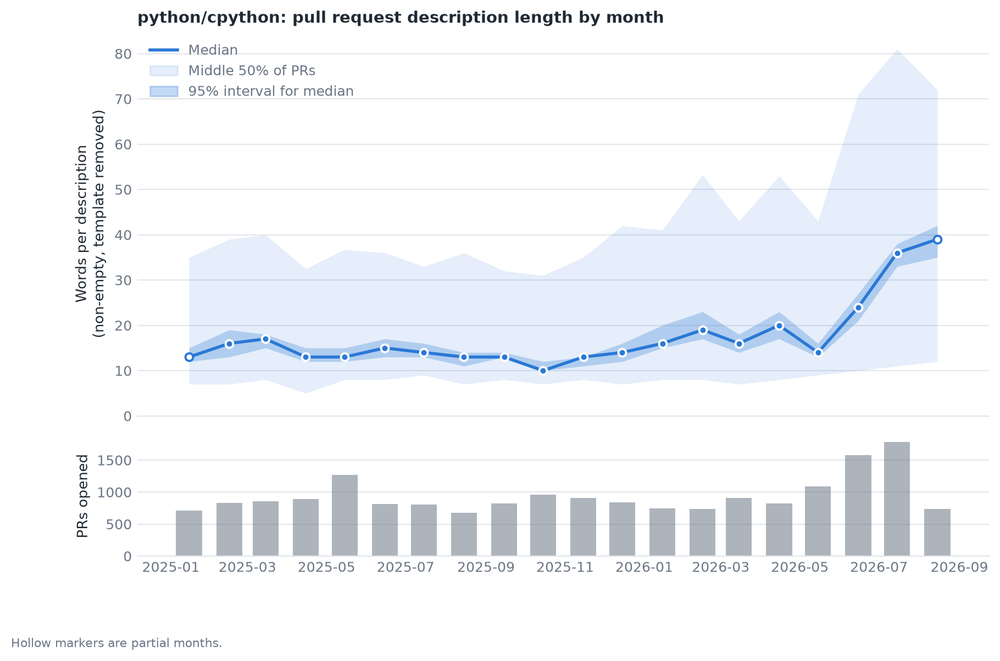
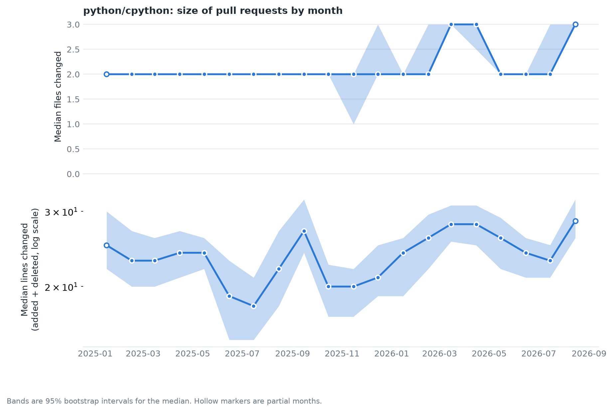
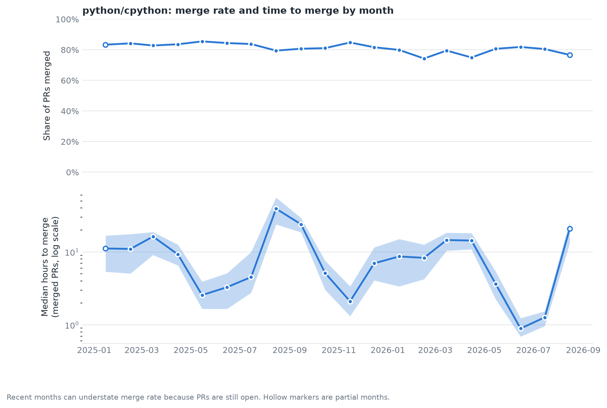
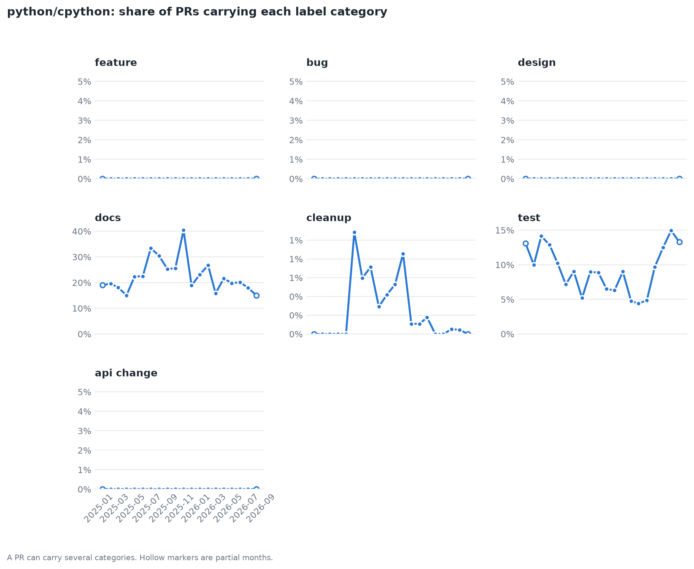
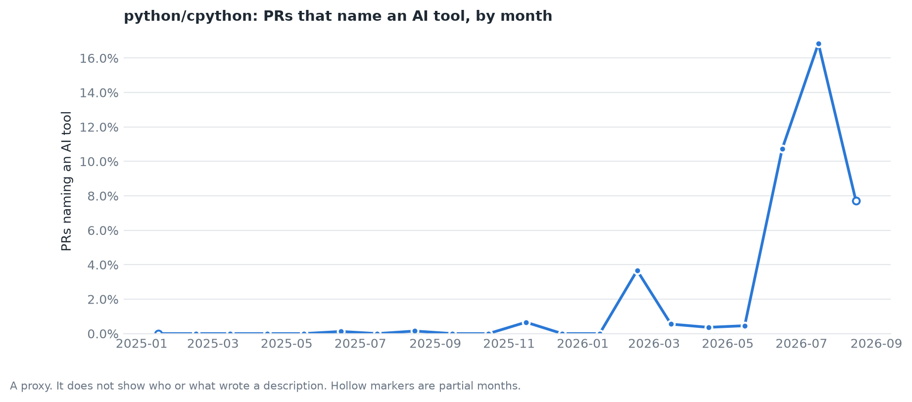
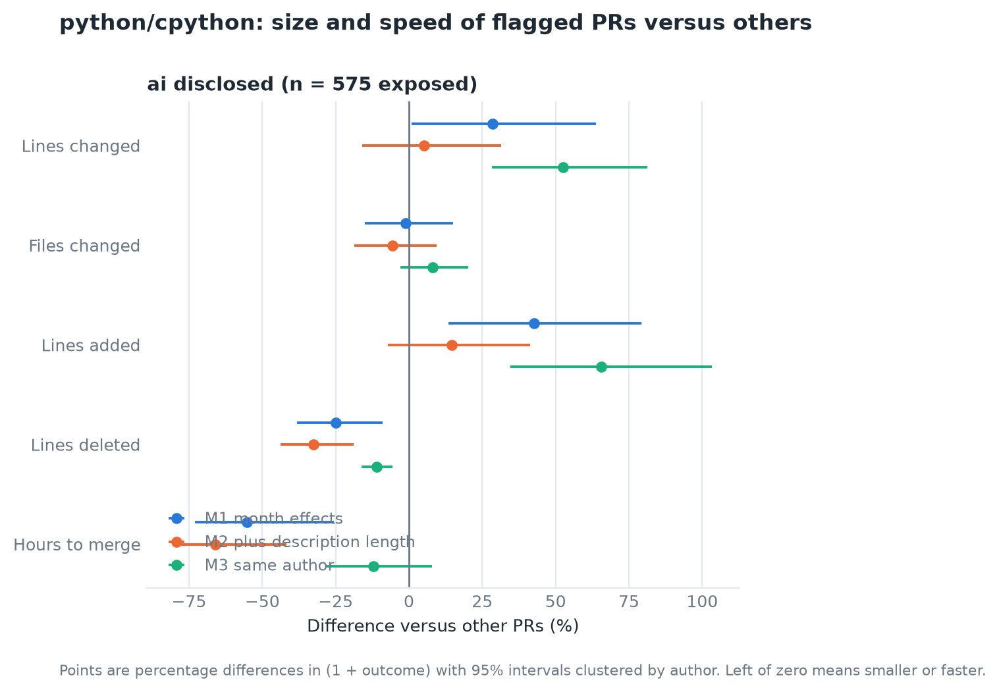

# Pull requests in python/cpython: description length, size, speed and labels

Window 2025-01-06 to 2026-08-17 (UTC). Data fetched 2026-11-19. prwords 3.0.0, generated 2026-11-26. Method fixed in advance in `docs/ANALYSIS_PLAN.md`.

## 1. Data

- Repository primary language: Python
- Pull requests opened in the window: 18,802
- Removed as bot accounts: 15
- Analysed: 18,787 PRs from 1,712 authors
- Merged: 15,287 (81.4%). Closed without merging: 2,452 (13.1%). Still open: 1,048
- Follow-up: merge outcomes use a 30-day follow-up. PRs without enough follow-up: 0
- Empty descriptions after cleaning: 1.9%

## 2. Did the PR template change?

No template line appeared or disappeared with a share of 50% or more. Template text was detected monthly and removed before counting words.

Distinct template lines detected: 2.

## 3. First 28 days versus last 28 days

First window 2025-01-06 to 2025-02-02. Last window 2026-07-21 to 2026-08-17. Ratios are last median divided by first median. Bootstrap intervals, 2,000 resamples.

| Metric                                |   n first |   n last |   Median first |   Median last |   Ratio |   Ratio low |   Ratio high |       p |   Cliff's delta |
|:--------------------------------------|----------:|---------:|---------------:|--------------:|--------:|------------:|-------------:|--------:|----------------:|
| Description words (non-empty)         |       741 |     1246 |          13    |         39    |    3    |        2.6  |         3.55 | 2.2e-44 |            0.37 |
| Files changed                         |       756 |     1256 |           2    |          3    |    1.5  |        1.5  |         1.5  | 0.0069  |            0.07 |
| Lines added                           |       756 |     1256 |          16    |         20    |    1.25 |        1.08 |         1.54 | 0.0014  |            0.09 |
| Lines deleted                         |       756 |     1256 |           4.5  |          3    |    0.67 |        0.6  |         0.75 | 1.9e-07 |           -0.14 |
| Net lines (added minus deleted)       |       756 |     1256 |           6    |         14    |    2.33 |        1.75 |         3    | 7e-14   |            0.2  |
| Lines changed (added plus deleted)    |       756 |     1256 |          24    |         27    |    1.12 |        0.93 |         1.35 | 0.15    |            0.04 |
| Hours from open to merge (merged PRs) |       630 |      956 |          10.83 |         11.53 |    1.06 |        0.65 |         2.19 | 0.16    |            0.04 |
| Commits                               |       756 |     1256 |           1    |          1    |    1    |        0.5  |         1    | 5e-11   |           -0.15 |
| Comments                              |       756 |     1256 |           1    |          1    |    1    |        0.5  |         1    | 0.022   |           -0.06 |
| Reviews                               |       756 |     1256 |           1    |          0    |    0    |        0    |         0    | 3.8e-35 |           -0.3  |

| Measure                             |   n first |   n last | Share first   | Share last   |   Change (points) |       p |
|:------------------------------------|----------:|---------:|:--------------|:-------------|------------------:|--------:|
| Merged within follow-up period      |       756 |     1256 | 77.2%         | 68.9%        |              -8.4 | 5e-05   |
| Closed without merging              |       756 |     1256 | 13.1%         | 11.9%        |              -1.2 | 0.44    |
| Opened as draft                     |       756 |     1256 | 3.6%          | 3.2%         |              -0.4 | 0.7     |
| From outside contributors           |       756 |     1256 | 56.5%         | 68.9%        |              12.5 | 2.4e-08 |
| Has a kind or type label            |       756 |     1256 | 3.0%          | 3.4%         |               0.4 | 0.7     |
| Description text repeated elsewhere |       756 |     1256 | 23.4%         | 33.6%        |              10.2 | 1.3e-06 |
| Names an AI tool (disclosure)       |       756 |     1256 | 0.0%          | 11.6%        |              11.6 | 6.6e-32 |
| Label category: feature             |       756 |     1256 | 0.0%          | 0.0%         |               0   | 1       |
| Label category: bug                 |       756 |     1256 | 0.0%          | 0.0%         |               0   | 1       |
| Label category: design              |       756 |     1256 | 0.0%          | 0.0%         |               0   | 1       |
| Label category: docs                |       756 |     1256 | 18.9%         | 14.4%        |              -4.5 | 0.0085  |
| Label category: cleanup             |       756 |     1256 | 0.0%          | 0.1%         |               0.1 | 1       |
| Label category: test                |       756 |     1256 | 12.8%         | 15.0%        |               2.2 | 0.19    |
| Label category: api_change          |       756 |     1256 | 0.0%          | 0.0%         |               0   | 1       |

## 4. Monthly trends

Theil-Sen slope per month and Kendall tau over full months only.

| metric                     |   months |   slope_per_month |   slope_ci_low |   slope_ci_high |     tau |       p |
|:---------------------------|---------:|------------------:|---------------:|----------------:|--------:|--------:|
| median_words               |       18 |             0.333 |         -0     |           0.875 |   0.366 |   0.041 |
| median_files_changed       |       18 |            -0     |         -0     |          -0     |   0.286 |   0.16  |
| median_additions           |       18 |             0.286 |          0.083 |           0.5   |   0.483 |   0.007 |
| median_deletions           |       18 |            -0.077 |         -0.167 |          -0     |  -0.388 |   0.04  |
| median_churn               |       18 |             0.222 |         -0     |           0.5   |   0.279 |   0.116 |
| median_hours_to_merge      |       18 |            -0.244 |         -1.021 |           0.485 |  -0.216 |   0.229 |
| merge_rate                 |       18 |            -0.003 |         -0.006 |          -0.001 |  -0.399 |   0.021 |
| share_outside_contributors |       18 |             0.005 |          0.001 |           0.008 |   0.451 |   0.009 |
| share_ai_disclosed         |       18 |             0     |         -0     |           0.001 |   0.59  |   0.001 |
| median_comments            |       18 |            -0     |         -0     |          -0     |   0     |   1     |
| median_reviews             |       18 |            -0     |         -0     |          -0     |  -0.542 |   0.008 |
| share_feature              |       18 |            -0     |         -0     |          -0     | nan     | nan     |
| share_bug                  |       18 |            -0     |         -0     |          -0     | nan     | nan     |
| share_design               |       18 |            -0     |         -0     |          -0     | nan     | nan     |
| share_docs                 |       18 |            -0.001 |         -0.008 |           0.005 |  -0.046 |   0.823 |
| share_cleanup              |       18 |            -0     |         -0.001 |           0     |  -0.069 |   0.699 |
| share_test                 |       18 |            -0.002 |         -0.006 |           0.002 |  -0.216 |   0.229 |
| share_api_change           |       18 |            -0     |         -0     |          -0     | nan     | nan     |

## 5. Labels

Share of PRs with a kind or type label: 3.5% overall. Label coverage by month is in `monthly_summary.csv` (`share_has_kind_label`).

| category            |   n_prs |   share |   median_words |   median_files |   median_churn |   merge_rate |   median_hours_to_merge |   share_ai_disclosed |
|:--------------------|--------:|--------:|---------------:|---------------:|---------------:|-------------:|------------------------:|---------------------:|
| feature             |       0 |   0     |            nan |            nan |            nan |      nan     |                 nan     |              nan     |
| bug                 |       0 |   0     |            nan |            nan |            nan |      nan     |                 nan     |              nan     |
| design              |       0 |   0     |            nan |            nan |            nan |      nan     |                 nan     |              nan     |
| docs                |    4165 |   0.222 |             11 |              1 |              9 |        0.867 |                   1.047 |                0.025 |
| cleanup             |      52 |   0.003 |             26 |              1 |             29 |        0.827 |                  21.587 |                0     |
| test                |    1829 |   0.097 |             19 |              1 |             13 |        0.897 |                   1.598 |                0.086 |
| api_change          |       0 |   0     |            nan |            nan |            nan |      nan     |                 nan     |              nan     |
| (no category label) |   12751 |   0.679 |             19 |              3 |             33 |        0.784 |                  11.905 |                0.025 |

## 6. Are PRs with signs of AI involvement smaller or larger?

Authorship is not observable. The proxy is `ai_disclosed`, defined in the analysis plan: 575 PRs (3.06%). 50 disclosed PRs are listed in `ai_disclosure_samples.csv` for manual audit.

### ai_disclosed

**Verdict: mixed.** Lines changed is larger, but lines deleted points the other way.

Pattern: lines changed: larger; files changed: no clear difference; lines added: larger; lines deleted: smaller; hours to merge: no clear difference.

Within-author permutation p-value, lines changed: 0.0005.

| Outcome        | Model                      |     n |   n exposed |   Median exposed |   Median others | Difference (95% CI)      |       p |   p (Holm) |
|:---------------|:---------------------------|------:|------------:|-----------------:|----------------:|:-------------------------|--------:|-----------:|
| Lines changed  | M1 month effects           | 18787 |         575 |             27   |            24   | +28.6% (+0.9 to +63.8)   | 0.042   |    0.085   |
| Lines changed  | M2 plus description length | 18787 |         575 |             27   |            24   | +5.1% (-15.9 to +31.5)   | 0.66    |    0.89    |
| Lines changed  | M3 same author             | 18787 |         575 |             27   |            24   | +52.6% (+28.4 to +81.4)  | 1.6e-06 |    8.1e-06 |
| Files changed  | M1 month effects           | 18787 |         575 |              2   |             2   | -1.1% (-15.0 to +15.1)   | 0.89    |    0.89    |
| Files changed  | M2 plus description length | 18787 |         575 |              2   |             2   | -5.6% (-18.7 to +9.5)    | 0.45    |    0.89    |
| Files changed  | M3 same author             | 18787 |         575 |              2   |             2   | +8.1% (-2.9 to +20.3)    | 0.16    |    0.31    |
| Lines added    | M1 month effects           | 18787 |         575 |             24   |            17   | +42.6% (+13.4 to +79.4)  | 0.0024  |    0.0097  |
| Lines added    | M2 plus description length | 18787 |         575 |             24   |            17   | +14.6% (-7.1 to +41.3)   | 0.2     |    0.61    |
| Lines added    | M3 same author             | 18787 |         575 |             24   |            17   | +65.5% (+34.7 to +103.4) | 1.7e-06 |    8.1e-06 |
| Lines deleted  | M1 month effects           | 18787 |         575 |              2   |             3   | -24.9% (-38.2 to -8.9)   | 0.0037  |    0.011   |
| Lines deleted  | M2 plus description length | 18787 |         575 |              2   |             3   | -32.5% (-43.8 to -18.9)  | 2.8e-05 |    0.00014 |
| Lines deleted  | M3 same author             | 18787 |         575 |              2   |             3   | -11.0% (-16.1 to -5.7)   | 9.2e-05 |    0.00027 |
| Hours to merge | M1 month effects           | 15287 |         524 |              0.6 |             6.1 | -55.2% (-73.0 to -25.6)  | 0.0019  |    0.0097  |
| Hours to merge | M2 plus description length | 15287 |         524 |              0.6 |             6.1 | -66.0% (-80.1 to -41.8)  | 8.4e-05 |    0.00033 |
| Hours to merge | M3 same author             | 15287 |         524 |              0.6 |             6.1 | -12.2% (-28.6 to +7.9)   | 0.22    |    0.31    |

### Robustness by tool (lines changed)

| tool        |   n exposed | Same month              | Same author             | call                | status                    |
|:------------|------------:|:------------------------|:------------------------|:--------------------|:--------------------------|
| claude      |         404 | +9.4% (-16.7 to +43.6)  | +72.7% (+63.1 to +82.9) | no clear difference | ok                        |
| unspecified |         165 | +88.7% (-3.2 to +268.1) | +4.6% (-38.2 to +77.2)  | no clear difference | ok                        |
| copilot     |           3 | n/a                     | n/a                     | nan                 | fewer than 30 exposed PRs |
| cline       |           1 | n/a                     | n/a                     | nan                 | fewer than 30 exposed PRs |
| chatgpt     |           1 | n/a                     | n/a                     | nan                 | fewer than 30 exposed PRs |
| codex       |           1 | n/a                     | n/a                     | nan                 | fewer than 30 exposed PRs |

### File type check

Sample: 300 exposed and 298 unexposed PRs from the same months. 2 PRs with more than 100 files were excluded.

Share of changed lines by file type:

| group     |   n_prs | code   | tests   | docs   | config   | generated   | other   |   median_code_test_lines |
|:----------|--------:|:-------|:--------|:-------|:---------|:------------|:--------|-------------------------:|
| exposed   |     300 | 53.6%  | 20.6%   | 22.5%  | 0.0%     | 0.0%        | 3.3%    |                       21 |
| unexposed |     298 | 49.7%  | 32.3%   | 13.3%  | 1.3%     | 0.0%        | 3.4%    |                       16 |

Code and test lines only, same month: +15.1% (95% CI -24.8 to +76.1), p = 0.52. This is a robustness check and does not change the verdict.

## 7. Other checks

- Outside contributors: 65.0% of PRs overall.
- Top 10 authors opened 54.4% of PRs.
- PRs whose description text is repeated elsewhere (10 or more words): 24.8%.

## 8. Limitations

- Word count and size describe PRs, not who wrote them. Proxies for AI involvement are noisy and omit undisclosed use.
- Added and deleted lines include generated or vendored files unless the project avoids committing them.
- Disclosure mostly captures tools that add attribution by default, so it is tool-skewed.
- Template removal is heuristic. Check `template_audit.csv`.
- One repository cannot support general claims. See the plan for replication.
- Months at the edges of the window are partial and are excluded from trend tests.

