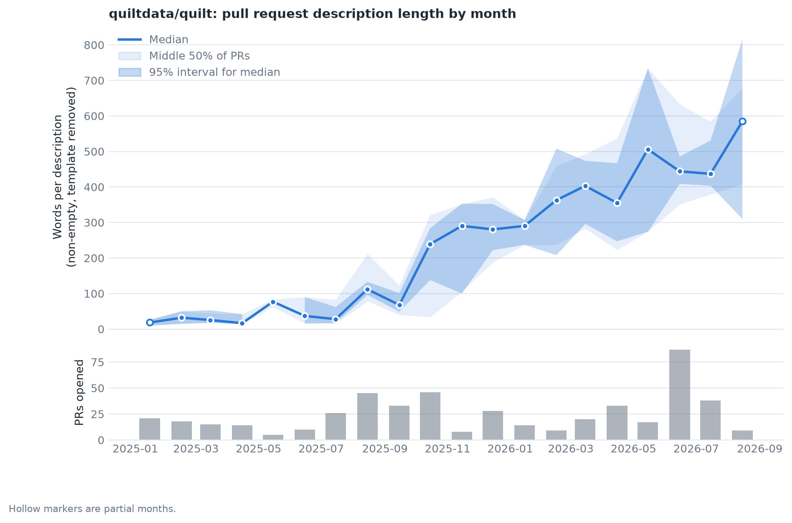
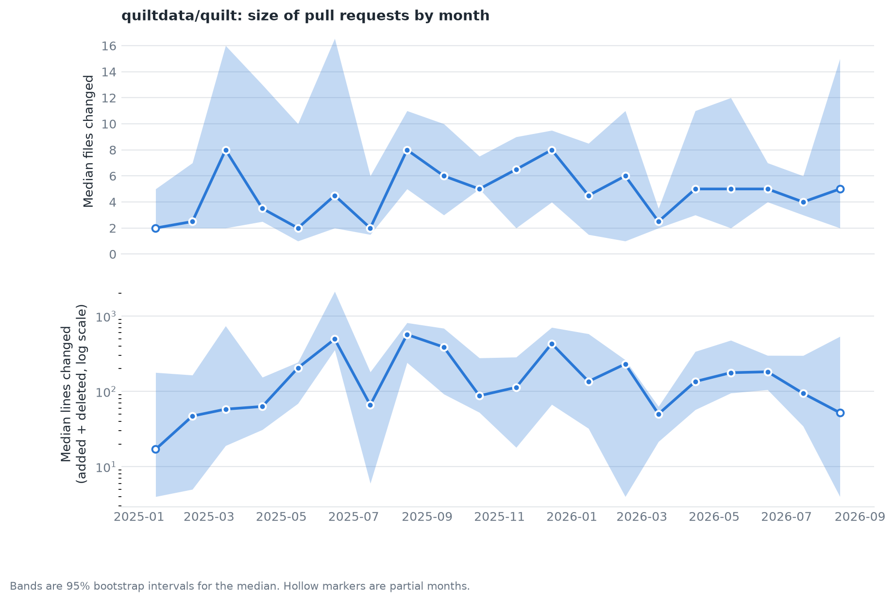
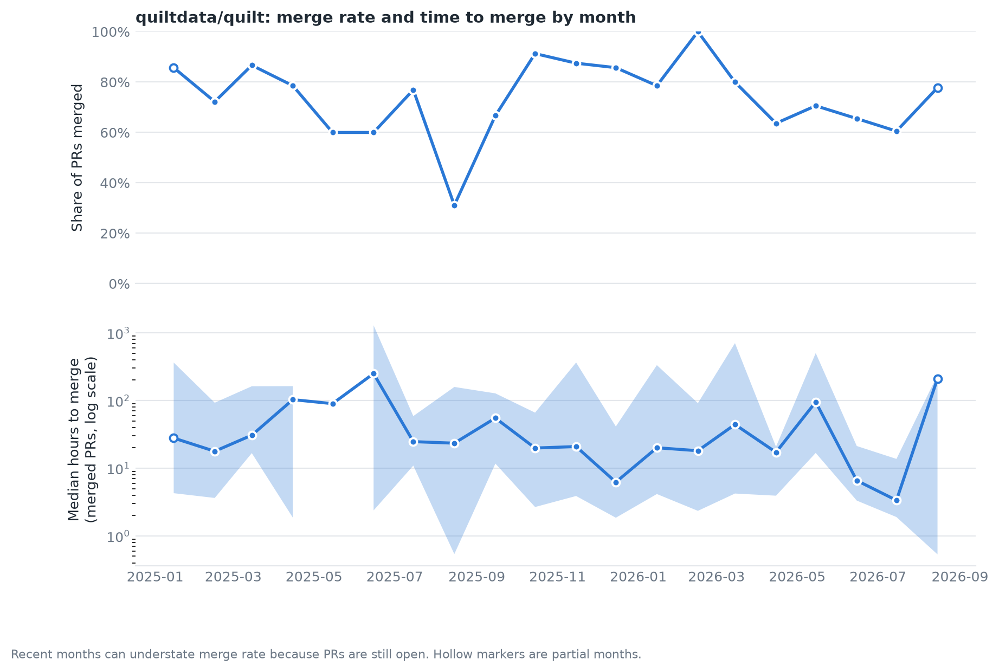
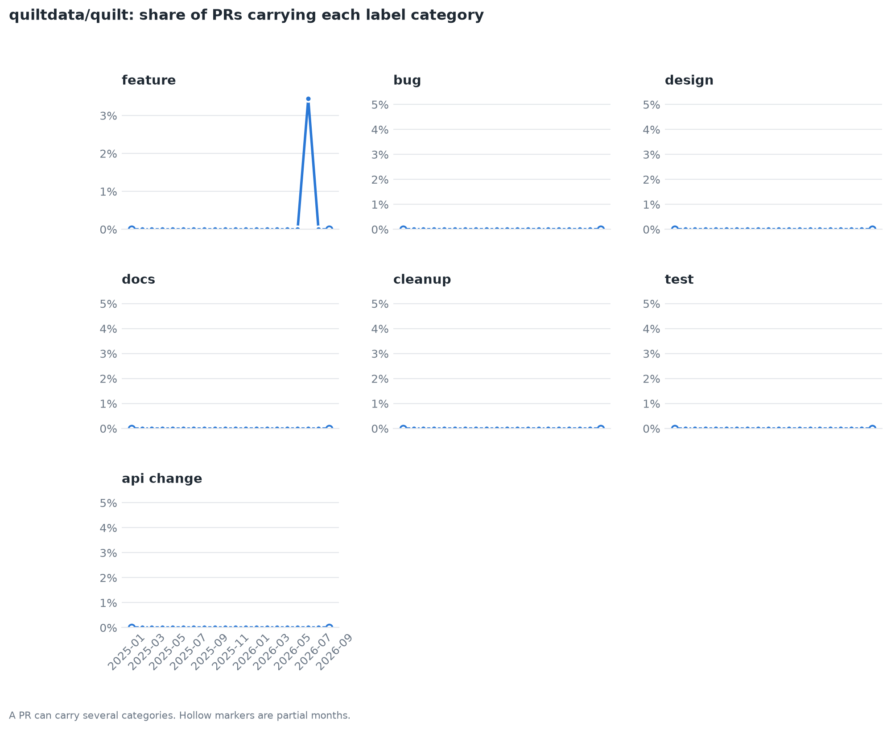
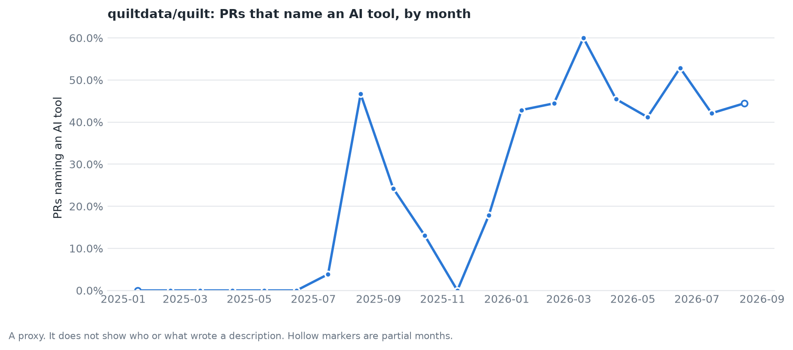
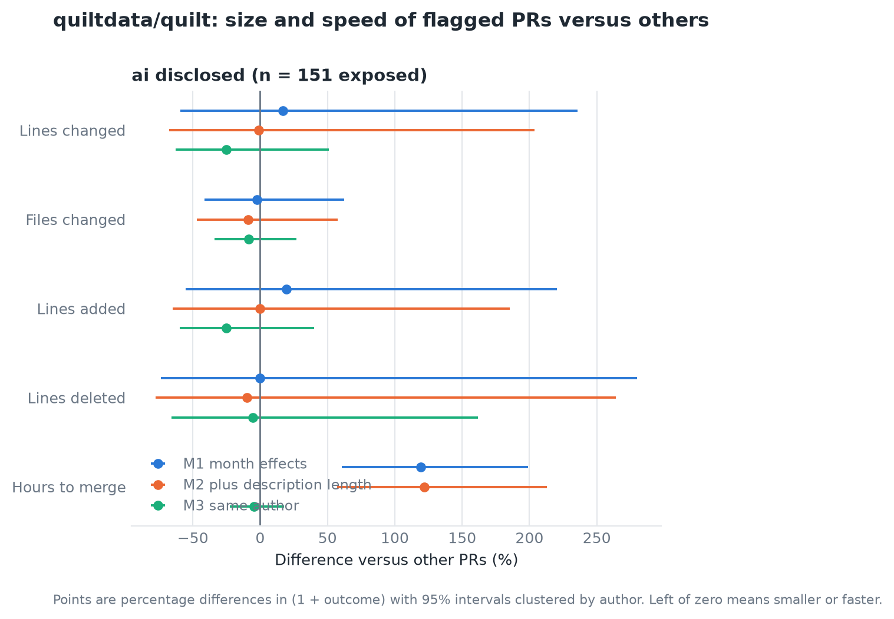

# Pull requests in quiltdata/quilt: description length, size, speed and labels

Window 2025-01-06 to 2026-08-17 (UTC). Data fetched 2026-11-20. prwords 3.0.0, generated 2026-11-26. Method fixed in advance in `docs/ANALYSIS_PLAN.md`.

## 1. Data

- Repository primary language: TypeScript
- Pull requests opened in the window: 878
- Removed as bot accounts: 382
- Analysed: 496 PRs from 7 authors
- Merged: 349 (70.4%). Closed without merging: 147 (29.6%). Still open: 0
- Follow-up: merge outcomes use a 30-day follow-up. PRs without enough follow-up: 0
- Empty descriptions after cleaning: 5.0%

## 2. Did the PR template change?

Lines that appeared or disappeared across the window (full list in `template_audit.csv`):

| line                         | first_month   | last_month   |   months |   peak_share | change_event   |
|:-----------------------------|:--------------|:-------------|---------:|-------------:|:---------------|
| sequence diagram             | 2025-11       | 2026-01      |        3 |         0.86 | removed        |
| greptile summary             | 2025-12       | 2026-08      |        6 |         0.86 | added          |
| | filename | overview |      | 2026-05       | 2026-08      |        4 |         0.83 | added          |
| |----------|----------|      | 2026-05       | 2026-08      |        4 |         0.83 | added          |
| ## summary                   | 2026-05       | 2026-05      |        1 |         0.7  | added          |
| confidence score: 5/5        | 2026-06       | 2026-06      |        1 |         0.64 | added          |
| 🤖 generated with claude code | 2026-06       | 2026-06      |        1 |         0.51 | added          |

Distinct template lines detected: 12.

## 3. First 28 days versus last 28 days

First window 2025-01-06 to 2025-02-02. Last window 2026-07-21 to 2026-08-17. Ratios are last median divided by first median. Bootstrap intervals, 2,000 resamples.

| Metric                                |   n first |   n last |   Median first |   Median last |   Ratio |   Ratio low |   Ratio high |       p |   Cliff's delta |
|:--------------------------------------|----------:|---------:|---------------:|--------------:|--------:|------------:|-------------:|--------:|----------------:|
| Description words (non-empty)         |        18 |       30 |          18.5  |        450    |   24.32 |       16.36 |        48.39 | 9.5e-09 |            1    |
| Files changed                         |        21 |       30 |           2    |          4    |    2    |        0.9  |         3.76 | 0.026   |            0.37 |
| Lines added                           |        21 |       30 |          15    |         49    |    3.27 |        0.24 |        29.32 | 0.13    |            0.25 |
| Lines deleted                         |        21 |       30 |           2    |         12    |    6    |        2    |        16    | 0.0082  |            0.44 |
| Net lines (added minus deleted)       |        21 |       30 |           7    |         33.5  |    4.79 |        0.18 |        38    | 0.47    |            0.12 |
| Lines changed (added plus deleted)    |        21 |       30 |          17    |         62.5  |    3.68 |        0.31 |        21.83 | 0.1     |            0.27 |
| Hours from open to merge (merged PRs) |        18 |       23 |          27.89 |          5.17 |    0.19 |        0.01 |         2.18 | 0.09    |           -0.31 |
| Commits                               |        21 |       30 |           4    |          5    |    1.25 |        0.38 |         3.25 | 0.98    |           -0.01 |
| Comments                              |        21 |       30 |           1    |          2    |    2    |        1    |         3    | 0.013   |            0.39 |
| Reviews                               |        21 |       30 |           3    |          1    |    0.33 |        0    |         1    | 0.012   |           -0.41 |

| Measure                             |   n first |   n last | Share first   | Share last   |   Change (points) |     p |
|:------------------------------------|----------:|---------:|:--------------|:-------------|------------------:|------:|
| Merged within follow-up period      |        21 |       30 | 76.2%         | 76.7%        |               0.5 | 1     |
| Closed without merging              |        21 |       30 | 14.3%         | 23.3%        |               9   | 0.49  |
| Opened as draft                     |        21 |       30 | 4.8%          | 13.3%        |               8.6 | 0.39  |
| From outside contributors           |        21 |       30 | 4.8%          | 16.7%        |              11.9 | 0.38  |
| Has a kind or type label            |        21 |       30 | 0.0%          | 0.0%         |               0   | 1     |
| Description text repeated elsewhere |        21 |       30 | 14.3%         | 0.0%         |             -14.3 | 0.064 |
| Names an AI tool (disclosure)       |        21 |       30 | 0.0%          | 26.7%        |              26.7 | 0.015 |
| Label category: feature             |        21 |       30 | 0.0%          | 0.0%         |               0   | 1     |
| Label category: bug                 |        21 |       30 | 0.0%          | 0.0%         |               0   | 1     |
| Label category: design              |        21 |       30 | 0.0%          | 0.0%         |               0   | 1     |
| Label category: docs                |        21 |       30 | 0.0%          | 0.0%         |               0   | 1     |
| Label category: cleanup             |        21 |       30 | 0.0%          | 0.0%         |               0   | 1     |
| Label category: test                |        21 |       30 | 0.0%          | 0.0%         |               0   | 1     |
| Label category: api_change          |        21 |       30 | 0.0%          | 0.0%         |               0   | 1     |

## 4. Monthly trends

Theil-Sen slope per month and Kendall tau over full months only.

| metric                     |   months |   slope_per_month |   slope_ci_low |   slope_ci_high |     tau |       p |
|:---------------------------|---------:|------------------:|---------------:|----------------:|--------:|--------:|
| median_words               |       18 |            30.444 |         24.417 |          36.214 |   0.8   |   0     |
| median_files_changed       |       18 |            -0     |         -0.214 |           0.25  |   0.055 |   0.759 |
| median_additions           |       18 |             2.208 |         -6.3   |           6.25  |   0.163 |   0.369 |
| median_deletions           |       18 |             0.375 |         -1.75  |           2.3   |   0.106 |   0.544 |
| median_churn               |       18 |             4.214 |        -13.667 |          10.375 |   0.15  |   0.41  |
| median_hours_to_merge      |       18 |            -1.61  |         -5.349 |          -0.434 |  -0.386 |   0.026 |
| merge_rate                 |       18 |            -0.001 |         -0.02  |           0.013 |  -0.046 |   0.791 |
| share_outside_contributors |       18 |             0.003 |         -0     |           0.006 |   0.48  |   0.009 |
| share_ai_disclosed         |       18 |             0.032 |          0.018 |           0.044 |   0.606 |   0.001 |
| median_comments            |       18 |             0.083 |         -0     |           0.167 |   0.529 |   0.006 |
| median_reviews             |       18 |            -0     |         -0.062 |           0.111 |   0.06  |   0.75  |
| share_feature              |       18 |            -0     |         -0     |          -0     |   0.294 |   0.148 |
| share_bug                  |       18 |            -0     |         -0     |          -0     | nan     | nan     |
| share_design               |       18 |            -0     |         -0     |          -0     | nan     | nan     |
| share_docs                 |       18 |            -0     |         -0     |          -0     | nan     | nan     |
| share_cleanup              |       18 |            -0     |         -0     |          -0     | nan     | nan     |
| share_test                 |       18 |            -0     |         -0     |          -0     | nan     | nan     |
| share_api_change           |       18 |            -0     |         -0     |          -0     | nan     | nan     |

## 5. Labels

Share of PRs with a kind or type label: 0.0% overall. Label coverage by month is in `monthly_summary.csv` (`share_has_kind_label`).

| category            |   n_prs |   share |   median_words |   median_files |   median_churn |   merge_rate |   median_hours_to_merge |   share_ai_disclosed |
|:--------------------|--------:|--------:|---------------:|---------------:|---------------:|-------------:|------------------------:|---------------------:|
| feature             |       3 |   0.006 |            630 |             47 |           8377 |        0     |                 nan     |                0.333 |
| bug                 |       0 |   0     |            nan |            nan |            nan |      nan     |                 nan     |              nan     |
| design              |       0 |   0     |            nan |            nan |            nan |      nan     |                 nan     |              nan     |
| docs                |       0 |   0     |            nan |            nan |            nan |      nan     |                 nan     |              nan     |
| cleanup             |       0 |   0     |            nan |            nan |            nan |      nan     |                 nan     |              nan     |
| test                |       0 |   0     |            nan |            nan |            nan |      nan     |                 nan     |              nan     |
| api_change          |       0 |   0     |            nan |            nan |            nan |      nan     |                 nan     |              nan     |
| (no category label) |     493 |   0.994 |            266 |              5 |            140 |        0.708 |                  19.022 |                0.304 |

## 6. Are PRs with signs of AI involvement smaller or larger?

Authorship is not observable. The proxy is `ai_disclosed`, defined in the analysis plan: 151 PRs (30.44%). 50 disclosed PRs are listed in `ai_disclosure_samples.csv` for manual audit.

### ai_disclosed

**Verdict: no difference detected.** The same-month interval for lines changed runs from -59.3% to +235.6%.

Pattern: lines changed: no clear difference; files changed: no clear difference; lines added: no clear difference; lines deleted: no clear difference; hours to merge: no clear difference.

Within-author permutation p-value, lines changed: 0.7016.

| Outcome        | Model                      |   n |   n exposed |   Median exposed |   Median others | Difference (95% CI)       |       p |   p (Holm) |
|:---------------|:---------------------------|----:|------------:|-----------------:|----------------:|:--------------------------|--------:|-----------:|
| Lines changed  | M1 month effects           | 496 |         151 |            187   |             125 | +16.9% (-59.3 to +235.6)  | 0.77    |    1       |
| Lines changed  | M2 plus description length | 496 |         151 |            187   |             125 | -1.1% (-67.8 to +203.6)   | 0.99    |    1       |
| Lines changed  | M3 same author             | 496 |         151 |            187   |             125 | -25.0% (-62.8 to +51.0)   | 0.42    |    1       |
| Files changed  | M1 month effects           | 496 |         151 |              5   |               5 | -2.3% (-41.2 to +62.2)    | 0.93    |    1       |
| Files changed  | M2 plus description length | 496 |         151 |              5   |               5 | -8.8% (-47.1 to +57.4)    | 0.74    |    1       |
| Files changed  | M3 same author             | 496 |         151 |              5   |               5 | -8.5% (-34.0 to +26.8)    | 0.59    |    1       |
| Lines added    | M1 month effects           | 496 |         151 |            111   |              84 | +19.4% (-55.5 to +220.4)  | 0.73    |    1       |
| Lines added    | M2 plus description length | 496 |         151 |            111   |              84 | -0.0% (-65.0 to +185.3)   | 1       |    1       |
| Lines added    | M3 same author             | 496 |         151 |            111   |              84 | -25.0% (-59.8 to +39.9)   | 0.37    |    1       |
| Lines deleted  | M1 month effects           | 496 |         151 |             29   |              18 | -0.2% (-73.8 to +280.1)   | 1       |    1       |
| Lines deleted  | M2 plus description length | 496 |         151 |             29   |              18 | -9.7% (-77.6 to +264.1)   | 0.89    |    1       |
| Lines deleted  | M3 same author             | 496 |         151 |             29   |              18 | -5.6% (-66.0 to +161.6)   | 0.91    |    1       |
| Hours to merge | M1 month effects           | 349 |          74 |             24.3 |              18 | +119.2% (+60.7 to +199.1) | 7.4e-07 |    3.7e-06 |
| Hours to merge | M2 plus description length | 349 |          74 |             24.3 |              18 | +121.8% (+57.2 to +212.8) | 5.6e-06 |    2.8e-05 |
| Hours to merge | M3 same author             | 349 |          74 |             24.3 |              18 | -4.5% (-22.4 to +17.6)    | 0.67    |    1       |

### Robustness by tool (lines changed)

| tool        |   n exposed | Same month               | Same author             | call                | status                    |
|:------------|------------:|:-------------------------|:------------------------|:--------------------|:--------------------------|
| unspecified |         150 | +17.8% (-58.8 to +237.4) | -24.4% (-62.4 to +51.7) | no clear difference | ok                        |
| claude      |           1 | n/a                      | n/a                     | nan                 | fewer than 30 exposed PRs |

### File type check

Sample: 148 exposed and 140 unexposed PRs from the same months. 5 PRs with more than 100 files were excluded.

Share of changed lines by file type:

| group     |   n_prs | code   | tests   | docs   | config   | generated   | other   |   median_code_test_lines |
|:----------|--------:|:-------|:--------|:-------|:---------|:------------|:--------|-------------------------:|
| exposed   |     148 | 44.6%  | 18.1%   | 6.8%   | 1.8%     | 27.2%       | 1.5%    |                     71.5 |
| unexposed |     140 | 38.7%  | 19.5%   | 8.0%   | 1.8%     | 31.6%       | 0.4%    |                     80   |

Code and test lines only, same month: -28.1% (95% CI -82.6 to +197.6), p = 0.65. This is a robustness check and does not change the verdict.

## 7. Other checks

- Outside contributors: 4.0% of PRs overall.
- Top 10 authors opened 100.0% of PRs.
- PRs whose description text is repeated elsewhere (10 or more words): 8.7%.

## 8. Limitations

- Word count and size describe PRs, not who wrote them. Proxies for AI involvement are noisy and omit undisclosed use.
- Added and deleted lines include generated or vendored files unless the project avoids committing them.
- Disclosure mostly captures tools that add attribution by default, so it is tool-skewed.
- Template removal is heuristic. Check `template_audit.csv`.
- One repository cannot support general claims. See the plan for replication.
- Months at the edges of the window are partial and are excluded from trend tests.

