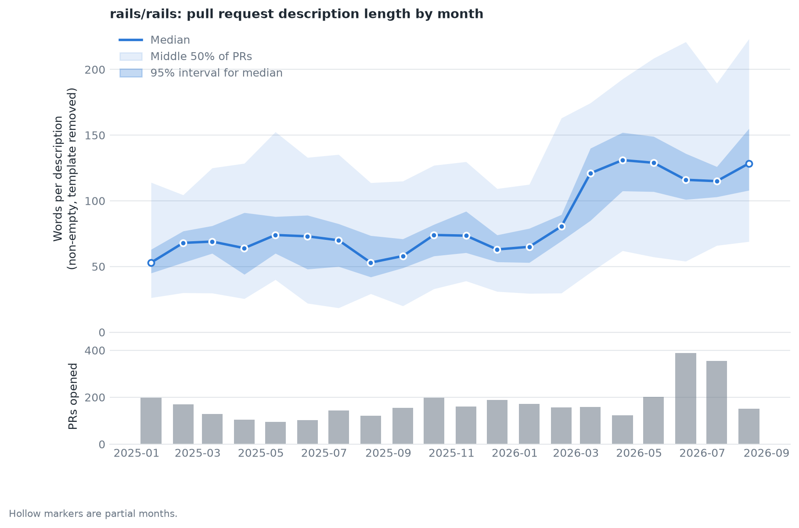
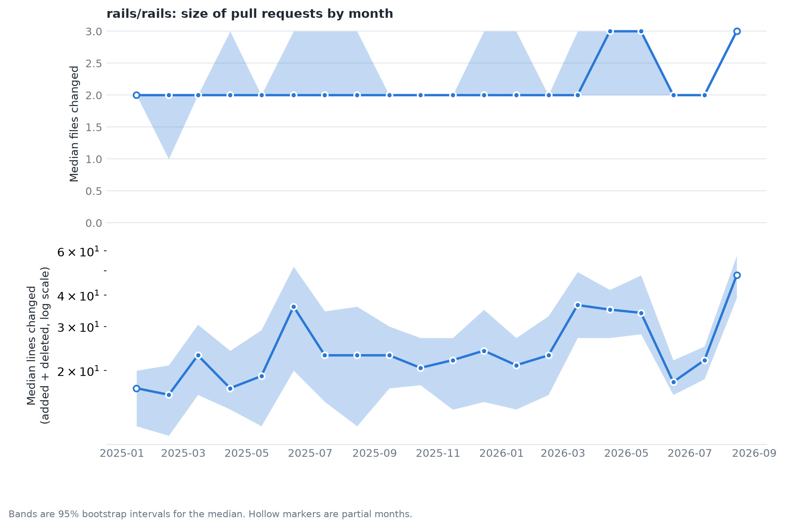
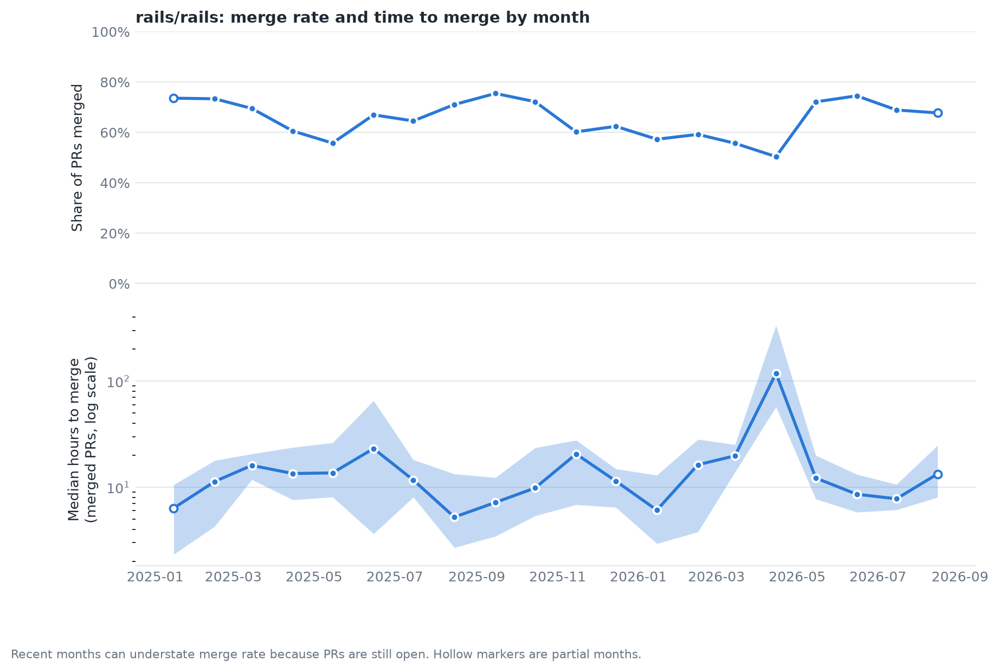
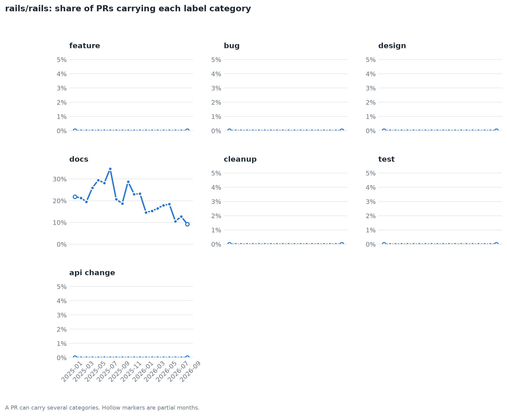
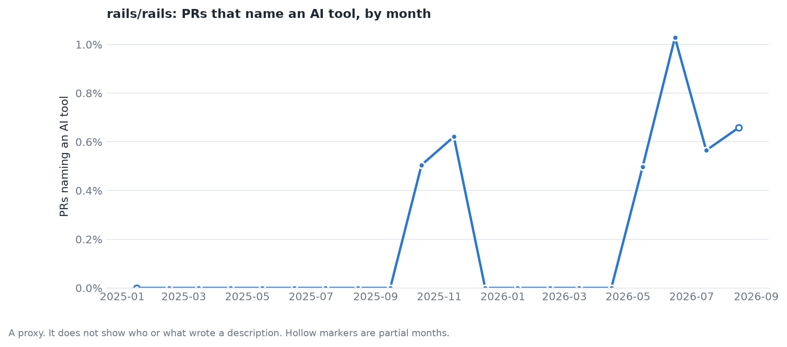

# Pull requests in rails/rails: description length, size, speed and labels

Window 2025-01-06 to 2026-08-17 (UTC). Data fetched 2026-11-19. prwords 3.0.0, generated 2026-11-26. Method fixed in advance in `docs/ANALYSIS_PLAN.md`.

## 1. Data

- Repository primary language: Ruby
- Pull requests opened in the window: 3,470
- Removed as bot accounts: 1
- Analysed: 3,469 PRs from 915 authors
- Merged: 2,320 (66.9%). Closed without merging: 673 (19.4%). Still open: 476
- Follow-up: merge outcomes use a 30-day follow-up. PRs without enough follow-up: 0
- Empty descriptions after cleaning: 1.7%

## 2. Did the PR template change?

No template line appeared or disappeared with a share of 50% or more. Template text was detected monthly and removed before counting words.

Distinct template lines detected: 9.

## 3. First 28 days versus last 28 days

First window 2025-01-06 to 2025-02-02. Last window 2026-07-21 to 2026-08-17. Ratios are last median divided by first median. Bootstrap intervals, 2,000 resamples.

| Metric                                |   n first |   n last |   Median first |   Median last |   Ratio |   Ratio low |   Ratio high |       p |   Cliff's delta |
|:--------------------------------------|----------:|---------:|---------------:|--------------:|--------:|------------:|-------------:|--------:|----------------:|
| Description words (non-empty)         |       192 |      302 |           54.5 |        118    |    2.17 |        1.76 |         2.69 | 1.8e-15 |            0.42 |
| Files changed                         |       199 |      306 |            2   |          3    |    1.5  |        1    |         1.5  | 0.00072 |            0.17 |
| Lines added                           |       199 |      306 |           12   |         25.5  |    2.12 |        1.41 |         3.22 | 0.00048 |            0.18 |
| Lines deleted                         |       199 |      306 |            2   |          4    |    2    |        1    |         2.5  | 0.0026  |            0.16 |
| Net lines (added minus deleted)       |       199 |      306 |            8   |         19    |    2.38 |        1.2  |         6.33 | 0.062   |            0.1  |
| Lines changed (added plus deleted)    |       199 |      306 |           17   |         34.5  |    2.03 |        1.5  |         2.92 | 7.3e-06 |            0.24 |
| Hours from open to merge (merged PRs) |       147 |      219 |            6.4 |         10.18 |    1.59 |        0.79 |         4.66 | 0.091   |            0.1  |
| Commits                               |       199 |      306 |            1   |          1    |    1    |        1    |         1    | 0.056   |            0.06 |
| Comments                              |       199 |      306 |            1   |          0    |    0    |        0    |         0    | 0.00023 |           -0.17 |
| Reviews                               |       199 |      306 |            0   |          0    |  nan    |      nan    |       nan    | 0.0041  |           -0.12 |

| Measure                             |   n first |   n last | Share first   | Share last   |   Change (points) |       p |
|:------------------------------------|----------:|---------:|:--------------|:-------------|------------------:|--------:|
| Merged within follow-up period      |       199 |      306 | 67.8%         | 68.0%        |               0.1 | 1       |
| Closed without merging              |       199 |      306 | 19.1%         | 14.1%        |              -5   | 0.14    |
| Opened as draft                     |       199 |      306 | 2.0%          | 0.0%         |              -2   | 0.024   |
| From outside contributors           |       199 |      306 | 52.3%         | 72.9%        |              20.6 | 2.8e-06 |
| Has a kind or type label            |       199 |      306 | 0.0%          | 0.0%         |               0   | 1       |
| Description text repeated elsewhere |       199 |      306 | 1.5%          | 0.3%         |              -1.2 | 0.31    |
| Names an AI tool (disclosure)       |       199 |      306 | 0.0%          | 1.0%         |               1   | 0.28    |
| Label category: feature             |       199 |      306 | 0.0%          | 0.0%         |               0   | 1       |
| Label category: bug                 |       199 |      306 | 0.0%          | 0.0%         |               0   | 1       |
| Label category: design              |       199 |      306 | 0.0%          | 0.0%         |               0   | 1       |
| Label category: docs                |       199 |      306 | 22.1%         | 10.8%        |             -11.3 | 0.00089 |
| Label category: cleanup             |       199 |      306 | 0.0%          | 0.0%         |               0   | 1       |
| Label category: test                |       199 |      306 | 0.0%          | 0.0%         |               0   | 1       |
| Label category: api_change          |       199 |      306 | 0.0%          | 0.0%         |               0   | 1       |

## 4. Monthly trends

Theil-Sen slope per month and Kendall tau over full months only.

| metric                     |   months |   slope_per_month |   slope_ci_low |   slope_ci_high |     tau |       p |
|:---------------------------|---------:|------------------:|---------------:|----------------:|--------:|--------:|
| median_words               |       18 |             2.875 |          0.714 |           5.091 |   0.446 |   0.01  |
| median_files_changed       |       18 |            -0     |         -0     |          -0     |   0.343 |   0.092 |
| median_additions           |       18 |             0.333 |         -0     |           0.846 |   0.308 |   0.08  |
| median_deletions           |       18 |            -0     |         -0     |          -0     |  -0.497 |   0.015 |
| median_churn               |       18 |             0.3   |         -0.091 |           1.125 |   0.231 |   0.192 |
| median_hours_to_merge      |       18 |            -0.156 |         -0.604 |           0.628 |  -0.046 |   0.823 |
| merge_rate                 |       18 |            -0.003 |         -0.012 |           0.006 |  -0.137 |   0.454 |
| share_outside_contributors |       18 |             0.011 |          0.005 |           0.017 |   0.464 |   0.007 |
| share_ai_disclosed         |       18 |            -0     |         -0     |           0     |   0.439 |   0.023 |
| median_comments            |       18 |            -0     |         -0.083 |          -0     |  -0.524 |   0.01  |
| median_reviews             |       18 |            -0     |         -0     |          -0     | nan     | nan     |
| share_feature              |       18 |            -0     |         -0     |          -0     | nan     | nan     |
| share_bug                  |       18 |            -0     |         -0     |          -0     | nan     | nan     |
| share_design               |       18 |            -0     |         -0     |          -0     | nan     | nan     |
| share_docs                 |       18 |            -0.009 |         -0.013 |          -0.003 |  -0.477 |   0.005 |
| share_cleanup              |       18 |            -0     |         -0     |          -0     | nan     | nan     |
| share_test                 |       18 |            -0     |         -0     |          -0     | nan     | nan     |
| share_api_change           |       18 |            -0     |         -0     |          -0     | nan     | nan     |

## 5. Labels

Share of PRs with a kind or type label: 0.0% overall. Label coverage by month is in `monthly_summary.csv` (`share_has_kind_label`).

| category            |   n_prs |   share |   median_words |   median_files |   median_churn |   merge_rate |   median_hours_to_merge |   share_ai_disclosed |
|:--------------------|--------:|--------:|---------------:|---------------:|---------------:|-------------:|------------------------:|---------------------:|
| feature             |       0 |   0     |            nan |            nan |            nan |      nan     |                 nan     |              nan     |
| bug                 |       0 |   0     |            nan |            nan |            nan |      nan     |                 nan     |              nan     |
| design              |       0 |   0     |            nan |            nan |            nan |      nan     |                 nan     |              nan     |
| docs                |     664 |   0.191 |             72 |              1 |             18 |        0.657 |                  11.606 |                0.005 |
| cleanup             |       0 |   0     |            nan |            nan |            nan |      nan     |                 nan     |              nan     |
| test                |       0 |   0     |            nan |            nan |            nan |      nan     |                 nan     |              nan     |
| api_change          |       0 |   0     |            nan |            nan |            nan |      nan     |                 nan     |              nan     |
| (no category label) |    2805 |   0.809 |             84 |              2 |             24 |        0.672 |                  11.606 |                0.002 |

## 6. Are PRs with signs of AI involvement smaller or larger?

Authorship is not observable. The proxy is `ai_disclosed`, defined in the analysis plan: 10 PRs (0.29%). 10 disclosed PRs are listed in `ai_disclosure_samples.csv` for manual audit.

### ai_disclosed

**Verdict: not testable.** Too few exposed PRs.

Pattern: lines changed: not estimated; files changed: not estimated; lines added: not estimated; lines deleted: not estimated; hours to merge: not estimated.

Not estimated: fewer than 30 exposed PRs (exposed PRs: 10).

### Robustness by tool (lines changed)

| tool        |   n exposed | status                    |
|:------------|------------:|:--------------------------|
| unspecified |           9 | fewer than 30 exposed PRs |
| codex       |           1 | fewer than 30 exposed PRs |

### File type check

Not run. Use `--file-check N` to sample N exposed PRs and matching unexposed PRs.

## 7. Other checks

- Outside contributors: 68.9% of PRs overall.
- Top 10 authors opened 31.6% of PRs.
- PRs whose description text is repeated elsewhere (10 or more words): 1.4%.

## 8. Limitations

- Word count and size describe PRs, not who wrote them. Proxies for AI involvement are noisy and omit undisclosed use.
- Added and deleted lines include generated or vendored files unless the project avoids committing them.
- Disclosure mostly captures tools that add attribution by default, so it is tool-skewed.
- Template removal is heuristic. Check `template_audit.csv`.
- One repository cannot support general claims. See the plan for replication.
- Months at the edges of the window are partial and are excluded from trend tests.

