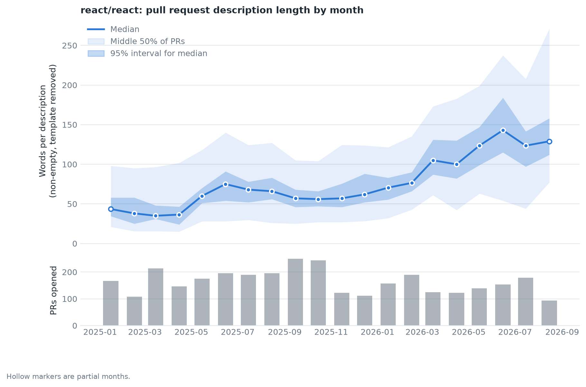
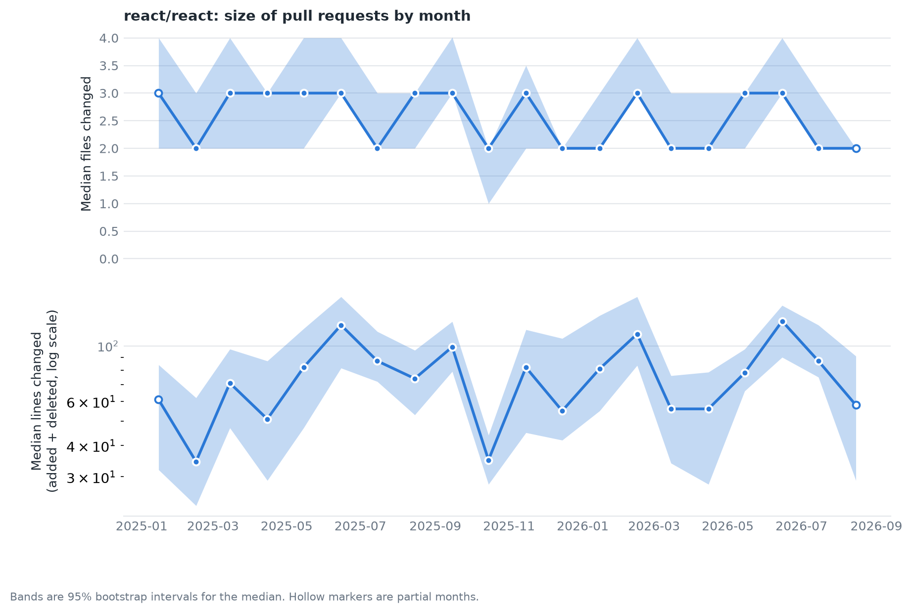
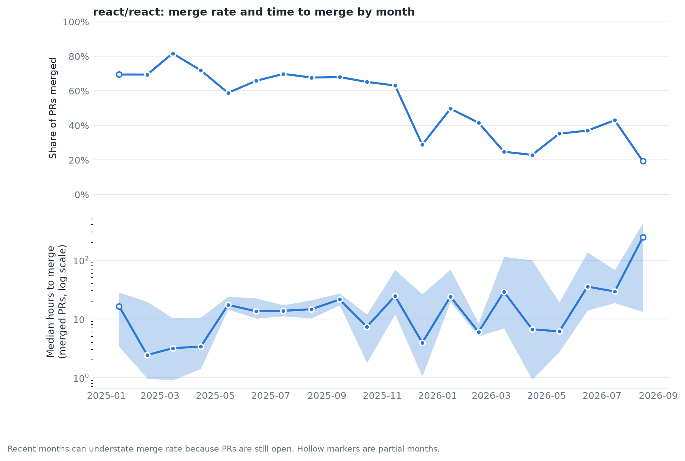
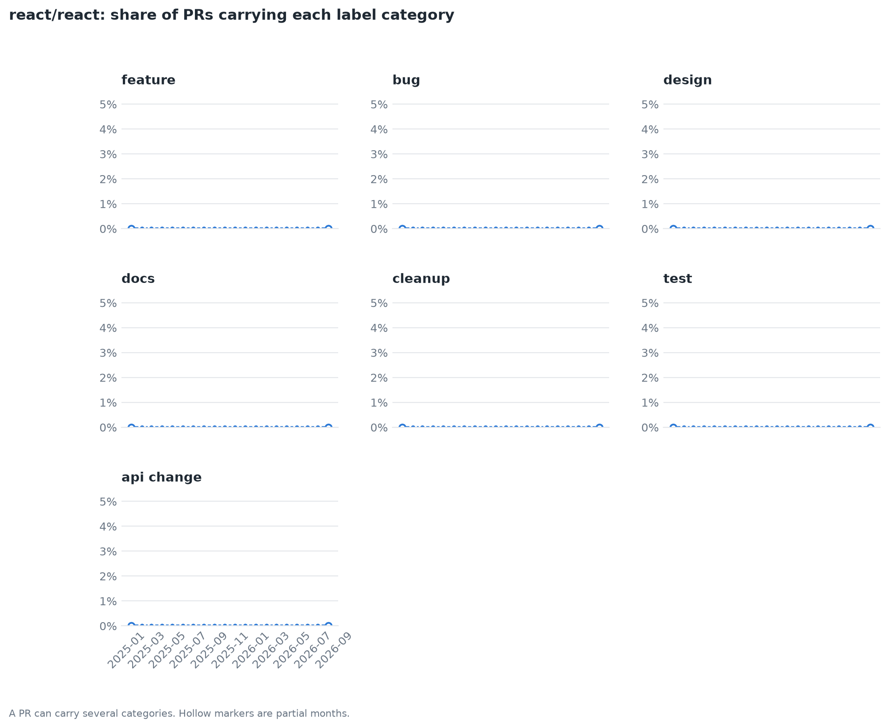
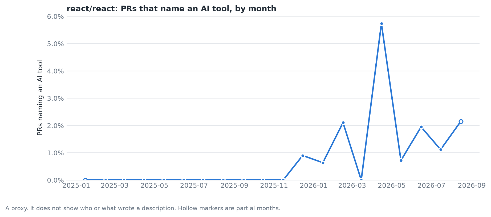

# Pull requests in react/react: description length, size, speed and labels

Window 2025-01-06 to 2026-08-17 (UTC). Data fetched 2026-11-19. prwords 3.0.0, generated 2026-11-26. Method fixed in advance in `docs/ANALYSIS_PLAN.md`.

## 1. Data

- Repository primary language: JavaScript
- Pull requests opened in the window: 3,401
- Removed as bot accounts: 126
- Analysed: 3,275 PRs from 785 authors
- Merged: 1,821 (55.6%). Closed without merging: 1,282 (39.1%). Still open: 172
- Follow-up: merge outcomes use a 30-day follow-up. PRs without enough follow-up: 0
- Empty descriptions after cleaning: 7.0%

## 2. Did the PR template change?

No template line appeared or disappeared with a share of 50% or more. Template text was detected monthly and removed before counting words.

Distinct template lines detected: 6.

## 3. First 28 days versus last 28 days

First window 2025-01-06 to 2025-02-02. Last window 2026-07-21 to 2026-08-17. Ratios are last median divided by first median. Bootstrap intervals, 2,000 resamples.

| Metric                                |   n first |   n last |   Median first |   Median last |   Ratio |   Ratio low |   Ratio high |       p |   Cliff's delta |
|:--------------------------------------|----------:|---------:|---------------:|--------------:|--------:|------------:|-------------:|--------:|----------------:|
| Description words (non-empty)         |       151 |      141 |          43    |         116   |    2.7  |        2.02 |         3.63 | 3e-08   |            0.38 |
| Files changed                         |       172 |      155 |           3    |           2   |    0.67 |        0.5  |         1    | 0.11    |           -0.1  |
| Lines added                           |       172 |      155 |          28.5  |          62   |    2.18 |        0.92 |         3.13 | 0.061   |            0.12 |
| Lines deleted                         |       172 |      155 |          12    |           6   |    0.5  |        0.21 |         1.08 | 0.0015  |           -0.2  |
| Net lines (added minus deleted)       |       172 |      155 |           9    |          30   |    3.33 |        1.24 |        12    | 0.00085 |            0.21 |
| Lines changed (added plus deleted)    |       172 |      155 |          65    |          74   |    1.14 |        0.64 |         2.15 | 0.9     |           -0.01 |
| Hours from open to merge (merged PRs) |       119 |       49 |          17.51 |          84.6 |    4.83 |        1    |        24.67 | 0.013   |            0.24 |
| Commits                               |       172 |      155 |           1    |           1   |    1    |        1    |         1    | 0.49    |            0.04 |
| Comments                              |       172 |      155 |           1    |           1   |    1    |        1    |         2    | 0.41    |            0.05 |
| Reviews                               |       172 |      155 |           1    |           1   |    1    |        1    |         1    | 0.0081  |            0.16 |

| Measure                             |   n first |   n last | Share first   | Share last   |   Change (points) |       p |
|:------------------------------------|----------:|---------:|:--------------|:-------------|------------------:|--------:|
| Merged within follow-up period      |       172 |      155 | 62.2%         | 31.0%        |             -31.2 | 2.3e-08 |
| Closed without merging              |       172 |      155 | 29.1%         | 33.5%        |               4.5 | 0.4     |
| Opened as draft                     |       172 |      155 | 0.0%          | 8.4%         |               8.4 | 4.6e-05 |
| From outside contributors           |       172 |      155 | 60.5%         | 60.6%        |               0.2 | 1       |
| Has a kind or type label            |       172 |      155 | 0.0%          | 0.0%         |               0   | 1       |
| Description text repeated elsewhere |       172 |      155 | 2.3%          | 1.3%         |              -1   | 0.69    |
| Names an AI tool (disclosure)       |       172 |      155 | 0.0%          | 1.9%         |               1.9 | 0.11    |
| Label category: feature             |       172 |      155 | 0.0%          | 0.0%         |               0   | 1       |
| Label category: bug                 |       172 |      155 | 0.0%          | 0.0%         |               0   | 1       |
| Label category: design              |       172 |      155 | 0.0%          | 0.0%         |               0   | 1       |
| Label category: docs                |       172 |      155 | 0.0%          | 0.0%         |               0   | 1       |
| Label category: cleanup             |       172 |      155 | 0.0%          | 0.0%         |               0   | 1       |
| Label category: test                |       172 |      155 | 0.0%          | 0.0%         |               0   | 1       |
| Label category: api_change          |       172 |      155 | 0.0%          | 0.0%         |               0   | 1       |

## 4. Monthly trends

Theil-Sen slope per month and Kendall tau over full months only.

| metric                     |   months |   slope_per_month |   slope_ci_low |   slope_ci_high |     tau |       p |
|:---------------------------|---------:|------------------:|---------------:|----------------:|--------:|--------:|
| median_words               |       18 |             5     |          3.208 |           6.75  |   0.678 |   0     |
| median_files_changed       |       18 |            -0     |         -0     |          -0     |  -0.181 |   0.374 |
| median_additions           |       18 |             2.111 |         -0.3   |           4.364 |   0.307 |   0.081 |
| median_deletions           |       18 |            -0.364 |         -0.75  |          -0     |  -0.402 |   0.024 |
| median_churn               |       18 |             1.182 |         -1.154 |           4.25  |   0.224 |   0.197 |
| median_hours_to_merge      |       18 |             1.018 |          0.21  |           2.042 |   0.425 |   0.014 |
| merge_rate                 |       18 |            -0.025 |         -0.036 |          -0.016 |  -0.634 |   0     |
| share_outside_contributors |       18 |             0.003 |         -0.013 |           0.019 |   0.072 |   0.709 |
| share_ai_disclosed         |       18 |             0.001 |         -0     |           0.001 |   0.604 |   0.001 |
| median_comments            |       18 |            -0     |         -0     |           0.077 |   0.648 |   0.001 |
| median_reviews             |       18 |            -0     |         -0.077 |          -0     |  -0.457 |   0.025 |
| share_feature              |       18 |            -0     |         -0     |          -0     | nan     | nan     |
| share_bug                  |       18 |            -0     |         -0     |          -0     | nan     | nan     |
| share_design               |       18 |            -0     |         -0     |          -0     | nan     | nan     |
| share_docs                 |       18 |            -0     |         -0     |          -0     | nan     | nan     |
| share_cleanup              |       18 |            -0     |         -0     |          -0     | nan     | nan     |
| share_test                 |       18 |            -0     |         -0     |          -0     | nan     | nan     |
| share_api_change           |       18 |            -0     |         -0     |          -0     | nan     | nan     |

## 5. Labels

Share of PRs with a kind or type label: 0.0% overall. Label coverage by month is in `monthly_summary.csv` (`share_has_kind_label`).

| category            |   n_prs |   share |   median_words |   median_files |   median_churn |   merge_rate |   median_hours_to_merge |   share_ai_disclosed |
|:--------------------|--------:|--------:|---------------:|---------------:|---------------:|-------------:|------------------------:|---------------------:|
| feature             |       0 |       0 |            nan |            nan |            nan |      nan     |                 nan     |              nan     |
| bug                 |       0 |       0 |            nan |            nan |            nan |      nan     |                 nan     |              nan     |
| design              |       0 |       0 |            nan |            nan |            nan |      nan     |                 nan     |              nan     |
| docs                |       0 |       0 |            nan |            nan |            nan |      nan     |                 nan     |              nan     |
| cleanup             |       0 |       0 |            nan |            nan |            nan |      nan     |                 nan     |              nan     |
| test                |       0 |       0 |            nan |            nan |            nan |      nan     |                 nan     |              nan     |
| api_change          |       0 |       0 |            nan |            nan |            nan |      nan     |                 nan     |              nan     |
| (no category label) |    3275 |       1 |             69 |              3 |             76 |        0.556 |                  14.075 |                0.006 |

## 6. Are PRs with signs of AI involvement smaller or larger?

Authorship is not observable. The proxy is `ai_disclosed`, defined in the analysis plan: 21 PRs (0.64%). 21 disclosed PRs are listed in `ai_disclosure_samples.csv` for manual audit.

### ai_disclosed

**Verdict: not testable.** Too few exposed PRs.

Pattern: lines changed: not estimated; files changed: not estimated; lines added: not estimated; lines deleted: not estimated; hours to merge: not estimated.

Not estimated: fewer than 30 exposed PRs (exposed PRs: 21).

### Robustness by tool (lines changed)

| tool        |   n exposed | status                    |
|:------------|------------:|:--------------------------|
| unspecified |          18 | fewer than 30 exposed PRs |
| claude      |           2 | fewer than 30 exposed PRs |
| codex       |           1 | fewer than 30 exposed PRs |

### File type check

Not run. Use `--file-check N` to sample N exposed PRs and matching unexposed PRs.

## 7. Other checks

- Outside contributors: 67.4% of PRs overall.
- Top 10 authors opened 54.5% of PRs.
- PRs whose description text is repeated elsewhere (10 or more words): 2.1%.

## 8. Limitations

- Word count and size describe PRs, not who wrote them. Proxies for AI involvement are noisy and omit undisclosed use.
- Added and deleted lines include generated or vendored files unless the project avoids committing them.
- Disclosure mostly captures tools that add attribution by default, so it is tool-skewed.
- Template removal is heuristic. Check `template_audit.csv`.
- One repository cannot support general claims. See the plan for replication.
- Months at the edges of the window are partial and are excluded from trend tests.

