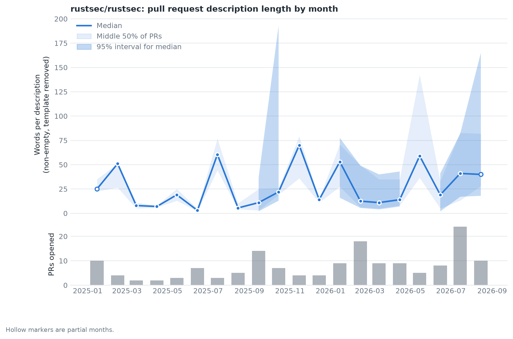
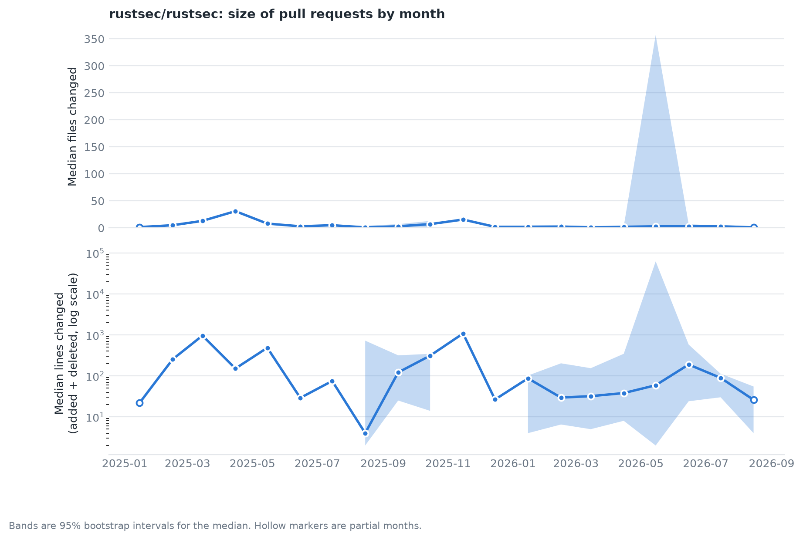
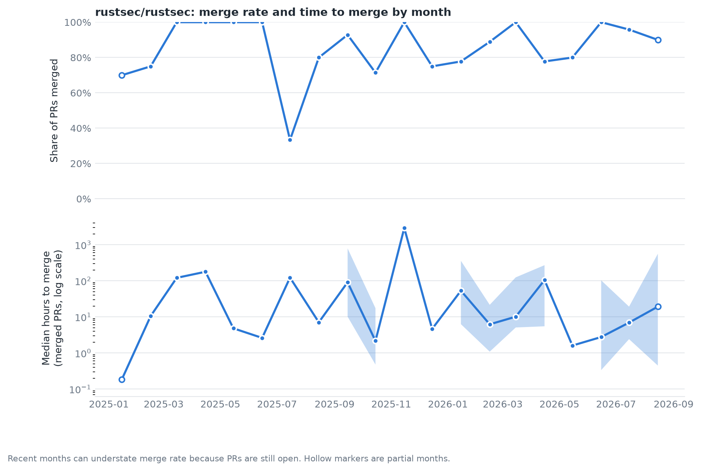
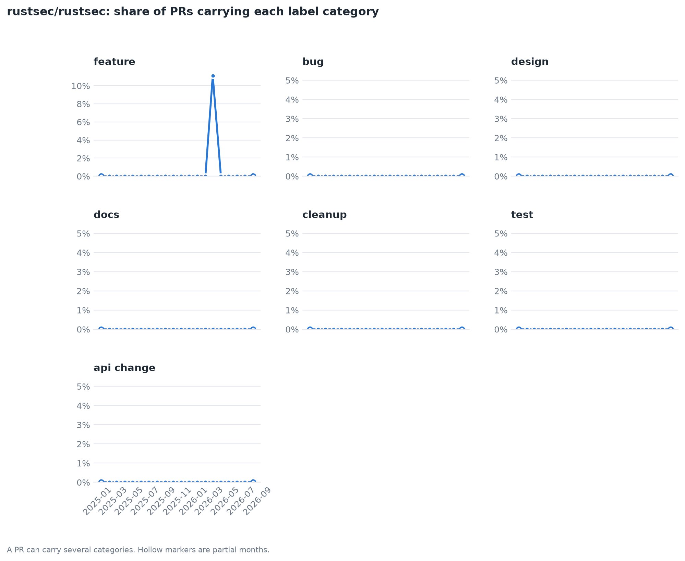
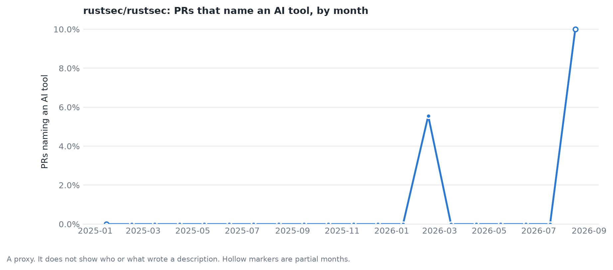

# Pull requests in rustsec/rustsec: description length, size, speed and labels

Window 2025-01-06 to 2026-08-17 (UTC). Data fetched 2026-11-20. prwords 3.0.0, generated 2026-11-26. Method fixed in advance in `docs/ANALYSIS_PLAN.md`.

## 1. Data

- Repository primary language: Rust
- Pull requests opened in the window: 313
- Removed as bot accounts: 156
- Analysed: 157 PRs from 42 authors
- Merged: 137 (87.3%). Closed without merging: 15 (9.6%). Still open: 5
- Follow-up: merge outcomes use a 30-day follow-up. PRs without enough follow-up: 0
- Empty descriptions after cleaning: 16.6%

## 2. Did the PR template change?

No template line appeared or disappeared with a share of 50% or more. Template text was detected monthly and removed before counting words.

Distinct template lines detected: 0.

## 3. First 28 days versus last 28 days

First window 2025-01-06 to 2025-02-02. Last window 2026-07-21 to 2026-08-17. Ratios are last median divided by first median. Bootstrap intervals, 2,000 resamples.

| Metric                                |   n first |   n last |   Median first |   Median last |   Ratio |   Ratio low |   Ratio high |      p |   Cliff's delta |
|:--------------------------------------|----------:|---------:|---------------:|--------------:|--------:|------------:|-------------:|-------:|----------------:|
| Description words (non-empty)         |         9 |       20 |          29    |         48    |    1.66 |        0.66 |         3.11 | 0.49   |            0.17 |
| Files changed                         |        12 |       21 |           2    |          2    |    1    |        0.28 |         3    | 0.66   |           -0.09 |
| Lines added                           |        12 |       21 |          32.5  |         25    |    0.77 |        0.03 |        10.17 | 0.39   |           -0.19 |
| Lines deleted                         |        12 |       21 |           8.5  |          7    |    0.82 |        0.02 |         2.2  | 0.17   |           -0.29 |
| Net lines (added minus deleted)       |        12 |       21 |          26.5  |          4    |    0.15 |        0    |         6.18 | 0.21   |           -0.27 |
| Lines changed (added plus deleted)    |        12 |       21 |          38.5  |         32    |    0.83 |        0.05 |         4.8  | 0.39   |           -0.19 |
| Hours from open to merge (merged PRs) |         8 |       20 |           0.65 |          4.37 |    6.69 |        0.34 |       132.94 | 0.07   |            0.45 |
| Commits                               |        12 |       21 |           1    |          1    |    1    |        0.29 |         2    | 0.42   |           -0.15 |
| Comments                              |        12 |       21 |           1    |          1    |    1    |        0    |         2.05 | 0.74   |           -0.07 |
| Reviews                               |        12 |       21 |           0    |          1    |  nan    |      nan    |       nan    | 0.0048 |            0.55 |

| Measure                             |   n first |   n last | Share first   | Share last   |   Change (points) |     p |
|:------------------------------------|----------:|---------:|:--------------|:-------------|------------------:|------:|
| Merged within follow-up period      |        12 |       21 | 66.7%         | 90.5%        |              23.8 | 0.16  |
| Closed without merging              |        12 |       21 | 33.3%         | 0.0%         |             -33.3 | 0.012 |
| Opened as draft                     |        12 |       21 | 0.0%          | 0.0%         |               0   | 1     |
| From outside contributors           |        12 |       21 | 25.0%         | 52.4%        |              27.4 | 0.16  |
| Has a kind or type label            |        12 |       21 | 0.0%          | 0.0%         |               0   | 1     |
| Description text repeated elsewhere |        12 |       21 | 16.7%         | 0.0%         |             -16.7 | 0.12  |
| Names an AI tool (disclosure)       |        12 |       21 | 0.0%          | 4.8%         |               4.8 | 1     |
| Label category: feature             |        12 |       21 | 0.0%          | 0.0%         |               0   | 1     |
| Label category: bug                 |        12 |       21 | 0.0%          | 0.0%         |               0   | 1     |
| Label category: design              |        12 |       21 | 0.0%          | 0.0%         |               0   | 1     |
| Label category: docs                |        12 |       21 | 0.0%          | 0.0%         |               0   | 1     |
| Label category: cleanup             |        12 |       21 | 0.0%          | 0.0%         |               0   | 1     |
| Label category: test                |        12 |       21 | 0.0%          | 0.0%         |               0   | 1     |
| Label category: api_change          |        12 |       21 | 0.0%          | 0.0%         |               0   | 1     |

## 4. Monthly trends

Theil-Sen slope per month and Kendall tau over full months only.

| metric                     |   months |   slope_per_month |   slope_ci_low |   slope_ci_high |     tau |       p |
|:---------------------------|---------:|------------------:|---------------:|----------------:|--------:|--------:|
| median_words               |       18 |             0.75  |         -0.75  |           2.267 |   0.211 |   0.224 |
| median_files_changed       |       18 |            -0.25  |         -0.7   |          -0     |  -0.344 |   0.054 |
| median_additions           |       18 |            -4.929 |        -18.846 |           3.083 |  -0.176 |   0.33  |
| median_deletions           |       18 |            -3.3   |         -9.25  |           0.2   |  -0.277 |   0.111 |
| median_churn               |       18 |            -7.111 |        -28.25  |           4.25  |  -0.15  |   0.41  |
| median_hours_to_merge      |       18 |            -0.592 |         -9.484 |           0.451 |  -0.216 |   0.229 |
| merge_rate                 |       18 |            -0     |         -0.012 |           0.012 |   0.007 |   0.969 |
| share_outside_contributors |       18 |             0.005 |         -0.017 |           0.029 |   0.06  |   0.732 |
| share_ai_disclosed         |       18 |            -0     |         -0     |          -0     |   0.137 |   0.5   |
| median_comments            |       18 |            -0.107 |         -0.292 |          -0     |  -0.519 |   0.005 |
| median_reviews             |       18 |            -0     |         -0     |          -0     |  -0.009 |   0.961 |
| share_feature              |       18 |            -0     |         -0     |          -0     |   0.176 |   0.386 |
| share_bug                  |       18 |            -0     |         -0     |          -0     | nan     | nan     |
| share_design               |       18 |            -0     |         -0     |          -0     | nan     | nan     |
| share_docs                 |       18 |            -0     |         -0     |          -0     | nan     | nan     |
| share_cleanup              |       18 |            -0     |         -0     |          -0     | nan     | nan     |
| share_test                 |       18 |            -0     |         -0     |          -0     | nan     | nan     |
| share_api_change           |       18 |            -0     |         -0     |          -0     | nan     | nan     |

## 5. Labels

Share of PRs with a kind or type label: 0.0% overall. Label coverage by month is in `monthly_summary.csv` (`share_has_kind_label`).

| category            |   n_prs |   share |   median_words |   median_files |   median_churn |   merge_rate |   median_hours_to_merge |   share_ai_disclosed |
|:--------------------|--------:|--------:|---------------:|---------------:|---------------:|-------------:|------------------------:|---------------------:|
| feature             |       1 |   0.006 |           40   |              1 |            6   |        1     |                   0.946 |                0     |
| bug                 |       0 |   0     |          nan   |            nan |          nan   |      nan     |                 nan     |              nan     |
| design              |       0 |   0     |          nan   |            nan |          nan   |      nan     |                 nan     |              nan     |
| docs                |       0 |   0     |          nan   |            nan |          nan   |      nan     |                 nan     |              nan     |
| cleanup             |       0 |   0     |          nan   |            nan |          nan   |      nan     |                 nan     |              nan     |
| test                |       0 |   0     |          nan   |            nan |          nan   |      nan     |                 nan     |              nan     |
| api_change          |       0 |   0     |          nan   |            nan |          nan   |      nan     |                 nan     |              nan     |
| (no category label) |     156 |   0.994 |           19.5 |              3 |           45.5 |        0.872 |                   9.869 |                0.013 |

## 6. Are PRs with signs of AI involvement smaller or larger?

Authorship is not observable. The proxy is `ai_disclosed`, defined in the analysis plan: 2 PRs (1.27%). 2 disclosed PRs are listed in `ai_disclosure_samples.csv` for manual audit.

### ai_disclosed

**Verdict: not testable.** Too few exposed PRs.

Pattern: lines changed: not estimated; files changed: not estimated; lines added: not estimated; lines deleted: not estimated; hours to merge: not estimated.

Not estimated: fewer than 30 exposed PRs (exposed PRs: 2).

### Robustness by tool (lines changed)

| tool        |   n exposed | status                    |
|:------------|------------:|:--------------------------|
| claude      |           1 | fewer than 30 exposed PRs |
| unspecified |           1 | fewer than 30 exposed PRs |

### File type check

Not run. Use `--file-check N` to sample N exposed PRs and matching unexposed PRs.

## 7. Other checks

- Outside contributors: 36.3% of PRs overall.
- Top 10 authors opened 77.1% of PRs.
- PRs whose description text is repeated elsewhere (10 or more words): 1.3%.

## 8. Limitations

- Word count and size describe PRs, not who wrote them. Proxies for AI involvement are noisy and omit undisclosed use.
- Added and deleted lines include generated or vendored files unless the project avoids committing them.
- Disclosure mostly captures tools that add attribution by default, so it is tool-skewed.
- Template removal is heuristic. Check `template_audit.csv`.
- One repository cannot support general claims. See the plan for replication.
- Months at the edges of the window are partial and are excluded from trend tests.

