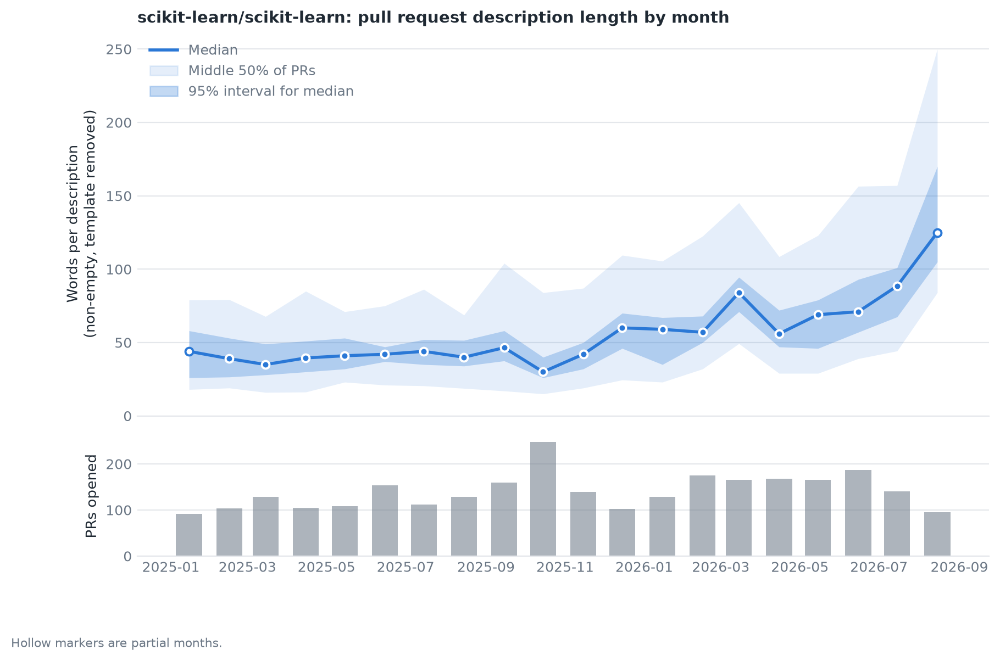
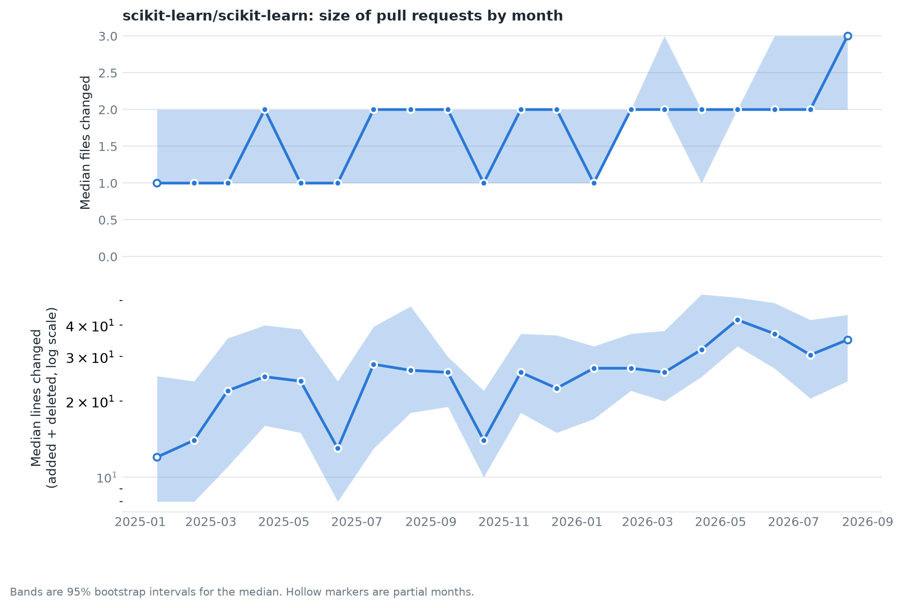
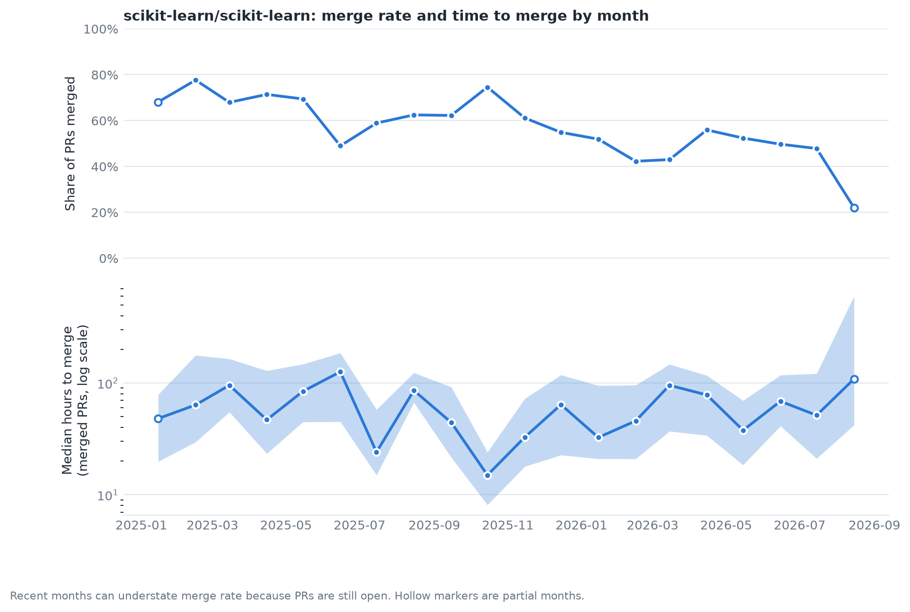
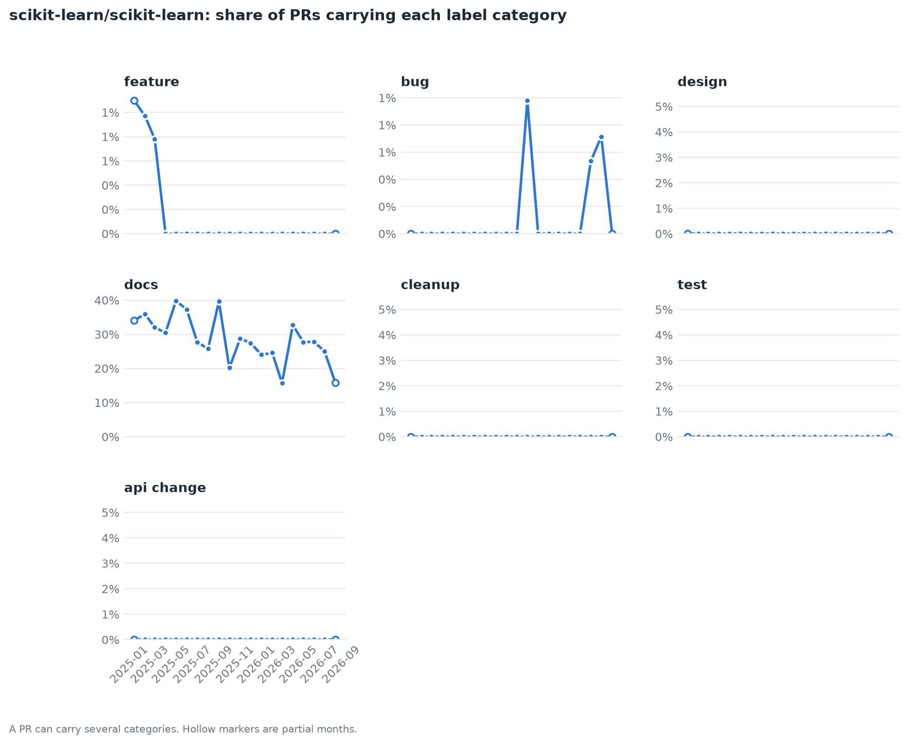
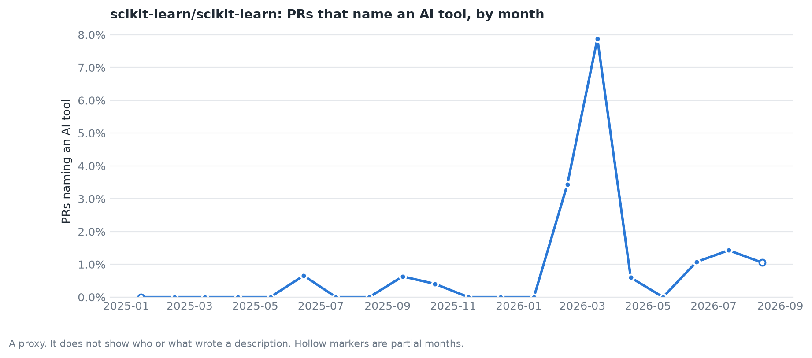

# Pull requests in scikit-learn/scikit-learn: description length, size, speed and labels

Window 2025-01-06 to 2026-08-17 (UTC). Data fetched 2026-11-19. prwords 3.0.0, generated 2026-11-26. Method fixed in advance in `docs/ANALYSIS_PLAN.md`.

## 1. Data

- Repository primary language: Python
- Pull requests opened in the window: 3,121
- Removed as bot accounts: 320
- Analysed: 2,801 PRs from 929 authors
- Merged: 1,599 (57.1%). Closed without merging: 1,003 (35.8%). Still open: 199
- Follow-up: merge outcomes use a 30-day follow-up. PRs without enough follow-up: 0
- Empty descriptions after cleaning: 2.9%

## 2. Did the PR template change?

Lines that appeared or disappeared across the window (full list in `template_audit.csv`):

| line                                                                   | first_month   | last_month   |   months |   peak_share | change_event   |
|:-----------------------------------------------------------------------|:--------------|:-------------|---------:|-------------:|:---------------|
| #### ai usage disclosure                                               | 2025-12       | 2026-08      |        9 |         0.6  | added          |
| i used ai assistance for:                                              | 2025-12       | 2026-08      |        9 |         0.57 | added          |
| documentation (including examples)                                     | 2025-12       | 2026-05      |        6 |         0.55 | added          |
| research and understanding                                             | 2025-12       | 2026-07      |        7 |         0.54 | added          |
| code generation (e.g., when writing an implementation or fixing a bug) | 2025-12       | 2026-05      |        6 |         0.53 | added          |
| test/benchmark generation                                              | 2025-12       | 2026-05      |        6 |         0.53 | added          |

Distinct template lines detected: 10.

## 3. First 28 days versus last 28 days

First window 2025-01-06 to 2025-02-02. Last window 2026-07-21 to 2026-08-17. Ratios are last median divided by first median. Bootstrap intervals, 2,000 resamples.

| Metric                                |   n first |   n last |   Median first |   Median last |   Ratio |   Ratio low |   Ratio high |       p |   Cliff's delta |
|:--------------------------------------|----------:|---------:|---------------:|--------------:|--------:|------------:|-------------:|--------:|----------------:|
| Description words (non-empty)         |        92 |      153 |          44    |        106    |    2.41 |        1.79 |         4.04 | 3.2e-13 |            0.56 |
| Files changed                         |        94 |      153 |           1    |          2    |    2    |        1    |         3    | 0.074   |            0.13 |
| Lines added                           |        94 |      153 |           7    |         22    |    3.14 |        1.78 |         5.38 | 0.00037 |            0.27 |
| Lines deleted                         |        94 |      153 |           2    |          4    |    2    |        0.8  |         4    | 0.15    |            0.11 |
| Net lines (added minus deleted)       |        94 |      153 |           3.5  |         13    |    3.71 |        2.2  |        13.02 | 0.00028 |            0.28 |
| Lines changed (added plus deleted)    |        94 |      153 |          11    |         30    |    2.73 |        1.42 |         4.12 | 0.0022  |            0.23 |
| Hours from open to merge (merged PRs) |        65 |       49 |          49.81 |         65.55 |    1.32 |        0.39 |         4.71 | 0.54    |            0.07 |
| Commits                               |        94 |      153 |           3    |          2    |    0.67 |        0.5  |         1    | 0.16    |           -0.11 |
| Comments                              |        94 |      153 |           3    |          2    |    0.67 |        0.57 |         1    | 0.0084  |           -0.2  |
| Reviews                               |        94 |      153 |           1    |          0    |    0    |        0    |         1    | 4.5e-05 |           -0.3  |

| Measure                             |   n first |   n last | Share first   | Share last   |   Change (points) |       p |
|:------------------------------------|----------:|---------:|:--------------|:-------------|------------------:|--------:|
| Merged within follow-up period      |        94 |      153 | 58.5%         | 26.1%        |             -32.4 | 5.2e-07 |
| Closed without merging              |        94 |      153 | 29.8%         | 50.3%        |              20.5 | 0.0015  |
| Opened as draft                     |        94 |      153 | 3.2%          | 24.2%        |              21   | 4.4e-06 |
| From outside contributors           |        94 |      153 | 47.9%         | 71.9%        |              24   | 0.00023 |
| Has a kind or type label            |        94 |      153 | 0.0%          | 0.0%         |               0   | 1       |
| Description text repeated elsewhere |        94 |      153 | 9.6%          | 2.0%         |              -7.6 | 0.012   |
| Names an AI tool (disclosure)       |        94 |      153 | 0.0%          | 2.0%         |               2   | 0.29    |
| Label category: feature             |        94 |      153 | 1.1%          | 0.0%         |              -1.1 | 0.38    |
| Label category: bug                 |        94 |      153 | 0.0%          | 0.7%         |               0.7 | 1       |
| Label category: design              |        94 |      153 | 0.0%          | 0.0%         |               0   | 1       |
| Label category: docs                |        94 |      153 | 35.1%         | 17.6%        |             -17.5 | 0.0023  |
| Label category: cleanup             |        94 |      153 | 0.0%          | 0.0%         |               0   | 1       |
| Label category: test                |        94 |      153 | 0.0%          | 0.0%         |               0   | 1       |
| Label category: api_change          |        94 |      153 | 0.0%          | 0.0%         |               0   | 1       |

## 4. Monthly trends

Theil-Sen slope per month and Kendall tau over full months only.

| metric                     |   months |   slope_per_month |   slope_ci_low |   slope_ci_high |     tau |       p |
|:---------------------------|---------:|------------------:|---------------:|----------------:|--------:|--------:|
| median_words               |       18 |             2.308 |          1.5   |           3.2   |   0.695 |   0     |
| median_files_changed       |       18 |            -0     |         -0     |           0.067 |   0.457 |   0.025 |
| median_additions           |       18 |             0.875 |          0.5   |           1.357 |   0.63  |   0     |
| median_deletions           |       18 |            -0     |         -0     |           0.083 |   0.158 |   0.409 |
| median_churn               |       18 |             0.833 |          0.333 |           1.444 |   0.558 |   0.001 |
| median_hours_to_merge      |       18 |            -0.826 |         -4.263 |           2.277 |  -0.098 |   0.601 |
| merge_rate                 |       18 |            -0.015 |         -0.023 |          -0.009 |  -0.569 |   0.001 |
| share_outside_contributors |       18 |            -0.001 |         -0.009 |           0.008 |  -0.072 |   0.709 |
| share_ai_disclosed         |       18 |             0     |         -0     |           0.001 |   0.405 |   0.03  |
| median_comments            |       18 |            -0     |         -0.1   |          -0     |  -0.421 |   0.032 |
| median_reviews             |       18 |            -0     |         -0.071 |          -0     |  -0.612 |   0.003 |
| share_feature              |       18 |            -0     |         -0     |          -0     |  -0.464 |   0.021 |
| share_bug                  |       18 |            -0     |         -0     |          -0     |   0.397 |   0.045 |
| share_design               |       18 |            -0     |         -0     |          -0     | nan     | nan     |
| share_docs                 |       18 |            -0.006 |         -0.014 |          -0     |  -0.359 |   0.039 |
| share_cleanup              |       18 |            -0     |         -0     |          -0     | nan     | nan     |
| share_test                 |       18 |            -0     |         -0     |          -0     | nan     | nan     |
| share_api_change           |       18 |            -0     |         -0     |          -0     | nan     | nan     |

## 5. Labels

Share of PRs with a kind or type label: 0.0% overall. Label coverage by month is in `monthly_summary.csv` (`share_has_kind_label`).

| category            |   n_prs |   share |   median_words |   median_files |   median_churn |   merge_rate |   median_hours_to_merge |   share_ai_disclosed |
|:--------------------|--------:|--------:|---------------:|---------------:|---------------:|-------------:|------------------------:|---------------------:|
| feature             |       3 |   0.001 |             40 |              5 |            131 |        1     |                1591.1   |                0     |
| bug                 |       3 |   0.001 |             56 |              2 |             10 |        1     |                  21.109 |                0     |
| design              |       0 |   0     |            nan |            nan |            nan |      nan     |                 nan     |              nan     |
| docs                |     789 |   0.282 |             40 |              1 |             10 |        0.629 |                  41.283 |                0.003 |
| cleanup             |       0 |   0     |            nan |            nan |            nan |      nan     |                 nan     |              nan     |
| test                |       0 |   0     |            nan |            nan |            nan |      nan     |                 nan     |              nan     |
| api_change          |       0 |   0     |            nan |            nan |            nan |      nan     |                 nan     |              nan     |
| (no category label) |    2006 |   0.716 |             61 |              2 |             37 |        0.547 |                  58.619 |                0.013 |

Cross-check against the repository's own size labels (coverage 0.8%, Spearman rho between size label and lines changed 0.96):

| size_label   |   n_prs |   median_churn |   p10_churn |   p90_churn |
|:-------------|--------:|---------------:|------------:|------------:|
| XS           |       1 |              1 |           1 |           1 |
| S            |       4 |             22 |          22 |          34 |
| M            |       7 |            110 |          84 |         164 |
| L            |       2 |            340 |         265 |         416 |
| XL           |       8 |            776 |         558 |        1993 |

## 6. Are PRs with signs of AI involvement smaller or larger?

Authorship is not observable. The proxy is `ai_disclosed`, defined in the analysis plan: 28 PRs (1.00%). 28 disclosed PRs are listed in `ai_disclosure_samples.csv` for manual audit.

### ai_disclosed

**Verdict: not testable.** Too few exposed PRs.

Pattern: lines changed: not estimated; files changed: not estimated; lines added: not estimated; lines deleted: not estimated; hours to merge: not estimated.

Not estimated: fewer than 30 exposed PRs (exposed PRs: 28).

### Robustness by tool (lines changed)

| tool        |   n exposed | status                    |
|:------------|------------:|:--------------------------|
| unspecified |          27 | fewer than 30 exposed PRs |
| claude      |           1 | fewer than 30 exposed PRs |

### File type check

Not run. Use `--file-check N` to sample N exposed PRs and matching unexposed PRs.

## 7. Other checks

- Outside contributors: 60.1% of PRs overall.
- Top 10 authors opened 33.3% of PRs.
- PRs whose description text is repeated elsewhere (10 or more words): 3.7%.

## 8. Limitations

- Word count and size describe PRs, not who wrote them. Proxies for AI involvement are noisy and omit undisclosed use.
- Added and deleted lines include generated or vendored files unless the project avoids committing them.
- Disclosure mostly captures tools that add attribution by default, so it is tool-skewed.
- Template removal is heuristic. Check `template_audit.csv`.
- One repository cannot support general claims. See the plan for replication.
- Months at the edges of the window are partial and are excluded from trend tests.

