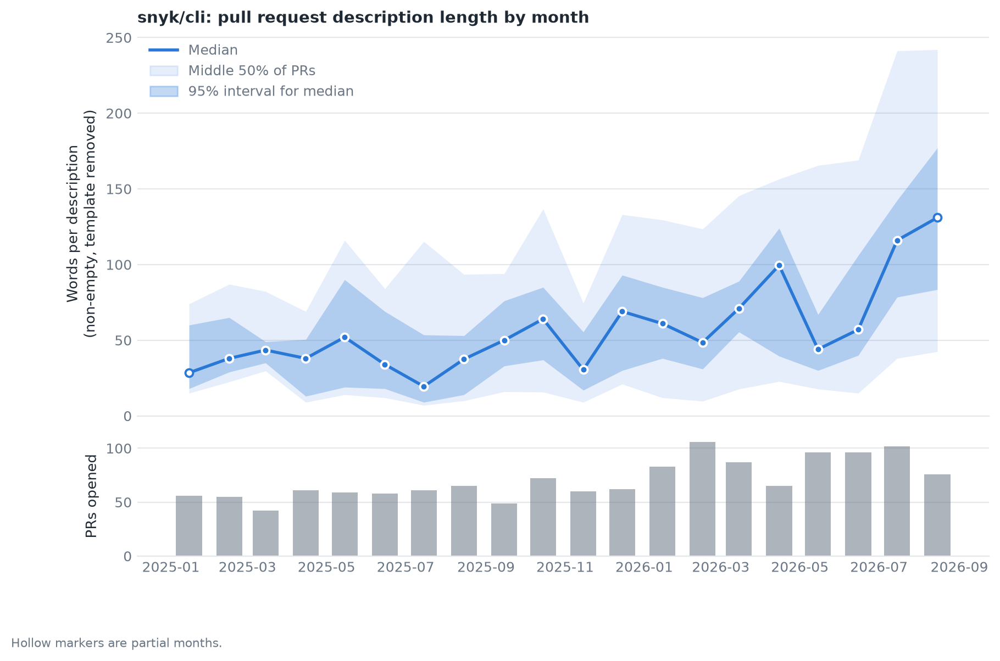
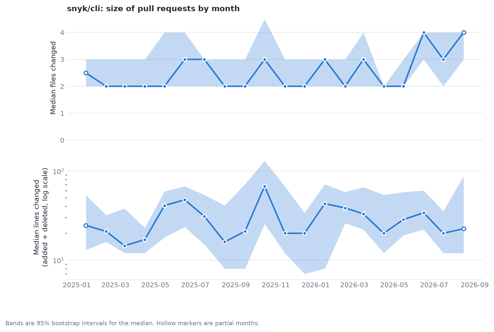
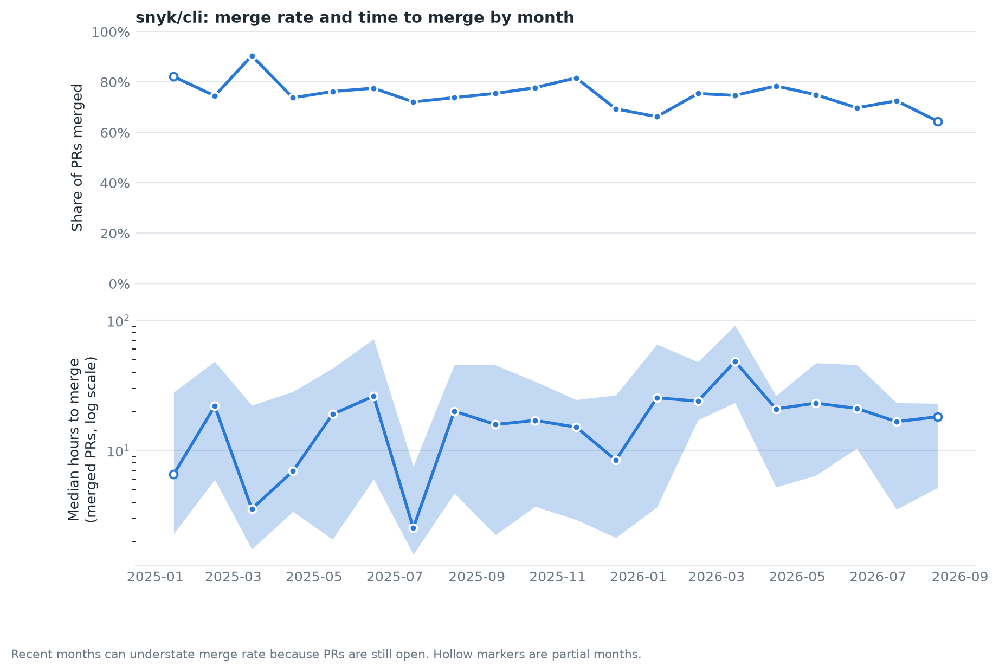
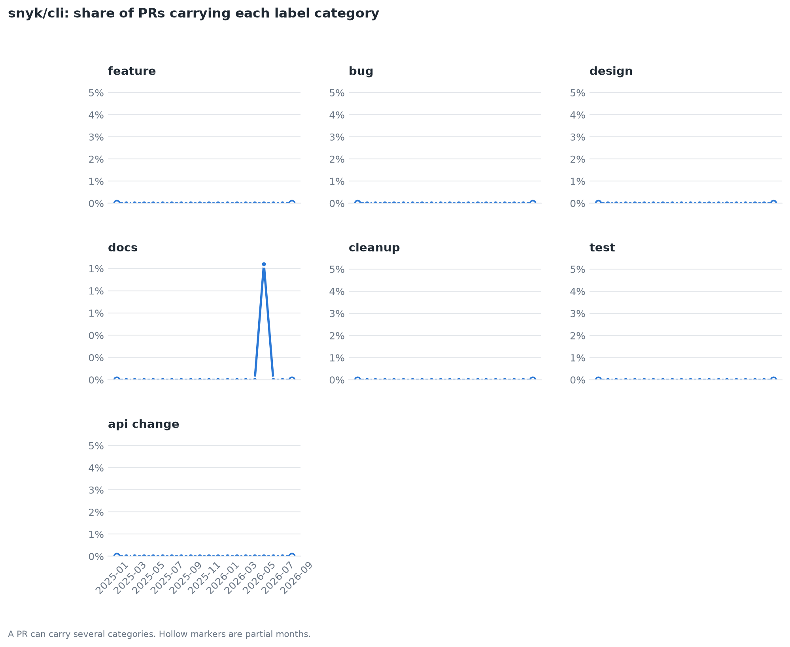
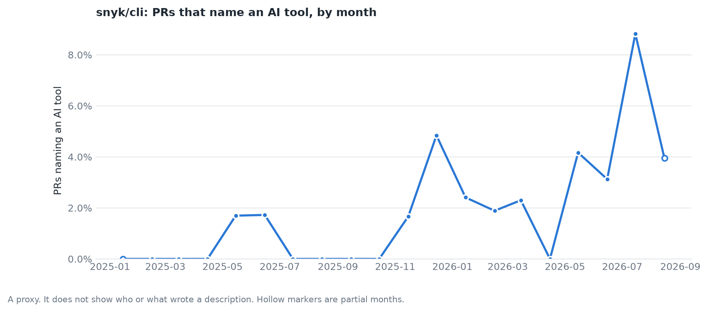
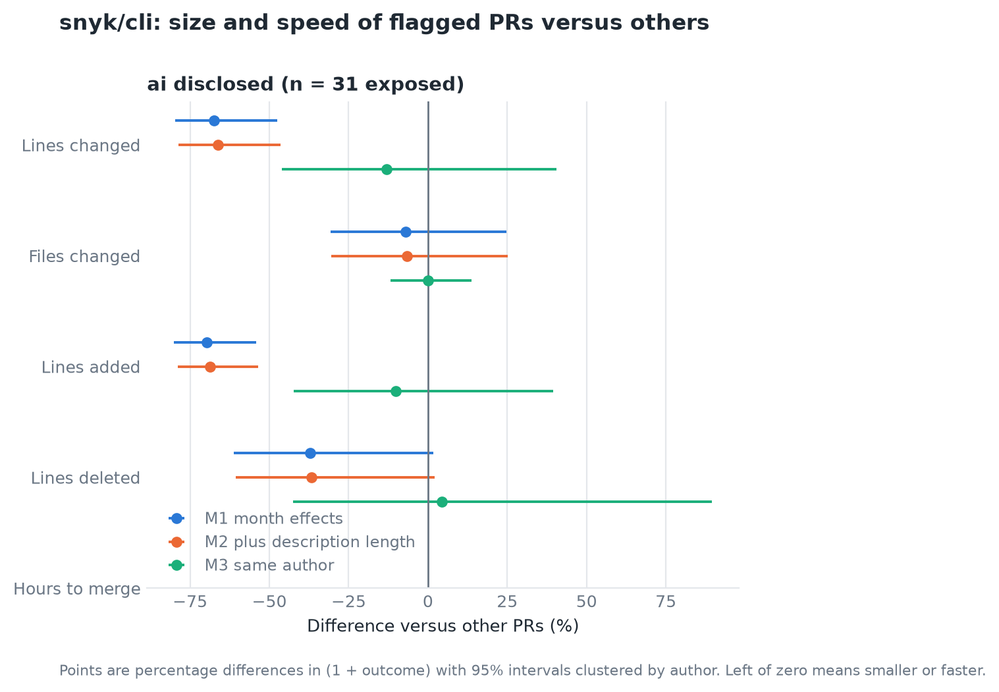

# Pull requests in snyk/cli: description length, size, speed and labels

Window 2025-01-06 to 2026-08-17 (UTC). Data fetched 2026-11-20. prwords 3.0.0, generated 2026-11-26. Method fixed in advance in `docs/ANALYSIS_PLAN.md`.

## 1. Data

- Repository primary language: TypeScript
- Pull requests opened in the window: 1,497
- Removed as bot accounts: 86
- Analysed: 1,411 PRs from 124 authors
- Merged: 1,050 (74.4%). Closed without merging: 361 (25.6%). Still open: 0
- Follow-up: merge outcomes use a 30-day follow-up. PRs without enough follow-up: 0
- Empty descriptions after cleaning: 16.7%

## 2. Did the PR template change?

Lines that appeared or disappeared across the window (full list in `template_audit.csv`):

| line                                                                     | first_month   | last_month   |   months |   peak_share | change_event   |
|:-------------------------------------------------------------------------|:--------------|:-------------|---------:|-------------:|:---------------|
| includes product update to be announced in the next stable release notes | 2025-03       | 2026-08      |       18 |         0.86 | added          |
| ## what's the product update that needs to be communicated to cli users? | 2025-04       | 2026-08      |       17 |         0.84 | added          |
| _what_ was changed, not _how_.                                           | 2025-06       | 2026-08      |       15 |         0.83 | added          |
| are release-note ready, emphasizing                                      | 2025-06       | 2026-08      |       15 |         0.83 | added          |
| commit messages                                                          | 2025-06       | 2026-08      |       15 |         0.83 | added          |

Distinct template lines detected: 16.

## 3. First 28 days versus last 28 days

First window 2025-01-06 to 2025-02-02. Last window 2026-07-21 to 2026-08-17. Ratios are last median divided by first median. Bootstrap intervals, 2,000 resamples.

| Metric                                |   n first |   n last |   Median first |   Median last |   Ratio |   Ratio low |   Ratio high |       p |   Cliff's delta |
|:--------------------------------------|----------:|---------:|---------------:|--------------:|--------:|------------:|-------------:|--------:|----------------:|
| Description words (non-empty)         |        50 |      108 |          28.5  |        121    |    4.25 |        2    |         6.6  | 9.7e-07 |            0.49 |
| Files changed                         |        56 |      126 |           2.5  |          4    |    1.6  |        1    |         2    | 0.24    |            0.11 |
| Lines added                           |        56 |      126 |          12.5  |         11.5  |    0.92 |        0.32 |         2.06 | 0.65    |            0.04 |
| Lines deleted                         |        56 |      126 |           8    |          6    |    0.75 |        0.52 |         2    | 0.82    |           -0.02 |
| Net lines (added minus deleted)       |        56 |      126 |           0    |          0    |  nan    |        0    |         0.58 | 0.7     |            0.03 |
| Lines changed (added plus deleted)    |        56 |      126 |          24.5  |         20.5  |    0.84 |        0.4  |         2.05 | 0.63    |            0.04 |
| Hours from open to merge (merged PRs) |        46 |       86 |           6.55 |         18.38 |    2.81 |        0.32 |         8.87 | 0.58    |            0.06 |
| Commits                               |        56 |      126 |           1    |          1    |    1    |        1    |         1    | 0.75    |            0.02 |
| Comments                              |        56 |      126 |           1    |          4    |    4    |        3    |         8    | 4.2e-24 |            0.93 |
| Reviews                               |        56 |      126 |           1    |          1    |    1    |        1    |         1    | 0.57    |            0.05 |

| Measure                             |   n first |   n last | Share first   | Share last   |   Change (points) |       p |
|:------------------------------------|----------:|---------:|:--------------|:-------------|------------------:|--------:|
| Merged within follow-up period      |        56 |      126 | 82.1%         | 67.5%        |             -14.7 | 0.049   |
| Closed without merging              |        56 |      126 | 17.9%         | 31.7%        |              13.9 | 0.071   |
| Opened as draft                     |        56 |      126 | 8.9%          | 7.9%         |              -1   | 0.78    |
| From outside contributors           |        56 |      126 | 85.7%         | 100.0%       |              14.3 | 5.6e-05 |
| Has a kind or type label            |        56 |      126 | 0.0%          | 0.0%         |               0   | 1       |
| Description text repeated elsewhere |        56 |      126 | 10.7%         | 17.5%        |               6.7 | 0.28    |
| Names an AI tool (disclosure)       |        56 |      126 | 0.0%          | 8.7%         |               8.7 | 0.019   |
| Label category: feature             |        56 |      126 | 0.0%          | 0.0%         |               0   | 1       |
| Label category: bug                 |        56 |      126 | 0.0%          | 0.0%         |               0   | 1       |
| Label category: design              |        56 |      126 | 0.0%          | 0.0%         |               0   | 1       |
| Label category: docs                |        56 |      126 | 0.0%          | 0.0%         |               0   | 1       |
| Label category: cleanup             |        56 |      126 | 0.0%          | 0.0%         |               0   | 1       |
| Label category: test                |        56 |      126 | 0.0%          | 0.0%         |               0   | 1       |
| Label category: api_change          |        56 |      126 | 0.0%          | 0.0%         |               0   | 1       |

## 4. Monthly trends

Theil-Sen slope per month and Kendall tau over full months only.

| metric                     |   months |   slope_per_month |   slope_ci_low |   slope_ci_high |     tau |       p |
|:---------------------------|---------:|------------------:|---------------:|----------------:|--------:|--------:|
| median_words               |       18 |             2.45  |          0.722 |           4.667 |   0.433 |   0.012 |
| median_files_changed       |       18 |            -0     |         -0     |           0.071 |   0.293 |   0.141 |
| median_additions           |       18 |             0.333 |         -0.167 |           0.875 |   0.256 |   0.146 |
| median_deletions           |       18 |            -0.083 |         -0.25  |          -0     |  -0.253 |   0.168 |
| median_churn               |       18 |             0.25  |         -1.042 |           1.389 |   0.08  |   0.647 |
| median_hours_to_merge      |       18 |             0.549 |         -0.307 |           1.443 |   0.216 |   0.229 |
| merge_rate                 |       18 |            -0.002 |         -0.007 |           0.001 |  -0.163 |   0.369 |
| share_outside_contributors |       18 |             0.01  |          0.005 |           0.013 |   0.629 |   0     |
| share_ai_disclosed         |       18 |             0.002 |         -0     |           0.004 |   0.542 |   0.003 |
| median_comments            |       18 |             0.2   |         -0     |           0.333 |   0.448 |   0.016 |
| median_reviews             |       18 |            -0     |         -0     |          -0     | nan     | nan     |
| share_feature              |       18 |            -0     |         -0     |          -0     | nan     | nan     |
| share_bug                  |       18 |            -0     |         -0     |          -0     | nan     | nan     |
| share_design               |       18 |            -0     |         -0     |          -0     | nan     | nan     |
| share_docs                 |       18 |            -0     |         -0     |          -0     |   0.255 |   0.21  |
| share_cleanup              |       18 |            -0     |         -0     |          -0     | nan     | nan     |
| share_test                 |       18 |            -0     |         -0     |          -0     | nan     | nan     |
| share_api_change           |       18 |            -0     |         -0     |          -0     | nan     | nan     |

## 5. Labels

Share of PRs with a kind or type label: 0.0% overall. Label coverage by month is in `monthly_summary.csv` (`share_has_kind_label`).

| category            |   n_prs |   share |   median_words |   median_files |   median_churn |   merge_rate |   median_hours_to_merge |   share_ai_disclosed |
|:--------------------|--------:|--------:|---------------:|---------------:|---------------:|-------------:|------------------------:|---------------------:|
| feature             |       0 |   0     |            nan |            nan |            nan |      nan     |                 nan     |              nan     |
| bug                 |       0 |   0     |            nan |            nan |            nan |      nan     |                 nan     |              nan     |
| design              |       0 |   0     |            nan |            nan |            nan |      nan     |                 nan     |              nan     |
| docs                |       1 |   0.001 |             68 |              2 |              6 |        0     |                 nan     |                0     |
| cleanup             |       0 |   0     |            nan |            nan |            nan |      nan     |                 nan     |              nan     |
| test                |       0 |   0     |            nan |            nan |            nan |      nan     |                 nan     |              nan     |
| api_change          |       0 |   0     |            nan |            nan |            nan |      nan     |                 nan     |              nan     |
| (no category label) |    1410 |   0.999 |             52 |              2 |             27 |        0.745 |                  18.962 |                0.022 |

## 6. Are PRs with signs of AI involvement smaller or larger?

Authorship is not observable. The proxy is `ai_disclosed`, defined in the analysis plan: 31 PRs (2.20%). 31 disclosed PRs are listed in `ai_disclosure_samples.csv` for manual audit.

### ai_disclosed

**Verdict: no difference detected.** The same-month gap does not hold within the same author, so it reflects who discloses AI use, not the PRs themselves.

Pattern: lines changed: no clear difference; files changed: no clear difference; lines added: no clear difference; lines deleted: no clear difference; hours to merge: not estimated.

Within-author permutation p-value, lines changed: 0.6467.

| Outcome       | Model                      |    n |   n exposed |   Median exposed |   Median others | Difference (95% CI)     |       p |   p (Holm) |
|:--------------|:---------------------------|-----:|------------:|-----------------:|----------------:|:------------------------|--------:|-----------:|
| Lines changed | M1 month effects           | 1411 |          31 |               12 |              29 | -67.4% (-79.7 to -47.5) | 3.9e-06 |    1.2e-05 |
| Lines changed | M2 plus description length | 1411 |          31 |               12 |              29 | -66.3% (-78.7 to -46.5) | 4e-06   |    1.2e-05 |
| Lines changed | M3 same author             | 1411 |          31 |               12 |              29 | -13.0% (-46.1 to +40.4) | 0.57    |    1       |
| Files changed | M1 month effects           | 1411 |          31 |                4 |               2 | -7.1% (-30.7 to +24.7)  | 0.62    |    0.62    |
| Files changed | M2 plus description length | 1411 |          31 |                4 |               2 | -6.7% (-30.5 to +25.2)  | 0.64    |    0.64    |
| Files changed | M3 same author             | 1411 |          31 |                4 |               2 | +0.1% (-11.8 to +13.7)  | 0.99    |    1       |
| Lines added   | M1 month effects           | 1411 |          31 |                6 |              14 | -69.8% (-80.1 to -54.1) | 1.9e-08 |    7.6e-08 |
| Lines added   | M2 plus description length | 1411 |          31 |                6 |              14 | -68.7% (-78.9 to -53.5) | 8.2e-09 |    3.3e-08 |
| Lines added   | M3 same author             | 1411 |          31 |                6 |              14 | -10.2% (-42.2 to +39.5) | 0.63    |    1       |
| Lines deleted | M1 month effects           | 1411 |          31 |                6 |               6 | -37.2% (-61.2 to +1.7)  | 0.059   |    0.12    |
| Lines deleted | M2 plus description length | 1411 |          31 |                6 |               6 | -36.6% (-60.7 to +2.1)  | 0.061   |    0.12    |
| Lines deleted | M3 same author             | 1411 |          31 |                6 |               6 | +4.4% (-42.5 to +89.6)  | 0.89    |    1       |

### Robustness by tool (lines changed)

| tool        |   n exposed | status                    |
|:------------|------------:|:--------------------------|
| cursor      |           9 | fewer than 30 exposed PRs |
| unspecified |           8 | fewer than 30 exposed PRs |
| gemini      |           7 | fewer than 30 exposed PRs |
| claude      |           7 | fewer than 30 exposed PRs |

### File type check

Sample: 31 exposed and 31 unexposed PRs from the same months. 0 PRs with more than 100 files were excluded.

Share of changed lines by file type:

| group     |   n_prs | code   | tests   | docs   | config   | generated   | other   |   median_code_test_lines |
|:----------|--------:|:-------|:--------|:-------|:---------|:------------|:--------|-------------------------:|
| exposed   |      31 | 0.2%   | 68.3%   | 0.0%   | 10.0%    | 21.5%       | 0.0%    |                        0 |
| unexposed |      31 | 1.0%   | 36.7%   | 0.9%   | 0.6%     | 60.7%       | 0.0%    |                        6 |

Code and test lines only, same month: -91.0% (95% CI -97.1 to -71.6), p = 3.8e-05. This is a robustness check and does not change the verdict.

## 7. Other checks

- Outside contributors: 93.9% of PRs overall.
- Top 10 authors opened 54.4% of PRs.
- PRs whose description text is repeated elsewhere (10 or more words): 19.8%.

## 8. Limitations

- Word count and size describe PRs, not who wrote them. Proxies for AI involvement are noisy and omit undisclosed use.
- Added and deleted lines include generated or vendored files unless the project avoids committing them.
- Disclosure mostly captures tools that add attribution by default, so it is tool-skewed.
- Template removal is heuristic. Check `template_audit.csv`.
- One repository cannot support general claims. See the plan for replication.
- Months at the edges of the window are partial and are excluded from trend tests.

