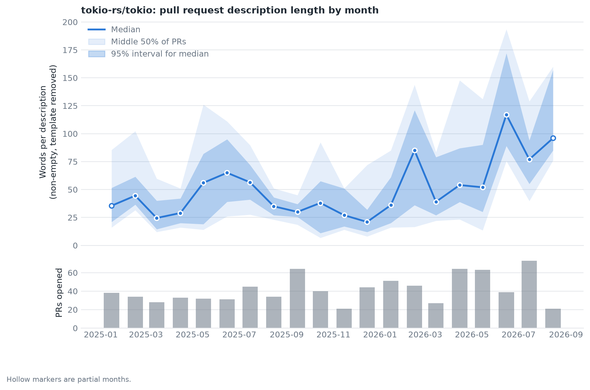
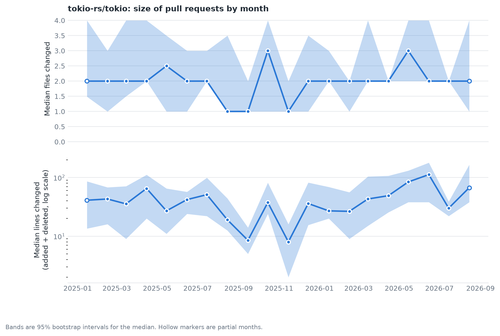
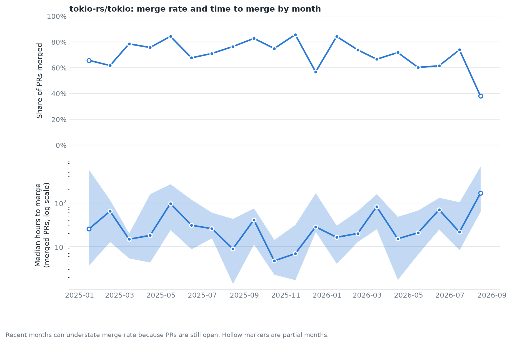
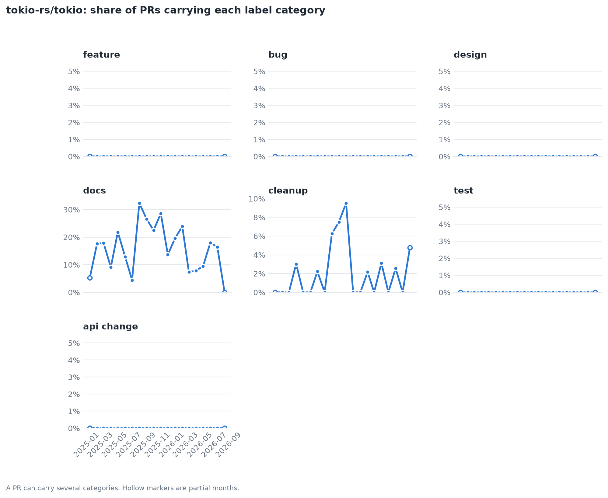
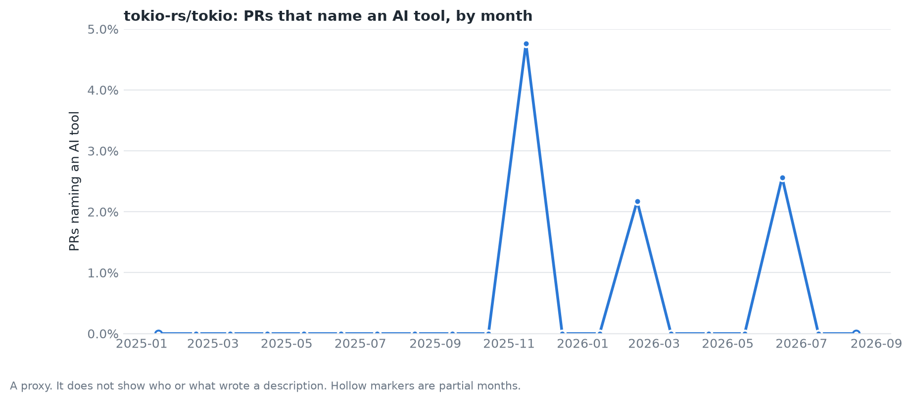

# Pull requests in tokio-rs/tokio: description length, size, speed and labels

Window 2025-01-06 to 2026-08-17 (UTC). Data fetched 2026-11-19. prwords 3.0.0, generated 2026-11-26. Method fixed in advance in `docs/ANALYSIS_PLAN.md`.

## 1. Data

- Repository primary language: Rust
- Pull requests opened in the window: 832
- Removed as bot accounts: 4
- Analysed: 828 PRs from 325 authors
- Merged: 590 (71.3%). Closed without merging: 176 (21.3%). Still open: 62
- Follow-up: merge outcomes use a 30-day follow-up. PRs without enough follow-up: 0
- Empty descriptions after cleaning: 3.0%

## 2. Did the PR template change?

No template line appeared or disappeared with a share of 50% or more. Template text was detected monthly and removed before counting words.

Distinct template lines detected: 2.

## 3. First 28 days versus last 28 days

First window 2025-01-06 to 2025-02-02. Last window 2026-07-21 to 2026-08-17. Ratios are last median divided by first median. Bootstrap intervals, 2,000 resamples.

| Metric                                |   n first |   n last |   Median first |   Median last |   Ratio |   Ratio low |   Ratio high |       p |   Cliff's delta |
|:--------------------------------------|----------:|---------:|---------------:|--------------:|--------:|------------:|-------------:|--------:|----------------:|
| Description words (non-empty)         |        38 |       40 |          35.5  |          97.5 |    2.75 |        1.82 |         5.56 | 0.00011 |            0.51 |
| Files changed                         |        39 |       40 |           2    |           2   |    1    |        0.33 |         2    | 0.091   |           -0.21 |
| Lines added                           |        39 |       40 |          34    |          30   |    0.88 |        0.37 |         3.63 | 0.79    |           -0.04 |
| Lines deleted                         |        39 |       40 |           4    |           8   |    2    |        0.62 |         5.33 | 0.44    |            0.1  |
| Net lines (added minus deleted)       |        39 |       40 |          12    |          12.5 |    1.04 |        0.18 |        10.83 | 0.82    |            0.03 |
| Lines changed (added plus deleted)    |        39 |       40 |          45    |          43   |    0.96 |        0.41 |         3.07 | 0.91    |           -0.02 |
| Hours from open to merge (merged PRs) |        25 |       23 |          25.56 |         139.7 |    5.47 |        0.16 |        33.2  | 0.43    |            0.13 |
| Commits                               |        39 |       40 |           2    |           1   |    0.5  |        0.33 |         1    | 0.15    |           -0.18 |
| Comments                              |        39 |       40 |           1    |           0.5 |    0.5  |        0    |         1    | 0.29    |           -0.13 |
| Reviews                               |        39 |       40 |           1    |           1   |    1    |        0.33 |         1    | 0.055   |           -0.24 |

| Measure                             |   n first |   n last | Share first   | Share last   |   Change (points) |     p |
|:------------------------------------|----------:|---------:|:--------------|:-------------|------------------:|------:|
| Merged within follow-up period      |        39 |       40 | 51.3%         | 50.0%        |              -1.3 | 1     |
| Closed without merging              |        39 |       40 | 30.8%         | 25.0%        |              -5.8 | 0.62  |
| Opened as draft                     |        39 |       40 | 5.1%          | 5.0%         |              -0.1 | 1     |
| From outside contributors           |        39 |       40 | 56.4%         | 77.5%        |              21.1 | 0.058 |
| Has a kind or type label            |        39 |       40 | 0.0%          | 0.0%         |               0   | 1     |
| Description text repeated elsewhere |        39 |       40 | 0.0%          | 0.0%         |               0   | 1     |
| Names an AI tool (disclosure)       |        39 |       40 | 0.0%          | 0.0%         |               0   | 1     |
| Label category: feature             |        39 |       40 | 0.0%          | 0.0%         |               0   | 1     |
| Label category: bug                 |        39 |       40 | 0.0%          | 0.0%         |               0   | 1     |
| Label category: design              |        39 |       40 | 0.0%          | 0.0%         |               0   | 1     |
| Label category: docs                |        39 |       40 | 5.1%          | 5.0%         |              -0.1 | 1     |
| Label category: cleanup             |        39 |       40 | 0.0%          | 2.5%         |               2.5 | 1     |
| Label category: test                |        39 |       40 | 0.0%          | 0.0%         |               0   | 1     |
| Label category: api_change          |        39 |       40 | 0.0%          | 0.0%         |               0   | 1     |

## 4. Monthly trends

Theil-Sen slope per month and Kendall tau over full months only.

| metric                     |   months |   slope_per_month |   slope_ci_low |   slope_ci_high |     tau |       p |
|:---------------------------|---------:|------------------:|---------------:|----------------:|--------:|--------:|
| median_words               |       18 |             1.708 |         -0.389 |           4.333 |   0.281 |   0.112 |
| median_files_changed       |       18 |            -0     |         -0     |          -0     |   0.08  |   0.681 |
| median_additions           |       18 |             0.278 |         -1.333 |           2.625 |   0.131 |   0.448 |
| median_deletions           |       18 |            -0     |         -0.167 |           0.154 |   0.021 |   0.907 |
| median_churn               |       18 |             0.5   |         -1.333 |           3.6   |   0.086 |   0.622 |
| median_hours_to_merge      |       18 |             0.027 |         -2.237 |           1.879 |   0.007 |   1     |
| merge_rate                 |       18 |            -0.004 |         -0.015 |           0.007 |  -0.19  |   0.293 |
| share_outside_contributors |       18 |             0.006 |         -0.006 |           0.022 |   0.176 |   0.33  |
| share_ai_disclosed         |       18 |            -0     |         -0     |          -0     |   0.257 |   0.195 |
| median_comments            |       18 |            -0     |         -0     |           0.071 |   0.156 |   0.425 |
| median_reviews             |       18 |            -0     |         -0     |           0.1   |   0.314 |   0.1   |
| share_feature              |       18 |            -0     |         -0     |          -0     | nan     | nan     |
| share_bug                  |       18 |            -0     |         -0     |          -0     | nan     | nan     |
| share_design               |       18 |            -0     |         -0     |          -0     | nan     | nan     |
| share_docs                 |       18 |            -0.003 |         -0.013 |           0.006 |  -0.059 |   0.765 |
| share_cleanup              |       18 |            -0     |         -0     |           0.002 |   0.078 |   0.676 |
| share_test                 |       18 |            -0     |         -0     |          -0     | nan     | nan     |
| share_api_change           |       18 |            -0     |         -0     |          -0     | nan     | nan     |

## 5. Labels

Share of PRs with a kind or type label: 0.0% overall. Label coverage by month is in `monthly_summary.csv` (`share_has_kind_label`).

| category            |   n_prs |   share |   median_words |   median_files |   median_churn |   merge_rate |   median_hours_to_merge |   share_ai_disclosed |
|:--------------------|--------:|--------:|---------------:|---------------:|---------------:|-------------:|------------------------:|---------------------:|
| feature             |       0 |   0     |          nan   |            nan |          nan   |      nan     |                 nan     |              nan     |
| bug                 |       0 |   0     |          nan   |            nan |          nan   |      nan     |                 nan     |              nan     |
| design              |       0 |   0     |          nan   |            nan |          nan   |      nan     |                 nan     |              nan     |
| docs                |     131 |   0.158 |           45   |              1 |            7   |        0.855 |                  13.832 |                0     |
| cleanup             |      16 |   0.019 |           39   |              1 |           14.5 |        1     |                  28.553 |                0     |
| test                |       0 |   0     |          nan   |            nan |          nan   |      nan     |                 nan     |              nan     |
| api_change          |       0 |   0     |          nan   |            nan |          nan   |      nan     |                 nan     |              nan     |
| (no category label) |     682 |   0.824 |           46.5 |              2 |           49   |        0.679 |                  26.725 |                0.004 |

## 6. Are PRs with signs of AI involvement smaller or larger?

Authorship is not observable. The proxy is `ai_disclosed`, defined in the analysis plan: 3 PRs (0.36%). 3 disclosed PRs are listed in `ai_disclosure_samples.csv` for manual audit.

### ai_disclosed

**Verdict: not testable.** Too few exposed PRs.

Pattern: lines changed: not estimated; files changed: not estimated; lines added: not estimated; lines deleted: not estimated; hours to merge: not estimated.

Not estimated: fewer than 30 exposed PRs (exposed PRs: 3).

### Robustness by tool (lines changed)

| tool        |   n exposed | status                    |
|:------------|------------:|:--------------------------|
| unspecified |           3 | fewer than 30 exposed PRs |

### File type check

Not run. Use `--file-check N` to sample N exposed PRs and matching unexposed PRs.

## 7. Other checks

- Outside contributors: 57.4% of PRs overall.
- Top 10 authors opened 41.7% of PRs.
- PRs whose description text is repeated elsewhere (10 or more words): 0.6%.

## 8. Limitations

- Word count and size describe PRs, not who wrote them. Proxies for AI involvement are noisy and omit undisclosed use.
- Added and deleted lines include generated or vendored files unless the project avoids committing them.
- Disclosure mostly captures tools that add attribution by default, so it is tool-skewed.
- Template removal is heuristic. Check `template_audit.csv`.
- One repository cannot support general claims. See the plan for replication.
- Months at the edges of the window are partial and are excluded from trend tests.

