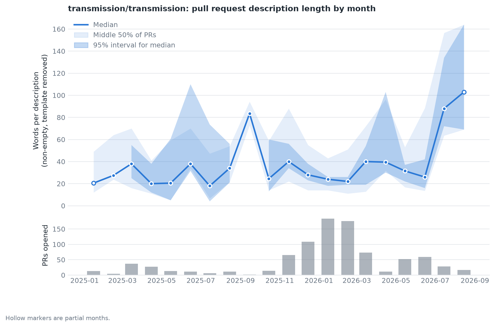
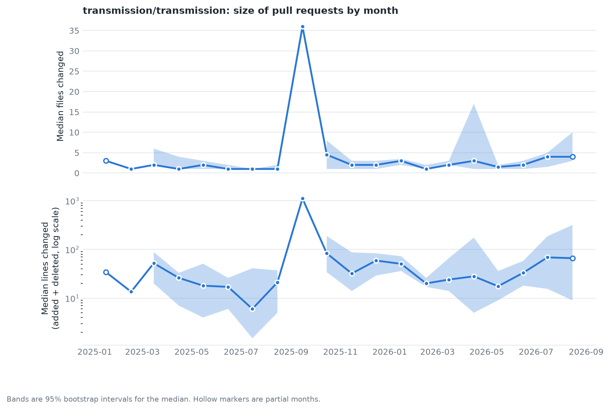
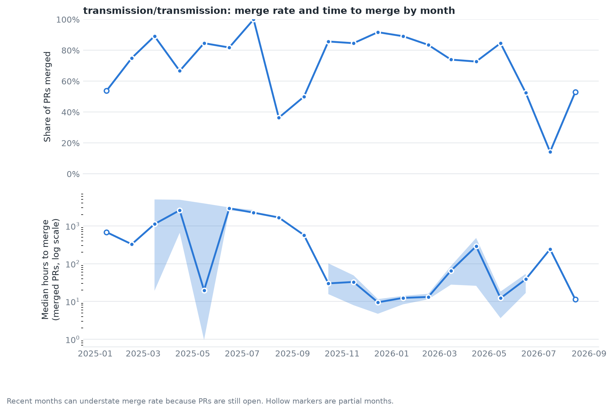
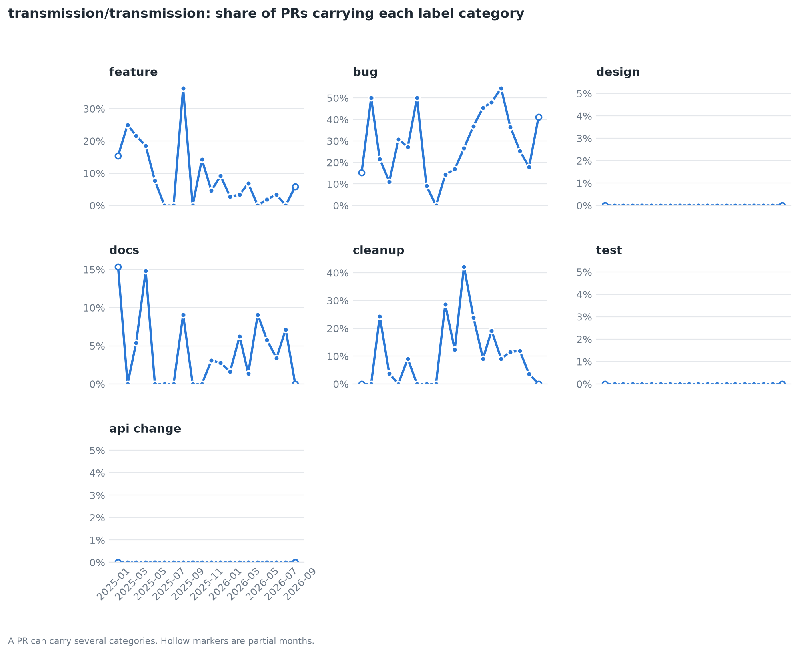
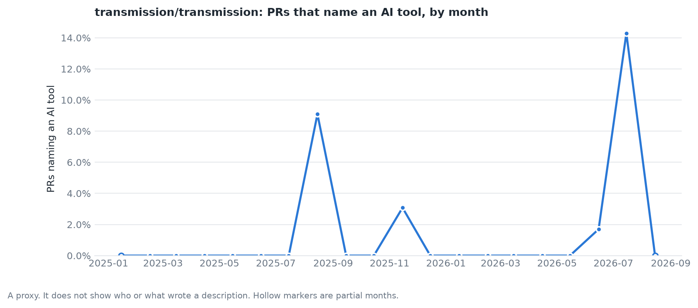

# Pull requests in transmission/transmission: description length, size, speed and labels

Window 2025-01-06 to 2026-08-17 (UTC). Data fetched 2026-11-20. prwords 3.0.0, generated 2026-11-26. Method fixed in advance in `docs/ANALYSIS_PLAN.md`.

## 1. Data

- Repository primary language: C++
- Pull requests opened in the window: 928
- Removed as bot accounts: 16
- Analysed: 912 PRs from 108 authors
- Merged: 720 (78.9%). Closed without merging: 93 (10.2%). Still open: 99
- Follow-up: merge outcomes use a 30-day follow-up. PRs without enough follow-up: 0
- Empty descriptions after cleaning: 8.1%

## 2. Did the PR template change?

No template line appeared or disappeared with a share of 50% or more. Template text was detected monthly and removed before counting words.

Distinct template lines detected: 0.

## 3. First 28 days versus last 28 days

First window 2025-01-06 to 2025-02-02. Last window 2026-07-21 to 2026-08-17. Ratios are last median divided by first median. Bootstrap intervals, 2,000 resamples.

| Metric                                |   n first |   n last |   Median first |   Median last |   Ratio |   Ratio low |   Ratio high |       p |   Cliff's delta |
|:--------------------------------------|----------:|---------:|---------------:|--------------:|--------:|------------:|-------------:|--------:|----------------:|
| Description words (non-empty)         |        12 |       20 |           20.5 |         96    |    4.68 |        1.54 |        11.89 | 0.00053 |            0.75 |
| Files changed                         |        13 |       20 |            3   |          4    |    1.33 |        0.83 |         4    | 0.072   |            0.37 |
| Lines added                           |        13 |       20 |           19   |         46    |    2.42 |        0.26 |        18.73 | 0.22    |            0.26 |
| Lines deleted                         |        13 |       20 |            6   |          5.5  |    0.92 |        0.18 |        13    | 0.8     |            0.06 |
| Net lines (added minus deleted)       |        13 |       20 |           13   |         35    |    2.69 |        0.21 |        24.25 | 0.27    |            0.23 |
| Lines changed (added plus deleted)    |        13 |       20 |           34   |         66.5  |    1.96 |        0.26 |        11.53 | 0.37    |            0.19 |
| Hours from open to merge (merged PRs) |         7 |       10 |          681   |         11.41 |    0.02 |        0    |         0.65 | 0.0068  |           -0.77 |
| Commits                               |        13 |       20 |            1   |          1    |    1    |        0.33 |         1    | 0.13    |           -0.26 |
| Comments                              |        13 |       20 |            2   |          0    |    0    |        0    |         0.5  | 0.1     |           -0.32 |
| Reviews                               |        13 |       20 |            1   |          0    |    0    |        0    |         0    | 0.0019  |           -0.57 |

| Measure                             |   n first |   n last | Share first   | Share last   |   Change (points) |     p |
|:------------------------------------|----------:|---------:|:--------------|:-------------|------------------:|------:|
| Merged within follow-up period      |        13 |       20 | 30.8%         | 50.0%        |              19.2 | 0.31  |
| Closed without merging              |        13 |       20 | 15.4%         | 20.0%        |               4.6 | 1     |
| Opened as draft                     |        13 |       20 | 7.7%          | 10.0%        |               2.3 | 1     |
| From outside contributors           |        13 |       20 | 69.2%         | 30.0%        |             -39.2 | 0.038 |
| Has a kind or type label            |        13 |       20 | 76.9%         | 70.0%        |              -6.9 | 1     |
| Description text repeated elsewhere |        13 |       20 | 0.0%          | 0.0%         |               0   | 1     |
| Names an AI tool (disclosure)       |        13 |       20 | 0.0%          | 10.0%        |              10   | 0.51  |
| Label category: feature             |        13 |       20 | 15.4%         | 5.0%         |             -10.4 | 0.55  |
| Label category: bug                 |        13 |       20 | 15.4%         | 40.0%        |              24.6 | 0.25  |
| Label category: design              |        13 |       20 | 0.0%          | 0.0%         |               0   | 1     |
| Label category: docs                |        13 |       20 | 15.4%         | 5.0%         |             -10.4 | 0.55  |
| Label category: cleanup             |        13 |       20 | 0.0%          | 0.0%         |               0   | 1     |
| Label category: test                |        13 |       20 | 0.0%          | 0.0%         |               0   | 1     |
| Label category: api_change          |        13 |       20 | 0.0%          | 0.0%         |               0   | 1     |

## 4. Monthly trends

Theil-Sen slope per month and Kendall tau over full months only.

| metric                     |   months |   slope_per_month |   slope_ci_low |   slope_ci_high |     tau |       p |
|:---------------------------|---------:|------------------:|---------------:|----------------:|--------:|--------:|
| median_words               |       18 |             0.438 |         -0.5   |           1.818 |   0.204 |   0.24  |
| median_files_changed       |       18 |             0.056 |         -0     |           0.167 |   0.293 |   0.114 |
| median_additions           |       18 |             0.692 |         -0.667 |           1.636 |   0.223 |   0.197 |
| median_deletions           |       18 |             0.083 |         -0.75  |           0.406 |   0.08  |   0.648 |
| median_churn               |       18 |             0.857 |         -1.5   |           3     |   0.176 |   0.33  |
| median_hours_to_merge      |       18 |           -32.617 |       -166.241 |           0.542 |  -0.333 |   0.057 |
| merge_rate                 |       18 |            -0.01  |         -0.03  |           0.006 |  -0.198 |   0.255 |
| share_outside_contributors |       18 |             0.005 |         -0.018 |           0.027 |   0.092 |   0.596 |
| share_ai_disclosed         |       18 |            -0     |         -0     |          -0     |   0.287 |   0.142 |
| median_comments            |       18 |            -0     |         -0     |          -0     |  -0.159 |   0.412 |
| median_reviews             |       18 |            -0.1   |         -0.167 |          -0     |  -0.575 |   0.002 |
| share_feature              |       18 |            -0.011 |         -0.017 |          -0     |  -0.412 |   0.019 |
| share_bug                  |       18 |             0.006 |         -0.01  |           0.026 |   0.118 |   0.495 |
| share_design               |       18 |            -0     |         -0     |          -0     | nan     | nan     |
| share_docs                 |       18 |             0.002 |         -0     |           0.005 |   0.283 |   0.113 |
| share_cleanup              |       18 |             0.003 |         -0.006 |           0.013 |   0.178 |   0.318 |
| share_test                 |       18 |            -0     |         -0     |          -0     | nan     | nan     |
| share_api_change           |       18 |            -0     |         -0     |          -0     | nan     | nan     |

## 5. Labels

Share of PRs with a kind or type label: 85.0% overall. Label coverage by month is in `monthly_summary.csv` (`share_has_kind_label`).

| category            |   n_prs |   share |   median_words |   median_files |   median_churn |   merge_rate |   median_hours_to_merge |   share_ai_disclosed |
|:--------------------|--------:|--------:|---------------:|---------------:|---------------:|-------------:|------------------------:|---------------------:|
| feature             |      56 |   0.061 |             39 |            3.5 |           82   |        0.661 |                  99.303 |                0     |
| bug                 |     303 |   0.332 |             26 |            1   |           15   |        0.904 |                  15.926 |                0.003 |
| design              |       0 |   0     |            nan |          nan   |          nan   |      nan     |                 nan     |              nan     |
| docs                |      37 |   0.041 |             14 |            1   |            6   |        0.946 |                  17.934 |                0.027 |
| cleanup             |     158 |   0.173 |             32 |            4   |          118.5 |        0.892 |                  15.028 |                0     |
| test                |       0 |   0     |            nan |          nan   |          nan   |      nan     |                 nan     |              nan     |
| api_change          |       0 |   0     |            nan |          nan   |          nan   |      nan     |                 nan     |              nan     |
| (no category label) |     362 |   0.397 |             33 |            2   |           37.5 |        0.655 |                  16.123 |                0.017 |

## 6. Are PRs with signs of AI involvement smaller or larger?

Authorship is not observable. The proxy is `ai_disclosed`, defined in the analysis plan: 8 PRs (0.88%). 8 disclosed PRs are listed in `ai_disclosure_samples.csv` for manual audit.

### ai_disclosed

**Verdict: not testable.** Too few exposed PRs.

Pattern: lines changed: not estimated; files changed: not estimated; lines added: not estimated; lines deleted: not estimated; hours to merge: not estimated.

Not estimated: fewer than 30 exposed PRs (exposed PRs: 8).

### Robustness by tool (lines changed)

| tool        |   n exposed | status                    |
|:------------|------------:|:--------------------------|
| unspecified |           7 | fewer than 30 exposed PRs |
| copilot     |           1 | fewer than 30 exposed PRs |

### File type check

Not run. Use `--file-check N` to sample N exposed PRs and matching unexposed PRs.

## 7. Other checks

- Outside contributors: 20.7% of PRs overall.
- Top 10 authors opened 85.0% of PRs.
- PRs whose description text is repeated elsewhere (10 or more words): 1.8%.

## 8. Limitations

- Word count and size describe PRs, not who wrote them. Proxies for AI involvement are noisy and omit undisclosed use.
- Added and deleted lines include generated or vendored files unless the project avoids committing them.
- Disclosure mostly captures tools that add attribution by default, so it is tool-skewed.
- Template removal is heuristic. Check `template_audit.csv`.
- One repository cannot support general claims. See the plan for replication.
- Months at the edges of the window are partial and are excluded from trend tests.

