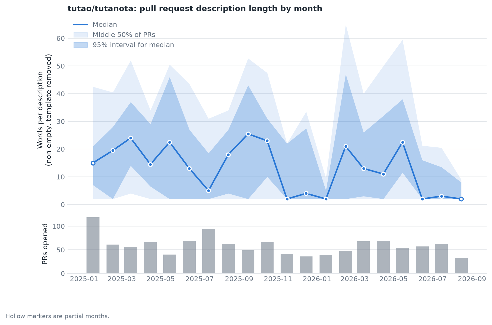
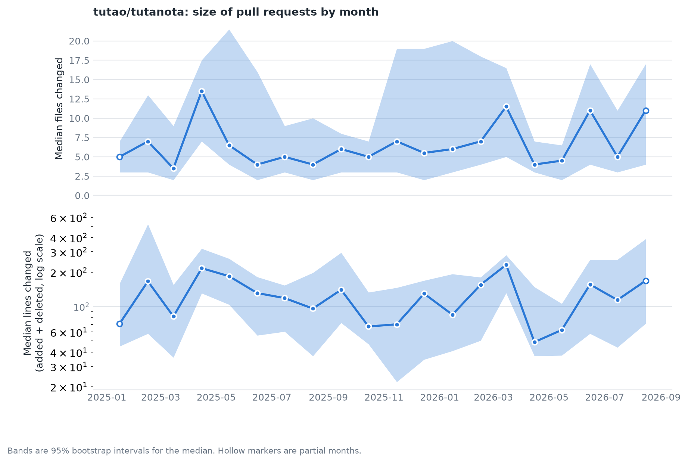
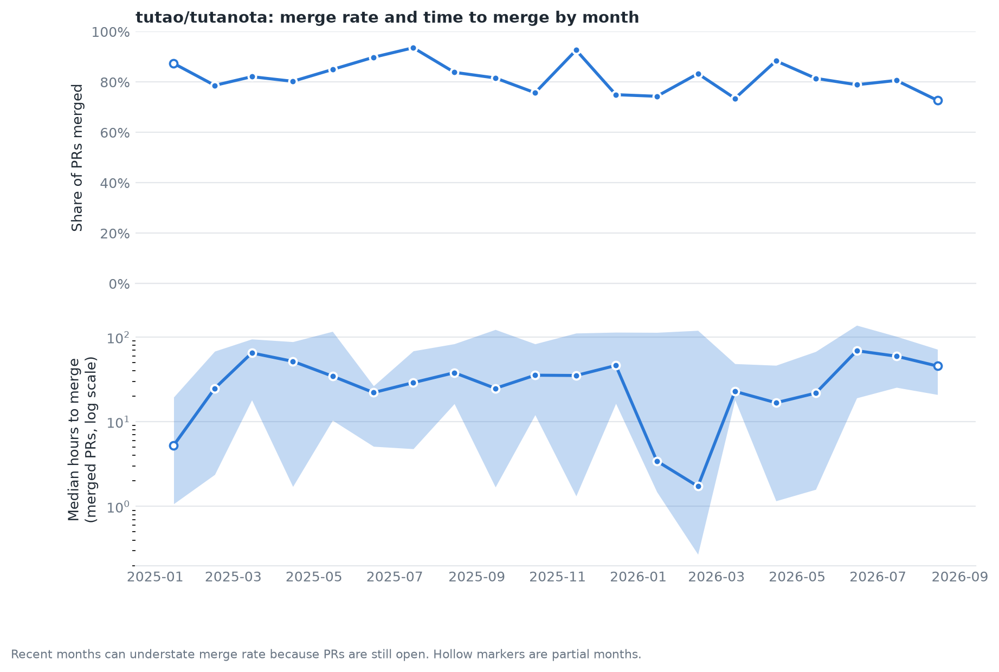
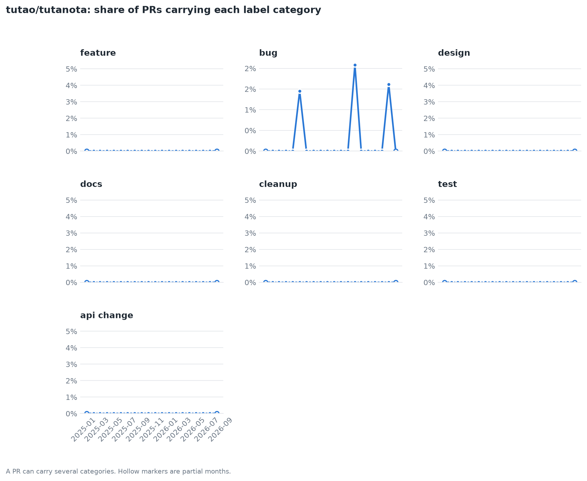
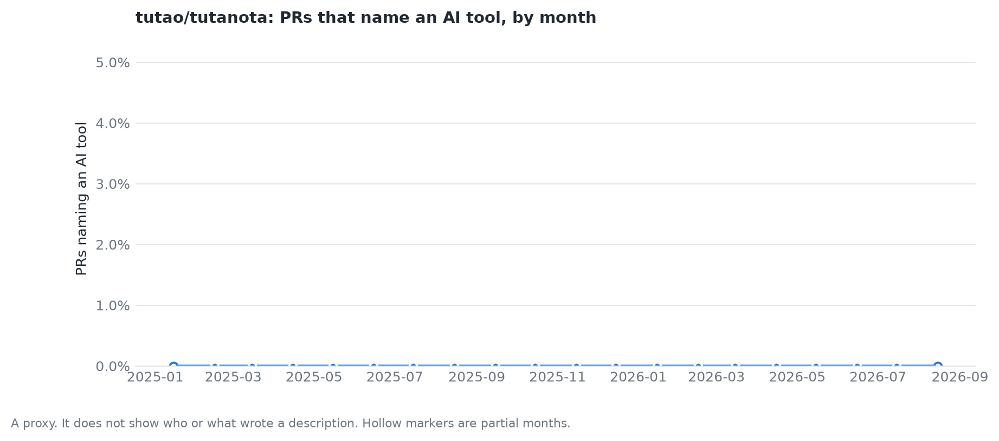

# Pull requests in tutao/tutanota: description length, size, speed and labels

Window 2025-01-06 to 2026-08-17 (UTC). Data fetched 2026-11-20. prwords 3.0.0, generated 2026-11-26. Method fixed in advance in `docs/ANALYSIS_PLAN.md`.

## 1. Data

- Repository primary language: TypeScript
- Pull requests opened in the window: 1,189
- Removed as bot accounts: 0
- Analysed: 1,189 PRs from 53 authors
- Merged: 985 (82.8%). Closed without merging: 193 (16.2%). Still open: 11
- Follow-up: merge outcomes use a 30-day follow-up. PRs without enough follow-up: 0
- Empty descriptions after cleaning: 39.8%

## 2. Did the PR template change?

No template line appeared or disappeared with a share of 50% or more. Template text was detected monthly and removed before counting words.

Distinct template lines detected: 0.

## 3. First 28 days versus last 28 days

First window 2025-01-06 to 2025-02-02. Last window 2026-07-21 to 2026-08-17. Ratios are last median divided by first median. Bootstrap intervals, 2,000 resamples.

| Metric                                |   n first |   n last |   Median first |   Median last |   Ratio |   Ratio low |   Ratio high |       p |   Cliff's delta |
|:--------------------------------------|----------:|---------:|---------------:|--------------:|--------:|------------:|-------------:|--------:|----------------:|
| Description words (non-empty)         |        74 |       28 |          15    |          2    |    0.13 |        0.1  |         0.73 | 0.017   |           -0.3  |
| Files changed                         |       121 |       50 |           5    |          7.5  |    1.5  |        0.71 |         3.33 | 0.37    |            0.09 |
| Lines added                           |       121 |       50 |          49    |        117.5  |    2.4  |        0.64 |         7.09 | 0.093   |            0.16 |
| Lines deleted                         |       121 |       50 |          27    |         48.5  |    1.8  |        0.48 |         5.5  | 0.22    |            0.12 |
| Net lines (added minus deleted)       |       121 |       50 |          11    |         55.5  |    5.05 |        0.66 |        12.1  | 0.023   |            0.22 |
| Lines changed (added plus deleted)    |       121 |       50 |          71    |        186    |    2.62 |        0.6  |         7.19 | 0.1     |            0.16 |
| Hours from open to merge (merged PRs) |       105 |       39 |           3.85 |         51.91 |   13.5  |        1.68 |        55.19 | 0.00091 |            0.36 |
| Commits                               |       121 |       50 |           1    |          1    |    1    |        1    |         2    | 0.64    |            0.04 |
| Comments                              |       121 |       50 |           0    |          0    |  nan    |      nan    |       nan    | 0.85    |           -0.01 |
| Reviews                               |       121 |       50 |           0    |          1    |  nan    |      nan    |       nan    | 0.23    |            0.1  |

| Measure                             |   n first |   n last | Share first   | Share last   |   Change (points) |      p |
|:------------------------------------|----------:|---------:|:--------------|:-------------|------------------:|-------:|
| Merged within follow-up period      |       121 |       50 | 85.1%         | 74.0%        |             -11.1 | 0.12   |
| Closed without merging              |       121 |       50 | 12.4%         | 18.0%        |               5.6 | 0.34   |
| Opened as draft                     |       121 |       50 | 0.0%          | 8.0%         |               8   | 0.0067 |
| From outside contributors           |       121 |       50 | 93.4%         | 100.0%       |               6.6 | 0.11   |
| Has a kind or type label            |       121 |       50 | 0.0%          | 0.0%         |               0   | 1      |
| Description text repeated elsewhere |       121 |       50 | 1.7%          | 0.0%         |              -1.7 | 1      |
| Names an AI tool (disclosure)       |       121 |       50 | 0.0%          | 0.0%         |               0   | 1      |
| Label category: feature             |       121 |       50 | 0.0%          | 0.0%         |               0   | 1      |
| Label category: bug                 |       121 |       50 | 0.0%          | 0.0%         |               0   | 1      |
| Label category: design              |       121 |       50 | 0.0%          | 0.0%         |               0   | 1      |
| Label category: docs                |       121 |       50 | 0.0%          | 0.0%         |               0   | 1      |
| Label category: cleanup             |       121 |       50 | 0.0%          | 0.0%         |               0   | 1      |
| Label category: test                |       121 |       50 | 0.0%          | 0.0%         |               0   | 1      |
| Label category: api_change          |       121 |       50 | 0.0%          | 0.0%         |               0   | 1      |

## 4. Monthly trends

Theil-Sen slope per month and Kendall tau over full months only.

| metric                     |   months |   slope_per_month |   slope_ci_low |   slope_ci_high |     tau |       p |
|:---------------------------|---------:|------------------:|---------------:|----------------:|--------:|--------:|
| median_words               |       18 |            -0.75  |         -1.591 |          -0     |  -0.319 |   0.068 |
| median_files_changed       |       18 |             0.038 |         -0.167 |           0.333 |   0.074 |   0.674 |
| median_additions           |       18 |            -1.917 |         -5     |           1.182 |  -0.19  |   0.293 |
| median_deletions           |       18 |            -0.821 |         -2.643 |           0.727 |  -0.216 |   0.229 |
| median_churn               |       18 |            -2.6   |         -8.667 |           3     |  -0.19  |   0.293 |
| median_hours_to_merge      |       18 |            -0.535 |         -2.551 |           2.042 |  -0.124 |   0.501 |
| merge_rate                 |       18 |            -0.003 |         -0.008 |           0.004 |  -0.176 |   0.33  |
| share_outside_contributors |       18 |            -0     |         -0     |          -0     |   0.333 |   0.101 |
| share_ai_disclosed         |       18 |            -0     |         -0     |          -0     | nan     | nan     |
| median_comments            |       18 |            -0     |         -0     |          -0     | nan     | nan     |
| median_reviews             |       18 |            -0     |         -0     |          -0     |   0.13  |   0.524 |
| share_feature              |       18 |            -0     |         -0     |          -0     | nan     | nan     |
| share_bug                  |       18 |            -0     |         -0     |          -0     |   0.187 |   0.346 |
| share_design               |       18 |            -0     |         -0     |          -0     | nan     | nan     |
| share_docs                 |       18 |            -0     |         -0     |          -0     | nan     | nan     |
| share_cleanup              |       18 |            -0     |         -0     |          -0     | nan     | nan     |
| share_test                 |       18 |            -0     |         -0     |          -0     | nan     | nan     |
| share_api_change           |       18 |            -0     |         -0     |          -0     | nan     | nan     |

## 5. Labels

Share of PRs with a kind or type label: 0.0% overall. Label coverage by month is in `monthly_summary.csv` (`share_has_kind_label`).

| category            |   n_prs |   share |   median_words |   median_files |   median_churn |   merge_rate |   median_hours_to_merge |   share_ai_disclosed |
|:--------------------|--------:|--------:|---------------:|---------------:|---------------:|-------------:|------------------------:|---------------------:|
| feature             |       0 |   0     |            nan |            nan |            nan |      nan     |                 nan     |                  nan |
| bug                 |       3 |   0.003 |             47 |              2 |             13 |        0.667 |                  57.953 |                    0 |
| design              |       0 |   0     |            nan |            nan |            nan |      nan     |                 nan     |                  nan |
| docs                |       0 |   0     |            nan |            nan |            nan |      nan     |                 nan     |                  nan |
| cleanup             |       0 |   0     |            nan |            nan |            nan |      nan     |                 nan     |                  nan |
| test                |       0 |   0     |            nan |            nan |            nan |      nan     |                 nan     |                  nan |
| api_change          |       0 |   0     |            nan |            nan |            nan |      nan     |                 nan     |                  nan |
| (no category label) |    1186 |   0.997 |             13 |              6 |            125 |        0.829 |                  23.932 |                    0 |

## 6. Are PRs with signs of AI involvement smaller or larger?

Authorship is not observable. The proxy is `ai_disclosed`, defined in the analysis plan: 0 PRs (0.00%). 0 disclosed PRs are listed in `ai_disclosure_samples.csv` for manual audit.

### ai_disclosed

**Verdict: not testable.** Too few exposed PRs.

Pattern: lines changed: not estimated; files changed: not estimated; lines added: not estimated; lines deleted: not estimated; hours to merge: not estimated.

Not estimated: fewer than 30 exposed PRs (exposed PRs: 0).

### Robustness by tool (lines changed)

No tool named in any disclosure.

### File type check

Not run. Use `--file-check N` to sample N exposed PRs and matching unexposed PRs.

## 7. Other checks

- Outside contributors: 99.2% of PRs overall.
- Top 10 authors opened 83.6% of PRs.
- PRs whose description text is repeated elsewhere (10 or more words): 0.3%.

## 8. Limitations

- Word count and size describe PRs, not who wrote them. Proxies for AI involvement are noisy and omit undisclosed use.
- Added and deleted lines include generated or vendored files unless the project avoids committing them.
- Disclosure mostly captures tools that add attribution by default, so it is tool-skewed.
- Template removal is heuristic. Check `template_audit.csv`.
- One repository cannot support general claims. See the plan for replication.
- Months at the edges of the window are partial and are excluded from trend tests.

