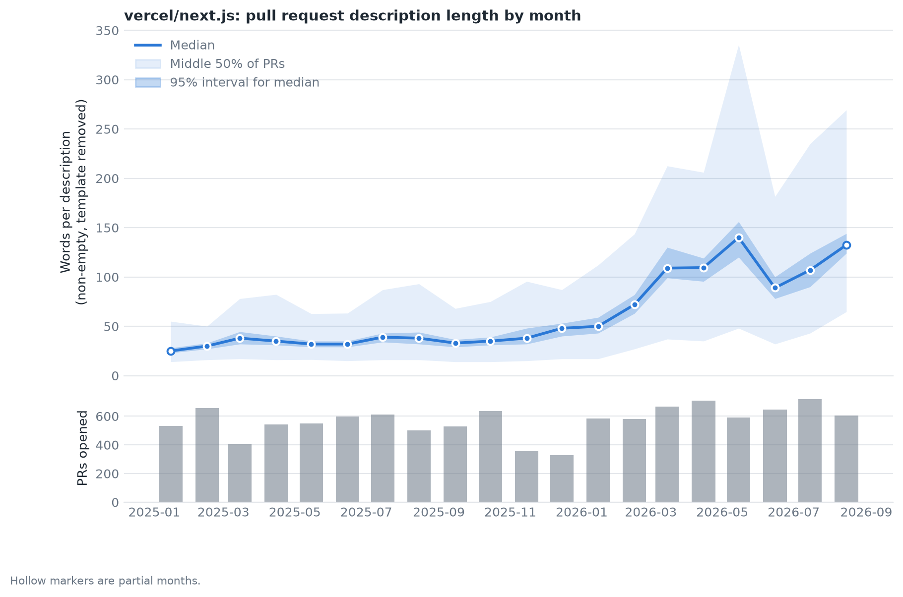
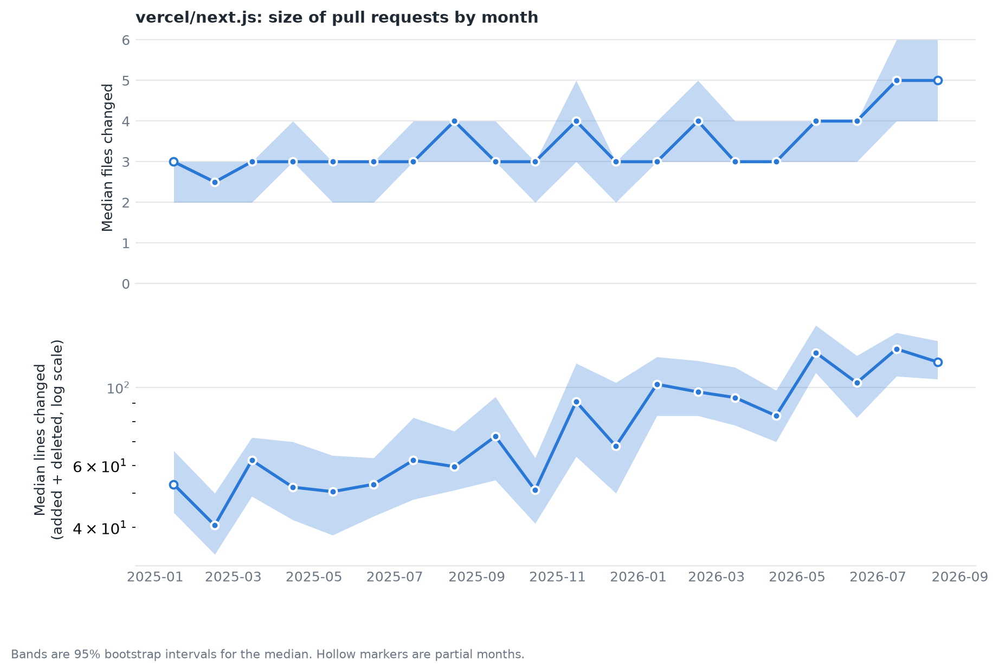
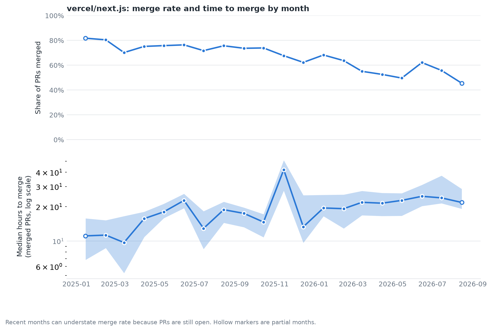
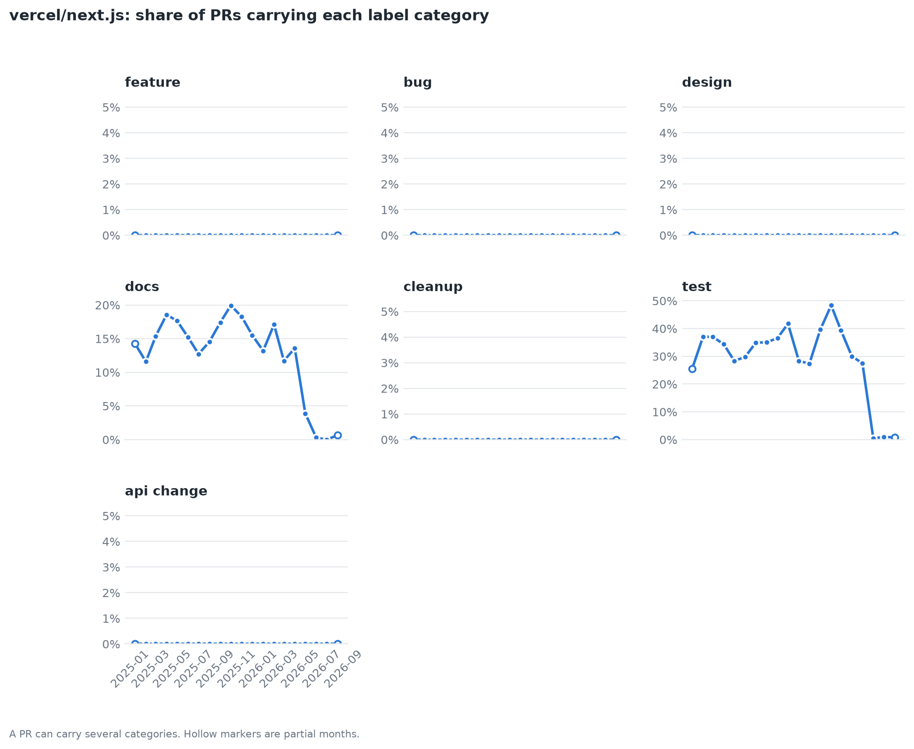
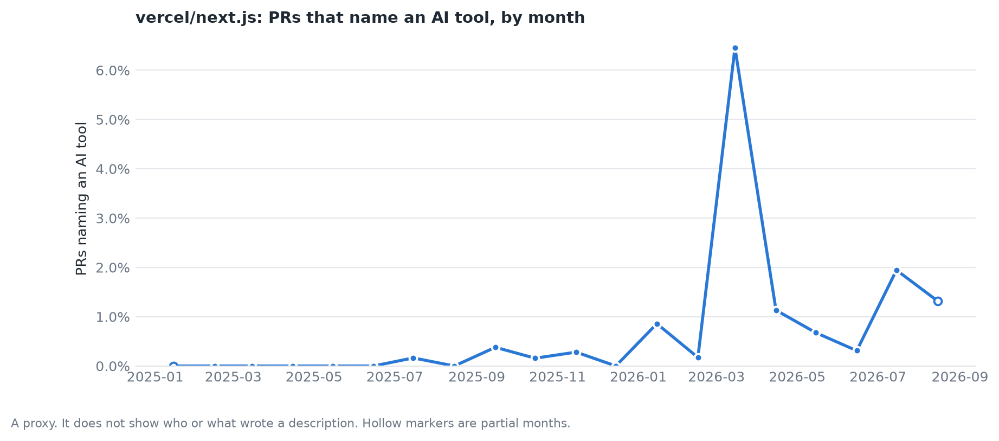
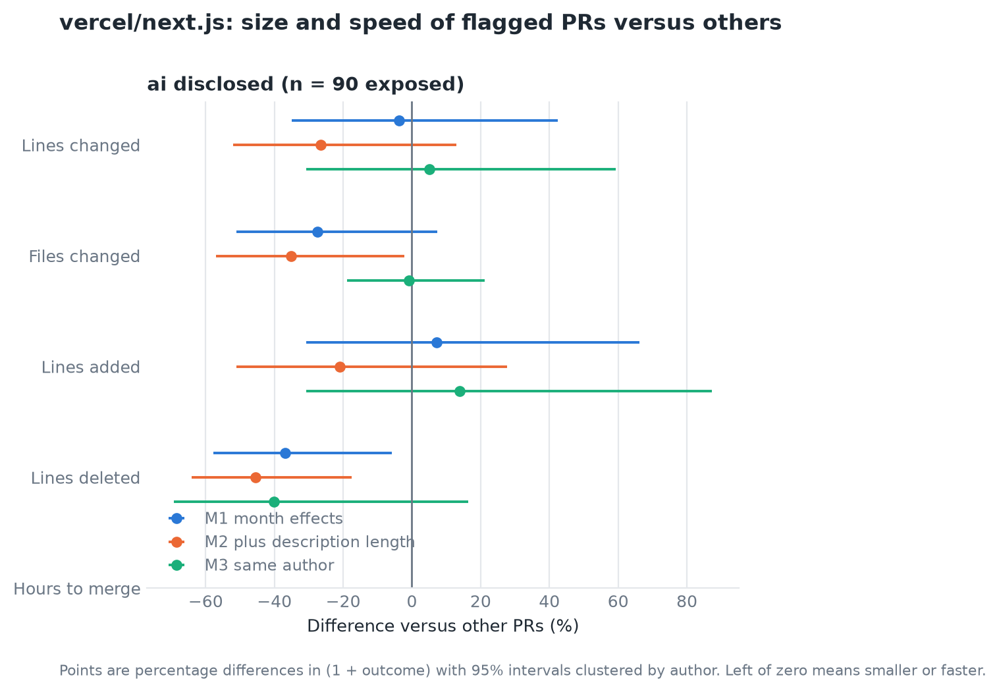

# Pull requests in vercel/next.js: description length, size, speed and labels

Window 2025-01-06 to 2026-08-17 (UTC). Data fetched 2026-11-19. prwords 3.0.0, generated 2026-11-26. Method fixed in advance in `docs/ANALYSIS_PLAN.md`.

## 1. Data

- Repository primary language: JavaScript
- Pull requests opened in the window: 13,069
- Removed as bot accounts: 1,722
- Analysed: 11,347 PRs from 1,581 authors
- Merged: 7,535 (66.4%). Closed without merging: 2,300 (20.3%). Still open: 1,512
- Follow-up: merge outcomes use a 30-day follow-up. PRs without enough follow-up: 0
- Empty descriptions after cleaning: 6.2%

## 2. Did the PR template change?

No template line appeared or disappeared with a share of 50% or more. Template text was detected monthly and removed before counting words.

Distinct template lines detected: 5.

## 3. First 28 days versus last 28 days

First window 2025-01-06 to 2025-02-02. Last window 2026-07-21 to 2026-08-17. Ratios are last median divided by first median. Bootstrap intervals, 2,000 resamples.

| Metric                                |   n first |   n last |   Median first |   Median last |   Ratio |   Ratio low |   Ratio high |       p |   Cliff's delta |
|:--------------------------------------|----------:|---------:|---------------:|--------------:|--------:|------------:|-------------:|--------:|----------------:|
| Description words (non-empty)         |       518 |      862 |           26   |        129    |    4.96 |        4.45 |         5.74 | 1.1e-81 |            0.61 |
| Files changed                         |       543 |      898 |            3   |          5    |    1.67 |        1.33 |         2.5  | 6.2e-12 |            0.21 |
| Lines added                           |       543 |      898 |           31   |         96    |    3.1  |        2.42 |         3.96 | 2.3e-24 |            0.32 |
| Lines deleted                         |       543 |      898 |           11   |         12    |    1.09 |        0.83 |         1.56 | 0.43    |            0.02 |
| Net lines (added minus deleted)       |       543 |      898 |            6   |         66    |   11    |        6.3  |        14.4  | 6.4e-31 |            0.36 |
| Lines changed (added plus deleted)    |       543 |      898 |           54   |        119.5  |    2.21 |        1.74 |         2.8  | 2.1e-17 |            0.27 |
| Hours from open to merge (merged PRs) |       443 |      452 |           11.7 |         21.16 |    1.81 |        1.23 |         2.89 | 0.00031 |            0.14 |
| Commits                               |       543 |      898 |            1   |          1    |    1    |        1    |         1    | 0.075   |           -0.05 |
| Comments                              |       543 |      898 |            3   |          2    |    0.67 |        0.67 |         1    | 4.6e-26 |           -0.31 |
| Reviews                               |       543 |      898 |            1   |          1    |    1    |        1    |         1    | 7.7e-11 |           -0.2  |

| Measure                             |   n first |   n last | Share first   | Share last   |   Change (points) |        p |
|:------------------------------------|----------:|---------:|:--------------|:-------------|------------------:|---------:|
| Merged within follow-up period      |       543 |      898 | 78.3%         | 47.6%        |             -30.7 | 9e-32    |
| Closed without merging              |       543 |      898 | 13.3%         | 22.7%        |               9.5 | 9e-06    |
| Opened as draft                     |       543 |      898 | 5.5%          | 25.9%        |              20.4 | 2.6e-25  |
| From outside contributors           |       543 |      898 | 53.2%         | 80.5%        |              27.3 | 1.9e-27  |
| Has a kind or type label            |       543 |      898 | 44.4%         | 1.0%         |             -43.4 | 2.1e-106 |
| Description text repeated elsewhere |       543 |      898 | 1.1%          | 1.7%         |               0.6 | 0.5      |
| Names an AI tool (disclosure)       |       543 |      898 | 0.0%          | 1.3%         |               1.3 | 0.0049   |
| Label category: feature             |       543 |      898 | 0.0%          | 0.0%         |               0   | 1        |
| Label category: bug                 |       543 |      898 | 0.0%          | 0.0%         |               0   | 1        |
| Label category: design              |       543 |      898 | 0.0%          | 0.0%         |               0   | 1        |
| Label category: docs                |       543 |      898 | 14.4%         | 0.4%         |             -13.9 | 7.3e-30  |
| Label category: cleanup             |       543 |      898 | 0.0%          | 0.0%         |               0   | 1        |
| Label category: test                |       543 |      898 | 25.6%         | 0.7%         |             -24.9 | 5.7e-56  |
| Label category: api_change          |       543 |      898 | 0.0%          | 0.0%         |               0   | 1        |

## 4. Monthly trends

Theil-Sen slope per month and Kendall tau over full months only.

| metric                     |   months |   slope_per_month |   slope_ci_low |   slope_ci_high |     tau |       p |
|:---------------------------|---------:|------------------:|---------------:|----------------:|--------:|--------:|
| median_words               |       18 |             4.529 |          1.833 |           7     |   0.718 |   0     |
| median_files_changed       |       18 |             0     |         -0     |           0.111 |   0.552 |   0.005 |
| median_additions           |       18 |             3.5   |          2.5   |           4.833 |   0.721 |   0     |
| median_deletions           |       18 |            -0     |         -0.167 |           0.25  |   0.062 |   0.729 |
| median_churn               |       18 |             4.3   |          3     |           5.611 |   0.708 |   0     |
| median_hours_to_merge      |       18 |             0.707 |          0.381 |           0.995 |   0.556 |   0.001 |
| merge_rate                 |       18 |            -0.015 |         -0.02  |          -0.01  |  -0.686 |   0     |
| share_outside_contributors |       18 |             0.011 |          0.005 |           0.017 |   0.569 |   0.001 |
| share_ai_disclosed         |       18 |             0.001 |          0     |           0.001 |   0.633 |   0     |
| median_comments            |       18 |            -0     |         -0.067 |          -0     |  -0.419 |   0.039 |
| median_reviews             |       18 |            -0     |         -0     |          -0     |  -0.108 |   0.594 |
| share_feature              |       18 |            -0     |         -0     |          -0     | nan     | nan     |
| share_bug                  |       18 |            -0     |         -0     |          -0     | nan     | nan     |
| share_design               |       18 |            -0     |         -0     |          -0     | nan     | nan     |
| share_docs                 |       18 |            -0.006 |         -0.012 |          -0.001 |  -0.373 |   0.032 |
| share_cleanup              |       18 |            -0     |         -0     |          -0     | nan     | nan     |
| share_test                 |       18 |            -0.005 |         -0.02  |           0.002 |  -0.216 |   0.229 |
| share_api_change           |       18 |            -0     |         -0     |          -0     | nan     | nan     |

## 5. Labels

Share of PRs with a kind or type label: 36.8% overall. Label coverage by month is in `monthly_summary.csv` (`share_has_kind_label`).

| category            |   n_prs |   share |   median_words |   median_files |   median_churn |   merge_rate |   median_hours_to_merge |   share_ai_disclosed |
|:--------------------|--------:|--------:|---------------:|---------------:|---------------:|-------------:|------------------------:|---------------------:|
| feature             |       0 |   0     |            nan |            nan |            nan |      nan     |                 nan     |              nan     |
| bug                 |       0 |   0     |            nan |            nan |            nan |      nan     |                 nan     |              nan     |
| design              |       0 |   0     |            nan |            nan |            nan |      nan     |                 nan     |              nan     |
| docs                |    1368 |   0.121 |             30 |              1 |             21 |        0.629 |                  23.175 |                0.002 |
| cleanup             |       0 |   0     |            nan |            nan |            nan |      nan     |                 nan     |              nan     |
| test                |    3252 |   0.287 |             63 |              7 |            158 |        0.704 |                  19.63  |                0.003 |
| api_change          |       0 |   0     |            nan |            nan |            nan |      nan     |                 nan     |              nan     |
| (no category label) |    6991 |   0.616 |             51 |              3 |             63 |        0.652 |                  17.664 |                0.011 |

## 6. Are PRs with signs of AI involvement smaller or larger?

Authorship is not observable. The proxy is `ai_disclosed`, defined in the analysis plan: 90 PRs (0.79%). 50 disclosed PRs are listed in `ai_disclosure_samples.csv` for manual audit.

### ai_disclosed

**Verdict: no difference detected.** The same-month interval for lines changed runs from -35.0% to +42.4%.

Pattern: lines changed: no clear difference; files changed: no clear difference; lines added: no clear difference; lines deleted: no clear difference; hours to merge: not estimated.

Within-author permutation p-value, lines changed: 0.4148.

| Outcome       | Model                      |     n |   n exposed |   Median exposed |   Median others | Difference (95% CI)     |      p |   p (Holm) |
|:--------------|:---------------------------|------:|------------:|-----------------:|----------------:|:------------------------|-------:|-----------:|
| Lines changed | M1 month effects           | 11347 |          90 |             85.5 |              78 | -3.8% (-35.0 to +42.4)  | 0.85   |      1     |
| Lines changed | M2 plus description length | 11347 |          90 |             85.5 |              78 | -26.5% (-52.1 to +12.8) | 0.16   |      0.32  |
| Lines changed | M3 same author             | 11347 |          90 |             85.5 |              78 | +5.1% (-30.7 to +59.2)  | 0.82   |      1     |
| Files changed | M1 month effects           | 11347 |          90 |              2   |               3 | -27.5% (-51.1 to +7.4)  | 0.11   |      0.33  |
| Files changed | M2 plus description length | 11347 |          90 |              2   |               3 | -35.2% (-57.0 to -2.2)  | 0.039  |      0.12  |
| Files changed | M3 same author             | 11347 |          90 |              2   |               3 | -0.9% (-18.8 to +21.1)  | 0.93   |      1     |
| Lines added   | M1 month effects           | 11347 |          90 |             62   |              50 | +7.2% (-30.8 to +66.1)  | 0.76   |      1     |
| Lines added   | M2 plus description length | 11347 |          90 |             62   |              50 | -20.9% (-51.0 to +27.8) | 0.34   |      0.34  |
| Lines added   | M3 same author             | 11347 |          90 |             62   |              50 | +13.9% (-30.7 to +87.3) | 0.61   |      1     |
| Lines deleted | M1 month effects           | 11347 |          90 |             10   |              11 | -37.0% (-57.8 to -5.8)  | 0.024  |      0.097 |
| Lines deleted | M2 plus description length | 11347 |          90 |             10   |              11 | -45.5% (-64.0 to -17.4) | 0.0042 |      0.017 |
| Lines deleted | M3 same author             | 11347 |          90 |             10   |              11 | -40.1% (-69.2 to +16.5) | 0.13   |      0.52  |

### Robustness by tool (lines changed)

| tool        |   n exposed | Same month              | Same author            | call                | status                    |
|:------------|------------:|:------------------------|:-----------------------|:--------------------|:--------------------------|
| unspecified |          75 | -14.3% (-39.5 to +21.4) | +2.0% (-32.2 to +53.4) | no clear difference | ok                        |
| claude      |          13 | n/a                     | n/a                    | nan                 | fewer than 30 exposed PRs |
| copilot     |           1 | n/a                     | n/a                    | nan                 | fewer than 30 exposed PRs |
| codex       |           1 | n/a                     | n/a                    | nan                 | fewer than 30 exposed PRs |

### File type check

Sample: 89 exposed and 87 unexposed PRs from the same months. 4 PRs with more than 100 files were excluded.

Share of changed lines by file type:

| group     |   n_prs | code   | tests   | docs   | config   | generated   | other   |   median_code_test_lines |
|:----------|--------:|:-------|:--------|:-------|:---------|:------------|:--------|-------------------------:|
| exposed   |      89 | 48.3%  | 43.9%   | 3.3%   | 0.8%     | 3.1%        | 0.7%    |                       63 |
| unexposed |      87 | 38.5%  | 41.3%   | 2.4%   | 1.0%     | 13.3%       | 3.5%    |                       97 |

Code and test lines only, same month: -20.3% (95% CI -54.2 to +38.7), p = 0.42. This is a robustness check and does not change the verdict.

## 7. Other checks

- Outside contributors: 60.4% of PRs overall.
- Top 10 authors opened 47.5% of PRs.
- PRs whose description text is repeated elsewhere (10 or more words): 1.4%.

## 8. Limitations

- Word count and size describe PRs, not who wrote them. Proxies for AI involvement are noisy and omit undisclosed use.
- Added and deleted lines include generated or vendored files unless the project avoids committing them.
- Disclosure mostly captures tools that add attribution by default, so it is tool-skewed.
- Template removal is heuristic. Check `template_audit.csv`.
- One repository cannot support general claims. See the plan for replication.
- Months at the edges of the window are partial and are excluded from trend tests.

