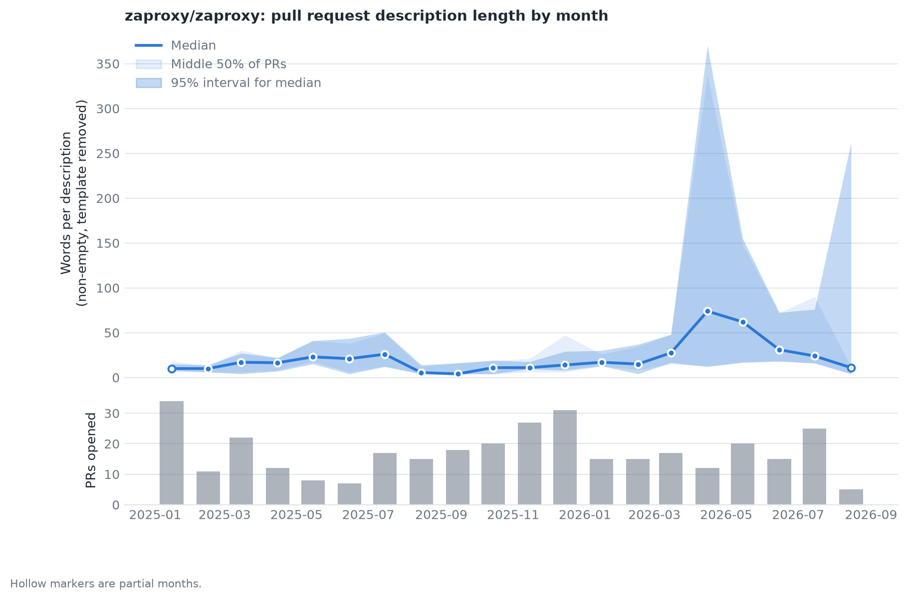
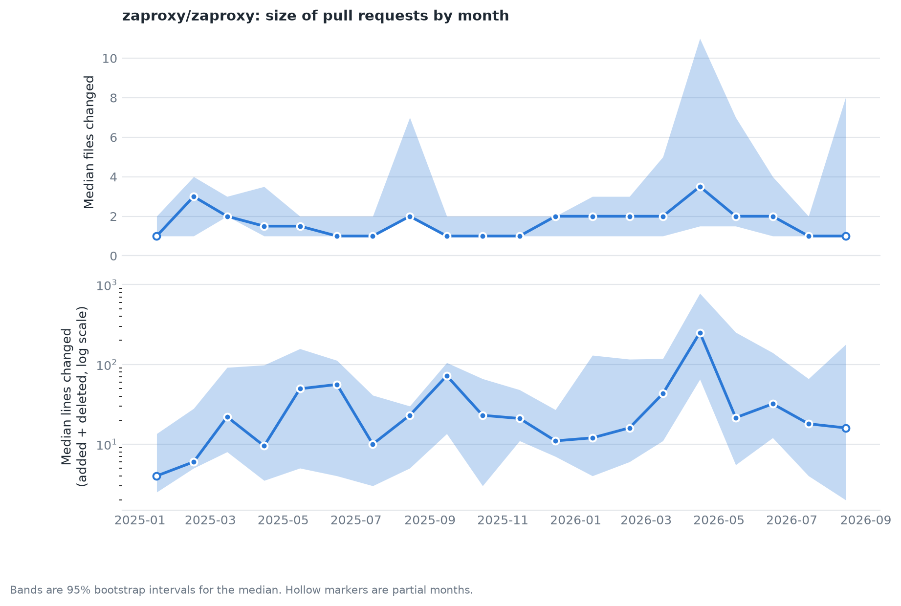
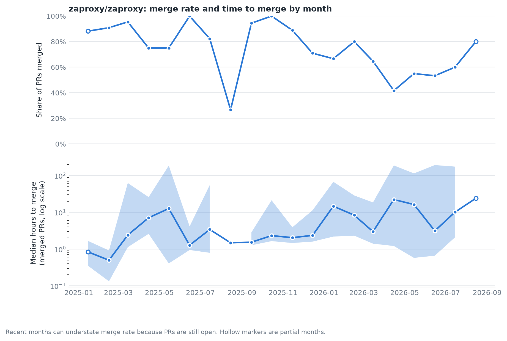
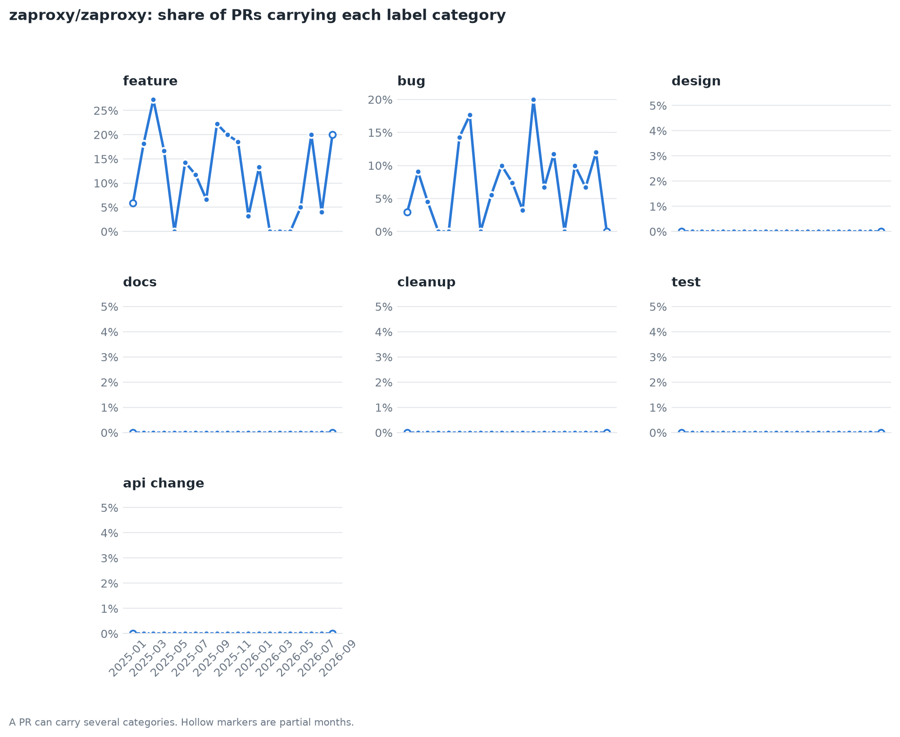
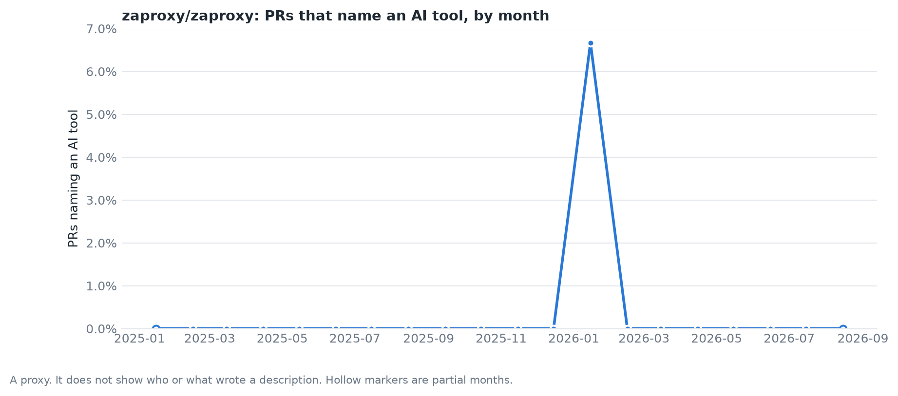

# Pull requests in zaproxy/zaproxy: description length, size, speed and labels

Window 2025-01-06 to 2026-08-17 (UTC). Data fetched 2026-11-20. prwords 3.0.0, generated 2026-11-26. Method fixed in advance in `docs/ANALYSIS_PLAN.md`.

## 1. Data

- Repository primary language: Java
- Pull requests opened in the window: 384
- Removed as bot accounts: 38
- Analysed: 346 PRs from 67 authors
- Merged: 260 (75.1%). Closed without merging: 64 (18.5%). Still open: 22
- Follow-up: merge outcomes use a 30-day follow-up. PRs without enough follow-up: 0
- Empty descriptions after cleaning: 15.3%

## 2. Did the PR template change?

No template line appeared or disappeared with a share of 50% or more. Template text was detected monthly and removed before counting words.

Distinct template lines detected: 0.

## 3. First 28 days versus last 28 days

First window 2025-01-06 to 2025-02-02. Last window 2026-07-21 to 2026-08-17. Ratios are last median divided by first median. Bootstrap intervals, 2,000 resamples.

| Metric                                |   n first |   n last |   Median first |   Median last |   Ratio |   Ratio low |   Ratio high |      p |   Cliff's delta |
|:--------------------------------------|----------:|---------:|---------------:|--------------:|--------:|------------:|-------------:|-------:|----------------:|
| Description words (non-empty)         |        30 |       14 |          10    |         51    |    5.1  |        0.92 |        12.7  | 0.03   |            0.41 |
| Files changed                         |        34 |       14 |           1    |          1    |    1    |        0.5  |         2    | 0.56   |           -0.1  |
| Lines added                           |        34 |       14 |           2.5  |          5.5  |    2.2  |        0.4  |        18.18 | 0.54   |            0.12 |
| Lines deleted                         |        34 |       14 |           1    |          4    |    4    |        1    |         7.25 | 0.09   |            0.31 |
| Net lines (added minus deleted)       |        34 |       14 |           0    |          0    |  nan    |        0    |         5    | 0.84   |            0.04 |
| Lines changed (added plus deleted)    |        34 |       14 |           4    |         11    |    2.75 |        0.38 |        18.4  | 0.33   |            0.18 |
| Hours from open to merge (merged PRs) |        30 |       10 |           0.83 |         47.68 |   57.18 |        1.46 |       428.74 | 0.0019 |            0.67 |
| Commits                               |        34 |       14 |           1    |          1    |    1    |        1    |         1.5  | 0.59   |            0.07 |
| Comments                              |        34 |       14 |           2    |          2.5  |    1.25 |        0.5  |         3    | 0.3    |            0.19 |
| Reviews                               |        34 |       14 |           2    |          2    |    1    |        0.5  |         1.5  | 0.98   |           -0.01 |

| Measure                             |   n first |   n last | Share first   | Share last   |   Change (points) |     p |
|:------------------------------------|----------:|---------:|:--------------|:-------------|------------------:|------:|
| Merged within follow-up period      |        34 |       14 | 88.2%         | 57.1%        |             -31.1 | 0.045 |
| Closed without merging              |        34 |       14 | 8.8%          | 7.1%         |              -1.7 | 1     |
| Opened as draft                     |        34 |       14 | 0.0%          | 0.0%         |               0   | 1     |
| From outside contributors           |        34 |       14 | 23.5%         | 64.3%        |              40.8 | 0.018 |
| Has a kind or type label            |        34 |       14 | 85.3%         | 92.9%        |               7.6 | 0.66  |
| Description text repeated elsewhere |        34 |       14 | 0.0%          | 0.0%         |               0   | 1     |
| Names an AI tool (disclosure)       |        34 |       14 | 0.0%          | 0.0%         |               0   | 1     |
| Label category: feature             |        34 |       14 | 5.9%          | 7.1%         |               1.3 | 1     |
| Label category: bug                 |        34 |       14 | 2.9%          | 0.0%         |              -2.9 | 1     |
| Label category: design              |        34 |       14 | 0.0%          | 0.0%         |               0   | 1     |
| Label category: docs                |        34 |       14 | 0.0%          | 0.0%         |               0   | 1     |
| Label category: cleanup             |        34 |       14 | 0.0%          | 0.0%         |               0   | 1     |
| Label category: test                |        34 |       14 | 0.0%          | 0.0%         |               0   | 1     |
| Label category: api_change          |        34 |       14 | 0.0%          | 0.0%         |               0   | 1     |

## 4. Monthly trends

Theil-Sen slope per month and Kendall tau over full months only.

| metric                     |   months |   slope_per_month |   slope_ci_low |   slope_ci_high |     tau |       p |
|:---------------------------|---------:|------------------:|---------------:|----------------:|--------:|--------:|
| median_words               |       18 |             1.333 |          0.071 |           3     |   0.375 |   0.031 |
| median_files_changed       |       18 |            -0     |         -0     |           0.056 |   0.085 |   0.654 |
| median_additions           |       18 |             0.417 |         -0.833 |           1.5   |   0.144 |   0.404 |
| median_deletions           |       18 |             0.15  |         -0     |           0.333 |   0.326 |   0.066 |
| median_churn               |       18 |             0.65  |         -1.167 |           2.25  |   0.17  |   0.324 |
| median_hours_to_merge      |       18 |             0.237 |          0.088 |           0.873 |   0.412 |   0.017 |
| merge_rate                 |       18 |            -0.023 |         -0.038 |          -0.009 |  -0.467 |   0.007 |
| share_outside_contributors |       18 |             0.01  |         -0     |           0.026 |   0.343 |   0.048 |
| share_ai_disclosed         |       18 |            -0     |         -0     |          -0     |   0.098 |   0.63  |
| median_comments            |       18 |            -0     |         -0     |           0.077 |   0.251 |   0.201 |
| median_reviews             |       18 |            -0     |         -0     |          -0     |  -0.086 |   0.673 |
| share_feature              |       18 |            -0.009 |         -0.016 |          -0     |  -0.308 |   0.079 |
| share_bug                  |       18 |             0.002 |         -0.004 |           0.008 |   0.168 |   0.34  |
| share_design               |       18 |            -0     |         -0     |          -0     | nan     | nan     |
| share_docs                 |       18 |            -0     |         -0     |          -0     | nan     | nan     |
| share_cleanup              |       18 |            -0     |         -0     |          -0     | nan     | nan     |
| share_test                 |       18 |            -0     |         -0     |          -0     | nan     | nan     |
| share_api_change           |       18 |            -0     |         -0     |          -0     | nan     | nan     |

## 5. Labels

Share of PRs with a kind or type label: 80.9% overall. Label coverage by month is in `monthly_summary.csv` (`share_has_kind_label`).

| category            |   n_prs |   share |   median_words |   median_files |   median_churn |   merge_rate |   median_hours_to_merge |   share_ai_disclosed |
|:--------------------|--------:|--------:|---------------:|---------------:|---------------:|-------------:|------------------------:|---------------------:|
| feature             |      38 |   0.11  |             22 |              2 |           43.5 |        0.974 |                  23.679 |                0     |
| bug                 |      25 |   0.072 |             22 |              2 |           47   |        1     |                   3.533 |                0     |
| design              |       0 |   0     |            nan |            nan |          nan   |      nan     |                 nan     |              nan     |
| docs                |       0 |   0     |            nan |            nan |          nan   |      nan     |                 nan     |              nan     |
| cleanup             |       0 |   0     |            nan |            nan |          nan   |      nan     |                 nan     |              nan     |
| test                |       0 |   0     |            nan |            nan |          nan   |      nan     |                 nan     |              nan     |
| api_change          |       0 |   0     |            nan |            nan |          nan   |      nan     |                 nan     |              nan     |
| (no category label) |     283 |   0.818 |             13 |              1 |           16   |        0.7   |                   2.096 |                0.004 |

## 6. Are PRs with signs of AI involvement smaller or larger?

Authorship is not observable. The proxy is `ai_disclosed`, defined in the analysis plan: 1 PRs (0.29%). 1 disclosed PRs are listed in `ai_disclosure_samples.csv` for manual audit.

### ai_disclosed

**Verdict: not testable.** Too few exposed PRs.

Pattern: lines changed: not estimated; files changed: not estimated; lines added: not estimated; lines deleted: not estimated; hours to merge: not estimated.

Not estimated: fewer than 30 exposed PRs (exposed PRs: 1).

### Robustness by tool (lines changed)

| tool        |   n exposed | status                    |
|:------------|------------:|:--------------------------|
| unspecified |           1 | fewer than 30 exposed PRs |

### File type check

Not run. Use `--file-check N` to sample N exposed PRs and matching unexposed PRs.

## 7. Other checks

- Outside contributors: 38.4% of PRs overall.
- Top 10 authors opened 80.3% of PRs.
- PRs whose description text is repeated elsewhere (10 or more words): 0.6%.

## 8. Limitations

- Word count and size describe PRs, not who wrote them. Proxies for AI involvement are noisy and omit undisclosed use.
- Added and deleted lines include generated or vendored files unless the project avoids committing them.
- Disclosure mostly captures tools that add attribution by default, so it is tool-skewed.
- Template removal is heuristic. Check `template_audit.csv`.
- One repository cannot support general claims. See the plan for replication.
- Months at the edges of the window are partial and are excluded from trend tests.

