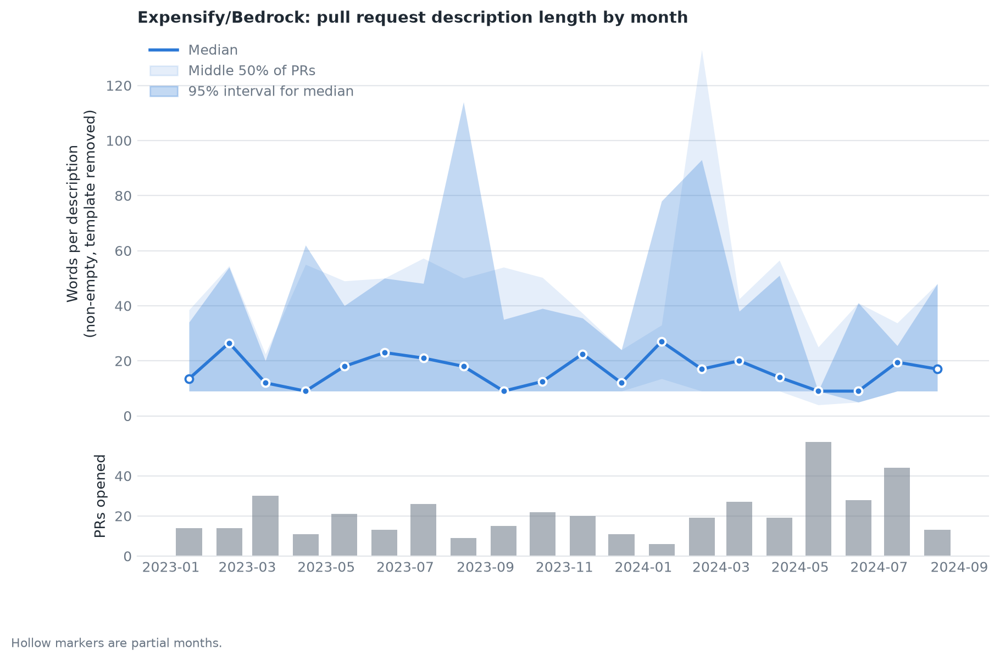
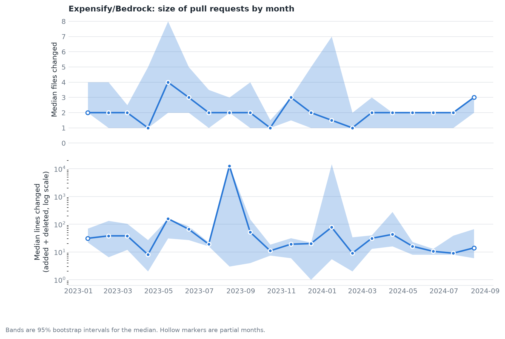
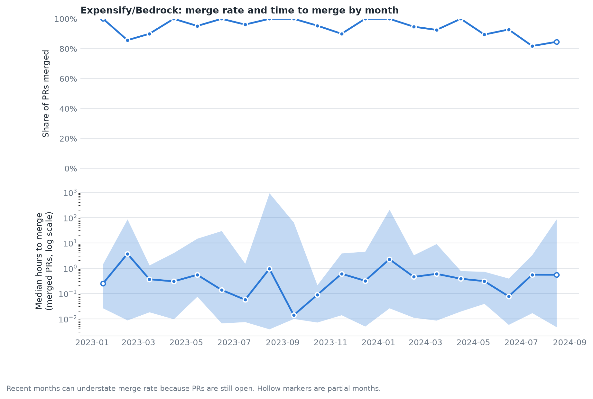
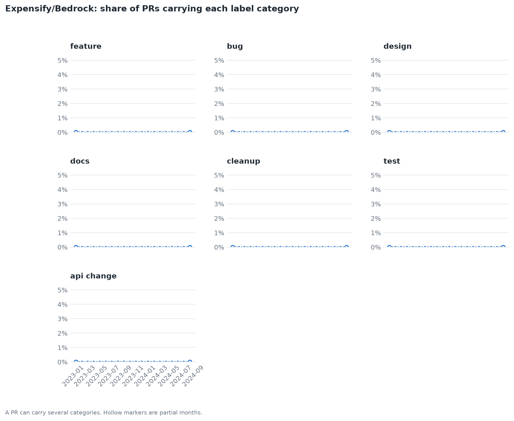
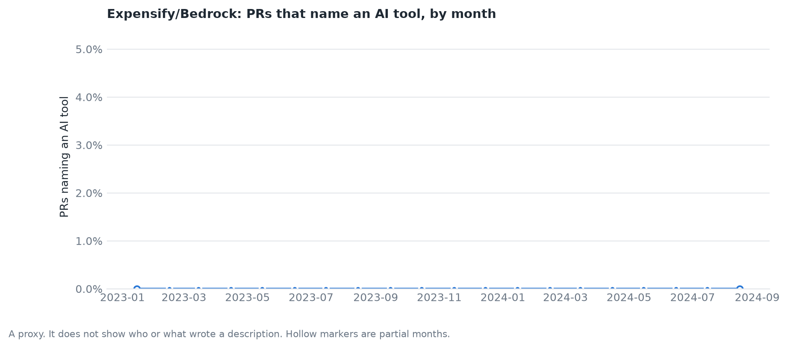

# Pull requests in Expensify/Bedrock: description length, size, speed and labels

Window 2023-01-09 to 2024-08-19 (UTC). Data fetched 2026-11-20. prwords 3.0.0, generated 2026-11-26. Method fixed in advance in `docs/ANALYSIS_PLAN.md`.

## 1. Data

- Repository primary language: C
- Pull requests opened in the window: 419
- Removed as bot accounts: 0
- Analysed: 419 PRs from 40 authors
- Merged: 388 (92.6%). Closed without merging: 31 (7.4%). Still open: 0
- Follow-up: merge outcomes use a 30-day follow-up. PRs without enough follow-up: 0
- Empty descriptions after cleaning: 2.6%

## 2. Did the PR template change?

No template line appeared or disappeared with a share of 50% or more. Template text was detected monthly and removed before counting words.

Distinct template lines detected: 6.

## 3. First 28 days versus last 28 days

First window 2023-01-09 to 2023-02-05. Last window 2024-07-23 to 2024-08-19. Ratios are last median divided by first median. Bootstrap intervals, 2,000 resamples.

| Metric                                |   n first |   n last |   Median first |   Median last |   Ratio |   Ratio low |   Ratio high |      p |   Cliff's delta |
|:--------------------------------------|----------:|---------:|---------------:|--------------:|--------:|------------:|-------------:|-------:|----------------:|
| Description words (non-empty)         |        16 |       31 |          13.5  |         17    |    1.26 |        0.42 |         3.45 | 0.5    |            0.12 |
| Files changed                         |        16 |       31 |           2    |          2    |    1    |        0.5  |         1.5  | 0.53   |           -0.11 |
| Lines added                           |        16 |       31 |          23.5  |          8    |    0.34 |        0.14 |         1.33 | 0.052  |           -0.35 |
| Lines deleted                         |        16 |       31 |           9.5  |          2    |    0.21 |        0.02 |         0.67 | 0.0021 |           -0.55 |
| Net lines (added minus deleted)       |        16 |       31 |          10    |          7    |    0.7  |        0.23 |        12    | 0.82   |            0.04 |
| Lines changed (added plus deleted)    |        16 |       31 |          39.5  |          9    |    0.23 |        0.07 |         0.89 | 0.02   |           -0.42 |
| Hours from open to merge (merged PRs) |        16 |       24 |           0.25 |          0.56 |    2.22 |        0.04 |        76.37 | 0.71   |            0.07 |
| Commits                               |        16 |       31 |           2    |          2    |    1    |        0.67 |         1.5  | 0.78   |            0.05 |
| Comments                              |        16 |       31 |           0    |          0    |  nan    |      nan    |       nan    | 0.7    |            0.06 |
| Reviews                               |        16 |       31 |           1    |          1    |    1    |        0    |         2    | 0.99   |            0    |

| Measure                             |   n first |   n last | Share first   | Share last   |   Change (points) |     p |
|:------------------------------------|----------:|---------:|:--------------|:-------------|------------------:|------:|
| Merged within follow-up period      |        16 |       31 | 100.0%        | 77.4%        |             -22.6 | 0.078 |
| Closed without merging              |        16 |       31 | 0.0%          | 22.6%        |              22.6 | 0.078 |
| Opened as draft                     |        16 |       31 | 0.0%          | 3.2%         |               3.2 | 1     |
| From outside contributors           |        16 |       31 | 93.8%         | 90.3%        |              -3.4 | 1     |
| Has a kind or type label            |        16 |       31 | 0.0%          | 0.0%         |               0   | 1     |
| Description text repeated elsewhere |        16 |       31 | 43.8%         | 54.8%        |              11.1 | 0.55  |
| Names an AI tool (disclosure)       |        16 |       31 | 0.0%          | 0.0%         |               0   | 1     |
| Label category: feature             |        16 |       31 | 0.0%          | 0.0%         |               0   | 1     |
| Label category: bug                 |        16 |       31 | 0.0%          | 0.0%         |               0   | 1     |
| Label category: design              |        16 |       31 | 0.0%          | 0.0%         |               0   | 1     |
| Label category: docs                |        16 |       31 | 0.0%          | 0.0%         |               0   | 1     |
| Label category: cleanup             |        16 |       31 | 0.0%          | 0.0%         |               0   | 1     |
| Label category: test                |        16 |       31 | 0.0%          | 0.0%         |               0   | 1     |
| Label category: api_change          |        16 |       31 | 0.0%          | 0.0%         |               0   | 1     |

## 4. Monthly trends

Theil-Sen slope per month and Kendall tau over full months only.

| metric                     |   months |   slope_per_month |   slope_ci_low |   slope_ci_high |     tau |       p |
|:---------------------------|---------:|------------------:|---------------:|----------------:|--------:|--------:|
| median_words               |       18 |            -0.2   |         -0.9   |           0.455 |  -0.141 |   0.423 |
| median_files_changed       |       18 |            -0     |         -0.045 |          -0     |  -0.117 |   0.542 |
| median_additions           |       18 |            -0.542 |         -2.875 |           0.278 |  -0.231 |   0.192 |
| median_deletions           |       18 |            -0.636 |         -1.143 |           0.125 |  -0.292 |   0.094 |
| median_churn               |       18 |            -1.583 |         -4.667 |           0.357 |  -0.264 |   0.129 |
| median_hours_to_merge      |       18 |            -0.004 |         -0.059 |           0.03  |  -0.046 |   0.823 |
| merge_rate                 |       18 |            -0     |         -0.008 |           0.003 |  -0.148 |   0.411 |
| share_outside_contributors |       18 |            -0     |         -0.01  |          -0     |  -0.142 |   0.44  |
| share_ai_disclosed         |       18 |            -0     |         -0     |          -0     | nan     | nan     |
| median_comments            |       18 |            -0     |         -0     |          -0     | nan     | nan     |
| median_reviews             |       18 |            -0     |         -0     |          -0     |   0.059 |   0.759 |
| share_feature              |       18 |            -0     |         -0     |          -0     | nan     | nan     |
| share_bug                  |       18 |            -0     |         -0     |          -0     | nan     | nan     |
| share_design               |       18 |            -0     |         -0     |          -0     | nan     | nan     |
| share_docs                 |       18 |            -0     |         -0     |          -0     | nan     | nan     |
| share_cleanup              |       18 |            -0     |         -0     |          -0     | nan     | nan     |
| share_test                 |       18 |            -0     |         -0     |          -0     | nan     | nan     |
| share_api_change           |       18 |            -0     |         -0     |          -0     | nan     | nan     |

## 5. Labels

Share of PRs with a kind or type label: 0.0% overall. Label coverage by month is in `monthly_summary.csv` (`share_has_kind_label`).

| category            |   n_prs |   share |   median_words |   median_files |   median_churn |   merge_rate |   median_hours_to_merge |   share_ai_disclosed |
|:--------------------|--------:|--------:|---------------:|---------------:|---------------:|-------------:|------------------------:|---------------------:|
| feature             |       0 |       0 |            nan |            nan |            nan |      nan     |                 nan     |                  nan |
| bug                 |       0 |       0 |            nan |            nan |            nan |      nan     |                 nan     |                  nan |
| design              |       0 |       0 |            nan |            nan |            nan |      nan     |                 nan     |                  nan |
| docs                |       0 |       0 |            nan |            nan |            nan |      nan     |                 nan     |                  nan |
| cleanup             |       0 |       0 |            nan |            nan |            nan |      nan     |                 nan     |                  nan |
| test                |       0 |       0 |            nan |            nan |            nan |      nan     |                 nan     |                  nan |
| api_change          |       0 |       0 |            nan |            nan |            nan |      nan     |                 nan     |                  nan |
| (no category label) |     419 |       1 |             12 |              2 |             20 |        0.926 |                   0.311 |                    0 |

## 6. Are PRs with signs of AI involvement smaller or larger?

Authorship is not observable. The proxy is `ai_disclosed`, defined in the analysis plan: 0 PRs (0.00%). 0 disclosed PRs are listed in `ai_disclosure_samples.csv` for manual audit.

### ai_disclosed

**Verdict: not testable.** Too few exposed PRs.

Pattern: lines changed: not estimated; files changed: not estimated; lines added: not estimated; lines deleted: not estimated; hours to merge: not estimated.

Not estimated: fewer than 30 exposed PRs (exposed PRs: 0).

### Robustness by tool (lines changed)

No tool named in any disclosure.

### File type check

Not run. Use `--file-check N` to sample N exposed PRs and matching unexposed PRs.

## 7. Other checks

- Outside contributors: 93.1% of PRs overall.
- Top 10 authors opened 71.4% of PRs.
- PRs whose description text is repeated elsewhere (10 or more words): 46.8%.

## 8. Limitations

- Word count and size describe PRs, not who wrote them. Proxies for AI involvement are noisy and omit undisclosed use.
- Added and deleted lines include generated or vendored files unless the project avoids committing them.
- Disclosure mostly captures tools that add attribution by default, so it is tool-skewed.
- Template removal is heuristic. Check `template_audit.csv`.
- One repository cannot support general claims. See the plan for replication.
- Months at the edges of the window are partial and are excluded from trend tests.

